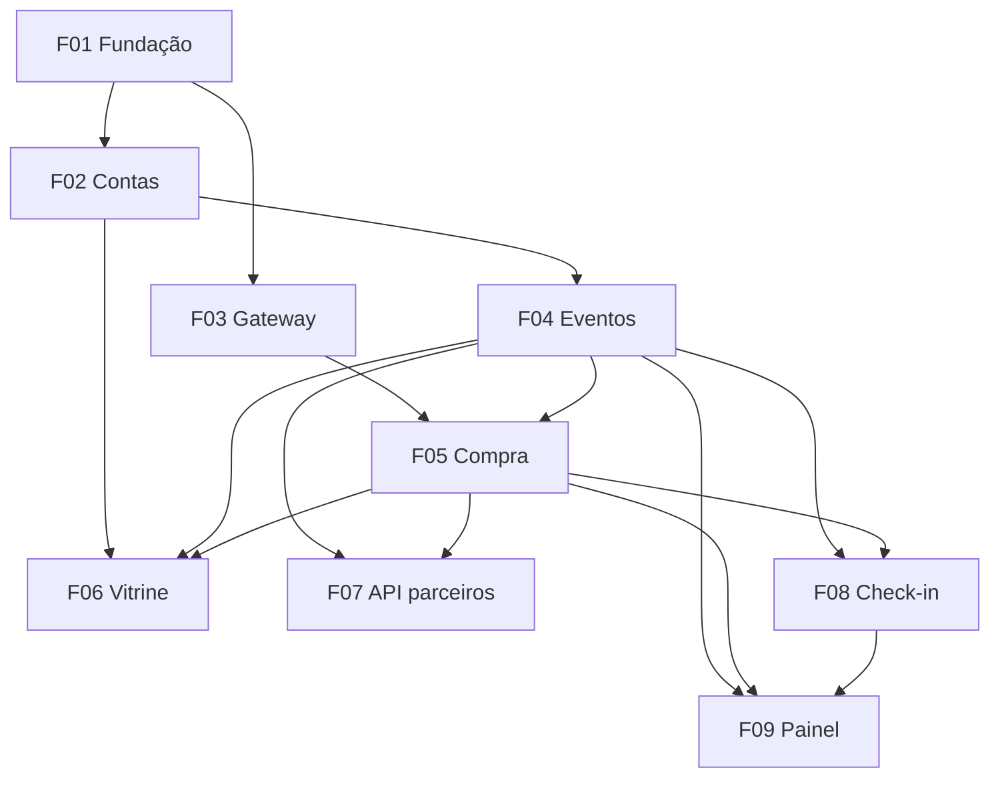

# Catraca

## 1. Resumo executivo

A Catraca vende ingressos para eventos pequenos — shows em bar, workshops, meetups. O organizador cria o evento, publica e opera tudo numa página de gestão própria: check-in na porta, painel de vendas e cancelamento. O participante compra pela vitrine com a própria conta, e parceiros externos vendem pela API com uma chave. Cada compra é de um ingresso, nasce pendente, ocupa vaga na hora e é confirmada ou recusada de forma assíncrona por um gateway de pagamento simulado.

O produto é para quatro públicos: o visitante, que só vê a vitrine; o participante, que cria conta, compra e acompanha os próprios ingressos; o organizador, cuja conta vem da seed e que só enxerga os próprios eventos; e o parceiro, sistema externo que fala com a API de contrato fixo. O valor central é a consistência quando as partes se encontram: a lotação nunca é ultrapassada, nem com compras simultâneas pelos dois canais; o evento cancelado não vende, não deixa entrar e não conta estorno como receita; e o painel bate com o estado real dos ingressos.

Tecnicamente, é uma aplicação Node.js com TypeScript (Fastify) que serve as páginas HTML e a API de parceiros na mesma porta, com PostgreSQL. Tudo roda em Docker Compose e sobe com um único comando a partir de um clone limpo, já com a seed. O produto é construído por agentes em waves: cada feature tem spec, plano e contrato, e só é dada como pronta quando um avaliador independente aprova o contrato.

## 2. Problema e oportunidade

### O problema

**Features que funcionam sozinhas e quebram juntas**
- Na primeira tentativa, compra, check-in e cancelamento passavam isoladamente, mas o evento cancelado continuava deixando gente entrar.
- O painel somava estorno como receita: o organizador via dinheiro que já tinha devolvido.
- Cada agente validou só a própria parte; nenhum critério exercitava o ponto onde duas features se tocam.

**Venda acima da lotação no pico**
- Um show de 100 lugares vendeu 112 ingressos (12% acima da capacidade) durante um pico de compras simultâneas.
- A checagem de vaga e a criação do ingresso não eram atômicas, e compras pela vitrine e pela API concorriam sem coordenação.

**Pagamento lento travando ou corrompendo o estado**
- O gateway responde entre 2 e 40 segundos; esperar a resposta segura a compra e o participante.
- Resposta do gateway que chega depois de um cancelamento não pode ressuscitar um ingresso.

**Trabalho dado como pronto por quem o fez**
- Relatórios de "pronto" escritos pelo próprio implementador não pegaram nenhuma das falhas acima.
- O ambiente dependia de passos manuais, e ninguém conseguia reproduzir a verificação do zero.

### A oportunidade

- **Integração explícita** → cada dependência entre features tem um critério cross-feature que exercita o encontro (cancelamento × check-in, cancelamento × painel, preço × receita, API × lotação).
- **Lotação garantida na origem** → um único serviço de compra, usado pela vitrine e pela API, reserva a vaga e cria o ingresso numa operação atômica por evento; a garantia é provada com rajadas de 30 compras simultâneas.
- **Compra assíncrona e idempotente** → a compra responde na hora como `pending`; o resultado do gateway só altera ingressos ainda pendentes, então nada que chegue depois do cancelamento muda o status.
- **Avaliação independente e ambiente reprodutível** → contrato por feature, avaliador com contexto separado, e `npm run up` / `npm run down` / `npm run gates` funcionando a partir de um clone limpo.

## 3. Público-alvo

### Usuários principais

**Visitante**
- Navega sem login e quer ver os eventos à venda, com data, local, preço e vagas disponíveis.
- Não compra; ao tentar, é levado a entrar ou criar conta.
- Não acessa nada da área do organizador.

**Participante**
- Cria a própria conta com nome, e-mail e senha, entra e sai quando quiser.
- Compra um ingresso por vez com cartão e acompanha em "Meus ingressos" o evento, o status e o código.
- Recarrega a página para ver a confirmação; aceita esperar alguns segundos pelo pagamento.

**Organizador**
- Tem a conta criada pela seed (não se cadastra pelo produto) e só vê e opera os próprios eventos.
- Cria, edita, publica e cancela eventos; na porta, faz o check-in digitando o código do ingresso.
- Acompanha no painel confirmados, pendentes, check-ins, vagas, receita e estornos.

**Parceiro**
- Sistema externo que vende ingressos pela API de parceiros, autenticado pelo cabeçalho `X-Api-Key`.
- Precisa de um contrato estável: campos, status HTTP e códigos de erro fixos.
- Suas compras não ficam ligadas a contas, mas valem para lotação, painel, check-in e cancelamento como as da vitrine.

### Perfil comportamental

Todos os públicos usam o produto em momentos curtos e objetivos: ver o que está à venda, comprar, conferir um ingresso, liberar uma entrada. Ninguém espera atualização em tempo real — recarregar a página basta —, mas todos esperam que o número que aparece na tela seja o verdadeiro: vagas disponíveis, status do ingresso e números do painel.

## 4. Objetivos

### Objetivos do produto

1. **Impedir** venda acima da lotação, em qualquer canal e sob compras simultâneas.
2. **Refletir** o resultado do pagamento sem bloquear a compra.
3. **Manter** o cancelamento coerente em todo o produto: listagens, compras, check-in, painel e respostas tardias do gateway.
4. **Dar** ao organizador números confiáveis e isolados dos de outros organizadores.
5. **Subir e verificar** o produto inteiro com um comando, a partir de um clone limpo.

### Métricas de sucesso

| Objetivo | Métrica | Condição de medição |
|---|---|---|
| Impedir venda acima da lotação | 0 ingressos além da lotação; exatamente 5 × `202` e 25 × `409` | Rajadas de 30 compras simultâneas pela API em eventos novos de lotação 5, em pelo menos 10 rodadas antes da entrega |
| Refletir o pagamento | Compra respondida em menos de 1 s; 100% das compras com final `0001` confirmadas em até 5 s; finais `0003`/`0004` resolvidos entre 30 e 40 s | Medido pela consulta do ingresso na API e em "Meus ingressos" |
| Cancelamento coerente | 100% dos ingressos confirmados → `refunded` e pendentes → `cancelled` em até 10 s; 0 mudanças por resposta tardia; 0 entradas liberadas em evento cancelado; Receita R$ 0,00 após cancelamento | Passos 12 a 14 do Fluxo do avaliador |
| Números confiáveis e isolados | 100% dos números do painel iguais ao estado dos ingressos; 0 dados de evento expostos a outro organizador, a participante ou a visitante | Passos 9, 10, 11, 14 e 15 do Fluxo do avaliador |
| Um comando | `npm run up` sem nenhum passo manual em clone limpo; `npm run gates` com código 0 na `main`; 0 containers do projeto depois de `npm run down` | Passos 1 e 17 do Fluxo do avaliador, em Linux ou WSL |

## 5. Histórias de usuário

### F01. Fundação e harness
- Como avaliador, quero clonar o repositório e rodar só `npm run up` para ter o produto em `http://localhost:3000` com a seed carregada.
- Como avaliador, quero rodar `npm run down` e ter a certeza de que nenhuma porta nem container do projeto ficou para trás.
- Como agente implementador, quero rodar `npm run gates` para saber se lint, tipos e testes passam antes de entregar.
- Como agente, quero um `AGENTS.md` na raiz que me diga os comandos, as regras do projeto e onde está cada artefato.
- Como sistema, quero rodar as migrations e a seed a cada subida sem duplicar dados.

### F02. Contas e acesso
- Como visitante, quero criar uma conta de participante com nome, e-mail e senha para poder comprar.
- Como participante ou organizador, quero entrar com e-mail e senha e sair quando terminar.
- Como organizador, quero que só a minha sessão de organizador abra a área do organizador.
- Como sistema, quero impedir que participantes e visitantes acessem qualquer página da área do organizador.

### F03. Gateway de pagamento simulado
- Como sistema, quero pedir a autorização de um pagamento e seguir em frente sem esperar a resposta.
- Como sistema, quero receber o resultado (aprovado ou recusado) no tempo da tabela do gateway, conforme o final do cartão.
- Como sistema, quero que um pagamento pendente continue sendo resolvido mesmo se a aplicação reiniciar.
- Como avaliador, quero simular um pagamento por comando e ver o resultado e o tempo que levou.

### F04. Gestão de eventos
- Como organizador, quero criar um evento com nome, data e hora, local, lotação e preço, que nasce como rascunho.
- Como organizador, quero editar e publicar meus eventos numa página de gestão com endereço próprio.
- Como organizador, quero mudar preço e lotação de um evento publicado sem afetar as compras já feitas.
- Como organizador, quero cancelar um evento publicado, de forma irreversível.
- Como organizador, quero ver só os meus eventos, e que ninguém mais veja os dados deles.

### F05. Compra e ciclo do ingresso
- Como sistema, quero registrar uma compra pendente que já ocupa vaga e responder na hora, sem esperar o gateway.
- Como sistema, quero recusar a compra quando não há vaga, mesmo com dezenas de compras simultâneas.
- Como sistema, quero confirmar ou recusar o ingresso quando o gateway responder, liberando a vaga na recusa.
- Como sistema, quero estornar os confirmados e cancelar os pendentes quando o evento é cancelado, ignorando respostas tardias do gateway.
- Como avaliador, quero criar compras por comando, inclusive em rajada, para verificar o serviço de compra antes de existirem vitrine e API.

### F06. Vitrine e Meus ingressos
- Como visitante, quero ver os eventos à venda com data, local, preço e vagas disponíveis.
- Como participante, quero comprar um ingresso informando o número do cartão.
- Como participante, quero ver `Ingressos esgotados` quando não houver mais vaga.
- Como participante, quero ver em "Meus ingressos" o evento, o status e o código de cada ingresso que comprei.

### F07. API de parceiros
- Como parceiro, quero listar os eventos à venda com preço em centavos e vagas disponíveis.
- Como parceiro, quero comprar um ingresso informando o e-mail do comprador e o cartão e receber o código na hora.
- Como parceiro, quero consultar o status de um ingresso, de qualquer canal de venda.
- Como parceiro, quero respostas de erro previsíveis (`401`, `422`, `404`, `409`) com códigos fixos.

### F08. Check-in
- Como organizador, quero digitar o código do ingresso na página de gestão e ver na hora se a entrada está liberada.
- Como organizador, quero que um ingresso já usado, não confirmado ou de outro evento seja barrado com a mensagem certa.
- Como organizador, quero que nenhum ingresso entre num evento cancelado.

### F09. Painel do evento
- Como organizador, quero ver na página de gestão quantos ingressos estão confirmados, pendentes e com check-in.
- Como organizador, quero ver as vagas disponíveis, a receita real e quantos ingressos foram estornados.
- Como organizador, quero que vendas da vitrine e da API entrem nos mesmos números.

## 6. Funcionalidades

### F01. Fundação e harness

**Provê (Provides):**
- Aplicação base: servidor HTTP na porta 3000, layout HTML comum com área de navegação, registro de rotas por módulo de feature e endpoint `GET /health` (usado por F02, F03)
- Banco PostgreSQL com migrations executadas automaticamente e mecanismo de seed idempotente executado em toda subida (usado por F02, F03)
- Contas da seed — organizador A, organizador B e participante — com nome, e-mail, papel e hash de senha (usado por F02)
- Configuração por variáveis de ambiente com valores padrão, sem `.env` obrigatório, incluindo o modo do gateway `simulado` (usado por F03)
- Infraestrutura de testes automatizados com banco isolado e os comandos `npm run up`, `npm run down` e `npm run gates` (usado por F02, F03)

**Capacidades:**
- Pré-requisitos do host: Docker (com Compose), Git e Node.js LTS. Nenhum runtime além do Node roda fora de container; o `package.json` da raiz não tem dependências, então não é preciso `npm install` para subir.
- `npm run up`: constrói a imagem, sobe banco e aplicação, espera a aplicação ficar saudável, roda migrations e seed. Endereços: `$WEB` = `$API` = `http://localhost:3000`. A porta e o nome do projeto do Compose podem ser trocados por variáveis de ambiente (para worktrees paralelas), com padrão 3000 e nome fixo.
- `npm run down`: remove os containers e a rede que a subida criou; preserva o volume do banco, de modo que a próxima subida reexecuta a seed sobre dados existentes.
- `npm run gates`: roda lint, checagem de tipos e os testes automatizados em container, num projeto do Compose separado e sem publicar portas no host; termina com código 0 só se tudo passar.
- Seed idempotente (upsert por e-mail), com as credenciais documentadas no README:
  - Organizador A — `organizador.a@catraca.test` / `catraca123`
  - Organizador B — `organizador.b@catraca.test` / `catraca123`
  - Participante — `participante@catraca.test` / `catraca123`
  - A seed não cria eventos.
- Modo padrão: gateway `simulado`, sem nenhuma chave de pagamento; a escala de atraso do gateway só existe no ambiente de testes.
- Fuso do produto: `America/Sao_Paulo` (-03:00).
- `AGENTS.md` na raiz com comandos, regras do projeto e mapa dos artefatos; `CLAUDE.md` aponta para ele; README com Como rodar, Endereços, Credenciais, Mapa dos artefatos e Decisões.
- Finais de linha LF e scripts em Node ou `sh` POSIX: tudo funciona em Linux, macOS e WSL.

**Experiência:**
1. O avaliador clona o repositório numa pasta vazia e roda `npm run up`.
2. O comando mostra o progresso da construção e termina quando `GET /health` responde `200` com `{"status":"ok"}` (o health também confere a conexão com o banco).
3. `http://localhost:3000` abre a vitrine (vazia até existirem eventos publicados), com links para Entrar e Criar conta.
4. `npm run gates` imprime o resumo de lint, tipos e testes (quantidade de testes executados e falhas).
5. `npm run down` encerra tudo; rodar de novo `npm run up` reaproveita o volume e reexecuta a seed sem erro.

**Tratamento de erros:**
- Porta 3000 ocupada: `npm run up` falha com mensagem indicando a porta em uso e como trocá-la por variável de ambiente.
- Docker parado ou ausente: o comando falha com `Docker não está disponível` e código diferente de 0.
- Falha de migration ou seed: a aplicação não fica saudável, `npm run up` termina com código diferente de 0 e mostra o erro da etapa.
- `npm run down` sem nada rodando termina com código 0 (idempotente).

### F02. Contas e acesso

**Consome (Consumes):**
- F01: aplicação base (layout, registro de rotas), banco com migrations e seed, contas da seed com nome, e-mail, papel e hash de senha, infraestrutura de testes

**Provê (Provides):**
- Sessão autenticada com id, nome, e-mail e papel do usuário (organizador ou participante) e a proteção "exige organizador" (usado por F04)
- Sessão autenticada de participante com id, nome e e-mail e a proteção "exige participante", com retorno à página de origem depois do login (usado por F06)

**Capacidades:**
- Cadastro (`/cadastro`) cria sempre conta de participante: nome (1 a 100 caracteres), e-mail (formato válido, único entre todas as contas, comparação sem diferenciar maiúsculas) e senha (mínimo 8 caracteres). Campos extras como papel são ignorados — organizador não se cadastra pelo produto.
- Senhas guardadas só como hash; nunca aparecem em logs nem em páginas.
- Login (`/entrar`) por e-mail e senha para participantes e organizadores; mensagem única para e-mail inexistente e senha errada.
- Sessão por cookie assinado, `HttpOnly`, válida por 12 horas; `Sair` encerra a sessão.
- Proteção da área do organizador (`/organizador` e tudo abaixo): visitante → redirecionamento para `/entrar`; participante → `403` com `Acesso negado` (R13).
- Proteção das páginas de participante (`/meus-ingressos` e a compra na vitrine): visitante → `/entrar`, voltando à página de origem depois do login.

**Experiência:**
1. No topo de todas as páginas: deslogado, links `Entrar` e `Criar conta`; logado, o nome do usuário, o link da sua área (`Meus ingressos` ou `Área do organizador`) e o botão `Sair`.
2. `/cadastro`: campos Nome, E-mail e Senha; ao enviar com sucesso, o participante já fica logado e vai para a vitrine.
3. `/entrar`: campos E-mail e Senha; organizador vai para `/organizador`, participante volta à página de origem ou à vitrine.
4. Erros aparecem acima do formulário, que mantém o nome e o e-mail digitados (nunca a senha).

**Tratamento de erros:**
- E-mail já usado (inclusive com outra combinação de maiúsculas): `E-mail já cadastrado`.
- Senha curta: `A senha precisa ter pelo menos 8 caracteres`; e-mail mal formado: `Informe um e-mail válido`; nome vazio: `Informe o nome`.
- Credenciais erradas: `E-mail ou senha inválidos`.
- Participante na área do organizador: página `403` com `Acesso negado`, sem nenhum dado de evento.
- Sessão expirada ou cookie adulterado: tratada como visitante (redirecionamento para `/entrar`).

### F03. Gateway de pagamento simulado

**Consome (Consumes):**
- F01: aplicação base (processo onde roda o worker do gateway), banco com migrations, configuração do modo do gateway `simulado`, infraestrutura de testes

**Provê (Provides):**
- Solicitação de autorização de pagamento (referência + número do cartão) que retorna na hora, e entrega assíncrona do resultado (aprovado ou recusado) a um tratador registrado, no prazo da tabela do gateway, com tentativas persistidas que sobrevivem a reinício (usado por F05)

**Capacidades:**
- Tabela do modo padrão (cópia do brief), pelo final do número do cartão:
  - Final `0001`: aprovado, com resposta entre 2 e 5 segundos
  - Final `0002`: recusado, com resposta entre 2 e 5 segundos
  - Final `0003`: aprovado, com resposta entre 30 e 40 segundos
  - Final `0004`: recusado, com resposta entre 30 e 40 segundos
  - Qualquer outro final: recusado, com resposta entre 2 e 5 segundos
- O atraso é sorteado de forma uniforme dentro da faixa, descontando o tempo de entrega, de modo que o efeito observável (o status do ingresso) aconteça sempre dentro da faixa: entre 2 e 5 s, ou entre 30 e 40 s, depois da solicitação.
- Cada tentativa é persistida com referência, 4 últimos dígitos do cartão (nunca o número completo), resultado sorteado, prazo de resposta e momento da entrega; o worker entrega cada resultado uma única vez.
- Depois de um reinício, tentativas pendentes são entregues no prazo original ou, se o prazo passou com a aplicação parada, em até 5 s depois de ela voltar.
- Escala de atraso configurável só no ambiente de testes; sem variável definida, valem os tempos da tabela.
- Comando de diagnóstico `gateway:simular`, executado dentro do container da aplicação, que recebe um número de cartão, espera o resultado e imprime o resultado e o tempo decorrido em segundos.

**Experiência:**
1. O sistema chama a autorização com a referência da compra e o cartão; a chamada retorna imediatamente.
2. No prazo sorteado, o worker entrega `aprovado` ou `recusado` ao tratador registrado (a compra, na F05).
3. O avaliador roda `gateway:simular` com um cartão e vê, por exemplo, `aprovado em 3,4 s`.

**Tratamento de erros:**
- Tratador ausente ou com erro na entrega: a tentativa fica pendente e é reentregue na próxima varredura, sem duplicar o efeito (o tratador da F05 é idempotente).
- Reinício com tentativas pendentes: retomadas a partir do banco, sem perda.
- Cartão com formato inválido nunca chega ao gateway — a validação de 16 dígitos é da compra (F05).

### F04. Gestão de eventos

**Consome (Consumes):**
- F02: sessão autenticada com id e papel do usuário e a proteção "exige organizador"

**Provê (Provides):**
- Evento com id (`evt_…`), id do organizador, nome, data e hora de início, local, lotação, preço vigente em centavos e status (`rascunho`, `publicado`, `cancelado`) (usado por F05, F06, F08, F09)
- Consulta de eventos à venda (publicados e não cancelados) com id, nome, data e hora de início, local e preço vigente em centavos (usado por F06, F07)
- Ponto de extensão da validação de lotação mínima (vagas ocupadas, zero até existir compra) e o evento de domínio "evento cancelado", executado na mesma transação do cancelamento (usado por F05)
- Página de gestão do evento com URL própria (`/organizador/eventos/{id}`), acessível só ao dono, com seções que outras features acrescentam sem editar a página (usado por F08, F09)

**Capacidades:**
- Campos do evento (R01): nome (1 a 120 caracteres), data e hora de início (precisa estar no futuro, ao criar e ao editar), local (1 a 200 caracteres), lotação (inteiro, mínimo 1) e preço (em reais, maior que zero, até 2 casas decimais, guardado em centavos).
- Todo evento nasce `rascunho` (R02). Publicar: `rascunho` → `publicado`.
- Edição permitida em `rascunho` e `publicado`, proibida em `cancelado`. A lotação nunca pode ficar menor que as vagas ocupadas (R03, R05); a mudança de preço vale só para compras feitas depois dela (R03).
- Cancelamento só de evento `publicado`, irreversível: depois dele o evento não pode ser editado, publicado de novo nem cancelado outra vez (R11). Os efeitos nos ingressos são da F05, na mesma transação.
- Cada evento tem página de gestão com URL própria, onde o organizador edita, publica, cancela, faz o check-in (F08) e vê o painel (F09) (R04).
- Isolamento (R13): a lista de `/organizador` mostra só os eventos do organizador logado; a página de gestão e todas as ações sobre evento de outro organizador respondem `404` com `Evento não encontrado`, sem expor nenhum dado.
- IDs de evento são strings no formato `evt_` seguido de caracteres aleatórios.
- Datas exibidas no formato `05/12/2026 21:00`, fuso `America/Sao_Paulo`.

**Experiência:**
1. `/organizador`: lista dos eventos do organizador (nome, data, status `Rascunho`/`Publicado`/`Cancelado`) e botão `Novo evento`.
2. `/organizador/eventos/novo`: formulário com Nome, Data e hora de início, Local, Lotação e Preço (R$). Ao salvar, vai para a página de gestão do evento criado.
3. Página de gestão `/organizador/eventos/{id}`: dados do evento e status; formulário de edição e botão `Publicar` (em rascunho); formulário de edição e botão `Cancelar evento` (em publicado), com confirmação "Cancelar é irreversível. Confirmar?"; em cancelado, só a indicação `Cancelado`, sem formulários de edição, publicação ou cancelamento. Abaixo ficam as seções de check-in e painel.
4. Mensagens de sucesso: `Evento criado`, `Evento atualizado`, `Evento publicado`, `Evento cancelado com sucesso`.

**Tratamento de erros:**
- Data no passado: `A data de início precisa estar no futuro` (criação e edição).
- Lotação inválida: `A lotação precisa ser um número inteiro maior ou igual a 1`; preço inválido: `O preço precisa ser maior que zero`.
- Lotação abaixo das vagas ocupadas: `A lotação não pode ficar menor que as vagas ocupadas`, sem alterar nada.
- Ação sobre evento cancelado: `Este evento foi cancelado e não pode mais ser alterado`; cancelar rascunho: `Só evento publicado pode ser cancelado`.
- Evento de outro organizador ou inexistente: `404` com `Evento não encontrado`.

### F05. Compra e ciclo do ingresso

**Consome (Consumes):**
- F03: solicitação de autorização de pagamento e entrega assíncrona do resultado (aprovado ou recusado)
- F04: evento com id, lotação, preço vigente em centavos e status; ponto de extensão da validação de lotação mínima; evento de domínio "evento cancelado"

**Provê (Provides):**
- Serviço de compra de um ingresso (evento, comprador — conta de participante ou e-mail —, número do cartão, canal) que responde na hora com id (`tkt_…`), código e status `pending`, ou com o motivo da recusa (`invalid_request`, `event_not_available`, `sold_out`) (usado por F06, F07)
- Vagas ocupadas e vagas disponíveis por evento (usado por F06, F07, F09)
- Ingresso com id, código, id do evento, status, `checkedIn`, valor pago em centavos, canal (vitrine ou API) e conta do comprador, com consultas por id, por código, por conta e por evento (usado por F06, F07, F08, F09)

**Capacidades:**
- Status do ingresso (rótulo na interface / valor na API): `pendente`/`pending` — compra criada, aguardando o gateway; `confirmado`/`confirmed` — o gateway aprovou; `recusado`/`declined` — o gateway recusou; `cancelado`/`cancelled` — estava pendente quando o evento foi cancelado; `estornado`/`refunded` — estava confirmado quando o evento foi cancelado. `checkedIn` é uma informação à parte, não um status.
- Vagas (R05): ocupadas = pendentes + confirmados; disponíveis = lotação − ocupadas; em evento cancelado, disponíveis = 0.
- Compra (R06): sempre de um ingresso; nasce `pending`, já ocupa vaga e é respondida sem esperar o gateway (em menos de 1 s).
- Ordem das verificações: cartão com exatamente 16 dígitos (senão `invalid_request`, antes de criar o ingresso); evento existente, publicado e não cancelado (senão `event_not_available`, R02); vaga disponível (senão `sold_out`, R07).
- Lotação sob concorrência (R07): a verificação de vaga e a criação do ingresso acontecem numa única operação atômica, serializada por evento; as vagas ocupadas nunca passam da lotação, nem com compras simultâneas pela vitrine e pela API.
- Resultado do gateway (R08): aprovado → `confirmed`; recusado → `declined`, liberando a vaga. O resultado só altera ingresso ainda `pending`.
- Código (R09): 8 caracteres `A-Z0-9`, único entre todos os ingressos do sistema.
- Preço (R03): a compra grava o preço vigente no momento como valor pago; mudanças posteriores de preço não alteram ingressos existentes. A validação de lotação mínima da F04 passa a usar as vagas ocupadas reais.
- Cancelamento (R11): na mesma transação que cancela o evento, confirmados → `refunded` e pendentes → `cancelled` (bem dentro dos 10 s); respostas do gateway que cheguem depois não mudam nenhum deles.
- Comandos de diagnóstico, executados dentro do container da aplicação e não expostos por HTTP: `compra:simular` (cria uma ou N compras simultâneas num evento, com cartão e e-mail, e imprime o resultado de cada uma) e `ingresso:consultar` (imprime um ingresso por id ou código).

**Experiência:**
1. Um canal (vitrine ou API) chama o serviço com evento, comprador, cartão e canal.
2. O serviço valida, reserva a vaga e cria o ingresso `pending` com código e valor pago, pede a autorização ao gateway e responde na hora.
3. Quando o gateway responde, o ingresso vira `confirmed` ou `declined`; quem consulta (página ou API) vê o novo status ao recarregar.
4. Quando o organizador cancela o evento, os ingressos do evento mudam na mesma operação, e respostas tardias do gateway são ignoradas.

**Tratamento de erros:**
- Cartão sem 16 dígitos: `invalid_request`, nenhum ingresso criado.
- Evento inexistente, em rascunho ou cancelado: `event_not_available`, nenhum ingresso criado.
- Sem vaga (inclusive na corrida entre compras simultâneas): `sold_out`, nenhum ingresso criado.
- Resposta do gateway para ingresso que não está mais `pending`: ignorada e registrada em log, sem alterar o ingresso.
- Falha ao registrar a tentativa de pagamento: a compra inteira é desfeita (o ingresso não fica pendente sem tentativa).

### F06. Vitrine e Meus ingressos

**Consome (Consumes):**
- F02: sessão autenticada de participante com id, nome e e-mail; proteção "exige participante" com retorno à página de origem
- F04: consulta de eventos à venda com id, nome, data e hora de início, local e preço vigente em centavos; evento com id e nome (para "Meus ingressos", inclusive de evento cancelado)
- F05: serviço de compra; vagas disponíveis; ingressos por conta com código, status e id do evento

**Provê (Provides):**
- Nada para outras features: é a superfície final do visitante e do participante.

**Capacidades:**
- Vitrine (`/`): eventos publicados e não cancelados, ordenados pela data de início, com nome, data e hora, local, preço (`R$ 100,00`) e vagas disponíveis (R02, R05).
- Página do evento (`/eventos/{id}`): os mesmos dados e, para participante logado com vaga disponível, o formulário de compra com o campo Número do cartão (16 dígitos).
- Sem vaga disponível: `Ingressos esgotados` no lugar do formulário; tentativa de compra que encontra o evento sem vaga também mostra `Ingressos esgotados` (R07).
- Visitante vê o botão `Entrar para comprar`, que leva a `/entrar` e volta ao evento depois do login; organizador logado vê `Compras são feitas com uma conta de participante` no lugar do formulário.
- "Meus ingressos" (`/meus-ingressos`): ingressos comprados pela vitrine com a conta logada, do mais recente para o mais antigo, com nome do evento, status (rótulo: `pendente`, `confirmado`, `recusado`, `cancelado`, `estornado`) e código (R09). Compras feitas pela API não aparecem.
- Evento cancelado sai da vitrine e sua página responde `404` com `Evento não encontrado` (R11).

**Experiência:**
1. O participante abre a vitrine, escolhe o evento e informa o número do cartão.
2. Ao enviar, é levado a "Meus ingressos" com a mensagem `Compra registrada`, e o ingresso aparece como `pendente` com o código.
3. Recarregando a página, o status muda para `confirmado` ou `recusado` quando o gateway responde.
4. Se as vagas acabarem, a página do evento passa a mostrar `Ingressos esgotados`.

**Tratamento de erros:**
- Cartão inválido: `Número de cartão inválido`, sem criar ingresso; o formulário continua na página do evento.
- Sem vaga no momento do envio: `Ingressos esgotados`, sem criar ingresso.
- Evento cancelado ou despublicado entre abrir a página e comprar: `Evento não encontrado`.
- Sessão expirada no envio: redirecionamento para `/entrar` e volta ao evento, sem criar ingresso.

### F07. API de parceiros

**Consome (Consumes):**
- F04: consulta de eventos à venda com id, nome, data e hora de início e preço vigente em centavos
- F05: serviço de compra; vagas disponíveis; ingresso por id com código, id do evento, status e `checkedIn`

**Provê (Provides):**
- Nada para outras features: é a superfície final do parceiro.

**Capacidades:**
- Contrato fixo (cópia do brief). Toda rota exige o cabeçalho `X-Api-Key` com a chave de parceiro documentada no README (padrão `parceiro-catraca-dev`, configurável por variável de ambiente); sem ele, ou com chave inválida, a resposta é `401` com `{"error":"unauthorized"}`, antes de qualquer outra verificação.
- `GET /api/partner/events` → `200` com array de eventos à venda (publicados e não cancelados), cada um com exatamente `id`, `name`, `startsAt` (ISO 8601 com offset, ex.: `2026-12-05T21:00:00-03:00`), `priceCents` (inteiro) e `availableSeats` (vagas disponíveis de R05).
- `POST /api/partner/events/{eventId}/purchases` com `Content-Type: application/json` e corpo `{ "buyerEmail": "...", "cardNumber": "..." }` → `202` com `{ "ticketId": "tkt_…", "code": "…", "status": "pending" }`.
- Erros da compra, nesta ordem, depois da chave: corpo inválido (campo faltando, e-mail mal formado, cartão sem 16 dígitos ou JSON malformado) → `422` com `{"error":"invalid_request"}`; evento inexistente, em rascunho ou cancelado → `404` com `{"error":"event_not_available"}`; falta de vaga → `409` com `{"error":"sold_out"}`.
- `GET /api/partner/tickets/{ticketId}` → `200` com `{ "ticketId", "code", "eventId", "status", "checkedIn" }`, para ingressos de qualquer canal; inexistente → `404` com `{"error":"ticket_not_found"}`.
- Os IDs são strings (`evt_…`, `tkt_…`). Compras pela API não se vinculam a contas, mas valem para lotação, painel, check-in e cancelamento exatamente como as da vitrine.

**Experiência:**
1. O parceiro lista os eventos e guarda o `id`.
2. Compra com o e-mail do comprador e o cartão; recebe `202` com `ticketId` e `code` na hora.
3. Consulta o ingresso até o `status` mudar de `pending` para `confirmed` ou `declined`.

**Tratamento de erros:**
- Sem chave ou chave errada: `401` `{"error":"unauthorized"}` nas três rotas.
- Corpo inválido: `422` `{"error":"invalid_request"}`.
- Evento indisponível: `404` `{"error":"event_not_available"}`.
- Sem vaga: `409` `{"error":"sold_out"}`.
- Ingresso inexistente: `404` `{"error":"ticket_not_found"}`.

### F08. Check-in

**Consome (Consumes):**
- F04: página de gestão do evento (seção acrescentada, acessível só ao dono); evento com id, status e id do organizador
- F05: ingresso por código com id do evento, status e `checkedIn`

**Provê (Provides):**
- Marcação de check-in no ingresso (`checkedIn` verdadeiro e data e hora do check-in) (usado por F09)

**Capacidades:**
- Na página de gestão, o organizador informa o código de um ingresso. A primeira situação verdadeira da lista, seguindo a ordem, define a mensagem exibida (R10):
  1. O código não existe ou é de outro evento: `Ingresso inválido para este evento`
  2. O evento está cancelado: `Evento cancelado`
  3. O ingresso não está confirmado: `Ingresso não confirmado`
  4. O ingresso já passou pelo check-in: `Ingresso já utilizado`
  5. Nenhuma das anteriores: `Entrada liberada`
- Só `Entrada liberada` altera dados: marca `checkedIn` verdadeiro, com data e hora, numa operação atômica (dois check-ins simultâneos do mesmo código geram um `Entrada liberada` e um `Ingresso já utilizado`).
- Em evento cancelado, o campo de check-in continua disponível e vale a lista acima.
- O código é aceito com espaços nas pontas e em minúsculas.
- Ingressos de qualquer canal (vitrine ou API) passam pelo mesmo check-in.

**Experiência:**
1. Na página de gestão, a seção "Check-in" tem o campo Código e o botão `Validar`.
2. Ao enviar, a página mostra a mensagem do resultado em destaque e limpa o campo para o próximo código.

**Tratamento de erros:**
- Código em branco: `Informe o código do ingresso`, sem consultar nada.
- Evento de outro organizador: `404` com `Evento não encontrado`, sem processar o código (R13).
- Check-in concorrente do mesmo código: só um é liberado.

### F09. Painel do evento

**Consome (Consumes):**
- F04: página de gestão do evento (seção acrescentada, acessível só ao dono); evento com lotação e status
- F05: ingressos do evento com status, valor pago em centavos e `checkedIn`; vagas disponíveis
- F08: marcação de check-in no ingresso (`checkedIn` verdadeiro)

**Provê (Provides):**
- Nada para outras features: é a superfície final do organizador.

**Capacidades:**
- A página de gestão mostra o painel do evento, contando as vendas da vitrine e da API com as definições do brief (R12):
  - **Confirmados:** ingressos confirmados, inclusive os que já passaram pelo check-in
  - **Pendentes:** ingressos pendentes
  - **Check-ins:** ingressos confirmados que já passaram pelo check-in
  - **Vagas disponíveis:** conforme R05
  - **Receita:** soma do valor pago pelos ingressos confirmados, com o preço vigente no momento de cada compra
  - **Estornados:** ingressos estornados
- Receita no formato `R$ 1.234,56`; `declined` e `cancelled` não entram em nenhum número (só liberam vaga, no caso do `declined`).
- Números calculados a partir dos ingressos no momento da leitura; recarregar a página atualiza.

**Experiência:**
1. Na página de gestão, a seção "Painel" mostra os seis números com os rótulos `Confirmados`, `Pendentes`, `Check-ins`, `Vagas disponíveis`, `Receita` e `Estornados`.
2. O organizador recarrega a página para ver os números atualizados depois de vendas, check-ins ou do cancelamento.

## 7. Fora de escopo

### Do brief
- Deploy e qualquer ambiente além do local.
- Gateway de pagamento real, e-mail e notificações.
- App mobile e qualidade visual: nenhum critério avalia design.
- Cadastro de organizador pelo produto.
- Mais de um ingresso por compra, mapa de assentos, cancelamento ou transferência de ingresso pelo participante.
- Atualização em tempo real: recarregar a página para ver o status novo basta.
- Fuso horário: use o que preferir; o fluxo só usa datas com pelo menos um dia de folga. (Decisão: o produto usa `America/Sao_Paulo`, -03:00.)

### Contas e acesso
- Recuperação ou troca de senha, edição de perfil e exclusão de conta.
- Login social, verificação de e-mail e autenticação em dois fatores.

### Eventos
- Exclusão de evento (rascunho fica como está), duplicação de evento e eventos recorrentes.
- Cancelamento de evento em rascunho.
- Imagens, categorias, busca, filtros e paginação na vitrine.

### Compras e ingressos
- Devolução real de dinheiro: estorno é só o status `refunded`.
- Vínculo de compras da API a contas de participante.
- Desfazer check-in e check-in pela API de parceiros.

### Parceiros
- Cadastro de parceiros, múltiplas chaves e rotação de chave pela interface (há uma única chave, configurada por variável de ambiente).
- Webhooks para parceiros e qualquer rota além das três do contrato fixo.

## 8. Grafo de dependências e waves

### Tabela de dependências

| # | Feature | Prioridade | Dependências |
|---|---------|------------|--------------|
| F01 | Fundação e harness | 1 | Nenhuma |
| F02 | Contas e acesso | 1 | F01 |
| F03 | Gateway de pagamento simulado | 1 | F01 |
| F04 | Gestão de eventos | 1 | F02 |
| F05 | Compra e ciclo do ingresso | 1 | F03, F04 |
| F06 | Vitrine e Meus ingressos | 1 | F02, F04, F05 |
| F07 | API de parceiros | 1 | F04, F05 |
| F08 | Check-in | 1 | F04, F05 |
| F09 | Painel do evento | 1 | F04, F05, F08 |

### Features de fundação

Estas features montam a infraestrutura compartilhada do projeto. Num projeto do zero, são implementadas em sequência, antes ou junto de qualquer feature que dependa delas:
- **F01 Fundação e harness** — servidor e layout base, registro de rotas por módulo, banco com migrations, seed idempotente, infraestrutura de testes, comandos `up`/`down`/`gates`, `AGENTS.md` e README.

A plataforma da F01 é usada por todas as features; só F02 e F03 a declaram em `Consome` porque são as que dependem diretamente dela — as demais chegam a ela pelas features de que dependem.

### Waves

Features da mesma wave podem ser construídas em paralelo. Uma wave só começa quando todas as features das waves anteriores estão concluídas e integradas à `main`.

**Nota:** features de fundação não rodam em paralelo entre si num projeto do zero, mesmo que caiam na mesma wave — compartilham arquivos de scaffolding e são implementadas em sequência até a base existir.

- **Wave 1**: F01
- **Wave 2** (paralela): F02, F03
- **Wave 3**: F04
- **Wave 4**: F05
- **Wave 5** (paralela): F06, F07, F08
- **Wave 6**: F09

### Níveis de prioridade

- **1** = Essencial — o produto não funciona sem ela
- **2** = Importante — agrega valor significativo
- **3** = Desejável — melhoria incremental

## 9. Critérios de aceite

### F01. Fundação e harness
- **F01-CA01** Numa pasta vazia, `git clone` seguido apenas de `npm run up` termina com código 0; em seguida, `curl -s http://localhost:3000/health` responde `200` com `{"status":"ok"}` e o banco contém exatamente as 3 contas da seed (organizador A, organizador B e participante), sem nenhum outro passo manual.
- **F01-CA02** `npm run down` termina com código 0; depois dele, `curl http://localhost:3000/health` falha com conexão recusada e `docker ps` não lista nenhum container do projeto.
- **F01-CA03** Depois de `npm run down`, um novo `npm run up` sobe sem erro, a seed roda de novo sem erro e o banco continua com exatamente uma conta para cada e-mail da seed.
- **F01-CA04** `npm run gates` executa lint, checagem de tipos e testes automatizados (a saída mostra uma quantidade de testes executados maior que zero) e termina com código 0 na `main`; com um teste falhando de propósito, termina com código diferente de 0.
- **F01-CA05** `npm run gates` roda com o ambiente de `npm run up` no ar sem derrubá-lo nem conflitar com ele: ao final, `http://localhost:3000/health` continua respondendo `200`.
- **F01-CA06** O produto sobe sem arquivo `.env` e sem nenhuma chave de pagamento, e a configuração padrão define o gateway no modo `simulado`.
- **F01-CA07** O `AGENTS.md` da raiz traz os comandos de subir, derrubar e gates, as regras do projeto e o mapa dos artefatos; o `CLAUDE.md` aponta para o `AGENTS.md`; o README traz pré-requisitos, comandos, endereços (`$WEB` e `$API`) e as credenciais da seed.

### F02. Contas e acesso
- **F02-CA01** Um visitante cria conta em `/cadastro` com nome, e-mail novo e senha de 8 ou mais caracteres e termina logado como participante, com o nome exibido no topo da página.
- **F02-CA02** Cadastro com e-mail já existente, inclusive com outra combinação de maiúsculas (`PARTICIPANTE@catraca.test`), é rejeitado com `E-mail já cadastrado` e não cria conta.
- **F02-CA03** Cadastro com senha de 7 caracteres é rejeitado com `A senha precisa ter pelo menos 8 caracteres`; com e-mail mal formado, com `Informe um e-mail válido`; sem nome, com `Informe o nome`.
- **F02-CA04** Login em `/entrar` com o organizador A da seed leva a `/organizador`; com o participante da seed leva à vitrine; senha errada e e-mail inexistente mostram a mesma mensagem `E-mail ou senha inválidos`.
- **F02-CA05** `Sair` encerra a sessão: depois dele, `/organizador` e `/meus-ingressos` redirecionam para `/entrar`.
- **F02-CA06** Na área do organizador (`/organizador` e tudo abaixo), visitante é redirecionado para `/entrar` e participante logado recebe `403` com `Acesso negado` (R13).
- **F02-CA07** Nenhum caminho do produto cria organizador: um `POST /cadastro` com o campo extra `papel=organizador` cria uma conta de participante.

### F03. Gateway de pagamento simulado
- **F03-CA01** `gateway:simular` com o cartão `4000000000000001` retorna o pedido na hora e entrega `aprovado` entre 2 e 5 s depois da solicitação.
- **F03-CA02** Cartão `4000000000000002` → `recusado` entre 2 e 5 s.
- **F03-CA03** Cartão `4000000000000003` → `aprovado` entre 30 e 40 s; aos 29 s ainda não há resultado.
- **F03-CA04** Cartão `4000000000000004` → `recusado` entre 30 e 40 s.
- **F03-CA05** Qualquer outro final (ex.: `4000000000000009`) → `recusado` entre 2 e 5 s.
- **F03-CA06** Uma tentativa pendente sobrevive ao reinício do container da aplicação: o resultado é entregue uma única vez, no prazo original ou, se o prazo passou durante o reinício, em até 5 s depois de a aplicação voltar.
- **F03-CA07** O número completo do cartão nunca é gravado: a tentativa persiste apenas os 4 últimos dígitos.
- **F03-CA08** Sem nenhuma variável de ambiente, valem os tempos da tabela do brief; a escala de atraso só altera os tempos quando definida explicitamente no ambiente de testes.

### F04. Gestão de eventos
- **F04-CA01** O organizador A cria um evento com nome, data e hora no mês seguinte, local, lotação 2 e preço R$ 100,00: o evento nasce `Rascunho`, aparece na lista de `/organizador` e tem página de gestão própria em `/organizador/eventos/{id}`, com id no formato `evt_…` (R01, R02, R04).
- **F04-CA02** Criar evento com a data de ontem é rejeitado com `A data de início precisa estar no futuro`, sem criar evento; editar um evento para uma data passada é rejeitado com a mesma mensagem e os dados não mudam (R01).
- **F04-CA03** Lotação `0` ou `1,5` é rejeitada com `A lotação precisa ser um número inteiro maior ou igual a 1`, e preço `0,00` com `O preço precisa ser maior que zero` (R01).
- **F04-CA04** `Publicar` muda o status do rascunho para `Publicado` (R02).
- **F04-CA05** Num evento publicado sem compras, mudar o preço para R$ 150,00 e a lotação para 3 é aceito, e a página de gestão mostra os novos valores (R03).
- **F04-CA06** Cancelar um evento publicado pede confirmação e muda o status para `Cancelado`; a página de gestão deixa de oferecer editar, publicar e cancelar, e um `POST` direto de edição ou publicação é rejeitado com `Este evento foi cancelado e não pode mais ser alterado`, sem alterar dados (R11).
- **F04-CA07** Evento em rascunho não oferece a ação de cancelar, e um `POST` direto de cancelamento num rascunho é rejeitado com `Só evento publicado pode ser cancelado` (R11).
- **F04-CA08** Logado como organizador B, a lista de `/organizador` não mostra eventos de A; abrir a URL de gestão de um evento de A responde `404` com `Evento não encontrado`, sem nome, números nem ingressos do evento; e os `POST`s de edição, publicação e cancelamento nesse evento respondem `404` sem alterar nada (R13).

### F05. Compra e ciclo do ingresso
- **F05-CA01** Uma compra com o cartão `4000000000000001` num evento publicado responde em menos de 1 s com ingresso `pending`, id no formato `tkt_…` e código; o ingresso fica `confirmed` entre 2 e 5 s depois (R06, R08).
- **F05-CA02** Num evento de lotação 2, uma compra pendente com `4000000000000004` deixa 1 vaga disponível; quando o gateway recusa (entre 30 e 40 s), o ingresso fica `declined` e as vagas disponíveis voltam a 2 (R05, R06, R08).
- **F05-CA03** Cartão com 15 dígitos, com 17 dígitos ou com caracteres não numéricos é recusado como `invalid_request` antes de criar ingresso: a contagem de ingressos do evento não muda.
- **F05-CA04** Num evento sem vaga disponível, a compra é recusada como `sold_out` e nenhum ingresso é criado (R07).
- **F05-CA05** 30 compras simultâneas num evento novo de lotação 5 resultam em exatamente 5 ingressos criados e 25 recusas `sold_out`; as vagas ocupadas nunca passam de 5; o resultado se repete em 3 rodadas seguidas, cada uma num evento novo (R05, R07).
- **F05-CA06** Todo ingresso tem código de 8 caracteres `A-Z0-9`, único entre todos os ingressos do sistema (R09).
- **F05-CA07** A compra grava o preço vigente: duas compras a R$ 100,00, mudança do preço para R$ 150,00 e uma nova compra resultam em valores pagos de 10000, 10000 e 15000 centavos (R03).
- **F05-CA08** Com um ingresso `confirmed` e outro `pending` (cartão `4000000000000003`) no mesmo evento, cancelar o evento deixa, em até 10 s, o confirmado `refunded` e o pendente `cancelled`; 45 s depois da compra pendente, ele continua `cancelled` (R11).
- **F05-CA09** Em evento cancelado, as vagas disponíveis são 0 e uma compra é recusada como `event_not_available` (R05, R11).
- **F05-CA10** Compra em evento em rascunho ou inexistente é recusada como `event_not_available` (R02).

### F06. Vitrine e Meus ingressos
- **F06-CA01** Deslogado, a vitrine (`/`) lista os eventos publicados com nome, data e hora, local, preço (`R$ 100,00`) e vagas disponíveis; um evento em rascunho não aparece (R02).
- **F06-CA02** Um participante compra pela vitrine com `4000000000000001` e é levado a "Meus ingressos", onde o ingresso aparece com o nome do evento, status `pendente` e código; recarregando em até 5 s, o status é `confirmado` (R06, R08, R09).
- **F06-CA03** Com 0 vagas disponíveis, a página do evento exibe `Ingressos esgotados` no lugar do formulário de compra; uma compra enviada depois de as vagas acabarem mostra `Ingressos esgotados` e não cria ingresso (R07).
- **F06-CA04** Cartão com menos de 16 dígitos mostra `Número de cartão inválido` e não cria ingresso.
- **F06-CA05** Visitante que clica em `Entrar para comprar` é levado a `/entrar` e, depois de entrar como participante, volta à página do evento; `/meus-ingressos` sem sessão redireciona para `/entrar`; organizador logado vê `Compras são feitas com uma conta de participante` no lugar do formulário.
- **F06-CA06** "Meus ingressos" mostra só os ingressos comprados pela vitrine com a conta logada; ingressos de outra conta e compras feitas pela API não aparecem (R09).
- **F06-CA07** As vagas disponíveis exibidas na vitrine são a lotação menos os ingressos pendentes e confirmados (R05).

### F07. API de parceiros
- **F07-CA01** `GET /api/partner/events` com a chave responde `200` com um array em que cada evento à venda tem exatamente `id`, `name`, `startsAt` (ISO 8601 com `-03:00`), `priceCents` e `availableSeats`; eventos em rascunho e cancelados não aparecem (R02, R05).
- **F07-CA02** `POST /api/partner/events/{eventId}/purchases` com `buyerEmail` e `cardNumber` válidos responde `202` com `ticketId`, `code` e `"status":"pending"` (R06).
- **F07-CA03** Corpo inválido responde `422` com `{"error":"invalid_request"}`: campo faltando, e-mail mal formado, `"cardNumber":"123"` e JSON malformado.
- **F07-CA04** Evento inexistente, em rascunho ou cancelado responde `404` com `{"error":"event_not_available"}` (R02, R11).
- **F07-CA05** Sem vaga, a compra responde `409` com `{"error":"sold_out"}` (R07).
- **F07-CA06** A ordem dos erros segue o brief: corpo inválido num evento cancelado ou sem vaga responde `422`, e corpo válido num evento cancelado responde `404`.
- **F07-CA07** 30 compras simultâneas num evento novo de lotação 5 resultam em exatamente 5 respostas `202` e 25 respostas `409`, em duas rodadas, cada uma num evento novo (R07).
- **F07-CA08** `GET /api/partner/tickets/{ticketId}` responde `200` com exatamente `ticketId`, `code`, `eventId`, `status` e `checkedIn` (`false` num ingresso novo), inclusive para ingresso comprado pela vitrine; `ticketId` inexistente responde `404` com `{"error":"ticket_not_found"}` (R09).
- **F07-CA09** Sem o cabeçalho `X-Api-Key` ou com chave errada, as três rotas respondem `401` com `{"error":"unauthorized"}`, antes de qualquer outra validação.
- **F07-CA10** Pela consulta do ingresso: uma compra com `4000000000000001` fica `confirmed` em até 5 s; com `4000000000000004`, continua `pending` aos 29 s e fica `declined` até 45 s (R08).
- **F07-CA11** Num clone limpo, sem `.env` e sem nenhuma chave de pagamento, uma compra pela API com `4000000000000001` fica `confirmed` em até 5 s.

### F08. Check-in
- **F08-CA01** A página de gestão do evento tem um campo de check-in que recebe o código do ingresso e exibe a mensagem do resultado (R04, R10).
- **F08-CA02** O código de um ingresso `confirmed` sem check-in resulta em `Entrada liberada`, e o ingresso passa a ter `checkedIn` verdadeiro (R10).
- **F08-CA03** O mesmo código de novo resulta em `Ingresso já utilizado` (R10).
- **F08-CA04** O código de um ingresso `pending` ou `declined` do evento resulta em `Ingresso não confirmado` (R10).
- **F08-CA05** `ZZZZZZZZ` ou o código de um ingresso de outro evento resultam em `Ingresso inválido para este evento` (R10).
- **F08-CA06** Em evento cancelado, o código de um ingresso desse evento (estornado, cancelado ou que já passou pelo check-in) resulta em `Evento cancelado`, e o código de um ingresso de outro evento resulta em `Ingresso inválido para este evento` (R10, R11).
- **F08-CA07** O código é aceito com espaços nas pontas e em minúsculas: ` k7q2m9xa ` encontra o ingresso `K7Q2M9XA`.

### F09. Painel do evento
- **F09-CA01** A página de gestão mostra o painel com os rótulos `Confirmados`, `Pendentes`, `Check-ins`, `Vagas disponíveis`, `Receita` e `Estornados` (R04, R12).
- **F09-CA02** Com 2 compras confirmadas a R$ 100,00, mudança do preço para R$ 150,00 e da lotação para 3, e uma terceira compra confirmada, o painel mostra Confirmados 3, Pendentes 0, Check-ins 0, Vagas disponíveis 0, Receita `R$ 350,00` e Estornados 0 (R03, R05, R12).
- **F09-CA03** Ingressos `pending` contam em Pendentes e ocupam vaga, mas não entram na Receita; `declined` e `cancelled` não entram em nenhum número e não ocupam vaga (R05, R12).
- **F09-CA04** Depois do cancelamento de um evento com 1 ingresso confirmado e 1 pendente, o painel mostra Confirmados 0, Pendentes 0, Check-ins 0, Vagas disponíveis 0, Receita `R$ 0,00` e Estornados 1 (R11, R12).
- **F09-CA05** Check-ins conta só os confirmados que passaram pelo check-in, e Confirmados continua incluindo esses ingressos (R12).

### Integração entre features
- **CF01** F01 → F02: o organizador A criado pela seed (F01) entra pelo login (F02) com as credenciais do README e chega a `/organizador`; depois de `npm run down` e `npm run up`, o mesmo login continua funcionando.
- **CF02** F01 → F03: com o ambiente subido por `npm run up` sem `.env` (F01), o gateway (F03) opera no modo `simulado` com os tempos do brief: `gateway:simular` com `4000000000000001` entrega `aprovado` entre 2 e 5 s.
- **CF03** F02 → F04: a gestão de eventos (F04) só aceita sessão de organizador (F02): visitante é redirecionado para `/entrar`, participante recebe `Acesso negado`, e o organizador B não vê nem opera os eventos de A, nem pela lista nem pela URL direta (R13).
- **CF04** F03 → F05: o resultado do gateway (F03) chega ao ingresso (F05): `4000000000000002` deixa o ingresso `declined` entre 2 e 5 s e libera a vaga; `4000000000000003` mantém o ingresso `pending` aos 29 s e o confirma até 40 s (R08).
- **CF05** F04 → F05: a compra (F05) respeita o evento de F04: rascunho é recusado como `event_not_available`; o preço vigente definido em F04 é o valor gravado na compra; reduzir a lotação (F04) abaixo das vagas ocupadas (F05) é rejeitado com `A lotação não pode ficar menor que as vagas ocupadas`, e aumentar é aceito (R02, R03, R05).
- **CF06** F04 → F05: cancelar o evento (F04) com um ingresso `confirmed` e um `pending` de cartão `4000000000000003` leva, em até 10 s, a `refunded` e `cancelled`; 45 s depois da compra pendente, ela continua `cancelled`, e as vagas disponíveis do evento são 0 (R05, R11).
- **CF07** F02 → F06: comprar na vitrine (F06) exige sessão de participante (F02): o visitante é levado a `/entrar` e volta ao evento depois do login; "Meus ingressos" de uma conta nunca mostra ingressos de outra (R09).
- **CF08** F04 → F06: a vitrine (F06) reflete o status do evento (F04): rascunho não aparece, publicado aparece, cancelado sai (R02, R11).
- **CF09** F05 → F06: a compra pela vitrine (F06) passa pelo serviço de compra (F05): nasce `pendente`, fica `confirmado` em até 5 s com `4000000000000001` e aparece em "Meus ingressos" com código; quando o serviço indica 0 vagas, a vitrine exibe `Ingressos esgotados` (R06, R07, R08, R09).
- **CF10** F04 → F07: a listagem da API (F07) traz o evento publicado de F04 com `priceCents` igual ao preço vigente (R$ 100,00 → `10000`; depois de mudar para R$ 150,00 → `15000`); rascunho e cancelado não aparecem, e a compra de evento cancelado responde `404` com `{"error":"event_not_available"}` (R02, R03, R11).
- **CF11** F05 → F07: `availableSeats` (F07) acompanha as vagas de F05: num evento de lotação 2 com 1 ingresso confirmado, uma compra pela API com `4000000000000004` leva `availableSeats` a 0 e a compra seguinte a `409` com `{"error":"sold_out"}`; depois da recusa (até 45 s), `availableSeats` volta a 1 (R05, R07, R08).
- **CF12** F05 → F07: a garantia de lotação do serviço de compra (F05) vale sob rajada na API (F07): 30 compras simultâneas num evento novo de lotação 5 resultam em exatamente 5 respostas `202` e 25 `409`, com as vagas ocupadas do evento em 5, em duas rodadas (R07).
- **CF13** F05 → F07: ingressos comprados pela API valem no cancelamento como os da vitrine: depois de cancelar o evento, `GET /api/partner/tickets/{ticketId}` mostra `refunded` para o confirmado e `cancelled` para o pendente em até 10 s (R11).
- **CF14** F04 → F08: o check-in (F08) fica na página de gestão (F04), acessível só ao dono; em evento cancelado (F04), o código de um ingresso dele resulta em `Evento cancelado`; o organizador B não acessa o check-in de evento de A (R04, R10, R11, R13).
- **CF15** F05 → F08: o check-in (F08) lê status e código do ingresso (F05): `confirmed` → `Entrada liberada` e, de novo, `Ingresso já utilizado`; `pending` ou `declined` → `Ingresso não confirmado`; código inexistente ou de outro evento → `Ingresso inválido para este evento` (R09, R10).
- **CF16** F04 → F09: o painel (F09) aparece na página de gestão (F04) apenas para o dono do evento, e a mudança de preço feita em F04 não altera o valor das compras anteriores na Receita (R03, R04, R12, R13).
- **CF17** F05 → F09: os números do painel (F09) batem com os ingressos de F05: Confirmados, Pendentes e Vagas disponíveis conforme R05, Receita só de confirmados com o valor pago e Estornados depois do cancelamento (R05, R11, R12).
- **CF18** F08 → F09: um check-in liberado (F08) aumenta Check-ins em 1 no painel (F09) sem mudar Confirmados, e tentativas recusadas não mudam nenhum número (R10, R12).
- **CF19** F06, F07 → F09: vendas da vitrine (F06) e da API (F07) contam juntas no painel (F09): 1 compra confirmada pela vitrine e 2 pela API, todas a R$ 100,00, mostram Confirmados 3 e Receita `R$ 300,00` (R12).
- **CF20** F07, F08 → F09: um ingresso comprado pela API (F07) passa no check-in (F08) com `Entrada liberada`, a consulta da API passa a mostrar `"checkedIn":true` e o painel (F09) mostra Check-ins 1 (R10, R12).

### Rastreabilidade das regras

| Regra | Critérios |
|-------|-----------|
| R01 | F04-CA01, F04-CA02, F04-CA03 |
| R02 | F04-CA01, F04-CA04, F05-CA10, F06-CA01, F07-CA01, F07-CA04, CF05, CF08, CF10 |
| R03 | F04-CA05, F05-CA07, F09-CA02, CF05, CF10, CF16 |
| R04 | F04-CA01, F08-CA01, F09-CA01, CF14, CF16 |
| R05 | F05-CA02, F05-CA05, F05-CA09, F06-CA07, F07-CA01, F09-CA02, F09-CA03, CF05, CF06, CF11, CF17 |
| R06 | F05-CA01, F05-CA02, F06-CA02, F07-CA02, CF09 |
| R07 | F05-CA04, F05-CA05, F06-CA03, F07-CA05, F07-CA07, CF09, CF11, CF12 |
| R08 | F05-CA01, F05-CA02, F06-CA02, F07-CA10, CF04, CF09, CF11 |
| R09 | F05-CA06, F06-CA02, F06-CA06, F07-CA08, CF07, CF09, CF15 |
| R10 | F08-CA01, F08-CA02, F08-CA03, F08-CA04, F08-CA05, F08-CA06, CF14, CF15, CF18, CF20 |
| R11 | F04-CA06, F04-CA07, F05-CA08, F05-CA09, F07-CA04, F08-CA06, F09-CA04, CF06, CF08, CF10, CF13, CF14, CF17 |
| R12 | F09-CA01, F09-CA02, F09-CA03, F09-CA04, F09-CA05, CF16, CF17, CF18, CF19, CF20 |
| R13 | F02-CA06, F04-CA08, CF03, CF14, CF16 |
