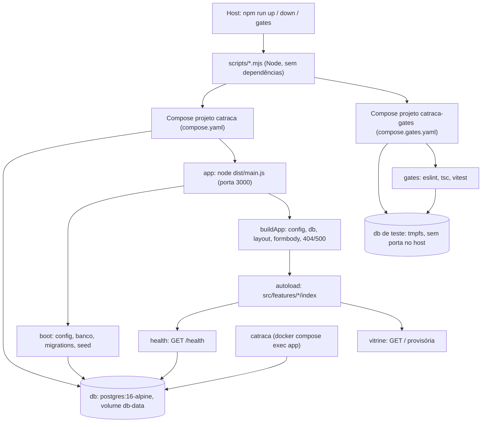

# Spec: F01 — Fundação e harness

## 1. Visão técnica

**O quê.** A F01 cria o esqueleto executável do produto e o harness que todas as outras features e o avaliador usam: a aplicação Node.js 24 + TypeScript (ESM, `strict`) com Fastify 5 em `app/`, o PostgreSQL 16 com migrations aplicadas automaticamente e uma seed idempotente das três contas, o layout HTML comum com navegação extensível, o carregamento automático dos módulos de feature, a linha de comando de diagnóstico `catraca`, a infraestrutura de testes com banco isolado e os três comandos da raiz — `npm run up`, `npm run down` e `npm run gates` — que funcionam a partir de um clone limpo sem `npm install` no host.

**Por quê.** Todas as features seguintes são implementadas e avaliadas contra um ambiente que precisa subir do zero, sem passos manuais, e que precisa conviver com worktrees paralelas (Wave 2 e Wave 5). Por isso a F01 fixa as convenções compartilhadas (pastas, módulos, migrations com timestamp, configuração com padrões, fuso, dinheiro em centavos, IDs com prefixo) e oferece pontos de extensão em que cada feature acrescenta arquivos novos em vez de editar arquivos comuns. Os gates rodam em container, num projeto Compose separado, para que o implementador e o avaliador possam rodá-los com o produto no ar.

**Complexidade:** `medium` — várias camadas (scripts do host, imagens e Compose, núcleo da aplicação, banco), poucas rotas HTTP (`GET /health` e `GET /`), esquema de banco simples (uma tabela de domínio e a tabela de controle das migrations) e integração apenas com o Docker.

### Escopo

**Incluído:**
- Estrutura do repositório: `app/` (aplicação, com `package.json` próprio), `scripts/` (comandos do host em Node), `compose.yaml`, `compose.gates.yaml`, `package.json` da raiz só com scripts.
- Imagem multi-stage `node:24-bookworm-slim` com `TZ=America/Sao_Paulo`, healthcheck e o atalho `catraca`.
- Compose do avaliador (`db` + `app`) e Compose dos gates (`db` efêmero + `gates`), sem conflito entre si.
- Configuração por variáveis de ambiente com padrões, sem `.env` obrigatório; `.env.example` documentando as opcionais.
- Runner de migrations (SQL com timestamp, tabela de controle, trava consultiva, checksum) e a migration da tabela `users`.
- Seed idempotente das três contas (upsert por e-mail), executada em toda subida.
- Núcleo HTTP: construção da aplicação, `@fastify/formbody` na raiz, respostas padrão 404/500, helper de template que escapa HTML, layout com área de navegação extensível, carregamento automático de `app/src/features/*/`.
- Módulos `health` (`GET /health`, confere o banco) e `vitrine` (`GET /` provisória, vazia).
- Utilitários compartilhados: IDs com prefixo, hash de senha scrypt, formatação de dinheiro e data no fuso do produto, transação.
- Linha de comando `catraca` com descoberta automática de comandos (`migrate`, `seed`, `config`, `help`).
- Infraestrutura de testes (Vitest, banco de teste com proteção, criação da aplicação para `inject`, limpeza entre testes) e os testes da própria F01.
- Lint (ESLint flat config + typescript-eslint) e checagem de tipos, executados pelos gates.
- `AGENTS.md` atualizado e `README.md` com as seções do Entregável.

**Excluído (e quem entrega):**
- Links `Entrar` e `Criar conta` no topo e qualquer lógica de sessão: F02, pelo ponto de extensão da navegação (ver Premissa P04).
- Conteúdo real da vitrine (`GET /`): F06, que assume o módulo `vitrine`.
- Worker e tempos do gateway: F03 (a F01 só fornece a configuração `GATEWAY_MODE`/`GATEWAY_DELAY_SCALE` e o ciclo de vida da aplicação).
- Rotas da API de parceiros e uso da `PARTNER_API_KEY`: F07 (a F01 só define o padrão da chave e a documenta).
- Tabelas de eventos, ingressos e pagamentos: F03, F04 e F05.

### Consome

Nada — Wave 1, sem dependências.

### Provê (contratos de saída e pontos de extensão)

| Item provido | Onde | Consumidores |
|---|---|---|
| Servidor HTTP na porta 3000 do container, publicado em `${CATRACA_PORT:-3000}` | `app/src/main.ts`, `compose.yaml` | todas |
| `GET /health` (`200 {"status":"ok"}`; confere o banco) | `app/src/features/health/` | F02, F03, avaliador |
| Módulo de feature = pasta em `app/src/features/<nome>/` com `index.ts` exportando um plugin Fastify (carregado automaticamente, com `loadOrder` opcional) | `app/src/core/modules.ts` | todas |
| Layout comum (`reply.page`), helper `html`/`raw`/`escapeHtml` e contribuições de navegação (`app.layout.addNavContributor`) | `app/src/core/html.ts`, `app/src/core/layout.ts` | F02 (navegação de sessão), F04, F06, F08, F09 |
| Decorators `app.config`, `app.db`, `app.layout`, `app.backgroundJobs` | `app/src/app.ts`, `app/src/core/types.ts` | todas |
| Banco PostgreSQL com migrations automáticas: novas migrations em `app/migrations/AAAAMMDDHHMMSS_<nome>.sql` | `app/src/db/migrate.ts` | F02, F03, F04, F05, F08 |
| Seed idempotente em toda subida; contas com `id`, `name`, `email`, `password_hash`, `role` | `app/src/db/seed.ts`, tabela `users` | F02 |
| `hashPassword`/`verifyPassword` (scrypt) | `app/src/core/password.ts` | F02 |
| `newId(prefixo)` (`usr_`, `evt_`, `tkt_`, `pay_`…) | `app/src/core/ids.ts` | F02, F03, F04, F05 |
| `withTransaction` e tipos `Db`/`Queryable` | `app/src/db/transaction.ts`, `app/src/db/pool.ts` | F03, F04, F05, F08 |
| Formatação: `formatBRL`, `formatDateTimeBR`, `toIsoWithOffset` (fuso `America/Sao_Paulo`) | `app/src/core/format.ts` | F04, F06, F07, F09 |
| Configuração tipada com padrões: `DATABASE_URL`, `PORT`, `SESSION_SECRET`, `GATEWAY_MODE=simulado`, `GATEWAY_DELAY_SCALE` (só em teste), `PARTNER_API_KEY` | `app/src/config.ts` | F02 (segredo de sessão), F03 (modo e escala), F07 (chave) |
| Comandos de diagnóstico: arquivo novo em `app/src/cli/commands/` vira `catraca <nome>` | `app/src/cli/index.ts` | F03 (`gateway:simular`), F05 (`compra:simular`, `ingresso:consultar`) |
| Infraestrutura de testes: `createTestApp`, `testDb`, `resetDatabase`, `withTemporaryDatabase`, `seedAccounts`; testes de cada feature em `app/test/<fNN>/` | `app/test/helpers/`, `app/vitest.config.ts` | todas |
| `npm run up`, `npm run down`, `npm run gates` (com `npm run gates -- <filtro>`) | `package.json`, `scripts/` | todas, avaliador |

### Regras e invariantes

- **Regras do brief implementadas:** nenhuma de R01–R13 diretamente. A F01 entrega o "Harness mínimo" (brief, Requisitos 3), os critérios "Ambiente e harness" do brief e os passos 1 e 17 do Fluxo do avaliador (subir, gates, derrubar, subir de novo).
- **Invariantes que a F01 estabelece para as demais features:**
  - *Modo padrão = avaliador:* o gateway fica `simulado` sem nenhuma variável e sem nenhuma chave de pagamento; `GATEWAY_DELAY_SCALE` só é lida com `NODE_ENV=test` (fora disso vale 1).
  - *Fuso do produto:* `America/Sao_Paulo` no container (`TZ`), em cada conexão com o banco (`TimeZone`) e nos formatadores.
  - *Dinheiro em centavos:* valores monetários são inteiros; `int8` do banco chega como `number`.
  - *HTML sempre escapado:* toda interpolação passa pelo helper `html`; `raw` só para conteúdo confiável gerado pelo próprio código.
  - *Migrations imutáveis depois de aplicadas:* o runner rejeita arquivo já aplicado cujo conteúdo mudou; mudanças entram como migration nova.
  - *Operações atômicas:* o utilitário de transação é o caminho para as operações que precisam de atomicidade nas features seguintes (R05–R07 na compra, R11 no cancelamento).
- **Invariantes compartilhadas do projeto** (lotação sob concorrência, efeitos do cancelamento, receita sem estorno, resposta tardia do gateway, isolamento do organizador, API igual à vitrine): a F01 não tem código de domínio e não as afeta; só fornece a base (transação, fuso, centavos) para as features que as implementam.

### Requisitos (capacidades do PRD → decisões desta spec)

| Capacidade (PRD F01) | Como esta spec atende |
|---|---|
| Host só com Docker (Compose), Git e Node.js LTS; raiz sem dependências | `package.json` da raiz sem `dependencies`/`devDependencies`; scripts do host usam só módulos nativos do Node ≥ 20 |
| `npm run up` constrói, sobe, espera saudável, roda migrations e seed | `scripts/up.mjs` → `docker compose up -d --build --wait`; a app roda migrations e seed antes de escutar (5.10); healthcheck da imagem consulta `/health` |
| Porta e nome do projeto trocáveis por variável | `CATRACA_PORT` (padrão 3000) e `COMPOSE_PROJECT_NAME` (padrão `catraca`), pelo shell ou por `.env` local |
| `npm run down` remove containers e rede, preserva o volume | `docker compose down --remove-orphans` (sem `-v`); também remove sobras do projeto de gates |
| `npm run gates` em container, projeto separado, sem portas, código 0 só se tudo passar | `compose.gates.yaml` no projeto `<projeto>-gates` (`catraca-gates` por padrão), banco em `tmpfs`, resumo final e código propagado (5.9) |
| Seed idempotente (upsert por e-mail) das 3 contas, sem eventos | `runSeed` com `ON CONFLICT ((lower(email)))`, 3 contas fixas (seção 6) |
| Modo padrão `simulado`, sem chave; escala só em teste | `loadConfig` (5.4) |
| Fuso `America/Sao_Paulo` | `TZ` na imagem e nos containers, `TimeZone` por conexão, formatadores com fuso explícito |
| `AGENTS.md`, `CLAUDE.md` → `AGENTS.md`, README | seção 4 (Documentação) |
| LF e scripts em Node ou `sh` POSIX | `.gitattributes` existente; scripts `.mjs`; `app/bin/catraca` em `sh` POSIX |

### Fluxos (experiência do PRD)

1. **Subida em clone limpo:** `git clone` → `npm run up` → o script confere o Docker e a porta, roda `docker compose up -d --build --wait` (mostrando o progresso do build), a app conecta no banco, aplica migrations, roda a seed, carrega os módulos e escuta; o healthcheck passa; o script confere `http://localhost:<porta>/health` no host e imprime `$WEB` e `$API`.
2. **Health:** `GET /health` responde `200` com `{"status":"ok"}` só se o banco responder.
3. **Página inicial:** `http://localhost:3000` abre a vitrine provisória (vazia) dentro do layout comum. Os links `Entrar` e `Criar conta` aparecem quando a F02 registrar sua contribuição de navegação.
4. **Gates:** `npm run gates` constrói a imagem de gates, sobe um banco efêmero sem portas, roda lint, typecheck e testes, imprime o resumo e devolve o código de saída.
5. **Derrubar e subir de novo:** `npm run down` remove containers e rede; um novo `npm run up` reaproveita o volume, não aplica migrations novas e a seed informa que as 3 contas já existiam.

## 2. Impacto na arquitetura

Repositório depois da F01 (arquivos novos, salvo indicação):

```
.
├── package.json              # só scripts: up, down, gates
├── compose.yaml              # ambiente do avaliador: db + app
├── compose.gates.yaml        # ambiente dos gates: db efêmero + gates
├── .env.example              # opcionais: CATRACA_PORT, COMPOSE_PROJECT_NAME, ...
├── .prettierignore           # docs/features/*/reports/
├── scripts/
│   ├── lib/harness.mjs
│   ├── up.mjs
│   ├── down.mjs
│   └── gates.mjs
├── app/
│   ├── package.json  package-lock.json  tsconfig.json  tsconfig.build.json
│   ├── eslint.config.js  vitest.config.ts  Dockerfile  .dockerignore
│   ├── bin/catraca           # atalho da CLI dentro do container
│   ├── tools/gates.mjs       # executor dos gates dentro do container
│   ├── migrations/20261125120000_create_users.sql
│   ├── src/
│   │   ├── main.ts  app.ts  config.ts
│   │   ├── core/   types.ts modules.ts html.ts layout.ts errors.ts ids.ts password.ts format.ts boot-log.ts
│   │   ├── db/     pool.ts transaction.ts migrate.ts seed.ts
│   │   ├── features/health/index.ts
│   │   ├── features/vitrine/index.ts
│   │   └── cli/    index.ts commands/{migrate,seed,config}.ts
│   └── test/
│       ├── global-setup.ts  setup.ts
│       ├── helpers/ app.ts db.ts seed.ts
│       ├── fixtures/ features-ok/ features-invalida/
│       └── f01/ *.test.ts
├── AGENTS.md                 # modificado
├── CLAUDE.md                 # sem mudança (já aponta para AGENTS.md)
└── README.md
```



## 3. Decisões técnicas

| Decisão | Abordagem escolhida | Alternativa considerada | Trade-off |
|---|---|---|---|
| Carregamento dos módulos | Loader próprio: cada subpasta de `src/features/` com `index` exportando um plugin Fastify; ordem por `loadOrder` (padrão 100) e nome da pasta | `@fastify/autoload` | Mais um arquivo nosso, mas ordem explícita, sem prefixo de rota implícito e erro claro com o nome do módulo |
| Compartilhamento entre módulos | Decorators na raiz (`config`, `db`, `layout`, `backgroundJobs`) e importação direta das funções públicas da feature provedora | Contêiner de injeção de dependências | Acoplamento por import é visível e tipado; exige disciplina de só importar o que a spec da provedora declarar público |
| Gates | Imagem com alvo `gates` + `docker compose run --rm` num projeto `<projeto>-gates`, banco em `tmpfs`, limpeza sempre | Rodar testes no host ou no container do `up` | Build extra por execução (com cache), em troca de isolamento total do ambiente no ar e de worktrees paralelas |
| Resumo dos gates | Executor dentro do container (`tools/gates.mjs`) roda as três etapas sempre e lê o relatório JSON do Vitest | Três `compose run` separados com parsing do texto | Um único ponto que conhece o formato; contagem de testes confiável |
| Paralelismo dos testes | Arquivos de teste em sequência (`fileParallelism: false`) sobre um banco de teste, limpo entre testes | Um banco por worker | Suíte um pouco mais lenta; nenhuma interferência entre arquivos, inclusive nos testes de concorrência da F05 |
| Migrations | Runner próprio: uma transação por arquivo, `pg_advisory_lock`, checksum SHA-256, aplica qualquer pendente em ordem de nome | Ferramenta externa (node-pg-migrate etc.) | Pouco código e SQL puro; migrations de branches paralelas com timestamp mais antigo ainda são aplicadas |
| Seed | Upsert por `lower(email)` que reescreve nome, papel e hash da senha a cada subida | `ON CONFLICT DO NOTHING` | Rehash a cada subida (~100 ms), em troca da garantia de que as credenciais do README sempre funcionam |
| Comandos do host | Node `.mjs` só com módulos nativos (compatível com Node ≥ 20) | `sh`/Makefile | Funciona em Linux, macOS e WSL com a mesma lógica de mensagens; nenhum `npm install` no host |
| HTML | Tagged template `html` que escapa por padrão + tipo `SafeHtml` | Motor de templates (EJS, Nunjucks) | Sem dependência e tipado; escapar é o padrão, `raw` é explícito |
| Fuso e formatos | Formatadores próprios sobre `Intl` com correções (espaço comum no `R$`, data sem vírgula) | Usar `Intl` direto em cada feature | Uma única fonte para `R$ 1.234,56`, `05/12/2026 21:00` e `2026-12-05T21:00:00-03:00` |

## 4. Componentes

**Raiz e harness do host:**

| Arquivo | Novo/Modificado | Propósito | Responsabilidades |
|---|---|---|---|
| `package.json` | Novo | Comandos da raiz | `"private": true`; scripts `up` → `node scripts/up.mjs`, `down` → `node scripts/down.mjs`, `gates` → `node scripts/gates.mjs`; `engines.node` `>=20`; nenhuma dependência |
| `scripts/lib/harness.mjs` | Novo | Funções comuns dos comandos | Raiz do repositório a partir do próprio arquivo; leitura de `CATRACA_PORT` e `COMPOSE_PROJECT_NAME` (shell > `.env` > padrão) com validação; checagem do Docker e do Compose; execução de processos com saída espelhada e capturada; checagem de porta livre (bind temporário em `0.0.0.0`); impressão com prefixo |
| `scripts/up.mjs` | Novo | `npm run up` | Docker → porta (pulada se o `app` do projeto já está rodando) → `docker compose -f compose.yaml up -d --build --wait --wait-timeout 120` → confere `/health` no host (até 10 s) → imprime endereços; em falha, imprime as últimas 80 linhas do log do `app` sem o prefixo do serviço (`docker compose logs --no-color --no-log-prefix --tail 80 app`) (5.9) |
| `scripts/down.mjs` | Novo | `npm run down` | Docker → `docker compose -f compose.yaml down --remove-orphans` → `docker compose -f compose.gates.yaml -p <projeto>-gates --progress quiet down -v --remove-orphans` → mensagem final; idempotente |
| `scripts/gates.mjs` | Novo | `npm run gates` | Docker → limpeza prévia do projeto de gates → `build gates` → `run --rm gates` (argumentos extras repassados ao Vitest) → limpeza (`down -v`, sempre, inclusive em Ctrl-C) → sai com o código do `run` |
| `compose.yaml` | Novo | Ambiente do avaliador | `name: catraca`; serviços `db` e `app` (5.11); volume `db-data` |
| `compose.gates.yaml` | Novo | Ambiente dos gates | `name: catraca-gates` (o script passa `-p`); serviços `db` (tmpfs) e `gates`; nenhum `ports` |
| `.env.example` | Novo | Documenta as variáveis opcionais | `CATRACA_PORT`, `COMPOSE_PROJECT_NAME`, `PARTNER_API_KEY`, `SESSION_SECRET`, todas comentadas; nada obrigatório |
| `.prettierignore` | Novo | Proteção dos relatórios | Contém `docs/features/*/reports/` (o projeto não instala formatador; o arquivo protege o "formatar ao salvar" de editores) |
| `.gitignore` | Sem mudança | — | Já ignora `node_modules/`, `dist/`, `coverage/`, `.env`, `.env.*` (exceto `.env.example`) |

**Aplicação — projeto e imagem:**

| Arquivo | Novo/Modificado | Propósito | Responsabilidades |
|---|---|---|---|
| `app/package.json` | Novo | Manifesto da aplicação | `"type": "module"`, `"private": true`, `engines.node` `>=24`; dependências: `fastify` ^5, `@fastify/formbody` ^8, `fastify-plugin` ^5, `pg` ^8; dev: `typescript` ^5.9, `@types/node` ^24, `@types/pg` ^8, `vitest` (major estável atual), `eslint` ^9, `@eslint/js`, `typescript-eslint` ^8, `globals`; scripts `build`, `start`, `lint`, `typecheck`, `test`, `gates`, `migrate`, `seed`, `cli` (5.8) |
| `app/package-lock.json` | Novo | Versões exatas | Gerado com `npm install` (no host ou num container `node:24-bookworm-slim`) e usado por `npm ci` no build |
| `app/tsconfig.json` | Novo | Typecheck de tudo | `strict`, `noUncheckedIndexedAccess`, `module`/`moduleResolution` `NodeNext`, `target` ES2023, `verbatimModuleSyntax`, `skipLibCheck`; inclui `src`, `test`, `vitest.config.ts`; imports relativos com extensão `.js` |
| `app/tsconfig.build.json` | Novo | Build de produção | Estende o anterior; `rootDir: src`, `outDir: dist`, inclui só `src` |
| `app/eslint.config.js` | Novo | Lint | Flat config: `@eslint/js` recommended + `typescript-eslint` `recommendedTypeChecked` (com `projectService`) para `src/**/*.ts` e `test/**/*.ts`; regras sem tipo para `*.js`/`*.mjs`/`vitest.config.ts`; ignora `dist/**`, `coverage/**`, `node_modules/**`. O escopo é só `app/` (o contexto do container); `docs/**` está fora por construção. Aceita arquivos de teste no estilo `describe`/`it`/`expect` do Vitest |
| `app/vitest.config.ts` | Novo | Executor de testes | `include: ['test/**/*.test.ts']`, `globalSetup: 'test/global-setup.ts'`, `setupFiles: ['test/setup.ts']`, `fileParallelism: false`, `testTimeout` 20 s, `hookTimeout` 30 s |
| `app/Dockerfile` | Novo | Imagem multi-stage | Estágios `base` (`node:24-bookworm-slim`, `ENV TZ=America/Sao_Paulo`, `WORKDIR /app`), `deps` (`npm ci`), `build` (`npm run build`), `gates` (a partir de `deps`, `COPY . .`, `CMD npm run gates`), `prod-deps` (`npm ci --omit=dev`), `runtime` (`NODE_ENV=production`, `node_modules` de produção, `dist`, `migrations`, `bin/catraca` em `/usr/local/bin/catraca` com modo 0755, `USER node`, `EXPOSE 3000`, `HEALTHCHECK`, `CMD ["node", "dist/main.js"]`) (5.11) |
| `app/.dockerignore` | Novo | Contexto enxuto | Ignora `node_modules`, `dist`, `coverage`, `*.log`, `.env*`; **não** ignora `test/` nem `migrations/` |
| `app/bin/catraca` | Novo | Atalho da CLI | Script `sh` POSIX que executa `node /app/dist/cli/index.js "$@"` |
| `app/tools/gates.mjs` | Novo | Executor dos gates no container | Roda `eslint .`, `tsc -p tsconfig.json --noEmit` e `vitest run` (reporter padrão + JSON em arquivo temporário, com os filtros recebidos), sempre as três; imprime o resumo de 5.9; sai com 0 só se tudo passou e houve ao menos 1 teste executado |

**Aplicação — núcleo:**

| Arquivo | Novo/Modificado | Propósito | Responsabilidades |
|---|---|---|---|
| `app/src/main.ts` | Novo | Entrada do processo | Etapas em ordem: configuração → banco (tentativas por até 30 s) → migrations → seed → `buildApp` → `listen`; mensagens `[catraca]` por etapa; em falha, `[catraca] falha na etapa <etapa>: <mensagem>` e código 1; `SIGTERM`/`SIGINT` → `app.close()` e fim do pool (5.10) |
| `app/src/app.ts` | Novo | `buildApp(options)` | Cria a instância Fastify (logger com `config.logLevel`), decora `config`, `db`, `layout`, `backgroundJobs`, registra `@fastify/formbody`, o decorator `reply.page`, os handlers de 404/500 e carrega os módulos de `featuresDir`; não escuta porta |
| `app/src/config.ts` | Novo | `loadConfig(env)` e `describeConfig(config)` | Lê e valida as variáveis de 5.4 com padrões; lança `ConfigError` com mensagem em pt-BR; `describeConfig` gera as linhas `CHAVE=valor` com segredos mascarados |
| `app/src/core/types.ts` | Novo | Tipos do Fastify | `declare module 'fastify'` para `FastifyInstance.config/db/layout/backgroundJobs` e `FastifyReply.page`; features acrescentam seus próprios tipos no próprio módulo |
| `app/src/core/modules.ts` | Novo | `loadFeatureModules(app, dir)` | Lista subpastas (ignora as iniciadas por `_` ou `.`), importa `index.ts` ou `index.js` (a extensão segue a do próprio loader), valida o `default`, ordena por `loadOrder` e nome, registra cada plugin e devolve os nomes carregados (5.5) |
| `app/src/core/html.ts` | Novo | Template seguro | `SafeHtml`, `html` (tagged template), `raw`, `escapeHtml` (5.6) |
| `app/src/core/layout.ts` | Novo | Layout e navegação | Registro de contribuições de navegação; `renderPage`; plugin que adiciona `reply.page` (5.6) |
| `app/src/core/errors.ts` | Novo | Respostas padrão | `setNotFoundHandler` e `setErrorHandler` da raiz (5.3) |
| `app/src/core/ids.ts` | Novo | `newId(prefix)` | `<prefixo>_` + 16 caracteres de `[a-z0-9]` com `crypto` (amostragem sem viés) |
| `app/src/core/password.ts` | Novo | Senhas | `hashPassword`, `verifyPassword` com `node:crypto` scrypt (formato em 5.7) |
| `app/src/core/format.ts` | Novo | Formatos do produto | `PRODUCT_TIMEZONE`, `formatBRL`, `formatDateTimeBR`, `toIsoWithOffset` (5.7) |
| `app/src/core/boot-log.ts` | Novo | Mensagens de boot e CLI | Linhas de texto com prefixo `[catraca]` em stdout/stderr (independentes do logger JSON do Fastify) |

**Aplicação — banco:**

| Arquivo | Novo/Modificado | Propósito | Responsabilidades |
|---|---|---|---|
| `app/src/db/pool.ts` | Novo | Conexões | `createPool(config)`: `max` 10, `connectionTimeoutMillis` 5000, `application_name` `catraca`, `options` `-c TimeZone=America/Sao_Paulo`; parser global de `int8` → `number`; tipos `Db` (Pool) e `Queryable` (Pool ou PoolClient); `waitForDatabase` (tentativas) |
| `app/src/db/transaction.ts` | Novo | `withTransaction(db, fn, options?)` | `BEGIN` (nível de isolamento opcional) → `fn(client)` → `COMMIT`; `ROLLBACK` e relança em erro; sempre libera o cliente |
| `app/src/db/migrate.ts` | Novo | `runMigrations(db, options?)` | Seção 6: tabela de controle, trava, validação de nomes, checksum, uma transação por arquivo, relatório `{ applied, alreadyApplied }`; diretório padrão `../../migrations` relativo ao próprio módulo (vale em `src/` e `dist/`) |
| `app/src/db/seed.ts` | Novo | `runSeed(db, options?)` e `SEED_ACCOUNTS` | Upsert das 3 contas numa transação; relatório `{ created, existing }` |
| `app/migrations/20261125120000_create_users.sql` | Novo | Primeira migration | Tabela `users` e índice único em `lower(email)` (seção 6) |

**Módulos de feature e CLI:**

| Arquivo | Novo/Modificado | Propósito | Responsabilidades |
|---|---|---|---|
| `app/src/features/health/index.ts` | Novo | `GET /health` | `SELECT 1` com limite de 2 s; `200 {"status":"ok"}` ou `503` (5.1); `Cache-Control: no-store` |
| `app/src/features/vitrine/index.ts` | Novo | `GET /` provisória | Página `Eventos à venda` com `Nenhum evento à venda no momento.` dentro do layout (5.2); a F06 assume e substitui este módulo |
| `app/src/cli/index.ts` | Novo | Dispatcher `catraca` | Descobre `commands/*` (cada um exporta `name`, `description`, `run`), cria o pool sob demanda, executa, fecha o pool e devolve o código; `help`/sem argumento lista os comandos; desconhecido → código 2 (5.8) |
| `app/src/cli/commands/migrate.ts` | Novo | `catraca migrate` | Roda `runMigrations` e imprime o relatório |
| `app/src/cli/commands/seed.ts` | Novo | `catraca seed` | Roda `runSeed` e imprime o relatório |
| `app/src/cli/commands/config.ts` | Novo | `catraca config` | Imprime `describeConfig(loadConfig(process.env))` |

**Testes (infraestrutura compartilhada e testes da F01):** ver seção 7.

**Documentação:**

| Arquivo | Novo/Modificado | Propósito | Responsabilidades |
|---|---|---|---|
| `AGENTS.md` | Modificado | Porta de entrada dos agentes | Tabela de comandos com situação `pronto` (`npm run up`, `npm run down`, `npm run gates`, `npm run gates -- <filtro>`, `docker compose exec app catraca <comando>`); remove a frase "Até a F01 ser integrada não existe ambiente…" e as menções "criado pela F01"; endereços `$WEB` = `$API` = `http://localhost:3000`; credenciais e chave no README (seção Credenciais); seção "Ambiente por worktree" (`.env` com `COMPOSE_PROJECT_NAME`/`CATRACA_PORT`, gates em `<projeto>-gates`); seção "Convenções de código" (módulos, `loadOrder`, navegação, `reply.page`/`html`, migrations com `date -u +%Y%m%d%H%M%S`, testes em `app/test/<fNN>/` com o ID do critério no nome, IDs com prefixo, centavos, fuso, variáveis de ambiente, sem formatador); mapa dos artefatos acrescido de `README.md`, `app/`, `compose*.yaml`, `scripts/`. Mantém as seções existentes (`## Regras do projeto`, `## Mapa dos artefatos`, ciclo e estado) |
| `README.md` | Novo | Entregável | Seções `## Como rodar` (pré-requisitos Docker com Compose v2, Git, Node.js LTS; `npm run up`/`down`/`gates`; worktrees), `## Endereços` (`$WEB` e `$API` = `http://localhost:3000`), `## Credenciais` (3 contas, senha `catraca123`, chave `parceiro-catraca-dev` no cabeçalho `X-Api-Key` — API entregue pela F07), `## Mapa dos artefatos` (`docs/brief.md`, `docs/PRD.md`, `docs/features/<ID>-<nome>/` com spec, plano, contrato e `reports/`, `docs/state.json`, `AGENTS.md`, `app/`; PRs da wave paralela "a completar após a Wave 2"), `## Decisões` (stack e por quê, harness, isolamento da avaliação; "R07 sob concorrência: a completar na F05"; "gateway assíncrono: a completar na F03/F05"); seções extras `## Variáveis de ambiente` e `## Comandos de diagnóstico` |
| `CLAUDE.md` | Sem mudança | — | Já contém `@AGENTS.md`; apenas conferido |

## 5. Contratos de API e interfaces

### 5.1 `GET /health`

- **Autenticação:** nenhuma. **Uso:** healthcheck do container, `npm run up`, avaliador.
- **Comportamento:** executa `SELECT 1` no pool com limite de 2 s.

| Situação | Status | Corpo (exato) | Cabeçalhos |
|---|---|---|---|
| Banco respondeu | `200` | `{"status":"ok"}` | `content-type: application/json; charset=utf-8`, `cache-control: no-store` |
| Banco não respondeu em 2 s ou erro | `503` | `{"status":"erro","motivo":"banco de dados indisponível"}` | idem |

### 5.2 `GET /` (vitrine provisória)

- **Autenticação:** nenhuma. **Resposta:** `200`, `content-type: text/html; charset=utf-8`, documento completo do layout (5.6) com `title` `Eventos à venda`, `<h1>Eventos à venda</h1>` e o parágrafo `Nenhum evento à venda no momento.`.
- **Dono futuro:** F06 substitui o conteúdo do módulo `app/src/features/vitrine/`. Nenhuma outra feature registra `GET /`.

### 5.3 Respostas padrão da raiz

| Situação | Caminho começa com `/api/` | Demais caminhos |
|---|---|---|
| Rota inexistente | `404` `{"error":"not_found"}` | `404` HTML no layout: título e `<h1>Página não encontrada</h1>` |
| Erro não tratado (status ≥ 500 ou sem status) | `500` `{"error":"internal_error"}` | `500` HTML no layout: `<h1>Algo deu errado. Tente novamente.</h1>` |
| Erro do Fastify com status 4xx (ex.: JSON malformado) | mesmo status, `{"error":"bad_request"}` | mesmo status, página com `<h1>Requisição inválida</h1>` |

O erro é registrado no log com stack; a resposta nunca expõe stack, SQL ou mensagem interna. Features podem definir handlers próprios no seu escopo (ex.: a F07 transforma corpo inválido em `422 {"error":"invalid_request"}`), que têm precedência sobre os da raiz.

### 5.4 Configuração (`loadConfig(env)`)

Nenhuma variável é obrigatória. Valor inválido → `ConfigError` e a aplicação não sobe (`[catraca] falha na etapa configuração: <mensagem>`).

| Variável | Padrão | Validação | Campo |
|---|---|---|---|
| `NODE_ENV` | `development` (a imagem define `production`; os gates, `test`) | `production`, `development` ou `test` | `nodeEnv` |
| `HOST` | `0.0.0.0` | texto não vazio | `host` |
| `PORT` | `3000` | inteiro 1–65535 | `port` |
| `DATABASE_URL` | `postgres://catraca:catraca@db:5432/catraca` | URL `postgres://` ou `postgresql://` | `databaseUrl` |
| `SESSION_SECRET` | `catraca-dev-session-secret-nao-usar-em-producao` | ≥ 32 caracteres | `sessionSecret` (usado pela F02) |
| `GATEWAY_MODE` | `simulado` | só `simulado` (`GATEWAY_MODE inválido: <valor>. Valor aceito: simulado`) | `gateway.mode` (F03) |
| `GATEWAY_DELAY_SCALE` | `1` | lida **só** com `NODE_ENV=test`: número > 0; fora de teste é ignorada (aviso no log) e vale `1` | `gateway.delayScale` (F03) |
| `PARTNER_API_KEY` | `parceiro-catraca-dev` | texto não vazio | `partnerApiKey` (F07) |
| `LOG_LEVEL` | `info` | `fatal`, `error`, `warn`, `info`, `debug`, `trace`, `silent` | `logLevel` |

O fuso não é configurável: `PRODUCT_TIMEZONE = 'America/Sao_Paulo'` (constante em `format.ts`); o container define `TZ` com o mesmo valor. Não existe nenhuma variável de chave de pagamento. Variáveis novas de features futuras entram em `config.ts` pela feature que as usa (as conhecidas hoje já estão aqui para evitar edições concorrentes).

`describeConfig` produz exatamente estas chaves, nesta ordem, uma por linha: `NODE_ENV`, `HOST`, `PORT`, `TZ` (valor de `process.env.TZ` ou `(não definido)`), `DATABASE_URL` (senha trocada por `****`), `GATEWAY_MODE`, `GATEWAY_DELAY_SCALE`, `PARTNER_API_KEY`, `SESSION_SECRET` (sempre `****`), `LOG_LEVEL`.

### 5.5 Interface de módulo de feature

- **Local:** `app/src/features/<nome>/index.ts` (pasta em minúsculas, `kebab-case`). Pastas iniciadas por `_` ou `.` são ignoradas (podem guardar código auxiliar compartilhado da própria feature).
- **Exportações:** `default` — plugin Fastify assíncrono (obrigatório); `loadOrder` — número opcional (padrão `100`; menor carrega antes; empate pelo nome da pasta). Uso previsto: sessão/autenticação da F02 com `loadOrder` baixo (ex.: `10`).
- **Registro:** `app.register(plugin)` sem prefixo; o plugin declara os caminhos completos. Plugins são encapsulados pelo Fastify; um módulo que precisa afetar todas as rotas (hook de sessão, decorator de request) envolve o plugin com `fastify-plugin`.
- **Ciclo de vida:** módulos com tarefas em segundo plano (worker da F03) as iniciam em `onReady` só quando `app.backgroundJobs` é `true` e as encerram em `onClose`. `main.ts` usa `true`; `createTestApp` usa `false` por padrão.
- **Erros:** pasta sem `index`, `index` sem `default` função ou falha de import → `Error` com a mensagem `Módulo de feature inválido: <nome> (<motivo>)`; a aplicação não sobe (`[catraca] falha na etapa módulos: …`).
- **API pública entre features:** funções exportadas de arquivos do próprio módulo (ex.: `service.ts`), declaradas na spec da feature provedora; nunca editar arquivos de outra feature para acrescentar comportamento.

### 5.6 Template e layout

- `html` (tagged template) → `SafeHtml`. Para cada valor interpolado: `SafeHtml` entra sem escapar; array → cada item tratado e concatenado; `null`, `undefined` e `false` → vazio; qualquer outro valor → `escapeHtml(String(valor))`.
- `escapeHtml` troca `&` `<` `>` `"` `'` por `&amp;` `&lt;` `&gt;` `&quot;` `&#39;`. Valores sempre entre aspas em atributos. URLs vindas do usuário não são aceitas em `href` sem validação da feature.
- `raw(texto)` → `SafeHtml` sem escapar (só para HTML gerado pelo código).
- `reply.page({ title, content, messages?, status? })`: responde `text/html; charset=utf-8` com o documento:
  - `<!doctype html>`, `<html lang="pt-BR">`, `<head>` com `charset` utf-8, `viewport`, `<title>{title} · Catraca</title>` e CSS mínimo embutido (sem arquivos estáticos);
  - `<header>` com `<nav aria-label="Navegação principal" data-area="navegacao">`: link `Catraca` para `/` seguido das contribuições de navegação, na ordem de `order`;
  - `<main>`: primeiro as `messages` (`{ kind: 'success' | 'error' | 'info', text }` → `<p class="msg msg-<kind>" role="status|alert">texto escapado</p>`), depois `content`.
- `app.layout.addNavContributor({ name, order, render })`: `render(request)` devolve `SafeHtml` (ou `Promise<SafeHtml>`); nome repetido → erro no registro. A F02 registra a contribuição que mostra `Entrar`/`Criar conta` ou o nome do usuário, o link da área e `Sair`.

### 5.7 Utilitários compartilhados

| Função | Contrato |
|---|---|
| `newId(prefix)` | `"<prefix>_"` + 16 caracteres de `[a-z0-9]` (ex.: `usr_k3j9x0q2m7a1b5c8`); prefixo `[a-z]+` |
| `hashPassword(senha)` | scrypt com N=16384, r=8, p=1, chave de 64 bytes, sal aleatório de 16 bytes; formato `scrypt$16384$8$1$<sal base64url>$<hash base64url>` |
| `verifyPassword(senha, hash)` | `true`/`false` com comparação em tempo constante; hash malformado → `false` (nunca lança) |
| `formatBRL(centavos)` | `R$ 1.234,56`, `R$ 100,00`, `R$ 0,00`; separador após `R$` é espaço comum U+0020 (o `Intl` do Node usa U+00A0 e precisa ser substituído) |
| `formatDateTimeBR(data)` | `dd/mm/aaaa hh:mm` no fuso `America/Sao_Paulo`, sem vírgula (o `Intl` pt-BR gera `05/12/2026, 21:00` e precisa ser montado por partes): `2026-12-06T00:00:00Z` → `05/12/2026 21:00` |
| `toIsoWithOffset(data)` | ISO 8601 com segundos e o offset do fuso: `2026-12-06T00:00:00Z` → `2026-12-05T21:00:00-03:00` (offset obtido por `Intl`, `timeZoneName: 'longOffset'`) |
| `withTransaction(db, fn, { isolation? })` | Executa `fn(client)` numa transação; devolve o resultado; desfaz e relança em erro |
| `createPool(config)` / `waitForDatabase(db, { timeoutMs })` | Ver 4; `waitForDatabase` tenta `SELECT 1` a cada 1 s até o limite |

### 5.8 Linha de comando `catraca`

- **Uso:** dentro do container da aplicação: `docker compose exec app catraca <comando> [argumentos]` (em scripts, `docker compose exec -T app …`). Equivalente: `npm run cli -- <comando>` dentro de `app/` com `dist/` construído.
- **Extensão:** um arquivo novo em `app/src/cli/commands/` exportando `name` (ex.: `gateway:simular`), `description` e `run({ args, config, db }) → Promise<number>` vira um comando; `db` é criado só quando acessado. Nomes com `:` são permitidos; o arquivo usa `-` (ex.: `gateway-simular.ts`).

| Comando | Saída (stdout) | Código |
|---|---|---|
| `catraca` ou `catraca help` | `Comandos disponíveis:` e uma linha por comando (`  <nome>  <descrição>`) | 0 |
| `catraca migrate` | `[catraca] migration aplicada: <id>` por arquivo aplicado e `[catraca] migrations: aplicadas <a>, já aplicadas <b>` | 0; erro → 1 |
| `catraca seed` | `[catraca] seed: contas garantidas 3 (criadas <c>, já existiam <e>)` | 0; erro → 1 |
| `catraca config` | as 10 linhas `CHAVE=valor` de 5.4 (ex.: `GATEWAY_MODE=simulado`, `SESSION_SECRET=****`) | 0 |
| comando desconhecido | stderr `Comando desconhecido: <nome>` seguido da lista | 2 |

### 5.9 Comandos do host

Todos rodam a partir da raiz do repositório (o script descobre a raiz pelo próprio caminho), usam `docker compose -f compose.yaml` (ou `-f compose.gates.yaml -p <projeto>-gates`) e prefixam suas linhas com `[up]`, `[down]` ou `[gates]`. `<projeto>` = `COMPOSE_PROJECT_NAME` do shell, senão do `.env`, senão `catraca` (validado: minúsculas, dígitos, `-` e `_`). `<porta>` = `CATRACA_PORT` do shell, senão do `.env`, senão `3000` (inteiro 1–65535).

**`npm run up`**

| Situação | Saída | Código |
|---|---|---|
| Início | `[up] Construindo e subindo a Catraca (projeto Compose "<projeto>", porta <porta>)...` e a saída do Compose (build e containers) | — |
| Sucesso | `[up] Catraca no ar.` / `[up] $WEB = http://localhost:<porta>` / `[up] $API = http://localhost:<porta>` / `[up] Contas da seed e chave de parceiro: README.md, seção "Credenciais".` | 0 |
| Docker ou Compose v2 indisponível | `[up] Docker não está disponível: <detalhe>` e `[up] Inicie o Docker (com o Compose v2) e rode o comando de novo.` | 1 |
| Porta ocupada (checada antes do Compose, se o `app` do projeto não estiver rodando; ou detectada no erro do Compose: `port is already allocated`/`address already in use`) | `[up] Porta <porta> em uso. Libere a porta ou escolha outra com a variável CATRACA_PORT (ex.: CATRACA_PORT=3001 npm run up, ou CATRACA_PORT=3001 no arquivo .env).` — nenhum container é criado quando a checagem prévia detecta | 1 |
| Compose falhou (ex.: migration ou seed com erro: o container `app` sai com 1 e o `--wait` falha) | `[up] Falha ao subir a Catraca (docker compose terminou com código <n>).`, `[up] Últimas linhas do log da aplicação:` e as últimas 80 linhas de `docker compose logs --no-color --no-log-prefix --tail 80 app` (incluindo, sem prefixo, a linha `[catraca] falha na etapa …`) | 1 |
| Container saudável, mas `/health` não responde no host em 10 s | `[up] A aplicação ficou saudável no container, mas http://localhost:<porta>/health não respondeu no host.` | 1 |
| Variável inválida | `[up] CATRACA_PORT inválida: <valor>` ou `[up] COMPOSE_PROJECT_NAME inválido: <valor>` | 1 |

**`npm run down`**

| Situação | Saída | Código |
|---|---|---|
| Normal (com ou sem nada no ar) | `[down] Derrubando a Catraca (projeto Compose "<projeto>")...`, saída do Compose e `[down] Pronto: containers e rede removidos; volume do banco preservado.` | 0 |
| Docker indisponível | `[down] Docker não está disponível: <detalhe>` | 1 |

**`npm run gates [-- <filtros do Vitest>]`**

| Situação | Saída | Código |
|---|---|---|
| Início | `[gates] projeto Compose "<projeto>-gates" (banco próprio, sem portas no host)` e a saída do build | — |
| Resumo (impresso pelo executor no container, sempre as quatro linhas) | `[gates] lint: ok` ou `[gates] lint: falhou`; `[gates] typecheck: ok` ou `[gates] typecheck: falhou`; `[gates] testes: ok (<N> executados, 0 falharam)`, `[gates] testes: falhou (<N> executados, <F> falharam)` ou `[gates] testes: falhou (nenhum teste executado)`; `[gates] resultado: OK` ou `[gates] resultado: FALHOU`. Com filtro, a linha de testes termina com ` [filtro: <args>]` | 0 só com `OK`; senão 1 |
| Build da imagem falhou | `[gates] resultado: FALHOU (não foi possível construir a imagem dos gates)` | 1 |
| Docker indisponível | `[gates] Docker não está disponível: <detalhe>` | 1 |
| Interrompido (Ctrl-C) | limpeza do projeto de gates e saída | 130 |

`<N> executados` = testes aprovados + reprovados no relatório JSON do Vitest. A limpeza final (`down -v --remove-orphans`) roda sempre, com progresso silencioso; ao terminar, nenhum container, rede ou volume do projeto `<projeto>-gates` permanece.

### 5.10 Saída da inicialização da aplicação

Linhas de texto (não JSON) do `boot-log`, nesta ordem, na primeira subida:

```
[catraca] conectando ao banco...
[catraca] migration aplicada: 20261125120000_create_users
[catraca] migrations: aplicadas 1, já aplicadas 0
[catraca] seed: contas garantidas 3 (criadas 3, já existiam 0)
[catraca] módulos: health, vitrine
[catraca] no ar na porta 3000 (gateway: simulado, fuso: America/Sao_Paulo)
```

Nas subidas seguintes: `[catraca] migrations: aplicadas 0, já aplicadas <n>` e `[catraca] seed: contas garantidas 3 (criadas 0, já existiam 3)`. Falha em qualquer etapa (`configuração`, `banco`, `migrations`, `seed`, `módulos`, `servidor`) → stderr `[catraca] falha na etapa <etapa>: <mensagem>` e código 1. Para migrations, `<mensagem>` = `<arquivo>: <mensagem do PostgreSQL>` (ex.: `[catraca] falha na etapa migrations: 29991231235959_falha_proposital.sql: division by zero`). Depois do `listen`, os logs de requisição são os do Fastify (JSON).

### 5.11 Imagem e Compose

**`compose.yaml`** (`name: catraca`; `COMPOSE_PROJECT_NAME` sobrescreve):

| Serviço | Definição |
|---|---|
| `db` | `image: postgres:16-alpine`; `POSTGRES_USER`/`POSTGRES_PASSWORD` `catraca`, `POSTGRES_DB` `catraca`, `TZ` e `PGTZ` `America/Sao_Paulo`; volume nomeado `db-data:/var/lib/postgresql/data`; healthcheck `pg_isready -h 127.0.0.1 -U catraca -d catraca` (intervalo 2 s, timeout 3 s, 30 tentativas); **sem `ports`** (acesso pelo `docker compose exec db psql -U catraca -d catraca`) |
| `app` | `build: { context: ./app, target: runtime }`; `environment`: `NODE_ENV=production`, `HOST=0.0.0.0`, `PORT=3000`, `DATABASE_URL=postgres://catraca:catraca@db:5432/catraca`, `TZ=America/Sao_Paulo` e repasse opcional (forma sem valor) de `PARTNER_API_KEY`, `SESSION_SECRET`, `LOG_LEVEL`; **não** define `GATEWAY_MODE` nem `GATEWAY_DELAY_SCALE`; `ports: ["${CATRACA_PORT:-3000}:3000"]`; `depends_on: db: condition: service_healthy`; `init: true`; sem política de restart (falha de boot encerra o container e faz o `--wait` falhar) |

Volume: `db-data` (nome final `<projeto>_db-data`, ex.: `catraca_db-data`).

**`compose.gates.yaml`** (`name: catraca-gates`; o script sempre passa `-p <projeto>-gates`):

| Serviço | Definição |
|---|---|
| `db` | `postgres:16-alpine`; banco `catraca_test`; `tmpfs: /var/lib/postgresql/data`; `command` com `-c fsync=off -c synchronous_commit=off -c full_page_writes=off`; mesmo healthcheck; sem `ports` |
| `gates` | `build: { context: ./app, target: gates }`; `NODE_ENV=test`, `DATABASE_URL=postgres://catraca:catraca@db:5432/catraca_test`, `TZ=America/Sao_Paulo`, `LOG_LEVEL=silent`; `depends_on: db: condition: service_healthy`; `command: ["npm", "run", "gates"]`; sem `ports` |

**`app/Dockerfile` — `HEALTHCHECK`** do estágio `runtime`: intervalo 2 s, timeout 3 s, `start-period` 60 s, 15 tentativas, comando `node -e` com `fetch('http://127.0.0.1:3000/health')` saindo com 0 só se `ok` (a imagem slim não tem `curl`).

## 6. Modelo de dados

**Tabela: `schema_migrations`** (criada pelo runner, não por arquivo de migration)

| Coluna | Tipo | Nulo | Padrão | Descrição |
|---|---|---|---|---|
| `id` | `text` | Não | — | Nome do arquivo sem `.sql` (ex.: `20261125120000_create_users`); chave primária |
| `checksum` | `text` | Não | — | SHA-256 (hex) do conteúdo do arquivo aplicado |
| `applied_at` | `timestamptz` | Não | `now()` | Momento da aplicação |

**Tabela: `users`**

| Coluna | Tipo | Nulo | Padrão | Descrição |
|---|---|---|---|---|
| `id` | `text` | Não | — | `usr_` + 16 `[a-z0-9]`, gerado pela aplicação |
| `name` | `text` | Não | — | 1 a 100 caracteres |
| `email` | `text` | Não | — | Como digitado (sem espaços nas pontas); 3 a 254 caracteres |
| `password_hash` | `text` | Não | — | Formato scrypt de 5.7; nunca a senha |
| `role` | `text` | Não | — | `organizador` ou `participante` |
| `created_at` | `timestamptz` | Não | `now()` | Criação |

**Índices e restrições:**

| Nome | Tipo | Definição | Propósito |
|---|---|---|---|
| `users_pkey` | PRIMARY KEY | `id` | Identificador |
| `users_id_format` | CHECK | `id ~ '^usr_[a-z0-9]{16}$'` | Formato de ID |
| `users_name_length` | CHECK | `char_length(name) BETWEEN 1 AND 100` | Limite do cadastro (F02) |
| `users_email_length` | CHECK | `char_length(email) BETWEEN 3 AND 254` | Sanidade |
| `users_role_check` | CHECK | `role IN ('organizador', 'participante')` | Papéis do produto |
| `users_email_lower_key` | UNIQUE INDEX | `lower(email)` | E-mail único sem diferenciar maiúsculas (F02-CA02); alvo do upsert da seed |

**Migration `app/migrations/20261125120000_create_users.sql`:**

```sql
CREATE TABLE users (
    id            text        PRIMARY KEY,
    name          text        NOT NULL,
    email         text        NOT NULL,
    password_hash text        NOT NULL,
    role          text        NOT NULL,
    created_at    timestamptz NOT NULL DEFAULT now(),
    CONSTRAINT users_id_format    CHECK (id ~ '^usr_[a-z0-9]{16}$'),
    CONSTRAINT users_name_length  CHECK (char_length(name) BETWEEN 1 AND 100),
    CONSTRAINT users_email_length CHECK (char_length(email) BETWEEN 3 AND 254),
    CONSTRAINT users_role_check   CHECK (role IN ('organizador', 'participante'))
);

CREATE UNIQUE INDEX users_email_lower_key ON users (lower(email));
```

**Runner de migrations (`runMigrations`):**
1. Lista `app/migrations/*.sql`; todo arquivo precisa casar com `^\d{14}_[a-z0-9_]+\.sql$` (senão: `Nome de migration inválido: <arquivo> (use AAAAMMDDHHMMSS_nome.sql)`).
2. Obtém um cliente dedicado e `pg_advisory_lock(<MIGRATION_LOCK_KEY>)` (constante inteira fixa do módulo); libera ao final, inclusive em erro.
3. Cria `schema_migrations` se não existir.
4. Para cada arquivo já registrado, compara o checksum; diferente → erro `Migration já aplicada foi alterada: <arquivo>. Crie uma migration nova (em desenvolvimento, recrie o volume com docker compose down -v).`
5. Aplica, em ordem crescente de nome, **todo** arquivo não registrado (inclusive com timestamp anterior ao último aplicado, vindo de branch paralela): `BEGIN` → conteúdo do arquivo (protocolo simples, várias instruções) → `INSERT` em `schema_migrations` → `COMMIT`; erro → `ROLLBACK` e erro `<arquivo>: <mensagem do PostgreSQL>`.
6. Devolve `{ applied: [ids], alreadyApplied: n }`.

**Seed (`runSeed`)** — `SEED_ACCOUNTS`, senha `catraca123` para as três:

| `name` | `email` | `role` |
|---|---|---|
| `Organizador A` | `organizador.a@catraca.test` | `organizador` |
| `Organizador B` | `organizador.b@catraca.test` | `organizador` |
| `Participante` | `participante@catraca.test` | `participante` |

Numa transação, para cada conta: `INSERT … VALUES (newId('usr'), …, hashPassword('catraca123'), …) ON CONFLICT ((lower(email))) DO UPDATE SET name = EXCLUDED.name, role = EXCLUDED.role, password_hash = EXCLUDED.password_hash`, distinguindo inserção de atualização (ex.: `RETURNING (xmax = 0)`). O `id` e o `created_at` de uma conta existente nunca mudam. A seed não cria eventos nem nenhum outro dado.

**Convenções para as próximas migrations:** um arquivo novo por mudança, nome `$(date -u +%Y%m%d%H%M%S)_<nome_em_snake_case>.sql`; dinheiro em `integer` (centavos); datas em `timestamptz`; IDs `text` com `CHECK` do prefixo; nunca editar migration já integrada à `main`.

## 7. Estratégia de testes

Os testes rodam pelo `npm run gates` (Vitest no container de gates, banco `catraca_test` efêmero). Cada teste ligado a critério leva o ID no nome.

**Infraestrutura compartilhada (usada por todas as features):**

| Arquivo | Papel |
|---|---|
| `app/test/global-setup.ts` | Recusa rodar se `NODE_ENV` ≠ `test` ou se o banco de `DATABASE_URL` não terminar em `_test` (`Os testes só rodam num banco terminado em _test (atual: <nome>)`); aplica as migrations uma vez |
| `app/test/setup.ts` | `beforeEach`: `resetDatabase()`; `afterEach`: fecha as apps criadas por `createTestApp`; `afterAll`: fecha o pool do arquivo |
| `app/test/helpers/db.ts` | `testDb()` (pool único por arquivo, `DATABASE_URL`), `resetDatabase()` (`TRUNCATE … RESTART IDENTITY CASCADE` de todas as tabelas de `public` exceto `schema_migrations`), `withTemporaryDatabase(fn)` (cria `catraca_test_tmp_<aleatório>`, entrega um pool e remove com `DROP DATABASE … WITH (FORCE)`) |
| `app/test/helpers/app.ts` | `createTestApp({ config?, featuresDir?, backgroundJobs? })` → `{ app, db, config }`: `buildApp` com `loadConfig({ ...process.env, NODE_ENV: 'test', ...config })`, o pool de teste, `backgroundJobs` `false` por padrão; uso com `app.inject()` |
| `app/test/helpers/seed.ts` | `seedAccounts()` → roda `runSeed` e devolve `{ organizadorA, organizadorB, participante }` com `id`, `email`, `name`, `role` |
| `app/test/fixtures/features-ok/{alfa,beta,_ignorada}/index.ts` | Módulos de exemplo (com `loadOrder` diferentes, rota de eco de formulário e rota que lança erro) |
| `app/test/fixtures/features-invalida/sem-default/index.ts` | Módulo sem `export default` |

Convenção: testes de cada feature em `app/test/<fNN>/` (ex.: `app/test/f02/`), para que features paralelas não editem os mesmos arquivos.

**`app/test/f01/health.test.ts`** (integração, `inject`)

| Teste | Descrição | Asserções |
|---|---|---|
| `F01-CA01 GET /health responde 200 com {"status":"ok"}` | Banco de teste no ar | status 200; corpo exato `{"status":"ok"}`; `content-type` JSON; `cache-control: no-store` |
| `GET /health responde 503 quando o banco está inacessível` | App com `DATABASE_URL` apontando para porta fechada | status 503; `{"status":"erro","motivo":"banco de dados indisponível"}`; responde em menos de 3 s |

**`app/test/f01/pages.test.ts`**

| Teste | Descrição | Asserções |
|---|---|---|
| `F01-CA01 GET / responde a vitrine provisória dentro do layout` | App real | 200; `text/html; charset=utf-8`; contém `<html lang="pt-BR">`, `data-area="navegacao"`, `Eventos à venda`, `Nenhum evento à venda no momento.` |
| `rota inexistente responde 404 em HTML` | `GET /nao-existe` | 404; `Página não encontrada` |
| `rota inexistente sob /api/ responde 404 em JSON` | `GET /api/nao-existe` | 404; `{"error":"not_found"}` |
| `erro não tratado responde 500 sem detalhes internos` | Fixture que lança | 500; `Algo deu errado. Tente novamente.`; corpo sem a mensagem do erro |
| `formulário urlencoded é interpretado na raiz` | Fixture de eco com `application/x-www-form-urlencoded` | campos recebidos |

**`app/test/f01/html.test.ts`** (unidade)

| Teste | Asserções |
|---|---|
| `escapa & < > " ' em valores interpolados` | `<script>alert("x")&'` → `&lt;script&gt;alert(&quot;x&quot;)&amp;&#39;` |
| `não escapa de novo fragmentos SafeHtml aninhados` | `html` dentro de `html` preserva as tags |
| `junta arrays e ignora null, undefined e false` | saída esperada exata |
| `raw insere conteúdo confiável sem escapar` | tag preservada |

**`app/test/f01/layout.test.ts`**

| Teste | Asserções |
|---|---|
| `página tem lang pt-BR, título com · Catraca e navegação com link para /` | estrutura de 5.6 |
| `contribuições de navegação aparecem na ordem de order` | duas contribuições registradas fora de ordem saem ordenadas |
| `rejeita contribuição de navegação com nome repetido` | erro no segundo registro |
| `mensagens aparecem antes do conteúdo e são escapadas` | ordem e escape |

**`app/test/f01/modules.test.ts`**

| Teste | Asserções |
|---|---|
| `carrega todos os módulos da pasta e registra as rotas de cada um` | rotas das fixtures respondem |
| `ordena por loadOrder e desempata pelo nome da pasta` | ordem devolvida pelo loader |
| `ignora pastas iniciadas por _` | rota de `_ignorada` responde 404 |
| `falha com o nome do módulo quando falta o export default` | mensagem `Módulo de feature inválido: sem-default (…)` |
| `a aplicação real carrega os módulos health e vitrine` | nomes devolvidos |

**`app/test/f01/migrations.test.ts`** (cada teste em `withTemporaryDatabase` e pasta temporária de migrations)

| Teste | Asserções |
|---|---|
| `F01-CA03 aplica as migrations pendentes em ordem e registra cada uma` | `applied` na ordem; linhas em `schema_migrations` com checksum |
| `F01-CA03 segunda execução não aplica nada` | `applied` vazio; `alreadyApplied` = total |
| `aplica migration pendente com timestamp anterior à última aplicada` | arquivo "antigo" acrescentado depois é aplicado |
| `migration com erro é desfeita por inteiro e não é registrada` | tabela criada no mesmo arquivo não existe; sem registro; erro com o nome do arquivo |
| `rejeita nome de arquivo fora do padrão` | mensagem `Nome de migration inválido: …` |
| `rejeita migration já aplicada cujo conteúdo mudou` | mensagem `Migration já aplicada foi alterada: …` |
| `duas execuções simultâneas aplicam cada migration uma única vez` | `Promise.all` de duas execuções; um registro por arquivo; nenhuma falha |
| `as migrations do projeto criam users com índice único em lower(email)` | colunas, CHECKs e índice presentes |

**`app/test/f01/seed.test.ts`**

| Teste | Asserções |
|---|---|
| `F01-CA01 cria exatamente as 3 contas da seed com nome, e-mail e papel` | 3 linhas iguais à tabela da seção 6; relatório `{ created: 3, existing: 0 }` |
| `F01-CA03 rodar a seed de novo não duplica contas e preserva os ids` | 3 linhas; mesmos `id`; relatório `{ created: 0, existing: 3 }` |
| `F01-CA03 seed restaura nome, papel e senha documentada de uma conta alterada` | depois de alterar nome/papel/hash, a seed devolve os valores e `verifyPassword('catraca123', …)` |
| `senhas da seed são hash scrypt e nunca o texto da senha` | prefixo `scrypt$`; sem `catraca123` no hash |
| `e-mail é único sem diferenciar maiúsculas` | inserir `ORGANIZADOR.A@catraca.test` viola `users_email_lower_key` |

**`app/test/f01/config.test.ts`**

| Teste | Asserções |
|---|---|
| `F01-CA06 sem variáveis de ambiente usa gateway simulado, escala 1 e chave de parceiro padrão` | `loadConfig({})` |
| `usa PORT 3000, HOST 0.0.0.0 e DATABASE_URL do Compose por padrão` | padrões de 5.4 |
| `rejeita GATEWAY_MODE diferente de simulado` | `ConfigError` com a mensagem de 5.4 |
| `ignora GATEWAY_DELAY_SCALE fora de NODE_ENV=test e aceita com NODE_ENV=test` | 1 em produção; 0.01 em teste |
| `rejeita GATEWAY_DELAY_SCALE não positiva no ambiente de testes` | `ConfigError` |
| `rejeita PORT fora de 1-65535 e SESSION_SECRET com menos de 32 caracteres` | `ConfigError` |
| `describeConfig mascara a senha do banco e o SESSION_SECRET` | `postgres://catraca:****@…`, `SESSION_SECRET=****` |

**`app/test/f01/core.test.ts`**

| Teste | Asserções |
|---|---|
| `newId gera prefixo_ + 16 caracteres [a-z0-9] sem repetir em 10 000 chamadas` | regex e unicidade |
| `hashPassword gera hashes diferentes para a mesma senha e verifyPassword confere` | sal aleatório; `true` |
| `verifyPassword rejeita senha errada e hash malformado sem lançar` | `false` |
| `formatBRL usa espaço comum, ponto no milhar e vírgula nos centavos` | `123456` → `R$ 1.234,56`; `10000` → `R$ 100,00`; `0` → `R$ 0,00`; sem U+00A0 |
| `formatDateTimeBR mostra dd/mm/aaaa hh:mm no fuso America/Sao_Paulo` | `2026-12-06T00:00:00Z` → `05/12/2026 21:00` |
| `toIsoWithOffset gera ISO 8601 com -03:00` | → `2026-12-05T21:00:00-03:00` |
| `withTransaction confirma no sucesso e desfaz no erro` | linha persiste / não persiste |

**`app/test/f01/cli.test.ts`**

| Teste | Asserções |
|---|---|
| `F01-CA06 catraca config imprime GATEWAY_MODE=simulado e mascara segredos` | linhas de 5.8 |
| `catraca help lista migrate, seed e config` | três nomes |
| `comando desconhecido termina com código 2 e lista os comandos` | código 2 |

**Cobertura dos critérios:**

| Critério | Testes automatizados | Verificação de ambiente (contrato) |
|---|---|---|
| F01-CA01 | `health.test.ts`, `pages.test.ts`, `seed.test.ts` | subida em clone limpo, health, contas no banco, página inicial, erros do `up` |
| F01-CA02 | — (comportamento do host e do Docker) | `down`, `down` de novo |
| F01-CA03 | `migrations.test.ts`, `seed.test.ts` | segunda subida e reexecução manual |
| F01-CA04 | a própria suíte, executada pelos gates | gates verde e gates vermelho |
| F01-CA05 | — (convivência de projetos Compose) | gates com o `up` no ar |
| F01-CA06 | `config.test.ts`, `cli.test.ts` | configuração efetiva no container |
| F01-CA07 | — (documentação) | conferência de `AGENTS.md`, `CLAUDE.md`, `README.md` |

**Critérios cross-feature que envolvem a F01:** CF01 (F01 → F02) e CF02 (F01 → F03) são cobertos por testes e contratos das consumidoras (`app/test/f02/`, `app/test/f03/`), usando `seedAccounts()` e `loadConfig` desta feature.

## 8. Tratamento de erros

| Situação | Onde | Comportamento |
|---|---|---|
| Porta ocupada | `scripts/up.mjs` | Mensagem de 5.9 com `CATRACA_PORT`; código 1; checagem prévia evita criar containers |
| Docker parado ou ausente / sem Compose v2 | `scripts/*.mjs` | `[<comando>] Docker não está disponível: <detalhe>`; código 1 |
| Falha de migration | `main.ts`, `migrate.ts` | Migration desfeita por inteiro; `[catraca] falha na etapa migrations: <arquivo>: <erro>`; container sai com 1; `npm run up` falha e mostra o log |
| Nome de migration inválido / migration aplicada alterada | `migrate.ts` | Erro com a mensagem da seção 6; app não sobe |
| Falha de seed | `main.ts`, `seed.ts` | Transação desfeita; `[catraca] falha na etapa seed: <erro>`; código 1 |
| Banco inacessível na subida | `main.ts` | Tentativas por até 30 s; depois `[catraca] falha na etapa banco: <erro>`; código 1 |
| Banco inacessível com a app no ar | `health` | `503`; o healthcheck marca o container como não saudável |
| Configuração inválida | `config.ts`, `main.ts` | `[catraca] falha na etapa configuração: <mensagem>`; código 1 |
| Módulo de feature inválido | `modules.ts` | `[catraca] falha na etapa módulos: Módulo de feature inválido: <nome> (<motivo>)`; código 1 |
| Rota inexistente / erro não tratado | `errors.ts` | 5.3; sem vazar detalhes |
| `npm run down` sem nada no ar | `scripts/down.mjs` | Código 0 (idempotente) |
| Gates sem testes executados | `tools/gates.mjs` | `[gates] testes: falhou (nenhum teste executado)`; código 1 |
| Testes apontando para banco que não é de teste | `test/global-setup.ts` | Aborta antes de qualquer `TRUNCATE` |
| Gates interrompido | `scripts/gates.mjs` | Limpa o projeto de gates; código 130 |

## 9. Premissas e decisões do modo não interativo

Decisões tomadas pela política de auto-aceite (spec-writer, Batch Mode, "Auto-Accept Policy") onde o PRD, o brief e o briefing técnico não fixam o detalhe. Revisáveis antes do commit do contrato.

| # | Premissa / decisão | Linha da política |
|---|---|---|
| P01 | Complexidade `medium`; plano em 4 fases (a última, Documentação). | Recomendação clara |
| P02 | Scripts do host compatíveis com Node.js ≥ 20 (só módulos nativos), embora a imagem use Node 24: o avaliador pode ter qualquer LTS. | Detalhe parcial do PRD |
| P03 | Loader de módulos próprio com `loadOrder` (não `@fastify/autoload`). | Recomendação clara |
| P04 | O passo 3 da Experiência do PRD ("vitrine com links para Entrar e Criar conta") se cumpre quando a F02 registrar sua contribuição de navegação; na F01 a navegação mostra só a marca `Catraca`, sem links para rotas que ainda não existem. | Descrição vaga / sequência de features |
| P05 | A vitrine provisória vive no módulo `vitrine`, que a F06 assume. | Recomendação clara |
| P06 | `@fastify/formbody` e `fastify-plugin` entram já na F01 (registrados/usáveis na raiz) para evitar registros concorrentes na Wave 2. | Recomendação clara |
| P07 | `app.backgroundJobs` (padrão `true` no processo, `false` nos testes) como ponto de extensão para o worker da F03. | Recomendação clara |
| P08 | `GATEWAY_MODE` aceita só `simulado`; `GATEWAY_DELAY_SCALE` só é lida com `NODE_ENV=test`. | Detalhe parcial do PRD |
| P09 | O banco não publica porta no host; acesso pelo `docker compose exec db psql`. | Recomendação clara |
| P10 | Projeto de gates = `<COMPOSE_PROJECT_NAME>-gates` (`catraca-gates` por padrão), para worktrees paralelas rodarem gates ao mesmo tempo. | Recomendação clara |
| P11 | Gates rodam lint, typecheck e testes sempre (mesmo com falha anterior) e aceitam filtros do Vitest (`npm run gates -- <filtro>`), marcando a linha de testes como filtrada. | Recomendação clara |
| P12 | Arquivos de teste em sequência sobre um banco `_test` limpo entre testes; proteção contra banco que não termina em `_test`. | Recomendação clara |
| P13 | Migrations com checksum, uma transação por arquivo, aplicação de pendentes fora de ordem e trava consultiva. | Detalhe parcial do PRD |
| P14 | Seed reescreve nome, papel e hash a cada subida (credenciais do README sempre válidas), preservando `id` e `created_at`. | Detalhe parcial do PRD |
| P15 | E-mail guardado como digitado, com índice único em `lower(email)`. | Recomendação clara |
| P16 | IDs: prefixo + `_` + 16 caracteres `[a-z0-9]`. | Detalhe parcial do briefing |
| P17 | Hash de senha `scrypt$16384$8$1$<sal>$<hash>`. | Recomendação clara |
| P18 | `int8` convertido para `number` globalmente (contagens e centavos cabem com folga em 2^53). | Recomendação clara |
| P19 | `TimeZone` da sessão do banco definido em cada conexão. | Recomendação clara |
| P20 | Formatadores de dinheiro e data entregues pela F01, com as correções do `Intl` verificadas na imagem (`U+00A0` no `R$`, vírgula na data pt-BR). | Recomendação clara |
| P21 | Mensagens de boot em texto com prefixo `[catraca]`; logs de requisição em JSON do Fastify. | Recomendação clara |
| P22 | `npm run up` faz checagem prévia de porta (bind temporário em `0.0.0.0`) e confere `/health` no host antes de sair com 0. | Detalhe parcial do PRD |
| P23 | `npm run down` também remove sobras do projeto de gates; nunca remove o volume do banco. | Recomendação clara |
| P24 | Sem política de restart no `app`: uma falha de boot encerra o container e o `--wait` falha rápido (comportamento conferido com Compose v5). | Recomendação clara |
| P25 | F01-CA02, F01-CA05, F01-CA07 e a parte "vermelha" do F01-CA04 não têm teste dentro da suíte (verificam host, Docker e documentação); são verificados pelo contrato. | Recomendação clara |
| P26 | O projeto não instala formatador; `.prettierignore` protege `docs/features/*/reports/` de formatação ao salvar. ESLint roda só em `app/`. | Recomendação clara |
| P27 | Seções do README que dependem de outras features ficam marcadas "a completar na F03/F05" e "a completar após a Wave 2". | Recomendação clara |
| P28 | Identificadores de código em inglês; textos de interface, logs e mensagens em pt-BR. | Recomendação clara |
| P29 | O contrato roda num clone limpo em `/tmp/catraca-eval-<timestamp>` e exige que não haja recursos prévios do projeto Compose `catraca` nem uso da porta 3000. | Recomendação clara |

**Conflitos PRD × brief:** nenhum conflito de conteúdo encontrado. Observação de sequência: o passo 3 da Experiência da F01 cita links que dependem da F02 (tratado em P04).

## 10. Desvios da implementação

Preenchido pelo implementador na fase Documentação: cada diferença entre esta spec e o que foi implementado, com o motivo.
