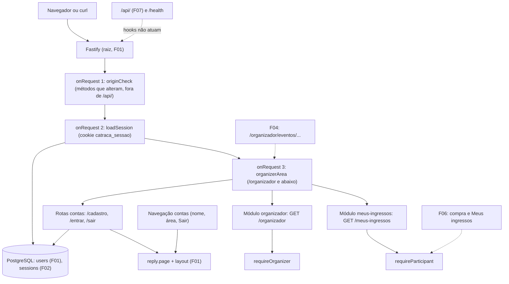

# Spec: F02 — Contas e acesso

## 1. Visão técnica

**O quê.** A F02 dá identidade às pessoas que usam a Catraca: cadastro de participante (`/cadastro`), login de participantes e organizadores (`/entrar`), saída (`/sair`), sessão por cookie assinado guardada no banco (tabela `sessions`), a navegação de conta no topo de todas as páginas e as proteções que as features seguintes usam — a área do organizador (`/organizador` e tudo abaixo) protegida automaticamente e os guardas exportados `requireOrganizer` e `requireParticipant`, com retorno seguro à página de origem depois do login. Para que os critérios sejam verificáveis já nesta wave, a F02 entrega também as páginas mínimas `/organizador` e `/meus-ingressos`, que a F04 e a F06 assumem.

**Por quê.** F04 (gestão de eventos) e F06 (vitrine e Meus ingressos) dependem de saber quem é o usuário e qual o seu papel, sempre a partir do servidor e nunca de um campo de formulário. A proteção por prefixo de caminho faz com que toda rota que a F04, a F08 e a F09 acrescentarem sob `/organizador` já nasça protegida, sem que cada feature precise lembrar de aplicar um guarda. A sessão no banco permite que `Sair` invalide a sessão de verdade (um cookie copiado antes da saída deixa de valer) e que as sessões sobrevivam a reinícios do container.

**Complexidade:** `medium` — vários componentes (hooks globais, cookie assinado, repositórios, páginas, navegação, guardas públicos), 7 rotas HTML, uma tabela nova e uma API pública consumida por duas features de waves seguintes.

### Escopo

**Incluído:**
- Migration da tabela `sessions` (timestamp próprio, depois do `users` da F01).
- Cookie de sessão `catraca_sessao` assinado com HMAC-SHA256 (`SESSION_SECRET` da F01), `HttpOnly`, `SameSite=Lax`, `Path=/`, `Max-Age=43200` (12 h); token aleatório cujo hash SHA-256 é a chave da sessão no banco.
- Hooks globais (módulo `contas`, `loadOrder` 10, envolvido por `fastify-plugin`): checagem de origem para métodos que alteram dados, carregamento da sessão em `request.user`, proteção da área do organizador por prefixo de caminho e `Cache-Control: no-store` em HTML de quem está logado.
- `GET/POST /cadastro`, `GET/POST /entrar`, `POST /sair`, com as mensagens exatas do PRD.
- Contribuição de navegação `contas` no layout da F01 (`Entrar`/`Criar conta` ou nome + link da área + `Sair`).
- API pública para outras features em `app/src/features/contas/public.ts`: tipos `SessionUser`/`Role`, `request.user`, `requireOrganizer`, `requireParticipant`, `currentUser`, `loginPath`, `safeReturnPath`.
- Módulos mínimos `organizador` (`GET /organizador`) e `meus-ingressos` (`GET /meus-ingressos`), assumidos depois pela F04 e pela F06.
- Auxiliar de sessão para os testes das features consumidoras (`app/test/helpers/session.ts`, arquivo novo).
- Testes em `app/test/f02/`.

**Excluído (e quem entrega):**
- Lista de eventos em `/organizador`, páginas `/organizador/eventos/...` e isolamento entre organizadores (R13, parte "cada organizador só vê os próprios eventos"): F04, usando `currentUser(request).id`.
- Ingressos em `/meus-ingressos`, página do evento, botão `Entrar para comprar` e o que o organizador vê na compra: F06, usando `requireParticipant` e `loginPath`.
- Recuperação/troca de senha, edição de perfil, exclusão de conta, login social, verificação de e-mail, 2FA (PRD, Fora de escopo).
- Limite de tentativas de login e bloqueio por força bruta (não pedidos pelo PRD; ver P29).

### Consome (F01)

| Item da F01 | Uso na F02 |
|---|---|
| Módulos em `app/src/features/<nome>/index.ts` com `loadOrder` | Módulo `contas` com `loadOrder` 10; módulos `organizador` e `meus-ingressos` com o padrão |
| `fastify-plugin` e `@fastify/formbody` (já na F01) | Hooks e decorator de request no escopo raiz; leitura dos formulários |
| `reply.page`, `html`/`raw`/`escapeHtml`, `app.layout.addNavContributor` | Todas as páginas, a página 403 e a navegação de conta |
| `app.db`, `withTransaction`, tipos `Db`/`Queryable` | Repositórios de contas e sessões; cadastro numa transação |
| `app.config.sessionSecret` (`SESSION_SECRET`, padrão de desenvolvimento) | Chave do HMAC do cookie |
| Tabela `users` (índice único `users_email_lower_key` em `lower(email)`) e seed (organizador A, organizador B, participante, senha `catraca123`) | Login, cadastro, unicidade do e-mail sem diferenciar maiúsculas |
| `hashPassword`/`verifyPassword` (scrypt), `newId('usr')` | Senhas e IDs das contas novas |
| Runner de migrations (`app/migrations/AAAAMMDDHHMMSS_<nome>.sql`) | Migration `sessions` |
| Infraestrutura de testes (`createTestApp`, `testDb`, `resetDatabase`, `seedAccounts`) | Testes em `app/test/f02/` |
| Handlers 404/500 da raiz | Páginas de erro continuam da F01 (com a navegação de conta) |

### Provê (contratos de saída e pontos de extensão)

| Item provido | Onde | Consumidores |
|---|---|---|
| `request.user: SessionUser \| null` em toda requisição HTML (`null` = visitante); `SessionUser = { id, name, email, role }`, `role` `organizador` ou `participante`, lido do banco a cada requisição | `app/src/features/contas/types.ts`, hook de sessão | F04, F06 |
| Área do organizador protegida automaticamente: qualquer caminho `/organizador` ou `/organizador/...` (inclusive rotas futuras e caminhos sem rota) → visitante `302` para `/entrar`, participante `403` com `Acesso negado` | hook `organizerArea` (5.2) | F04, F08, F09 |
| `requireOrganizer` — guarda `preHandler` com o mesmo comportamento, para uso explícito | `app/src/features/contas/public.ts` | F04 |
| `requireParticipant(options?)` — guarda `preHandler`: visitante → `/entrar?voltar=<origem>`; organizador → `403` ou, com `allowOrganizer`, segue para o handler decidir | `public.ts` | F06 |
| `currentUser(request)` — usuário da sessão (lança erro se usado sem guarda) | `public.ts` | F04, F06 |
| `loginPath(voltar?)` — `/entrar` ou `/entrar?voltar=<caminho codificado>` (para o botão `Entrar para comprar`) | `public.ts` | F06 |
| `safeReturnPath(valor)` — validação do parâmetro de volta contra open redirect | `public.ts` | F06 |
| Página mínima `GET /organizador` com `<h1>Área do organizador</h1>` | `app/src/features/organizador/index.ts` | F04 assume o módulo |
| Página mínima `GET /meus-ingressos` com `<h1>Meus ingressos</h1>`, protegida por `requireParticipant()` | `app/src/features/meus-ingressos/index.ts` | F06 assume o módulo |
| Link da área na navegação (`Meus ingressos` / `Área do organizador`) — as features consumidoras não acrescentam outro | contribuição `contas` | F04, F06 |
| Checagem de origem em todo `POST`/`PUT`/`PATCH`/`DELETE` fora de `/api/` (formulários das features seguintes protegidos sem código extra) | hook `originCheck` (5.2) | F04, F06, F08 |
| Auxiliares de teste `loginAs(app, email, senha?)` e `sessionCookieFor(app, userId)` → valor do cabeçalho `Cookie` | `app/test/helpers/session.ts` | testes da F04, F06, F08, F09 |

**Como a F04 usa:** as rotas sob `/organizador` já estão protegidas pelo hook; a F04 pode declarar `preHandler: requireOrganizer` por clareza (idempotente) e obtém o dono com `currentUser(request).id` — nunca de campo de formulário. Ao assumir o módulo `organizador`, mantém o `<h1>Área do organizador</h1>` e o `requireOrganizer` de `GET /organizador`.

**Como a F06 usa:** a página do evento é pública e escolhe o que mostrar por `request.user` (visitante: link `loginPath('/eventos/<id>')` com o texto `Entrar para comprar`; organizador: `Compras são feitas com uma conta de participante`; participante: formulário). O `POST` de compra usa `requireParticipant({ returnTo: (request) => '/eventos/<id>', allowOrganizer: true })` (sessão expirada no envio volta ao evento sem criar ingresso; o handler trata o organizador). Ao assumir `meus-ingressos`, mantém `requireParticipant()` e o `<h1>Meus ingressos</h1>`.

### Regras e invariantes

- **Regras do brief implementadas:** R13, parte "Participante e visitante não acessam a área de organizador" (F02-CA06). A parte "cada organizador só vê e opera os próprios eventos" é da F04, que usa a identidade provida aqui. Também implementa o "Quem usa" do brief: participante cria a própria conta (nome, e-mail, senha), entra e sai; organizador não se cadastra pelo produto (F02-CA07).
- **Invariantes compartilhadas que a F02 sustenta ou não pode quebrar:**
  - *Isolamento do organizador (R13):* a identidade vem sempre da sessão no servidor (`request.user`, papel lido do banco a cada requisição); nenhum caminho do produto cria organizador; a área `/organizador` inteira exige papel `organizador`.
  - *API de parceiros igual à vitrine:* os hooks da F02 não tocam caminhos `/api/` (nem `/health`): a API da F07 continua autenticada só por `X-Api-Key`, sem sessão e sem checagem de origem.
  - Lotação, cancelamento, receita e respostas tardias do gateway não são afetados (a F02 não tem código de eventos nem de ingressos).
- **Invariantes próprias:** senha só como hash scrypt, nunca em página nem em log; cookie de sessão nunca legível por script (`HttpOnly`) e nunca aceito sem assinatura válida; o parâmetro de volta nunca leva para fora do produto.

### Requisitos (capacidades do PRD → decisões desta spec)

| Capacidade (PRD F02) | Como esta spec atende |
|---|---|
| `/cadastro` cria sempre participante; nome 1–100, e-mail válido e único sem diferenciar maiúsculas, senha ≥ 8; campos extras ignorados | 5.4; papel fixo `'participante'` no SQL; índice `users_email_lower_key` da F01 decide a unicidade (corrida segura) |
| Senhas só como hash, nunca em logs nem em páginas | `hashPassword` da F01; formulários nunca repõem a senha; logs sem corpo de requisição e sem e-mail (5.14) |
| `/entrar` para os dois papéis, mensagem única para e-mail inexistente e senha errada | 5.6; mesmo status, mesma mensagem e verificação de hash também para e-mail inexistente (tempo parecido) |
| Sessão por cookie assinado, `HttpOnly`, 12 h; `Sair` encerra | 5.1 e 5.7; sessão no banco, apagada no `Sair` |
| Área do organizador: visitante → `/entrar`; participante → `403` `Acesso negado` | Hook por prefixo (5.2) + `requireOrganizer` |
| Páginas de participante: visitante → `/entrar` e volta à origem | `requireParticipant` + `voltar` validado (5.12, 5.13) |
| Topo de todas as páginas: `Entrar`/`Criar conta` ou nome, link da área e `Sair` | Contribuição de navegação `contas` (5.11), presente também nas páginas 404/500 da F01 |
| Erros acima do formulário, mantendo nome e e-mail, nunca a senha | `reply.page({ messages })` da F01 (mensagens antes do conteúdo) e valores repostos escapados |
| Sessão expirada ou cookie adulterado = visitante | Hook de sessão limpa o cookie e segue como visitante (5.2) |

### Fluxos (experiência do PRD)

1. **Cadastro:** visitante abre `/cadastro` (Nome, E-mail, Senha) → envia → conta `participante` criada e sessão aberta na mesma transação → `302` para `/` → a navegação mostra o nome, `Meus ingressos` e `Sair`.
2. **Login do organizador:** `/entrar` → e-mail e senha da seed → `302` para `/organizador` (sempre, mesmo com `voltar`).
3. **Login do participante:** `/entrar` (ou `/entrar?voltar=/meus-ingressos`, vindo de uma página protegida) → `302` para o `voltar` válido ou para `/`.
4. **Erro:** a página do formulário volta com status `422`, a mensagem acima do formulário e os campos nome/e-mail preenchidos.
5. **Sair:** botão `Sair` (formulário `POST /sair`) → sessão apagada no banco, cookie limpo, `302` para `/`.
6. **Acesso negado:** participante em `/organizador...` → página `403` `Acesso negado`; visitante → `302` para `/entrar`.

## 2. Impacto na arquitetura

Arquivos novos (nenhum arquivo existente da F01 é editado no código da aplicação):

```
app/
├── migrations/<AAAAMMDDHHMMSS>_create_sessions.sql   # timestamp gerado na implementação, > 20261125120000
├── src/features/
│   ├── contas/
│   │   ├── index.ts         # plugin (fastify-plugin), loadOrder 10: decorator, hooks, navegação, rotas
│   │   ├── public.ts        # API pública para F04/F06 (reexporta tipos e guardas)
│   │   ├── types.ts         # SessionUser, Role, augmentation de FastifyRequest.user
│   │   ├── cookie.ts        # leitura, assinatura e cabeçalhos do cookie
│   │   ├── sessions.ts      # SQL de sessões
│   │   ├── users.ts         # SQL de contas (login e cadastro)
│   │   ├── validation.ts    # regras e mensagens do cadastro e do login
│   │   ├── return-path.ts   # safeReturnPath e loginPath
│   │   ├── guards.ts        # hooks globais e guardas exportados
│   │   ├── pages.ts         # HTML dos formulários, 403, navegação
│   │   └── routes.ts        # /cadastro, /entrar, /sair
│   ├── organizador/index.ts       # GET /organizador mínima (F04 assume)
│   └── meus-ingressos/index.ts    # GET /meus-ingressos mínima (F06 assume)
└── test/
    ├── helpers/session.ts         # loginAs, sessionCookieFor (para testes das consumidoras)
    └── f02/                       # testes da F02 (seção 7) e fixtures
```

Documentação (fase final, acréscimos pontuais): `AGENTS.md`, `README.md`, `docs/state.json` (só a entrada F02), seção 10 desta spec.



### Paralelismo (Wave 2: F02 ‖ F03)

- A F02 cria só os arquivos listados acima. Não edita `app/package.json`, `app/package-lock.json`, `app/src/app.ts`, `app/src/config.ts`, `app/src/core/*`, `app/src/db/*`, `compose*.yaml`, `scripts/` nem nada de `app/src/features/gateway/` ou `app/test/f03/` (da F03).
- Nenhuma dependência npm nova (cookie e HMAC com `node:crypto`), justamente para não disputar o lockfile com a F03.
- Nenhuma variável de ambiente nova (usa `SESSION_SECRET`, que a F01 já definiu).
- A migration tem timestamp gerado na implementação (`date -u +%Y%m%d%H%M%S`); o runner da F01 aplica pendentes fora de ordem, então a ordem relativa à migration da F03 não importa (não há dependência entre elas).
- Nenhum item do contrato depende da F03.
- Documentação compartilhada: só acréscimos de linhas em seções específicas (5.15), para reduzir conflitos de merge com a F03.

## 3. Decisões técnicas

| Decisão | Abordagem escolhida | Alternativa considerada | Trade-off |
|---|---|---|---|
| Onde vive a sessão | Tabela `sessions` (hash SHA-256 do token como chave, `expires_at`), cookie assinado só com o token | Cookie autocontido assinado (id + expiração no próprio cookie) | Uma consulta por requisição com cookie, em troca de `Sair` invalidar de verdade, sessões que sobrevivem a reinícios e papel sempre lido do banco |
| Cookie e assinatura | Código próprio com `node:crypto` (HMAC-SHA256, `timingSafeEqual`) e leitura do cabeçalho `Cookie` | `@fastify/cookie` | ~60 linhas nossas e testadas, em troca de não editar `package.json`/lockfile na wave paralela |
| CSRF | `SameSite=Lax` + checagem de origem (`Origin` diferente do `Host`, `Origin: null` ou `Sec-Fetch-Site: cross-site` → `403`) em métodos que alteram dados, fora de `/api/` | Token CSRF por formulário | Sem campo oculto em cada formulário das features seguintes; depende de navegadores modernos enviarem `Origin`/`Sec-Fetch-Site` (todos os atuais enviam) e de `SameSite=Lax` |
| Proteção da área do organizador | Hook global por prefixo de caminho (decodificado) e pelo padrão da rota casada, mais o guarda `requireOrganizer` exportado | Só guardas por rota | Uma regra central que cobre rotas futuras e caminhos sem rota; as features não podem "esquecer" o guarda |
| Retorno depois do login | Parâmetro `voltar` com caminho local validado (`safeReturnPath`), carregado em campo oculto no formulário | Guardar a origem na sessão ou em cookie | Sem estado extra; a validação estrita elimina open redirect |
| Páginas `/organizador` e `/meus-ingressos` | Módulos mínimos da F02, assumidos pela F04 e pela F06 (mesmo padrão da vitrine provisória da F01) | Esperar F04/F06 | F02-CA04/CA05/CA06 verificáveis já na Wave 2; as consumidoras substituem só o conteúdo |
| Igualdade de tempo no login | `verifyPassword` contra um hash fixo quando o e-mail não existe | Responder logo | ~50 ms a mais em login com e-mail inexistente, em troca de não revelar quais e-mails existem pelo tempo |

## 4. Componentes

**Módulo `contas` (`app/src/features/contas/`):**

| Arquivo | Novo/Modificado | Propósito | Responsabilidades |
|---|---|---|---|
| `index.ts` | Novo | Plugin da feature | `export const loadOrder = 10`; `default` envolvido por `fastify-plugin` (nome `contas`): `decorateRequest('user', null)`; calcula o hash fixo de 5.6 uma vez; registra os hooks `onRequest` na ordem `originCheck` → `loadSession` → `organizerArea` e o `onSend` `noStoreWhenLoggedIn`; registra a contribuição de navegação; registra as rotas de `routes.ts` |
| `types.ts` | Novo | Tipos | `Role = 'organizador' \| 'participante'`; `SessionUser = { id: string; name: string; email: string; role: Role }`; `declare module 'fastify' { interface FastifyRequest { user: SessionUser \| null } }` |
| `public.ts` | Novo | API pública (única porta de entrada para outras features) | Reexporta `SessionUser`, `Role`, `requireOrganizer`, `requireParticipant`, `RequireParticipantOptions`, `currentUser`, `loginPath`, `safeReturnPath`, `SESSION_COOKIE_NAME` (5.12) |
| `cookie.ts` | Novo | Cookie de sessão | `SESSION_COOKIE_NAME = 'catraca_sessao'`, `SESSION_MAX_AGE_SECONDS = 43200`; `newSessionToken()`; `signToken(token, secret)`; `verifySignedValue(valor, secret) → token \| null`; `readCookie(cabeçalho, nome)`; `sessionCookieHeader(valor)`; `clearSessionCookieHeader()` (5.1) |
| `sessions.ts` | Novo | SQL de sessões | `createSession(db, userId) → token`; `findSessionUser(db, token) → SessionUser \| null`; `deleteSession(db, token)`; `deleteExpiredSessions(db)`; o token só circula em memória — o banco guarda `sha256(token)` em hex (seção 6) |
| `users.ts` | Novo | SQL de contas | `findUserForLogin(db, email) → { user: SessionUser, passwordHash } \| null` (busca por `lower(email)`); `insertParticipant(client, { name, email, passwordHash }) → SessionUser` com papel literal `'participante'` no SQL; converte violação de `users_email_lower_key` (código `23505`) em `EmailAlreadyRegisteredError` |
| `validation.ts` | Novo | Regras dos formulários | `validateSignup(body)` → valores normalizados ou lista de mensagens na ordem Nome, E-mail, Senha; `readLoginForm(body)` → `{ email, password, voltar }`; campo ausente ou não-texto (ex.: repetido) vale texto vazio (5.4, 5.6) |
| `return-path.ts` | Novo | Volta segura | `safeReturnPath(valor)`; `loginPath(voltar?)` (5.13) |
| `guards.ts` | Novo | Proteções | Hooks `originCheck`, `loadSession`, `organizerArea`, `noStoreWhenLoggedIn`; `isOrganizerAreaRequest(request)`; guardas `requireOrganizer`, `requireParticipant`; `currentUser`; páginas 403 via `pages.ts` (5.2, 5.10, 5.12) |
| `pages.ts` | Novo | HTML | `signupContent`, `loginContent`, `forbiddenContent('organizador' \| 'participante')`, `originBlockedContent`, `navContribution(user)`; tudo com `html` da F01 (valores escapados) (5.3–5.11) |
| `routes.ts` | Novo | Rotas | `GET/POST /cadastro`, `GET/POST /entrar`, `POST /sair` (5.3–5.7) |

**Módulos mínimos assumidos por outras features:**

| Arquivo | Novo/Modificado | Propósito | Responsabilidades |
|---|---|---|---|
| `app/src/features/organizador/index.ts` | Novo | `GET /organizador` | `preHandler: requireOrganizer`; `reply.page` com título `Área do organizador` (5.8). A F04 assume o módulo e troca o conteúdo pela lista de eventos |
| `app/src/features/meus-ingressos/index.ts` | Novo | `GET /meus-ingressos` | `preHandler: requireParticipant()`; `reply.page` com título `Meus ingressos` (5.9). A F06 assume o módulo e troca o conteúdo pelos ingressos |

**Banco:**

| Migration | Tabelas | Operação | Notas |
|---|---|---|---|
| `app/migrations/<AAAAMMDDHHMMSS>_create_sessions.sql` | `sessions` | CREATE | Timestamp gerado com `date -u +%Y%m%d%H%M%S` na implementação; precisa ser maior que `20261125120000` (FK para `users`) |

**Testes:**

| Arquivo | Novo/Modificado | Propósito |
|---|---|---|
| `app/test/helpers/session.ts` | Novo (arquivo novo na pasta de auxiliares da F01; nenhum auxiliar existente é editado) | `loginAs(app, email, senha = 'catraca123') → Promise<string>` (faz `POST /entrar` por `inject`, exige `302` e devolve `catraca_sessao=<valor>` para o cabeçalho `Cookie`); `sessionCookieFor(app, userId) → Promise<string>` (cria a sessão direto no banco e assina com `app.config.sessionSecret`) |
| `app/test/f02/*.test.ts` | Novo | Seção 7 |
| `app/test/f02/fixtures/features/contas/index.ts` | Novo | Reexporta `default` e `loadOrder` do módulo real (para apps de teste com pasta de módulos própria) |
| `app/test/f02/fixtures/features/rotas-teste/index.ts` | Novo | Rotas fora da área do organizador usando `requireOrganizer`, `requireParticipant()` com e sem opções e `currentUser`, e um `POST` simples para a checagem de origem |

**Documentação:** ver 5.15.

## 5. Contratos de API e interfaces

Todas as páginas são HTML (`text/html; charset=utf-8`) renderizadas por `reply.page` da F01. Formulários usam `application/x-www-form-urlencoded`. Redirecionamentos usam `302` com `location` relativo. Nomes de campo dos formulários em pt-BR (`nome`, `email`, `senha`, `voltar`).

### 5.1 Cookie de sessão

| Aspecto | Definição |
|---|---|
| Nome | `catraca_sessao` |
| Valor | `<token>.<assinatura>`: `token` = 32 bytes aleatórios em base64url sem padding (43 caracteres); `assinatura` = HMAC-SHA256(`SESSION_SECRET`, `token`) em base64url sem padding (43 caracteres); total 87 caracteres, formato `^[A-Za-z0-9_-]{43}\.[A-Za-z0-9_-]{43}$` |
| Ao criar | `Set-Cookie: catraca_sessao=<valor>; Max-Age=43200; Path=/; HttpOnly; SameSite=Lax` (exatamente estes atributos, nesta ordem; sem `Secure`, ver P04) |
| Ao limpar | `Set-Cookie: catraca_sessao=; Max-Age=0; Path=/; HttpOnly; SameSite=Lax` |
| Validade | 12 h absolutas a partir do login/cadastro (`expires_at = now() + interval '12 hours'` no banco, `Max-Age=43200` no navegador); sem renovação deslizante |
| Verificação | Formato → assinatura com `timingSafeEqual` → `sha256(token)` encontrado em `sessions` com `expires_at > now()` → usuário. Qualquer falha = visitante |
| Leitura do cabeçalho | Separar por `;`, nome antes do primeiro `=`, espaços nas pontas removidos; aspas duplas envolventes removidas; havendo mais de um `catraca_sessao`, vale o primeiro |

Trocar o `SESSION_SECRET` invalida todas as sessões (assinatura deixa de conferir); isso é registrado no README.

### 5.2 Hooks globais (módulo `contas`)

Registrados no escopo raiz (via `fastify-plugin`) e por isso aplicados a todas as rotas de todos os módulos e também ao handler 404 da F01. Ordem de execução em `onRequest`:

| # | Hook | Quando atua | Comportamento |
|---|---|---|---|
| 1 | `originCheck` | Método ∉ {`GET`, `HEAD`, `OPTIONS`} e caminho não começa com `/api/` | Bloqueia com `403` (página 5.10, "Requisição bloqueada") se `Sec-Fetch-Site` = `cross-site`, ou se `Origin` está presente e é `null`, inválido ou com `host` (hostname:porta) diferente do cabeçalho `Host`. Sem `Origin` e sem `Sec-Fetch-Site: cross-site` (ex.: `curl`) → segue. Registra `contas: requisição bloqueada por origem` (nível `warn`, com o `origin`) |
| 2 | `loadSession` | Caminho não começa com `/api/` e não é `/health` | `request.user = null`; sem cookie → visitante; com cookie: verificação de 5.1; inválido, adulterado, expirado ou inexistente no banco → acrescenta o cabeçalho de limpeza de 5.1 e segue como visitante (log `contas: cookie de sessão descartado`, nível `debug`); válido → `request.user` com id, nome, e-mail e papel atuais do banco |
| 3 | `organizerArea` | Requisição da área do organizador (abaixo) | Visitante → `302` `location: /entrar` (sem `voltar`, qualquer método); participante → `403` (página 5.10, organizador); organizador → segue |

**Requisição da área do organizador** (`isOrganizerAreaRequest`): o caminho sem query, decodificado com `decodeURIComponent` (se a decodificação falhar, usa o caminho cru), é `/organizador` ou começa com `/organizador/`; **ou** o padrão da rota casada (`request.routeOptions.url`) é `/organizador` ou começa com `/organizador/`. Assim `/organizador`, `/organizador/`, `/organizador/eventos/novo` (antes de existir), `/organizador/eventos/evt_x/checkin` e `/%6Frganizador` são todos protegidos. `/organizadores` não é.

`onSend` `noStoreWhenLoggedIn`: se `request.user` não é `null`, a resposta é `text/html` e não tem `cache-control`, define `cache-control: no-store` (o botão "voltar" do navegador não reexibe páginas de conta depois do `Sair`).

### 5.3 `GET /cadastro`

- **Autenticação:** nenhuma. Logado → `302` para `/organizador` (organizador) ou `/` (participante).
- **Resposta:** `200`, título `Criar conta`. Conteúdo (ordem fixa):
  - `<h1>Criar conta</h1>`
  - `<form method="post" action="/cadastro">` com, nesta ordem: `<label for="nome">Nome</label>` + `<input id="nome" name="nome" type="text" value="<nome>" autocomplete="name">`; `<label for="email">E-mail</label>` + `<input id="email" name="email" type="text" inputmode="email" value="<email>" autocomplete="email">`; `<label for="senha">Senha</label>` + `<input id="senha" name="senha" type="password" autocomplete="new-password">` (nunca com `value`); `<button type="submit">Criar conta</button>`.
  - `<p>Já tem conta? <a href="/entrar">Entrar</a></p>`
- Sem atributos de validação do navegador (`required`, `minlength`, `type="email"`): as mensagens do servidor são sempre as exibidas (P13).

### 5.4 `POST /cadastro`

**Requisição:**

| Campo | Tipo | Obrigatório | Validação (na ordem) | Mensagem |
|---|---|---|---|---|
| `nome` | texto | Sim | Espaços das pontas removidos; vazio → erro; mais de 100 caracteres (contados por ponto de código) → erro | `Informe o nome`; `O nome pode ter no máximo 100 caracteres` |
| `email` | texto | Sim | Espaços das pontas removidos; precisa casar com `^[^\s@]+@[^\s@]+\.[^\s@]+$` e ter no máximo 254 caracteres; vazio também é inválido | `Informe um e-mail válido` |
| `senha` | texto | Sim | Sem remover espaços; menos de 8 caracteres → erro; sem máximo | `A senha precisa ter pelo menos 8 caracteres` |
| qualquer outro (`papel`, `role`, `voltar`...) | — | — | Ignorado | — |

**Processamento:** (1) valida todos os campos e junta as mensagens na ordem Nome, E-mail, Senha; havendo alguma, responde o erro sem consultar o banco. (2) `hashPassword(senha)`. (3) `withTransaction`: `insertParticipant` (papel literal `participante`) e `createSession`. (4) Violação de `users_email_lower_key` → `E-mail já cadastrado` (inclusive na corrida entre dois cadastros simultâneos). (5) Se a requisição tinha sessão válida, ela é apagada. (6) Limpa sessões expiradas (`deleteExpiredSessions`).

| Situação | Status | Cabeçalhos | Corpo |
|---|---|---|---|
| Sucesso | `302` | `location: /`; `set-cookie` de criação (5.1) | — |
| Erro de validação ou e-mail já usado | `422` | sem `set-cookie` de sessão | Página `Criar conta` com cada mensagem em `reply.page({ messages: [{ kind: 'error', text }] })` (aparecem antes do `<h1>` e do formulário), `nome` e `email` repostos como digitados (escapados), senha vazia |

Exemplo:

```
POST /cadastro
Content-Type: application/x-www-form-urlencoded

nome=Ana+Souza&email=ana%40example.com&senha=segredo123&papel=organizador

302
location: /
set-cookie: catraca_sessao=Q2x...43 caracteres...k0.mE1...43 caracteres...Zw; Max-Age=43200; Path=/; HttpOnly; SameSite=Lax
```

A conta criada tem `role = 'participante'`; o campo `papel` foi ignorado.

### 5.5 `GET /entrar`

- **Query:** `voltar` (opcional) — validado por `safeReturnPath`; inválido é descartado em silêncio.
- **Logado:** organizador → `302` `/organizador`; participante → `302` para o `voltar` válido ou `/`.
- **Resposta (visitante):** `200`, título `Entrar`. Conteúdo: `<h1>Entrar</h1>`; `<form method="post" action="/entrar">` com `<label for="email">E-mail</label>` + `<input id="email" name="email" type="text" inputmode="email" value="<email>" autocomplete="username">`, `<label for="senha">Senha</label>` + `<input id="senha" name="senha" type="password" autocomplete="current-password">`, e, só quando há `voltar` válido, `<input type="hidden" name="voltar" value="<voltar>">`; `<button type="submit">Entrar</button>`; `<p>Não tem conta? <a href="/cadastro">Criar conta</a></p>`.

### 5.6 `POST /entrar`

**Requisição:** `email` (espaços das pontas removidos; comparado sem diferenciar maiúsculas), `senha` (como digitada), `voltar` (opcional).

**Processamento:** (1) `email` ou `senha` vazios → erro. (2) `findUserForLogin`; existe → `verifyPassword(senha, hash)`; não existe → `verifyPassword(senha, HASH_FIXO)` e resultado falso (`HASH_FIXO` = `hashPassword` de um texto aleatório, calculado uma vez no registro do plugin). (3) Falha → erro. (4) Sucesso → apaga a sessão anterior da requisição, se houver; `deleteExpiredSessions`; `createSession`; cookie; log `contas: sessão criada` com `userId` e `role`.

| Situação | Status | Cabeçalhos | Corpo |
|---|---|---|---|
| Organizador | `302` | `location: /organizador` (ignora `voltar`); `set-cookie` de criação | — |
| Participante | `302` | `location:` `safeReturnPath(voltar)` ou `/`; `set-cookie` de criação | — |
| E-mail inexistente, senha errada ou campo vazio | `422` | sem `set-cookie` de sessão | Página `Entrar` com a mensagem única `E-mail ou senha inválidos` antes do formulário, `email` reposto (escapado), senha vazia, `voltar` válido mantido no campo oculto |

### 5.7 `POST /sair`

- **Autenticação:** nenhuma exigida (idempotente). Sujeito ao `originCheck`.
- **Processamento:** se o cookie tem assinatura válida, apaga a linha da sessão (`deleteSession`), mesmo que expirada; log `contas: sessão encerrada` com `userId` quando havia usuário.
- **Resposta:** sempre `302`, `location: /`, `set-cookie` de limpeza (5.1). `GET /sair` não existe (404 da F01).

### 5.8 `GET /organizador` (página mínima)

- **Proteção:** hook `organizerArea` + `preHandler: requireOrganizer`.
- **Resposta (organizador):** `200`, título `Área do organizador`, conteúdo `<h1>Área do organizador</h1><p>Os seus eventos vão aparecer aqui.</p>`.
- **Dono futuro:** F04 (lista de eventos e `Novo evento`), mantendo o `<h1>` e o guarda.

### 5.9 `GET /meus-ingressos` (página mínima)

- **Proteção:** `preHandler: requireParticipant()` (visitante → `302` `location: /entrar?voltar=%2Fmeus-ingressos`; organizador → `403` de 5.10, até a F06 decidir outra coisa).
- **Resposta (participante):** `200`, título `Meus ingressos`, conteúdo `<h1>Meus ingressos</h1><p>Você ainda não tem ingressos.</p>`.
- **Dono futuro:** F06, mantendo o `<h1>` e o guarda.

### 5.10 Páginas de bloqueio

| Caso | Status | Título | Conteúdo |
|---|---|---|---|
| Participante na área do organizador (hook ou `requireOrganizer`) | `403` | `Acesso negado` | `<h1>Acesso negado</h1><p>Esta área é exclusiva para organizadores.</p>` |
| Organizador em página de participante (`requireParticipant` sem `allowOrganizer`) | `403` | `Acesso negado` | `<h1>Acesso negado</h1><p>Esta página é exclusiva para participantes.</p>` |
| Origem não permitida (`originCheck`) | `403` | `Requisição bloqueada` | `<h1>Requisição bloqueada</h1><p>Origem da requisição não permitida.</p>` |

Nenhuma delas mostra dado de evento ou de outra conta; a navegação mostra o usuário logado normalmente.

### 5.11 Navegação

Contribuição `app.layout.addNavContributor({ name: 'contas', order: 1000, render })` (vem depois de qualquer outra contribuição). HTML exato devolvido por `render(request)`:

| Situação | HTML |
|---|---|
| Visitante | `<span class="nav-conta"><a href="/entrar">Entrar</a> <a href="/cadastro">Criar conta</a></span>` |
| Participante | `<span class="nav-conta"><span class="nav-usuario">{nome}</span> <a href="/meus-ingressos">Meus ingressos</a> <form method="post" action="/sair" style="display:inline"><button type="submit">Sair</button></form></span>` |
| Organizador | igual ao participante, com `<a href="/organizador">Área do organizador</a>` no lugar do link `Meus ingressos` |

`{nome}` é escapado. As features consumidoras não acrescentam outro link para a própria área.

### 5.12 API pública para outras features (`app/src/features/contas/public.ts`)

| Export | Assinatura | Comportamento |
|---|---|---|
| `SessionUser`, `Role` | tipos de 4 | — |
| `request.user` | `SessionUser \| null` | Definido pelo hook em toda requisição HTML; `null` para visitante e em `/api/` e `/health` |
| `requireOrganizer` | função `preHandler` (`(request, reply) => Promise<void>`), usada como `{ preHandler: requireOrganizer }` | Visitante → `302` `/entrar`; participante → `403` (5.10, organizador); organizador → segue |
| `requireParticipant(options?)` | `(options?: { returnTo?: (request: FastifyRequest) => string; allowOrganizer?: boolean }) => preHandler` | Visitante → `302` para `loginPath(destino)`, sendo destino `returnTo(request)` se informado, senão `request.url` em `GET`/`HEAD`, senão nenhum (`/entrar`); organizador → `403` (5.10, participante), ou segue quando `allowOrganizer: true`; participante → segue |
| `currentUser(request)` | `(request: FastifyRequest) => SessionUser` | Devolve `request.user`; se `null`, lança `Error('currentUser sem sessão: use requireOrganizer ou requireParticipant na rota')` (vira `500` da F01 — erro de programação) |
| `loginPath(voltar?)` | `(voltar?: string) => string` | `/entrar` se `voltar` ausente ou inválido; senão `/entrar?voltar=` + `encodeURIComponent(safeReturnPath(voltar))` (ex.: `/eventos/evt_ab12` → `/entrar?voltar=%2Feventos%2Fevt_ab12`) |
| `safeReturnPath(valor)` | `(valor: unknown) => string \| null` | 5.13 |
| `SESSION_COOKIE_NAME` | `'catraca_sessao'` | Para testes |

Nenhuma outra feature importa de `contas/` fora de `public.ts` (os testes podem importar internos).

### 5.13 Validação do `voltar` (`safeReturnPath`)

Devolve o caminho local seguro ou `null`. Regras, na ordem:
1. Precisa ser texto com 1 a 2048 caracteres.
2. Sem caracteres de controle (U+0000–U+001F, U+007F) e sem `\` em nenhuma posição (navegadores tratam `\` como `/` e descartam tabulação e quebra de linha, o que transformaria `/\host` ou `/<TAB>/host` em `//host`).
3. Precisa começar com `/` e o segundo caractere não pode ser `/`.
4. `new URL(valor, 'http://catraca.invalid')` precisa ter origem `http://catraca.invalid`; o resultado é `pathname + search` (sem `#`).
5. Destinos de conta não são aceitos: caminho igual a `/entrar`, `/cadastro` ou `/sair` (ou começando com eles seguidos de `/` ou `?`) → `null`.

Exemplos: `/meus-ingressos` → `/meus-ingressos`; `/eventos/evt_ab12?x=1` → `/eventos/evt_ab12?x=1`; `https://evil.example/`, `//evil.example/x`, `/\evil.example`, `/<TAB>/evil.example`, `javascript:alert(1)`, `http:/evil.example`, `evil`, `/entrar` → `null`.

### 5.14 Logs

Mensagens com prefixo `contas:` pelo logger do Fastify (`request.log`), nunca com senha, hash, token, cookie nem e-mail; só `userId`/`role` quando há usuário:

| Evento | Nível | Mensagem |
|---|---|---|
| Cadastro concluído | `info` | `contas: conta criada` (`userId`) |
| Login concluído | `info` | `contas: sessão criada` (`userId`, `role`) |
| Login recusado | `info` | `contas: login recusado` |
| Saída | `info` | `contas: sessão encerrada` (`userId`, se havia) |
| Cookie descartado | `debug` | `contas: cookie de sessão descartado` (motivo: `assinatura`, `formato`, `expirada_ou_inexistente`) |
| Origem bloqueada | `warn` | `contas: requisição bloqueada por origem` (`origin`, `secFetchSite`) |

O logger padrão do Fastify não registra corpo nem cabeçalhos da requisição; nenhum handler da F02 registra `request.body`.

### 5.15 Documentação (fase final)

| Arquivo | Mudança (só acréscimos) |
|---|---|
| `README.md` | Em `## Credenciais`: linha "Entrar em `$WEB/entrar`; novas contas de participante em `$WEB/cadastro` (organizador não se cadastra)". Em `## Variáveis de ambiente`: nota de que trocar `SESSION_SECRET` encerra todas as sessões. Em `## Decisões`: uma linha sobre sessão (cookie assinado `HttpOnly`/`SameSite=Lax` + tabela `sessions`) e proteção da área do organizador |
| `AGENTS.md` | Em "Convenções de código": linha "Sessão e acesso: importe só de `app/src/features/contas/public.ts` (`request.user`, `requireOrganizer`, `requireParticipant`, `currentUser`, `loginPath`); tudo sob `/organizador` já é protegido; nos testes, `loginAs`/`sessionCookieFor` de `app/test/helpers/session.ts`" |

## 6. Modelo de dados

**Tabela `users`:** sem mudança (criada pela F01). A F02 só insere contas com `role = 'participante'` e lê por `lower(email)` (índice `users_email_lower_key`).

**Tabela: `sessions`**

| Coluna | Tipo | Nulo | Padrão | Descrição |
|---|---|---|---|---|
| `token_hash` | `text` | Não | — | SHA-256 do token do cookie, em hex minúsculo (64 caracteres); chave primária. O token em si nunca é gravado |
| `user_id` | `text` | Não | — | Dono da sessão (`users.id`) |
| `created_at` | `timestamptz` | Não | `now()` | Login ou cadastro |
| `expires_at` | `timestamptz` | Não | — | `now() + interval '12 hours'` na criação |

**Índices e restrições:**

| Nome | Tipo | Definição | Propósito |
|---|---|---|---|
| `sessions_pkey` | PRIMARY KEY | `token_hash` | Busca da sessão a cada requisição |
| `sessions_token_hash_format` | CHECK | `token_hash ~ '^[0-9a-f]{64}$'` | Garante que só hashes são gravados |
| `sessions_user_id_fkey` | FOREIGN KEY | `user_id REFERENCES users (id) ON DELETE CASCADE` | Integridade; apagar conta (fora de escopo) não deixa sessão órfã |
| `sessions_user_id_idx` | INDEX | `user_id` | Consultas por usuário (testes, diagnóstico) |
| `sessions_expires_at_idx` | INDEX | `expires_at` | Limpeza de expiradas |

**Migration `app/migrations/<AAAAMMDDHHMMSS>_create_sessions.sql`:**

```sql
CREATE TABLE sessions (
    token_hash text        PRIMARY KEY,
    user_id    text        NOT NULL REFERENCES users (id) ON DELETE CASCADE,
    created_at timestamptz NOT NULL DEFAULT now(),
    expires_at timestamptz NOT NULL,
    CONSTRAINT sessions_token_hash_format CHECK (token_hash ~ '^[0-9a-f]{64}$')
);

CREATE INDEX sessions_user_id_idx ON sessions (user_id);
CREATE INDEX sessions_expires_at_idx ON sessions (expires_at);
```

**Consultas (SQL explícito, parâmetros posicionais):**

| Função | SQL |
|---|---|
| `createSession` | `INSERT INTO sessions (token_hash, user_id, expires_at) VALUES ($1, $2, now() + interval '12 hours')` |
| `findSessionUser` | `SELECT u.id, u.name, u.email, u.role FROM sessions s JOIN users u ON u.id = s.user_id WHERE s.token_hash = $1 AND s.expires_at > now()` |
| `deleteSession` | `DELETE FROM sessions WHERE token_hash = $1` |
| `deleteExpiredSessions` | `DELETE FROM sessions WHERE expires_at <= now()` |
| `findUserForLogin` | `SELECT id, name, email, role, password_hash FROM users WHERE lower(email) = lower($1)` |
| `insertParticipant` | `INSERT INTO users (id, name, email, password_hash, role) VALUES ($1, $2, $3, $4, 'participante') RETURNING id, name, email, role` |

A seed da F01 preserva o `id` das contas a cada subida, então as sessões continuam válidas depois de `npm run down`/`npm run up` (o volume é preservado). O `resetDatabase` dos testes já trunca `sessions` (todas as tabelas de `public`).

## 7. Estratégia de testes

Testes de integração com `createTestApp` + `app.inject()` (banco `catraca_test` dos gates); unitários para cookie e `voltar`. Cada teste ligado a critério leva o ID no nome. Arquivos em `app/test/f02/`.

**`cookie.test.ts`** (unidade)

| Teste | Asserções |
|---|---|
| `assina o token e confere com o mesmo segredo` | `verifySignedValue(signToken(t, s), s) === t`; valor com 87 caracteres no formato de 5.1 |
| `rejeita assinatura alterada, valor sem assinatura, formato inválido e outro segredo` | `null` nos quatro casos, sem lançar |
| `lê o cookie certo entre vários e ignora espaços e aspas` | `a=1; catraca_sessao="x.y" ; b=2` → `x.y` |
| `cabeçalho de criação tem Max-Age=43200, Path=/, HttpOnly, SameSite=Lax e não tem Secure` | texto exato de 5.1 |
| `cabeçalho de limpeza tem valor vazio e Max-Age=0` | texto exato de 5.1 |

**`retorno.test.ts`** (unidade)

| Teste | Asserções |
|---|---|
| `aceita caminho local com query e descarta o fragmento` | `/eventos/evt_ab12?x=1#y` → `/eventos/evt_ab12?x=1` |
| `rejeita URL absoluta, //host, /\host, controle, javascript: e http:/host` | todos `null` |
| `rejeita /entrar, /cadastro e /sair como destino` | `null` |
| `rejeita vazio, não texto e mais de 2048 caracteres` | `null` |
| `loginPath codifica o voltar e ignora voltar inválido` | `/entrar?voltar=%2Fmeus-ingressos`; `/entrar` |

**`cadastro.test.ts`** (integração)

| Teste | Asserções |
|---|---|
| `F02-CA01 cadastro válido cria participante, abre sessão e redireciona para /` | `302`, `location: /`, `set-cookie` de 5.1; linha em `users` com `role = participante`; 1 linha em `sessions` |
| `F02-CA01 depois do cadastro o topo mostra o nome, Meus ingressos e Sair` | `GET /` com o cookie: HTML de 5.11 (participante) com o nome |
| `F02-CA01 senha de exatamente 8 caracteres é aceita` | `302` |
| `F02-CA01 senha guardada como hash scrypt e ausente da resposta` | `password_hash` começa com `scrypt$` e não contém a senha; nenhuma resposta contém a senha |
| `F02-CA02 e-mail da seed com outras maiúsculas é rejeitado com E-mail já cadastrado` | `PARTICIPANTE@catraca.test` e `Organizador.A@Catraca.Test` → `422`, mensagem exata, sem `set-cookie`; contagem de contas inalterada |
| `F02-CA02 cadastros simultâneos com o mesmo e-mail criam uma única conta` | `Promise.all` de 5 cadastros: 1 × `302`, 4 × `422` `E-mail já cadastrado`; 1 linha |
| `F02-CA03 senha de 7 caracteres é rejeitada` | `422`, `A senha precisa ter pelo menos 8 caracteres`, nenhuma conta |
| `F02-CA03 e-mail mal formado é rejeitado` | `nao-e-um-email`, `a@b`, `a b@c.d` → `Informe um e-mail válido` |
| `F02-CA03 nome vazio ou só com espaços é rejeitado` | `Informe o nome` |
| `nome com mais de 100 caracteres é rejeitado` | `O nome pode ter no máximo 100 caracteres` |
| `erros aparecem antes do formulário na ordem dos campos e mantêm nome e e-mail, nunca a senha` | posições no HTML; `value` repostos; senha ausente |
| `F02-CA07 campos extras papel e role não criam organizador` | `papel=organizador&role=organizador` → `role = participante`; `location: /`; `GET /organizador` → `403` |
| `nome com HTML aparece escapado no topo` | `<b>Zé</b>` → `&lt;b&gt;Zé&lt;/b&gt;` |
| `GET /cadastro com sessão redireciona para a área do usuário` | participante → `/`; organizador → `/organizador` |

**`login.test.ts`**

| Teste | Asserções |
|---|---|
| `F02-CA04 organizador A da seed vai para /organizador` | `302`, `location: /organizador`, `set-cookie` |
| `F02-CA04 participante da seed vai para a vitrine` | `302`, `location: /` |
| `F02-CA04 senha errada e e-mail inexistente mostram a mesma mensagem` | os dois `422` com `E-mail ou senha inválidos`; nenhuma outra mensagem de erro; sem `set-cookie` |
| `campos vazios mostram a mesma mensagem` | `422`, `E-mail ou senha inválidos` |
| `e-mail é comparado sem diferenciar maiúsculas e sem espaços nas pontas` | ` ORGANIZADOR.A@CATRACA.TEST ` → `302` `/organizador` |
| `participante volta ao voltar válido e organizador ignora o voltar` | `/meus-ingressos` → `location: /meus-ingressos`; organizador → `/organizador` |
| `voltar malicioso leva à vitrine` | cada valor rejeitado em 5.13 → `location: /` |
| `formulário de login guarda o voltar válido e descarta o inválido` | campo oculto presente/ausente; `evil.example` nunca no HTML |
| `novo login substitui a sessão anterior` | cookie antigo deixa de valer; 1 sessão a menos |
| `GET /entrar com sessão redireciona` | participante com `voltar` → destino; organizador → `/organizador` |

**`sessao.test.ts`**

| Teste | Asserções |
|---|---|
| `sessão vale 12 horas` | `expires_at - created_at` = 43200 s |
| `F02-CA05 Sair apaga a sessão, limpa o cookie e redireciona para /` | `302`, `location: /`, `set-cookie` de limpeza; linha removida |
| `F02-CA05 depois de Sair, /organizador e /meus-ingressos redirecionam para /entrar mesmo reenviando o cookie antigo` | `/entrar`; `/entrar?voltar=%2Fmeus-ingressos` |
| `Sair sem sessão também redireciona para /` | `302` |
| `sessão expirada é tratada como visitante e o cookie é limpo` | `expires_at` no passado → `/organizador` `302 /entrar` + limpeza |
| `cookie com assinatura adulterada ou de outro SESSION_SECRET é tratado como visitante` | `302 /entrar` + limpeza |
| `papel é lido do banco a cada requisição` | trocar `role` no banco muda o acesso sem novo login |
| `/health ignora o cookie de sessão` | cookie inválido → `200` sem `set-cookie` |
| `páginas HTML de quem está logado levam cache-control no-store` | `GET /` logado → `no-store`; visitante → sem `no-store` |

**`protecao.test.ts`**

| Teste | Asserções |
|---|---|
| `F02-CA06 visitante na área do organizador é redirecionado para /entrar` | `/organizador`, `/organizador/`, `/organizador/eventos/novo`, `/%6Frganizador` → `302 /entrar`; `POST /organizador/eventos` → `302 /entrar` |
| `F02-CA06 participante na área do organizador recebe 403 Acesso negado` | mesmos caminhos (GET e POST) → `403`, `<h1>Acesso negado</h1>`, sem `<h1>Área do organizador</h1>` |
| `organizador abre /organizador e recebe 404 em caminho inexistente da área` | `200` com `<h1>Área do organizador</h1>`; `/organizador/nao-existe` → `404` |
| `/organizadores não é área do organizador` | visitante → `404` |
| `requireParticipant leva o visitante a /entrar com a página de origem` | `GET /meus-ingressos` → `/entrar?voltar=%2Fmeus-ingressos`; rota de teste com query preserva a query |
| `requireParticipant em POST usa returnTo ou /entrar` | fixture: com `returnTo` → `/entrar?voltar=<codificado>`; sem → `/entrar` |
| `requireParticipant barra organizador com 403 ou deixa passar com allowOrganizer` | `403` `Esta página é exclusiva para participantes.`; com opção → handler recebe `role = organizador` |
| `requireOrganizer fora da área tem o mesmo comportamento do hook` | fixture: visitante `302 /entrar`, participante `403`, organizador `200` |
| `currentUser sem sessão lança erro de programação` | fixture sem guarda → `500` da F01 |

**`origem.test.ts`**

| Teste | Asserções |
|---|---|
| `POST com Origin de outro site é bloqueado sem efeito` | `POST /sair` com `Origin: http://evil.example` → `403` `Origem da requisição não permitida.`; sessão continua válida |
| `POST com Origin null ou Sec-Fetch-Site cross-site é bloqueado` | `403` |
| `POST com Origin igual ao Host passa` | `302` |
| `POST sem Origin passa` | `302` (clientes como `curl`) |
| `GET com Origin de outro site não é bloqueado` | `200` |
| `caminhos /api/ não passam pela checagem de origem nem pela sessão` | `POST /api/qualquer` com `Origin` estranho → `404` `{"error":"not_found"}` (e não `403`) |

**`navegacao.test.ts`**

| Teste | Asserções |
|---|---|
| `F02-CA01 visitante vê Entrar e Criar conta em /, /entrar, /cadastro e na página 404` | HTML de 5.11 (visitante) |
| `participante vê nome, Meus ingressos e Sair, sem Entrar nem Área do organizador` | 5.11 |
| `organizador vê nome, Área do organizador e Sair` | 5.11 |

**`cf01-seed-login.test.ts`**

| Teste | Asserções |
|---|---|
| `CF01 organizador A da seed entra com catraca123 e chega a /organizador` | `seedAccounts()`; `loginAs` → `GET /organizador` `200` |
| `CF01 rodar a seed de novo (nova subida) mantém o login e a sessão existente` | `runSeed` de novo; sessão anterior continua válida; novo login `302 /organizador` |

**Cobertura dos critérios:**

| Critério | Testes automatizados | Contrato |
|---|---|---|
| F02-CA01 | `cadastro.test.ts`, `navegacao.test.ts` | C01, C02, C03 |
| F02-CA02 | `cadastro.test.ts` | C04 |
| F02-CA03 | `cadastro.test.ts` | C05 |
| F02-CA04 | `login.test.ts`, `retorno.test.ts` | C07, C08, C09, C10, C11 |
| F02-CA05 | `sessao.test.ts` | C12 |
| F02-CA06 | `protecao.test.ts`, `sessao.test.ts`, `origem.test.ts` | C13, C14, C15, C16 |
| F02-CA07 | `cadastro.test.ts` | C06 |
| CF01 (F01 → F02) | `cf01-seed-login.test.ts` | C17 |

**Critérios cross-feature em que a F02 é provedora:** CF03 (F02 → F04) e CF07 (F02 → F06) pertencem às consumidoras; os testes delas usam `loginAs`/`sessionCookieFor` e os guardas desta feature.

## 8. Tratamento de erros

| Situação | Onde | Comportamento |
|---|---|---|
| E-mail já usado (qualquer combinação de maiúsculas, inclusive corrida) | `POST /cadastro` | `422`, `E-mail já cadastrado`, nenhuma conta criada |
| Senha curta / e-mail mal formado / nome vazio / nome longo | `POST /cadastro` | `422`, mensagens de 5.4 na ordem dos campos, valores repostos, nenhuma consulta ao banco |
| Credenciais erradas ou campos vazios | `POST /entrar` | `422`, `E-mail ou senha inválidos`, sem revelar se o e-mail existe |
| Participante na área do organizador | hook / `requireOrganizer` | `403`, `Acesso negado`, sem dado de evento |
| Visitante na área do organizador | hook / `requireOrganizer` | `302` `/entrar` |
| Visitante em página de participante | `requireParticipant` | `302` `/entrar?voltar=<origem>` |
| Organizador em página de participante | `requireParticipant` | `403` `Acesso negado` (ou o handler decide, com `allowOrganizer`) |
| Sessão expirada, inexistente ou cookie adulterado | `loadSession` | Visitante + cookie limpo (logo, redirecionamento para `/entrar` nas áreas protegidas) |
| `voltar` inválido ou malicioso | `safeReturnPath` | Descartado; destino `/` |
| Requisição que altera dados vinda de outra origem | `originCheck` | `403` `Requisição bloqueada`, nada processado |
| Banco indisponível durante login/cadastro/sessão | handler / hook | Erro propagado → `500` da F01 (sem detalhes) |
| `currentUser` sem sessão | guardas | `500` (erro de programação, registrado no log) |
| Corpo com campo repetido ou não-texto | `validation.ts` | Tratado como vazio → mensagens normais |

## 9. Premissas e decisões do modo não interativo

Decisões tomadas pela política de auto-aceite (spec-writer, Batch Mode, "Auto-Accept Policy") onde o PRD, o brief, o briefing técnico e a spec da F01 não fixam o detalhe. Revisáveis antes do commit do contrato.

| # | Premissa / decisão | Linha da política |
|---|---|---|
| P01 | Complexidade `medium`; plano em 4 fases (a última, Documentação). | Recomendação clara |
| P02 | Sessões guardadas no banco (tabela `sessions`, chave = SHA-256 do token); o cookie leva só o token assinado. `Sair` apaga a linha; sessões sobrevivem a reinícios; o papel é relido a cada requisição. | Recomendação clara |
| P03 | Nenhuma dependência npm nova: leitura de cookie e HMAC com `node:crypto` (evita disputar `package.json`/lockfile com a F03). | Nova tecnologia / wave paralela |
| P04 | Validade absoluta de 12 h (sem renovação); `Max-Age=43200`; sem atributo `Secure`, porque o produto só roda em `http://localhost` (deploy fora de escopo) e o `curl` do avaliador não reenviaria cookie `Secure` por HTTP. | Detalhe parcial do PRD |
| P05 | Nome do cookie `catraca_sessao`; valor `<token 43>.<assinatura 43>` em base64url. | Detalhe parcial do PRD |
| P06 | CSRF: `SameSite=Lax` + checagem de origem (`Origin`/`Sec-Fetch-Site`) em métodos que alteram dados fora de `/api/`; sem token CSRF. Bloqueio → `403` `Requisição bloqueada` / `Origem da requisição não permitida.` | Recomendação clara |
| P07 | Área do organizador protegida por hook global de prefixo (caminho decodificado + padrão da rota), cobrindo rotas futuras e caminhos sem rota; `requireOrganizer` exportado para uso explícito. | Recomendação clara |
| P08 | Visitante na área do organizador → `302` para `/entrar` exatamente (sem `voltar`), e o login de organizador vai sempre para `/organizador` (leitura literal do PRD: Capacidades e Experiência 3). | Detalhe parcial do PRD |
| P09 | `requireParticipant`: visitante → `/entrar?voltar=<url>` em `GET`/`HEAD`, `/entrar` nos demais métodos salvo `returnTo`; organizador → `403` `Acesso negado` por padrão, ou segue com `allowOrganizer` (a F06 decide a mensagem `Compras são feitas com uma conta de participante`). | Detalhe parcial do PRD |
| P10 | Páginas mínimas `/organizador` e `/meus-ingressos` em módulos próprios, assumidos pela F04 e pela F06, que mantêm o `<h1>` e o guarda. Necessárias porque F02-CA04/CA05/CA06 exigem essas rotas antes da Wave 3/5. | Descrição vaga / sequência de features |
| P11 | Erros de formulário respondem `422` com a página refeita; sucessos respondem `302` (POST-redirect-GET). Login recusado também `422`. | Detalhe parcial do PRD |
| P12 | Cadastro bem-sucedido vai sempre para `/` (sem `voltar`), como na Experiência 2 do PRD. | Detalhe parcial do PRD |
| P13 | Formulários sem validação do navegador (`required`, `minlength`, `type="email"`): o avaliador vê sempre as mensagens do servidor. | Recomendação clara |
| P14 | Validação: nome e e-mail sem espaços nas pontas; nome até 100 pontos de código, com a mensagem nova `O nome pode ter no máximo 100 caracteres`; e-mail com `^[^\s@]+@[^\s@]+\.[^\s@]+$` e até 254 caracteres, guardado como digitado; senha sem trim e sem máximo; várias mensagens juntas na ordem dos campos; checagem de e-mail duplicado só com os campos válidos. | Detalhe parcial do PRD |
| P15 | Duplicidade decidida pelo índice único (`23505` em `users_email_lower_key`), seguro sob concorrência; conta e sessão criadas na mesma transação. | Recomendação clara |
| P16 | Login com e-mail inexistente também executa `verifyPassword` (contra um hash fixo), para não revelar contas pelo tempo de resposta. | Recomendação clara |
| P17 | Usuário logado que abre `GET /entrar` ou `GET /cadastro` é levado à própria área; `POST /entrar` e `POST /cadastro` logado substituem a sessão anterior. | Recomendação clara |
| P18 | `Sair` só por `POST /sair` (botão em formulário); `GET /sair` não existe; `POST /sair` sem sessão também redireciona para `/`. | Recomendação clara |
| P19 | Hooks de sessão e de origem não atuam em `/api/` nem em `/health` (API de parceiros da F07 e healthcheck independentes de sessão). | Recomendação clara |
| P20 | `Cache-Control: no-store` em respostas HTML de quem está logado. | Recomendação clara |
| P21 | Pasta do módulo `contas`, `loadOrder` 10 (sugerido pela F01); identificadores em inglês, textos em pt-BR (F01 P28); campos de formulário em pt-BR (`nome`, `email`, `senha`, `voltar`), como o `papel` citado no F02-CA07. | Recomendação clara |
| P22 | Contribuição de navegação `contas` com `order` 1000 (fica à direita/no fim) e HTML exato de 5.11. | Recomendação clara |
| P23 | Auxiliar `app/test/helpers/session.ts` criado pela F02 (arquivo novo na pasta de auxiliares da F01, sem editar os existentes) para os testes de F04, F06, F08 e F09. | Recomendação clara |
| P24 | Se algum teste da F01 fixar a lista exata de módulos carregados (`health`, `vitrine`), a F02 ajusta só essa asserção para "contém" e registra em Desvios (a F03 tem o mesmo risco; o conflito, se houver, é resolvido no merge). | Padrões conflitantes |
| P25 | Sessões expiradas são apagadas a cada login/cadastro (`DELETE … WHERE expires_at <= now()`), sem tarefa em segundo plano. | Recomendação clara |
| P26 | Logs nunca levam senha, hash, token, cookie nem e-mail; só `userId`/`role`. | Recomendação clara |
| P27 | O contrato roda na pasta do commit avaliado (não em clone limpo) com o ambiente de `npm run up`; o item do CF01 derruba e sobe o ambiente de novo e por isso é o último. | Recomendação clara |
| P28 | Timestamp da migration gerado na implementação (`date -u +%Y%m%d%H%M%S`), maior que `20261125120000`. | Recomendação clara |
| P29 | Sem limite de tentativas de login nem bloqueio por força bruta (não pedido no PRD nem no brief). | Descrição vaga |
| P30 | Sem mensagem de sucesso ("flash") depois do cadastro, login ou saída: o nome no topo (ou sua ausência) é o retorno visível. | Descrição vaga |

**Conflitos PRD × brief:** nenhum. Observação de sequência: F02-CA05 cita `/meus-ingressos`, página da F06 (wave 5), e F02-CA04/CA06 citam `/organizador`, página da F04 (wave 3); tratado em P10.

## 10. Desvios da implementação

Preenchido pelo implementador na fase Documentação: cada diferença entre esta spec e o que foi implementado, com o motivo.
