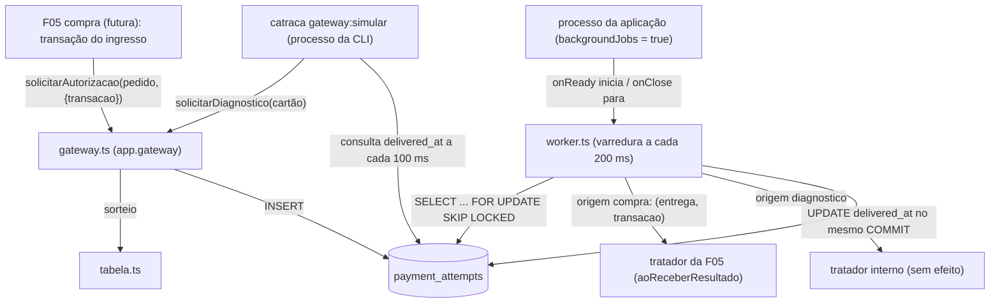

# Spec: F03 — Gateway de pagamento simulado

## 1. Visão técnica

**O quê.** A F03 entrega o gateway de pagamento simulado do modo padrão: uma solicitação de autorização que grava a tentativa e retorna na hora, um sorteio de resultado e de atraso pela tabela do brief (final do cartão), um worker que varre o banco e entrega cada resultado vencido exatamente uma vez ao tratador registrado (a compra, na F05), a retomada das tentativas pendentes depois de um reinício e o comando de diagnóstico `catraca gateway:simular`, que mostra o resultado e o tempo decorrido sem depender de nenhuma outra feature. Tudo vive no módulo `app/src/features/gateway/`, numa tabela própria (`payment_attempts`) e num comando novo da CLI.

**Por quê.** A compra (F05) precisa responder sem esperar o pagamento (R06) e mudar o ingresso quando o resultado chega (R08), inclusive depois de um reinício e sem nunca aplicar o mesmo resultado duas vezes; e uma resposta que chega depois do cancelamento não pode mudar o ingresso (R11). Por isso o gateway guarda prazos absolutos no banco, entrega pela própria base de dados com `FOR UPDATE SKIP LOCKED` e faz a entrega e o efeito do tratador na mesma transação. Os tempos são a parte observável que o avaliador cobra (passos 5–8 e 12–14 do Fluxo do avaliador): o sorteio e o intervalo de varredura são escolhidos para que o efeito caia sempre dentro das faixas do brief, com folga para quem observa por consulta periódica.

**Complexidade:** `medium` — nenhuma rota HTTP, mas várias camadas (sorteio, persistência, worker concorrente com retomada, ciclo de vida no processo da aplicação, comando de diagnóstico), uma tabela nova com índice parcial e garantias de entrega única sob concorrência e reinício.

**Wave paralela.** A F03 é implementada ao mesmo tempo que a F02 (Contas e acesso), em outra worktree. A F03 toca **somente**: arquivos novos em `app/src/features/gateway/`, `app/src/cli/commands/gateway-simular.ts`, a migration nova com timestamp próprio, `app/test/f03/`, o auxiliar novo `app/test/helpers/gateway.ts`, duas mudanças pontuais no `README.md`, uma linha na tabela de comandos do `AGENTS.md`, a seção 10 desta spec e a entrada F03 do `docs/state.json`. Nenhum arquivo da F01 é editado, salvo o ajuste mínimo descrito na premissa P23.

### Escopo

**Incluído:**
- Tabela `payment_attempts` (migration nova) com índice parcial para a varredura e restrições que impedem guardar mais que os 4 últimos dígitos do cartão.
- Tabela de respostas do modo padrão (cópia do brief) e sorteio uniforme do atraso dentro de faixas internas que garantem o efeito dentro das faixas do brief (5.2).
- Interface pública para a F05: `solicitarAutorizacao({ referencia, numeroCartao }, { transacao? })` e `aoReceberResultado(tratador)` (5.1), exposta no decorator `app.gateway` e, fora do Fastify, pela fábrica `criarGatewaySimulado`.
- Worker de varredura (200 ms) com `FOR UPDATE SKIP LOCKED`, entrega e marcação de `delivered_at` na mesma transação, reentrega com espera crescente em caso de falha do tratador, retomada imediata depois de reinício (5.3).
- Tratador interno das tentativas de diagnóstico (origem `diagnostico`), que permite o diagnóstico funcionar sem a F05.
- Comando `catraca gateway:simular <cartão> [--sem-esperar]` com saída literal (5.4).
- Escala de atraso (`GATEWAY_DELAY_SCALE`) aplicada ao sorteio — lida pela F01 só com `NODE_ENV=test`.
- Logs estruturados com mensagens fixas, sem o número do cartão (5.5).
- Auxiliar de testes para as consumidoras (`app/test/helpers/gateway.ts`) e os testes da F03.
- README (comando de diagnóstico e decisão "gateway assíncrono") e uma linha na tabela de comandos do `AGENTS.md`.

**Excluído (e quem entrega):**
- Efeito do resultado no ingresso (`pending` → `confirmed`/`declined`), liberação de vaga, ignorar resposta tardia depois do cancelamento: F05 (tratador registrado com `aoReceberResultado`).
- Validação de cartão com 16 dígitos na compra e o erro `invalid_request`: F05/F06/F07 (o gateway só recusa, defensivamente, o que não tiver 16 dígitos).
- Gateway real, outros modos, chaves de pagamento: fora de escopo (o `GATEWAY_MODE` só aceita `simulado`, F01).
- Qualquer rota HTTP do gateway: o diagnóstico é só por CLI dentro do container.

### Consome (F01)

| Item consumido | Onde (F01) | Uso na F03 |
|---|---|---|
| Módulo de feature com `loadOrder` e `fastify-plugin` | `app/src/core/modules.ts` | Módulo `gateway` com `loadOrder` 20 |
| Decorators `app.db`, `app.config`, `app.backgroundJobs`, logger do Fastify | `app/src/app.ts` | Pool, configuração do gateway, início do worker só no processo da aplicação |
| Runner de migrations com timestamp | `app/src/db/migrate.ts` | Migration `AAAAMMDDHHMMSS_create_payment_attempts.sql` |
| `withTransaction`, tipos `Db`/`Queryable` | `app/src/db/transaction.ts`, `app/src/db/pool.ts` | Transação de entrega; tipo da opção `transacao` |
| `newId(prefixo)` | `app/src/core/ids.ts` | `pay_…` (tentativa) e `sim_…` (referência de diagnóstico) |
| Configuração `gateway.mode` (`simulado`) e `gateway.delayScale` (1 fora de `NODE_ENV=test`) | `app/src/config.ts` | Modo e escala do sorteio |
| Comando novo em `app/src/cli/commands/` | `app/src/cli/index.ts` | `gateway:simular` |
| Infraestrutura de testes (`createTestApp`, `testDb`, `resetDatabase`) | `app/test/helpers/` | Testes em `app/test/f03/` |

### Provê (contratos de saída)

| Item provido | Onde | Consumidores |
|---|---|---|
| `app.gateway.solicitarAutorizacao({ referencia, numeroCartao }, { transacao? })` → retorna na hora com a tentativa registrada; com `transacao` (cliente `pg` dentro de uma transação), a tentativa nasce e morre com a transação do chamador | `app/src/features/gateway/gateway.ts` (via `public.ts`) | F05 (compra, dentro da transação que cria o ingresso) |
| `app.gateway.aoReceberResultado(tratador)` — um tratador por processo; chamado pelo worker com `(entrega, transacao)` uma única vez por tentativa, dentro da transação que marca a entrega | idem | F05 (confirma/recusa o ingresso) |
| `criarGatewaySimulado({ db, config, log? })` — mesma interface fora do Fastify (só para solicitar; a entrega é sempre do worker do processo da aplicação) | `app/src/features/gateway/public.ts` | F05 (`compra:simular` na CLI) |
| `ErroGateway` com `codigo` (`cartao_invalido`, `referencia_invalida`, `referencia_duplicada`, `tratador_ja_registrado`) | `app/src/features/gateway/erros.ts` (via `public.ts`) | F05 |
| Tabela `payment_attempts` (leitura apenas, para diagnóstico/consultas) | migration da F03 | F05 (`ingresso:consultar`, opcional) |
| Comando `catraca gateway:simular` | `app/src/cli/commands/gateway-simular.ts` | avaliador, agentes |
| Auxiliares de teste `vencerTentativas`, `entregarVencidas`, `aguardarEntrega` | `app/test/helpers/gateway.ts` | testes da F05 |

**Como a F05 usa (orientação para a spec da F05):**
1. Na transação da compra (`withTransaction(app.db, async (client) => …)`), depois de criar o ingresso `pending`: `await app.gateway.solicitarAutorizacao({ referencia: ticketId, numeroCartao }, { transacao: client })`. Erro aqui desfaz a compra inteira (PRD, F05 Tratamento de erros).
2. No registro do módulo da F05 (que carrega depois do `gateway` pelo `loadOrder`): `app.gateway.aoReceberResultado(async (entrega, transacao) => …)`, alterando o ingresso **só se ainda estiver `pending`** e usando `transacao` em todas as escritas. Resposta para ingresso que não está mais `pending` → registrar em log e retornar normalmente (a tentativa fica entregue).
3. O cancelamento (F05/F04) não mexe em `payment_attempts`: o resultado tardio é entregue uma vez e o tratador o ignora.
4. Na CLI (`compra:simular`), usar `criarGatewaySimulado({ db, config })` para solicitar; quem entrega é o worker da aplicação no ar.

### Regras e invariantes

- **Do brief:** a tabela do "Gateway de pagamento simulado" (resultado e faixa de tempo pelo final do cartão) e o "modo padrão é o do avaliador" (Requisitos 3). Nenhuma regra R01–R13 é implementada sozinha pela F03; ela é a base de R06 (compra responde sem esperar o gateway), R08 (aprovado → confirmado, recusado → recusado) e R11 (resposta tardia não muda o ingresso), cujo efeito no ingresso é da F05.
- **Invariantes compartilhadas que a F03 não pode quebrar:**
  - *Resposta tardia (R11):* o gateway nunca altera ingressos; só entrega o resultado, uma vez, a um tratador que decide dentro da mesma transação. Um resultado que chega depois do cancelamento é entregue normalmente e ignorado pela F05.
  - *Lotação sob concorrência (R05–R07):* a solicitação é um único `INSERT` sem trava global; dentro da transação atômica da compra, não serializa compras de eventos diferentes nem toma travas que a compra não controle.
  - *API igual à vitrine:* a solicitação não tem canal; compras da vitrine e da API seguem o mesmo caminho e os mesmos tempos.
  - *Modo padrão = avaliador:* sem nenhuma variável, modo `simulado` e escala 1; a escala só altera tempos com `NODE_ENV=test` (F01).
  - *Dado de cartão:* o número completo nunca é persistido, logado ou impresso; só os 4 últimos dígitos (e a coluna recusa qualquer outra coisa).

### Requisitos (capacidades do PRD → decisões desta spec)

| Capacidade (PRD F03) | Como esta spec atende |
|---|---|
| Tabela do modo padrão por final do cartão | `tabela.ts` (5.2): `0001` aprovado/rápida, `0002` recusado/rápida, `0003` aprovado/lenta, `0004` recusado/lenta, outro recusado/rápida; "final" = 4 últimos dígitos |
| Atraso uniforme dentro da faixa, descontando o tempo de entrega, efeito sempre dentro da faixa | Sorteio uniforme em ms em [2 200; 4 000] e [30 500; 38 500]; varredura a cada 200 ms; orçamento de entrega em 5.2 |
| Tentativa persistida com referência, 4 últimos dígitos, resultado, prazo e momento da entrega; entrega única | Tabela `payment_attempts` (seção 6); entrega e marca na mesma transação com `FOR UPDATE SKIP LOCKED` (5.3) |
| Depois de um reinício, pendentes no prazo original ou em até 5 s depois de voltar | Prazo absoluto (`due_at`) no relógio do banco; primeira varredura imediata no `onReady` (5.3) |
| Escala de atraso só no ambiente de testes | `config.gateway.delayScale` da F01 (lida só com `NODE_ENV=test`) multiplica o atraso sorteado |
| Comando `gateway:simular` no container: recebe o cartão, espera, imprime resultado e tempo | `gateway-simular.ts` (5.4), tempo = `delivered_at − requested_at` com uma casa decimal |
| Tratador ausente ou com erro: pendente, reentregue sem duplicar | Sem tratador, a origem não entra na varredura; erro → rollback, `last_error`, reentrega na varredura seguinte com espera crescente (5.3) |
| Cartão inválido nunca chega ao gateway | Validação é da F05; `solicitarAutorizacao` recusa defensivamente com `ErroGateway('cartao_invalido')` sem gravar |

### Fluxos (experiência do PRD)

1. **Solicitação (F05):** dentro da transação da compra, `solicitarAutorizacao` valida a entrada, sorteia resultado e atraso, grava a tentativa com `requested_at = clock_timestamp()` e `due_at = requested_at + atraso` e retorna (milissegundos). A tentativa fica visível para o worker quando a compra faz commit.
2. **Entrega:** a cada 200 ms o worker do processo da aplicação abre uma transação, trava a próxima tentativa vencida de uma origem com tratador (`SKIP LOCKED`), chama o tratador com a transação, marca `delivered_at` e faz commit; repete até não haver vencidas.
3. **Diagnóstico:** `docker compose exec -T app catraca gateway:simular 4000000000000001` grava uma tentativa de origem `diagnostico`, imprime a linha da solicitação na hora, espera o worker da aplicação entregá-la (tratador interno) e imprime `aprovado em 3,4 s`.
4. **Reinício:** as tentativas pendentes continuam no banco; ao subir, a primeira varredura roda imediatamente e entrega as vencidas; as demais saem no prazo original.

## 2. Impacto na arquitetura

Arquivos da F03 (todos novos, salvo indicação):

```
app/
├── migrations/AAAAMMDDHHMMSS_create_payment_attempts.sql
├── src/
│   ├── features/gateway/
│   │   ├── index.ts        # plugin (fastify-plugin, nome "gateway"), loadOrder 20
│   │   ├── public.ts       # o que outras features podem importar
│   │   ├── types.ts        # tipos públicos + augmentation de FastifyInstance.gateway
│   │   ├── erros.ts        # ErroGateway
│   │   ├── tabela.ts       # tabela do brief, faixas internas, sorteio
│   │   ├── repositorio.ts  # SQL da tabela payment_attempts
│   │   ├── gateway.ts      # criarGatewaySimulado: solicitar, registrar tratador, processar vencidas, consultar
│   │   └── worker.ts       # laço de varredura (iniciar/parar)
│   └── cli/commands/gateway-simular.ts
└── test/
    ├── helpers/gateway.ts  # auxiliares para os testes da F05
    └── f03/*.test.ts
README.md   # modificado: 2 trechos
AGENTS.md   # modificado: 1 linha na tabela de comandos
```



## 3. Decisões técnicas

| Decisão | Abordagem escolhida | Alternativa considerada | Trade-off |
|---|---|---|---|
| Mecanismo de entrega | Worker de varredura no banco: `SELECT … FOR UPDATE SKIP LOCKED` sobre um índice parcial das pendentes, a cada 200 ms | `setTimeout` em memória por tentativa (com recuperação na subida) | Até 200 ms de latência e uma consulta barata a cada 200 ms, em troca de uma única lógica para tempo normal, reinício e vários processos |
| Referência de tempo | Prazo absoluto `due_at = requested_at + atraso`, ambos no relógio do banco (`clock_timestamp()` no `INSERT`, `now()` na varredura) | Prazo relativo calculado no relógio do Node | Nenhuma diferença de relógio entre CLI, aplicação e banco; o prazo sobrevive ao reinício sem recálculo |
| Garantia de entrega | Tratador executado na transação que trava a tentativa e grava `delivered_at`; falha desfaz tudo | Marcar entregue e depois chamar o tratador (no máximo uma vez) ou chamar e depois marcar (pelo menos uma vez) | Efeito exatamente uma vez sem tabela de deduplicação; o tratador fica sujeito aos limites da transação (5.3) |
| Roteamento dos resultados | Coluna `origin` (`compra` → tratador registrado; `diagnostico` → tratador interno); a varredura só busca origens com tratador no processo | Prefixo da referência ou tratador da F05 tolerando referências alheias | Diagnóstico independente da F05; "sem tratador" vira simplesmente "não selecionado", sem travar nem contar tentativa |
| Diagnóstico | A CLI só solicita e consulta; quem entrega é o worker do processo da aplicação | CLI com worker próprio para a referência que criou | Exercita o caminho real (worker, tempos, reinício); depende da aplicação no ar — que é o caso de `docker compose exec app` |
| Sorteio | `crypto.randomInt` em milissegundos, injetável nos testes; escala aplicada ao valor sorteado | `random()` no SQL | Limites testáveis de forma determinística; o banco só recebe o atraso já escalado |
| Faixas internas | [2,2; 4,0] s e [30,5; 38,5] s (5.2) | [2,0; 4,5] s e [30,0; 39,5] s (exemplo do orquestrador) | Distribuição mais estreita que a do brief, em troca de folga para quem mede por consulta periódica ("em até 5 s") e para máquina carregada |
| Unidade de trabalho | Uma transação por entrega, até 500 por varredura | Lote de N tentativas numa transação com savepoints | Uma falha não atrasa as demais; mais commits (irrelevante no volume do produto) |
| Falha do tratador | Reentrega com espera crescente via `next_delivery_at`: 0,2 s × 2^(n−1), até 5 s | Reentregar a cada varredura sempre | A primeira reentrega acontece na varredura seguinte (PRD); um defeito persistente não inunda o log |
| Interface para a F05 | Objeto `app.gateway` (decorator com `fastify-plugin`, uma instância por aplicação) + fábrica `criarGatewaySimulado` | Funções soltas com registro global | Sem estado global entre aplicações de teste; F05 declara dependência pelo nome do plugin |

## 4. Componentes

**Módulo `app/src/features/gateway/`:**

| Arquivo | Novo/Modificado | Propósito | Responsabilidades |
|---|---|---|---|
| `index.ts` | Novo | Plugin da feature | `export const loadOrder = 20`; `default` envolvido por `fastify-plugin` com nome `gateway`: cria `criarGatewaySimulado({ db: app.db, config: app.config, log: app.log })`, `app.decorate('gateway', …)`; hook `onReady` → `gateway.iniciarWorker()` só se `app.backgroundJobs`; hook `onClose` → `await gateway.pararWorker()` (sempre; idempotente) |
| `public.ts` | Novo | API importável por outras features | Reexporta `criarGatewaySimulado`, `ErroGateway`, os tipos de `types.ts` e as constantes `FAIXA_RAPIDA_MS`, `FAIXA_LENTA_MS`, `INTERVALO_VARREDURA_MS`; outras features importam só daqui |
| `types.ts` | Novo | Tipos públicos | `ResultadoPagamento`, `PedidoAutorizacao`, `OpcoesSolicitacao`, `SolicitacaoRegistrada`, `EntregaResultado`, `TratadorResultado`, `TentativaPagamento`, `GatewaySimulado` (5.1); `declare module 'fastify'` acrescentando `gateway: GatewaySimulado` a `FastifyInstance` |
| `erros.ts` | Novo | Erro de domínio | `ErroGateway extends Error` com `codigo` (5.1) e mensagem em pt-BR |
| `tabela.ts` | Novo | Tabela do brief e sorteio | `FAIXA_RAPIDA_MS = [2200, 4000]`, `FAIXA_LENTA_MS = [30500, 38500]`; `finalDoCartao(numero)`; `regraPorFinal(final)` → `{ resultado, faixa }`; `sortearResposta(numeroCartao, { escala, sortearInteiro })` → `{ finalCartao, resultado, atrasoMs }` (5.2) |
| `repositorio.ts` | Novo | SQL de `payment_attempts` | `inserirTentativa(executor, dados)`; `buscarTentativa(executor, id)`; `travarProximaVencida(client, origens)`; `marcarEntregue(client, id)`; `registrarFalha(db, id, mensagem)`; traduz a violação de `payment_attempts_origin_reference_key` em `ErroGateway('referencia_duplicada')` (5.3, seção 6) |
| `gateway.ts` | Novo | Fábrica `criarGatewaySimulado({ db, config, log?, sortearInteiro? })` | Implementa `GatewaySimulado`: `solicitarAutorizacao`, `solicitarDiagnostico`, `aoReceberResultado`, `processarVencidas`, `consultarTentativa`, `iniciarWorker`, `pararWorker`; registra o tratador interno de `diagnostico`; mantém o registro de tratadores por instância |
| `worker.ts` | Novo | Laço de varredura | `criarLacoDeVarredura({ processar, intervaloMs, log })` com `iniciar()` (primeira varredura imediata), `parar()` (espera a varredura em andamento), encadeamento por `setTimeout` com `unref()`, espera de 1 s depois de erro de banco (5.3) |

**CLI, migration e testes:**

| Arquivo | Novo/Modificado | Propósito | Responsabilidades |
|---|---|---|---|
| `app/src/cli/commands/gateway-simular.ts` | Novo | `catraca gateway:simular` | `name = 'gateway:simular'`, `description = 'Simula um pagamento no gateway e mostra o resultado e o tempo'`; `run({ args, config, db })` conforme 5.4; usa `criarGatewaySimulado` com logger silencioso; nunca imprime o número completo |
| `app/migrations/AAAAMMDDHHMMSS_create_payment_attempts.sql` | Novo | Tabela e índices | Seção 6. Timestamp UTC gerado na implementação com `date -u +%Y%m%d%H%M%S` (necessariamente posterior a `20261125120000`); nome distinto de qualquer migration da F02 |
| `app/test/helpers/gateway.ts` | Novo (arquivo novo na pasta de auxiliares da F01; nenhum existente é editado) | Apoio aos testes das consumidoras | `vencerTentativas(db, { referencias? })` → torna pendentes vencidas agora (`delay_ms = 0`, `due_at = next_delivery_at = requested_at`), devolve a quantidade; `entregarVencidas(app)` → `app.gateway.processarVencidas()`; `aguardarEntrega(db, tentativaId, { timeoutMs })` → espera `delivered_at` por consulta a cada 20 ms |
| `app/test/f03/*.test.ts` | Novo | Testes da F03 | Seção 7 |

**Documentação (fase final):**

| Arquivo | Mudança (pontual) |
|---|---|
| `README.md` | Em `## Comandos de diagnóstico`: linha `docker compose exec app catraca gateway:simular 4000000000000001` com a explicação (finais `0001`–`0004`, `--sem-esperar`, saída `aprovado em 3,4 s`). Em `## Decisões`: substituir o marcador "gateway assíncrono: a completar na F03/F05" por um parágrafo curto (tentativa persistida com prazo absoluto no relógio do banco; worker a cada 200 ms com `FOR UPDATE SKIP LOCKED`; entrega e efeito na mesma transação, exatamente uma vez; retomada após reinício; faixas internas e por quê; escala só com `NODE_ENV=test`), mantendo "efeito nos ingressos e resposta tardia: F05" |
| `AGENTS.md` | Uma linha na tabela de comandos: `docker compose exec app catraca gateway:simular <cartão>` — "Simula um pagamento (finais `0001`–`0004`) e mostra resultado e tempo" |
| `docs/state.json` | Só a entrada F03 (`aguardando_avaliacao` ao final da implementação) |

## 5. Contratos de interfaces

Não há rotas HTTP. As interfaces são a API TypeScript do módulo, o comportamento do worker, o comando da CLI e as mensagens de log.

### 5.1 API pública do gateway (`app.gateway` / `criarGatewaySimulado`)

A interface pública usa os nomes de domínio pedidos para a F05 (pt-BR); identificadores internos e colunas seguem a convenção da F01 (inglês) — premissa P02.

**Tipos (`types.ts`):**

| Tipo | Definição |
|---|---|
| `ResultadoPagamento` | `'aprovado' \| 'recusado'` |
| `PedidoAutorizacao` | `{ referencia: string; numeroCartao: string }` — `referencia` casa com `^[A-Za-z0-9_-]{1,64}$` (a F05 usa o id do ingresso `tkt_…`); `numeroCartao` casa com `^[0-9]{16}$` |
| `OpcoesSolicitacao` | `{ transacao?: Queryable }` — cliente `pg` de uma transação aberta pelo chamador; sem ele, usa o pool (`INSERT` autônomo) |
| `SolicitacaoRegistrada` | `{ tentativaId: string; referencia: string; finalCartao: string; solicitadoEm: Date; prazo: Date }` — **não** inclui o resultado |
| `EntregaResultado` | `{ tentativaId: string; referencia: string; resultado: ResultadoPagamento; finalCartao: string; solicitadoEm: Date; prazo: Date; tentativaDeEntrega: number }` (`tentativaDeEntrega` = 1 na primeira) |
| `TratadorResultado` | `(entrega: EntregaResultado, transacao: PoolClient) => Promise<void>` |
| `TentativaPagamento` | `{ tentativaId; origem: 'compra' \| 'diagnostico'; referencia; finalCartao; solicitadoEm: Date; prazo: Date; entregueEm: Date \| null; tentativasDeEntrega: number; ultimoErro: string \| null; resultado: ResultadoPagamento \| null }` — `resultado` é `null` enquanto a tentativa não foi entregue |
| `GatewaySimulado` | os membros abaixo |

**Membros de `GatewaySimulado`:**

| Membro | Contrato |
|---|---|
| `modo` | `'simulado'` (somente leitura) |
| `escala` | `config.gateway.delayScale` (somente leitura) |
| `solicitarAutorizacao(pedido, opcoes?)` → `Promise<SolicitacaoRegistrada>` | Valida `numeroCartao` (senão `ErroGateway('cartao_invalido')`) e `referencia` (senão `referencia_invalida`) **antes** de tocar no banco; sorteia (5.2); grava a tentativa com `origin = 'compra'` usando `opcoes.transacao` ou o pool; retorna sem esperar nada (um `INSERT`). Referência já usada → `referencia_duplicada` (numa transação do chamador, a transação fica abortada e o chamador deve desfazê-la). Nunca registra o número completo em lugar nenhum |
| `solicitarDiagnostico(numeroCartao)` → `Promise<SolicitacaoRegistrada>` | Igual, com `origin = 'diagnostico'` e `referencia = newId('sim')`; usado só pela CLI e pelos testes |
| `aoReceberResultado(tratador)` → `void` | Registra o tratador da origem `compra` nesta instância; segundo registro → `ErroGateway('tratador_ja_registrado')`. Pode ser chamado antes ou depois de o worker iniciar (vale a partir da varredura seguinte) |
| `processarVencidas({ limite? })` → `Promise<{ entregues: number; falhas: number }>` | Executa uma varredura completa (5.3), até `limite` (padrão 500) entregas; usado pelo worker e pelos testes |
| `consultarTentativa(tentativaId, executor?)` → `Promise<TentativaPagamento \| null>` | Leitura de uma tentativa |
| `iniciarWorker({ intervaloMs? })` | Inicia o laço (padrão `INTERVALO_VARREDURA_MS = 200`); idempotente; loga `gateway: worker iniciado` |
| `pararWorker()` → `Promise<void>` | Para o laço e espera a varredura em andamento terminar; idempotente; loga `gateway: worker parado` se estava rodando |

**`ErroGateway`:** `name = 'ErroGateway'`, `codigo` e mensagem:

| `codigo` | Mensagem |
|---|---|
| `cartao_invalido` | `Número de cartão inválido: são necessários 16 dígitos` |
| `referencia_invalida` | `Referência de pagamento inválida` |
| `referencia_duplicada` | `Já existe uma tentativa de pagamento para esta referência` |
| `tratador_ja_registrado` | `Já existe um tratador de resultado registrado no gateway` |

**Regras para o tratador (F05):** usa a `transacao` recebida em todas as escritas; não faz `COMMIT`/`ROLLBACK`; não toca em `payment_attempts`; é idempotente (só altera o que ainda está pendente); lançar erro desfaz o efeito e agenda a reentrega; roda sob `lock_timeout = 2s` e `statement_timeout = 5s`.

### 5.2 Tabela de respostas, sorteio e orçamento de tempo

"Final" = os 4 últimos dígitos do número de 16 dígitos.

| Final | Resultado | Faixa do brief | Sorteio interno (escala 1) |
|---|---|---|---|
| `0001` | `aprovado` | 2–5 s | uniforme em [2 200; 4 000] ms |
| `0002` | `recusado` | 2–5 s | uniforme em [2 200; 4 000] ms |
| `0003` | `aprovado` | 30–40 s | uniforme em [30 500; 38 500] ms |
| `0004` | `recusado` | 30–40 s | uniforme em [30 500; 38 500] ms |
| qualquer outro | `recusado` | 2–5 s | uniforme em [2 200; 4 000] ms |

- Sorteio: `sortearInteiro(min, max)` inclusivo, padrão `crypto.randomInt(min, max + 1)` (uniforme em milissegundos). `atrasoMs = Math.round(sorteado × escala)`, com `escala = config.gateway.delayScale` (1 fora de `NODE_ENV=test`, regra da F01). A escala não muda o intervalo de varredura.
- O sorteio acontece no processo que solicita (aplicação para compras; CLI para diagnóstico) e o atraso escalado é gravado em `delay_ms`.

**Orçamento (por que o efeito fica dentro da faixa do brief).** O efeito observável é o commit da transação de entrega (onde a F05 muda o ingresso).

| Parcela | Faixa rápida | Faixa lenta |
|---|---|---|
| Atraso sorteado (a partir do `INSERT`) | 2,200–4,000 s | 30,500–38,500 s |
| Espera até a próxima varredura (intervalo) | ≤ 0,200 s | ≤ 0,200 s |
| Varredura em andamento que ainda não via a tentativa | ≤ 0,100 s (orçamento) | ≤ 0,100 s |
| Transação de entrega (tratador + marca + commit) | ≤ 0,200 s (orçamento; limite rígido 5 s por comando) | idem |
| **Pior caso previsto do efeito** | **≤ 4,5 s** | **≤ 39,0 s** |
| Folga até o limite superior do brief | ≥ 0,5 s | ≥ 1,0 s |
| Folga no limite inferior | 0,2 s | 0,5 s (1,5 s sobre "aos 29 s ainda pendente") |

- **Limite inferior:** a varredura só seleciona `next_delivery_at <= now()` e `next_delivery_at >= due_at = requested_at + atraso`; `requested_at` é o `clock_timestamp()` do `INSERT`, posterior à chegada da requisição. Logo o efeito acontece pelo menos `atraso` depois da solicitação. A folga de 0,2 s cobre a medição feita a partir da **resposta** da compra (que chega ao cliente depois do `INSERT`).
- **Limite superior:** `due_at` + espera da varredura + entrega. A folga de 0,5 s (faixa rápida) cobre a observação por consulta periódica ("em até 5 s" nos passos 5 e 8 do Fluxo e nos contratos de F05/F06/F07) e CPU disputada (gates rodando ao lado). O exemplo [2,0; 4,5] s deixaria ≤ 0,3 s, e um avaliador que consulta a cada 0,5–1 s poderia ver o efeito só depois de 5 s.
- Transação de compra longa (fila da trava do evento na F05): o `requested_at` é tomado no `INSERT` com `clock_timestamp()` (não `now()`, que seria o início da transação), e a tentativa só fica visível no commit; a entrega acontece em `max(commit, due_at)` + varredura.

### 5.3 Worker: varredura e entrega

**Laço (`worker.ts`):** `iniciar()` agenda a primeira varredura **imediatamente**; ao fim de cada varredura agenda a próxima para `intervaloMs` depois (encadeamento por `setTimeout`, sem sobreposição). Erro de banco durante a varredura (ex.: banco indisponível) → log `gateway: falha na varredura` (warn) e próxima varredura em `max(intervaloMs, 1000)` ms; nada se perde, pois o estado está no banco. `parar()` impede novos agendamentos e aguarda a varredura em andamento. O timer usa `unref()`.

**Varredura (`processarVencidas`):** repete o ciclo abaixo até não haver tentativa vencida elegível ou atingir `limite`:

1. `BEGIN`; `SET LOCAL lock_timeout = '2s'`; `SET LOCAL statement_timeout = '5s'`.
2. Seleciona e trava uma tentativa:
   `SELECT … FROM payment_attempts WHERE delivered_at IS NULL AND next_delivery_at <= now() AND origin = ANY($origens) ORDER BY next_delivery_at, id LIMIT 1 FOR UPDATE SKIP LOCKED`,
   em que `$origens` = origens com tratador nesta instância (`diagnostico` sempre; `compra` só depois de `aoReceberResultado`). Nenhuma → `COMMIT` e fim da varredura.
3. Chama o tratador da origem com `(entrega, client)`.
4. `UPDATE payment_attempts SET delivered_at = clock_timestamp(), delivery_attempts = delivery_attempts + 1, last_error = NULL, updated_at = clock_timestamp() WHERE id = $1 AND delivered_at IS NULL RETURNING requested_at, delivered_at`.
5. `COMMIT`; log `gateway: resultado entregue`.
6. Se o tratador ou os passos 4–5 falharem: `ROLLBACK` (o efeito do tratador some junto); depois, fora da transação, `UPDATE … SET delivery_attempts = delivery_attempts + 1, last_error = left(<mensagem>, 500), next_delivery_at = greatest(due_at, clock_timestamp() + make_interval(secs => least(0.2 * 2 ^ delivery_attempts, 5))), updated_at = clock_timestamp() WHERE id = $1 AND delivered_at IS NULL` (o expoente usa o valor anterior: 1ª falha → 0,2 s, depois 0,4 s, 0,8 s … até 5 s; `greatest` mantém a restrição `next_delivery_at >= due_at`); log `gateway: falha na entrega` (error). A tentativa volta na varredura seguinte.

**Garantias:**
- *Entrega única:* a linha travada com `FOR UPDATE` é reavaliada pelo PostgreSQL depois da trava (READ COMMITTED), então uma tentativa já entregue por outro worker nunca é entregue de novo; `SKIP LOCKED` evita que dois workers esperem pela mesma linha. A marca e o efeito do tratador estão no mesmo commit: ou os dois existem, ou nenhum.
- *Sem tratador:* origem sem tratador não entra em `$origens`; a tentativa fica pendente sem contar tentativa de entrega e é entregue quando houver tratador.
- *Retomada:* o processo novo começa com uma varredura imediata no `onReady` (antes do `listen`), entregando as tentativas cujo prazo venceu com a aplicação parada; as demais saem no prazo original (o `due_at` é absoluto). Interrupção no meio de uma entrega (`SIGKILL`) desfaz a transação e a tentativa é reentregue depois.
- *Parada limpa:* `app.close()` (SIGTERM via `main.ts` da F01) chama `pararWorker()`, que espera a entrega em andamento antes de o pool ser encerrado.

**Tratador interno de `diagnostico`:** não faz nada além de deixar a entrega acontecer (a marca `delivered_at` é o efeito observável pela CLI).

### 5.4 Comando `catraca gateway:simular`

- **Uso:** `docker compose exec -T app catraca gateway:simular <número do cartão> [--sem-esperar]` (a opção pode vir antes ou depois do número).
- **Comportamento:** cria `criarGatewaySimulado({ db, config, log: silencioso })`, mede o tempo de `solicitarDiagnostico(numero)` no próprio processo, imprime a linha 1 imediatamente (antes de esperar) e, sem `--sem-esperar`, consulta a tentativa a cada 100 ms até `delivered_at` existir ou até o limite `max(60 000 × escala, 2 000)` ms desde a solicitação. A CLI não roda worker: quem entrega é o worker do processo da aplicação.
- **Tempo do resultado:** `entregueEm − solicitadoEm` (ambos do relógio do banco), em segundos, uma casa decimal, vírgula decimal (`toFixed(1)` com `.` trocado por `,`).

| Situação | Saída | Código |
|---|---|---|
| Solicitação registrada (linha 1, stdout, impressa na hora) | `solicitação pay_<16 [a-z0-9]> registrada em <S> s (cartão final <NNNN>, modo simulado, escala <E>)` — `<S>` = duração da solicitação no processo da CLI; `<E>` = `String(escala)` (ex.: `1`, `0.01`) | — |
| Resultado entregue (linha 2, stdout) | `aprovado em <S> s` ou `recusado em <S> s` (ex.: `aprovado em 3,4 s`) | 0 |
| `--sem-esperar` | só a linha 1 | 0 |
| Sem resultado dentro do limite (stderr) | `sem resultado em <S> s: a tentativa pay_<id> continua pendente (o worker roda no processo da aplicação; ela está no ar?)` | 1 |
| Sem argumento, argumento extra ou opção desconhecida (stderr) | `Uso: catraca gateway:simular <número do cartão com 16 dígitos> [--sem-esperar]` | 2 |
| Número sem exatamente 16 dígitos (stderr; nada é gravado; o valor digitado não é repetido) | `Número de cartão inválido: informe exatamente 16 dígitos (ex.: 4000000000000001).` | 2 |
| Erro inesperado (stderr) | `Erro: <mensagem>` | 1 |

Expressões para conferência: linha 1 `^solicitação pay_[a-z0-9]{16} registrada em [0-9]+,[0-9] s \(cartão final [0-9]{4}, modo simulado, escala [0-9.]+\)$`; linha 2 `^(aprovado|recusado) em [0-9]+,[0-9] s$`.

### 5.5 Logs (logger JSON do Fastify, nível padrão `info`)

| Mensagem (`msg`) | Nível | Campos (nesta ordem) | Quando |
|---|---|---|---|
| `gateway: worker iniciado` | info | `modo` (`"simulado"`), `escala` (número), `intervaloMs` (número) | `iniciarWorker` no processo da aplicação |
| `gateway: resultado entregue` | info | `tentativaId`, `referencia`, `origem`, `resultado`, `tentativa`, `atrasoMs` (`delivered_at − requested_at`) | cada entrega confirmada (uma linha por tentativa) |
| `gateway: falha na entrega` | error | `tentativaId`, `referencia`, `origem`, `tentativa`, `err` | tratador ou marca falhou |
| `gateway: falha na varredura` | warn | `err` | erro fora de uma entrega (ex.: banco indisponível) |
| `gateway: worker parado` | info | — | `pararWorker` com o laço ativo |

Exemplo de linha: `{"level":30,…,"modo":"simulado","escala":1,"intervaloMs":200,"msg":"gateway: worker iniciado"}`. Nenhum log contém o número do cartão (nem os 4 últimos dígitos). A solicitação registra no máximo `debug`.

### 5.6 Ciclo de vida no processo

- `loadOrder = 20`: depois do módulo `contas` da F02 (10) e antes dos módulos com o padrão 100 (a F05 entre eles), de modo que `app.gateway` já existe quando a F05 registra o tratador. Boot da aplicação depois da F03: `[catraca] módulos: gateway, health, vitrine` (com a F02: `contas, gateway, health, vitrine`).
- `main.ts` (F01) usa `backgroundJobs = true` → o worker inicia no `onReady`. `createTestApp` usa `false` → o worker só roda se o teste chamar `app.gateway.iniciarWorker({ intervaloMs })` ou `processarVencidas()`; o `onClose` para o worker em qualquer caso.
- A CLI (processo separado) nunca inicia worker.

### 5.7 Auxiliares de teste (`app/test/helpers/gateway.ts`)

| Função | Contrato |
|---|---|
| `vencerTentativas(db, { referencias? })` | Para as tentativas pendentes (todas ou das referências dadas): `delay_ms = 0`, `due_at = next_delivery_at = requested_at`; devolve quantas mudaram |
| `entregarVencidas(app)` | `app.gateway.processarVencidas()` |
| `aguardarEntrega(db, tentativaId, { timeoutMs = 2000 })` | Consulta a cada 20 ms até `delivered_at` existir; devolve a `TentativaPagamento`; estoura com erro descritivo no limite |

## 6. Modelo de dados

**Tabela: `payment_attempts`**

| Coluna | Tipo | Nulo | Padrão | Descrição |
|---|---|---|---|---|
| `id` | `text` | Não | — | `pay_` + 16 `[a-z0-9]` (`newId('pay')`) |
| `origin` | `text` | Não | — | `compra` (tratador registrado) ou `diagnostico` (tratador interno) |
| `reference` | `text` | Não | — | Referência do chamador (`tkt_…` na F05; `sim_…` no diagnóstico) |
| `card_last4` | `text` | Não | — | Os 4 últimos dígitos; **única** informação do cartão guardada |
| `result` | `text` | Não | — | Resultado sorteado: `aprovado` ou `recusado` |
| `delay_ms` | `integer` | Não | — | Atraso sorteado, já escalado |
| `requested_at` | `timestamptz` | Não | — | `clock_timestamp()` do `INSERT` |
| `due_at` | `timestamptz` | Não | — | Prazo de resposta: `requested_at + delay_ms` |
| `next_delivery_at` | `timestamptz` | Não | — | Próxima entrega possível: `due_at` no início; avança com a espera crescente depois de falha |
| `delivered_at` | `timestamptz` | Sim | — | Momento da entrega (gravado na transação do tratador) |
| `delivery_attempts` | `integer` | Não | `0` | Tentativas de entrega feitas (com sucesso ou falha) |
| `last_error` | `text` | Sim | — | Última falha de entrega (até 500 caracteres) |
| `updated_at` | `timestamptz` | Não | `clock_timestamp()` | Última alteração |

**Índices e restrições:**

| Nome | Tipo | Definição | Propósito |
|---|---|---|---|
| `payment_attempts_pkey` | PRIMARY KEY | `id` | Identificador |
| `payment_attempts_origin_reference_key` | UNIQUE INDEX | `(origin, reference)` | Uma tentativa por referência; consulta da F05 por ingresso |
| `payment_attempts_pending_idx` | INDEX parcial | `(next_delivery_at) WHERE delivered_at IS NULL` | Varredura das pendentes vencidas |
| `payment_attempts_id_format` | CHECK | `id ~ '^pay_[a-z0-9]{16}$'` | Formato do id |
| `payment_attempts_origin_check` | CHECK | `origin IN ('compra', 'diagnostico')` | Origens conhecidas |
| `payment_attempts_reference_format` | CHECK | `reference ~ '^[A-Za-z0-9_-]{1,64}$'` | Referência sanitizada |
| `payment_attempts_card_last4_format` | CHECK | `card_last4 ~ '^[0-9]{4}$'` | Impede gravar o número completo (F03-CA07) |
| `payment_attempts_result_check` | CHECK | `result IN ('aprovado', 'recusado')` | Resultados do gateway |
| `payment_attempts_delay_check` | CHECK | `delay_ms >= 0` | Sanidade |
| `payment_attempts_due_check` | CHECK | `due_at >= requested_at` | Prazo depois da solicitação |
| `payment_attempts_next_check` | CHECK | `next_delivery_at >= due_at` | Nunca entregar antes do prazo |
| `payment_attempts_attempts_check` | CHECK | `delivery_attempts >= 0` | Sanidade |
| `payment_attempts_delivered_check` | CHECK | `delivered_at IS NULL OR (delivered_at >= due_at AND delivery_attempts >= 1)` | Entrega só depois do prazo e contada |

**Migration `app/migrations/AAAAMMDDHHMMSS_create_payment_attempts.sql`:**

```sql
CREATE TABLE payment_attempts (
    id                text        PRIMARY KEY,
    origin            text        NOT NULL,
    reference         text        NOT NULL,
    card_last4        text        NOT NULL,
    result            text        NOT NULL,
    delay_ms          integer     NOT NULL,
    requested_at      timestamptz NOT NULL,
    due_at            timestamptz NOT NULL,
    next_delivery_at  timestamptz NOT NULL,
    delivered_at      timestamptz,
    delivery_attempts integer     NOT NULL DEFAULT 0,
    last_error        text,
    updated_at        timestamptz NOT NULL DEFAULT clock_timestamp(),
    CONSTRAINT payment_attempts_id_format         CHECK (id ~ '^pay_[a-z0-9]{16}$'),
    CONSTRAINT payment_attempts_origin_check      CHECK (origin IN ('compra', 'diagnostico')),
    CONSTRAINT payment_attempts_reference_format  CHECK (reference ~ '^[A-Za-z0-9_-]{1,64}$'),
    CONSTRAINT payment_attempts_card_last4_format CHECK (card_last4 ~ '^[0-9]{4}$'),
    CONSTRAINT payment_attempts_result_check      CHECK (result IN ('aprovado', 'recusado')),
    CONSTRAINT payment_attempts_delay_check       CHECK (delay_ms >= 0),
    CONSTRAINT payment_attempts_due_check         CHECK (due_at >= requested_at),
    CONSTRAINT payment_attempts_next_check        CHECK (next_delivery_at >= due_at),
    CONSTRAINT payment_attempts_attempts_check    CHECK (delivery_attempts >= 0),
    CONSTRAINT payment_attempts_delivered_check   CHECK (delivered_at IS NULL OR (delivered_at >= due_at AND delivery_attempts >= 1))
);

CREATE UNIQUE INDEX payment_attempts_origin_reference_key ON payment_attempts (origin, reference);
CREATE INDEX payment_attempts_pending_idx ON payment_attempts (next_delivery_at) WHERE delivered_at IS NULL;
```

**Inserção (`inserirTentativa`):** um único `INSERT … SELECT` que toma `clock_timestamp()` uma vez (CTE) e grava `requested_at = t`, `due_at = next_delivery_at = t + delay_ms * interval '1 millisecond'`, `updated_at = t`, devolvendo `requested_at` e `due_at`. Violação de `payment_attempts_origin_reference_key` (SQLSTATE `23505`) → `ErroGateway('referencia_duplicada')`.

**Retenção:** tentativas nunca são apagadas (volume de desenvolvimento; o volume não justifica limpeza). `resetDatabase()` da F01 limpa a tabela entre testes.

## 7. Estratégia de testes

Todos rodam pelo `npm run gates` (banco `catraca_test`, `NODE_ENV=test`). Cada teste ligado a critério leva o ID no nome. Testes que precisam do worker criam a aplicação com `backgroundJobs: false` e chamam `app.gateway.iniciarWorker({ intervaloMs: 20 })` (ou `processarVencidas()`), salvo onde indicado. Tempos reais (escala 1) só nas faixas rápidas; as lentas usam escala.

**Estrutura:**

| Arquivo | Tipo | Alvo |
|---|---|---|
| `app/test/f03/tabela.test.ts` | Unidade | `tabela.ts` |
| `app/test/f03/solicitacao.test.ts` | Integração (banco) | `solicitarAutorizacao`, migration |
| `app/test/f03/worker.test.ts` | Integração | varredura, tratadores, ciclo de vida |
| `app/test/f03/retomada.test.ts` | Integração | reinício e entrega única sob concorrência |
| `app/test/f03/tempos.test.ts` | Integração (tempo real) | faixas do brief de ponta a ponta |
| `app/test/f03/escala-atraso.test.ts` | Integração | escala de atraso — **só** testes do F03-CA08 (o contrato roda este arquivo isolado) |
| `app/test/f03/cli.test.ts` | Integração | `gateway:simular` (saída capturada com `vi.spyOn(process.stdout/stderr, 'write')`) |

**`tabela.test.ts`**

| Teste | Asserções |
|---|---|
| `F03-CA01 final 0001 sorteia aprovado com atraso entre 2200 e 4000 ms` | resultado; `sortearInteiro` recebe (2200, 4000); extremos injetados dão 2200 e 4000 |
| `F03-CA02 final 0002 sorteia recusado com atraso entre 2200 e 4000 ms` | idem |
| `F03-CA03 final 0003 sorteia aprovado com atraso entre 30500 e 38500 ms` | idem com (30500, 38500) |
| `F03-CA04 final 0004 sorteia recusado com atraso entre 30500 e 38500 ms` | idem |
| `F03-CA05 outros finais sorteiam recusado com atraso entre 2200 e 4000 ms` | finais `0000`, `0005`, `0009`, `0011`, `1001`, `4444`, `9999` |
| `considera só os 4 últimos dígitos` | `4000000000010001` → `0001`/aprovado; `4000000000000011` → recusado |
| `1000 sorteios reais ficam dentro das faixas` | com `crypto.randomInt` real |
| `escala multiplica o atraso e arredonda para milissegundos` | 0.01 × 30500 = 305; 0.5 × 2201 = 1101 |

**`solicitacao.test.ts`**

| Teste | Asserções |
|---|---|
| `solicitarAutorizacao retorna em menos de 200 ms sem esperar o resultado` | duração; retorno sem `resultado`; linha `delivered_at IS NULL` |
| `grava referência, origem compra, final do cartão, resultado, atraso e prazo = requested_at + atraso` | colunas; `due_at − requested_at = delay_ms`; `next_delivery_at = due_at`; id `pay_…` |
| `F03-CA07 nunca grava o número completo do cartão` | `card_last4 = '0001'`; `payment_attempts::text` sem o número; `UPDATE` com 5 ou 16 dígitos viola `payment_attempts_card_last4_format` |
| `com a transação do chamador a tentativa só aparece depois do commit e some no rollback` | outra conexão não vê antes do commit; rollback não deixa linha |
| `recusa cartão sem 16 dígitos e referência inválida sem gravar nada` | `ErroGateway` com `cartao_invalido`/`referencia_invalida`; contagem 0 |
| `recusa segunda tentativa para a mesma referência` | `referencia_duplicada` |
| `a migration cria payment_attempts com as restrições e o índice parcial` | `pg_constraint`/`pg_indexes` com os nomes da seção 6 |

**`worker.test.ts`**

| Teste | Asserções |
|---|---|
| `não entrega antes do prazo` | `processarVencidas` antes de `due_at` → 0 entregues |
| `entrega a tentativa vencida ao tratador com a transação e marca delivered_at no mesmo commit` | tratador escreve numa tabela auxiliar (schema `f03_teste`, criado e removido pelo arquivo); efeito e marca presentes; `delivery_attempts = 1`; `EntregaResultado` completo |
| `erro no tratador desfaz o efeito, grava last_error e reentrega na varredura seguinte uma única vez` | 1ª: sem efeito, `delivery_attempts = 1`, `last_error`, `next_delivery_at` ≈ +0,2 s; 2ª varredura após 0,2 s: efeito único, `delivery_attempts = 2`, `last_error` nulo |
| `sem tratador registrado, tentativas de compra ficam pendentes sem contar tentativa de entrega` | `delivery_attempts = 0`; registrar o tratador depois → entregue na próxima varredura |
| `tentativas de diagnóstico são entregues pelo tratador interno sem tratador de compra` | `delivered_at` preenchido |
| `aoReceberResultado recusa um segundo tratador` | `tratador_ja_registrado` |
| `pararWorker espera a entrega em andamento terminar` | tratador lento (300 ms); `pararWorker` resolve depois do commit |
| `o worker só inicia com backgroundJobs e para no close da aplicação` | `createTestApp({ backgroundJobs: true })` entrega sem chamadas manuais; após `app.close()` nada mais é entregue; com `false`, nada é entregue sozinho |
| `o módulo carrega com loadOrder 20 e decora app.gateway` | nomes carregados; `app.gateway.modo === 'simulado'` |

**`retomada.test.ts`**

| Teste | Asserções |
|---|---|
| `F03-CA06 tentativa pendente criada antes do reinício é entregue no prazo original por um worker novo` | app A solicita (escala 0,05, final `0003`) e fecha; app B inicia o worker; entrega única com `delivered_at` em `[due_at, due_at + 0,25 s]` |
| `F03-CA06 prazo vencido com a aplicação parada é entregue logo na primeira varredura` | tentativa vencida antes de B subir; com o intervalo padrão (200 ms), `delivered_at` ≤ início do worker + 1 s; `delivery_attempts = 1` |
| `F03-CA06 dois workers concorrentes entregam cada tentativa uma única vez` | 60 tentativas vencidas; duas instâncias com `processarVencidas` em paralelo, 3 rodadas; tratador grava efeito com chave única por referência; 60 efeitos, 60 `delivery_attempts = 1`, nenhum erro |

**`tempos.test.ts`** (o primeiro teste usa o worker real com o intervalo padrão de 200 ms e escala 1)

| Teste | Asserções |
|---|---|
| `F03-CA01 F03-CA02 F03-CA05 CF02 com a configuração padrão os cartões rápidos são entregues entre 2 e 5 s` | `createTestApp({ backgroundJobs: true })` sem variáveis de gateway: `modo = 'simulado'`, `escala = 1`; solicita `…0001`, `…0002`, `…0009`; aos 1,9 s todas pendentes; resultados `aprovado`/`recusado`/`recusado`; `delivered_at − requested_at` em [2,0; 5,0] s |
| `F03-CA03 F03-CA04 com escala 0,1 os cartões lentos ficam pendentes aos 2,9 s e são entregues entre 3,0 e 4,0 s` | `createTestApp` com `GATEWAY_DELAY_SCALE=0.1` e worker de 20 ms; `…0003` → `aprovado`, `…0004` → `recusado`; pendentes aos 2,9 s; tempo em [3,0; 4,0] s (as faixas do brief × 0,1) |

**`escala-atraso.test.ts`** (somente F03-CA08; o contrato roda este arquivo isolado)

| Teste | Asserções |
|---|---|
| `F03-CA08 sem variáveis de ambiente a escala é 1 e os atrasos ficam nas faixas da tabela` | `loadConfig({})` → `delayScale = 1`; 200 sorteios de cada faixa dentro de [2200; 4000] e [30500; 38500] |
| `F03-CA08 GATEWAY_DELAY_SCALE fora de NODE_ENV=test não altera os atrasos` | `loadConfig({ NODE_ENV: 'production', GATEWAY_DELAY_SCALE: '0.01' })` → escala 1; tentativa `…0003` gravada com `delay_ms` em [30500; 38500] |
| `F03-CA08 com NODE_ENV=test e GATEWAY_DELAY_SCALE=0.01 o prazo escala e a entrega acontece no prazo escalado` | `delay_ms` em [305; 385]; com worker de 20 ms, entregue com tempo em [0,30; 0,50] s |

**`cli.test.ts`** (aplicação de teste com worker de 20 ms; configuração da CLI com escala 0,01)

| Teste | Asserções |
|---|---|
| `F03-CA01 gateway:simular imprime a solicitação na hora e o resultado no formato literal` | linha 1 escrita antes da entrega; regex da linha 1 e da linha 2 (5.4); código 0 |
| `gateway:simular --sem-esperar imprime só a solicitação e sai com 0` | uma linha; tentativa pendente no banco |
| `F03-CA07 gateway:simular nunca mostra o número completo do cartão` | stdout e stderr sem o número |
| `gateway:simular sem argumento ou com cartão inválido sai com 2 sem gravar tentativa` | mensagens de 5.4; contagem 0 |
| `gateway:simular sem worker no ar sai com 1 depois do limite` | sem worker; código 1 em ≈ 2 s; mensagem `sem resultado em …` |
| `catraca help lista gateway:simular` | presente na lista |

**Cobertura dos critérios:**

| Critério | Testes automatizados | Verificação no contrato |
|---|---|---|
| F03-CA01 | `tabela`, `tempos`, `cli` | `gateway:simular` com `…0001` |
| F03-CA02 | `tabela`, `tempos` | `…0002` |
| F03-CA03 | `tabela`, `tempos` | `…0003`, pendente aos 29 s |
| F03-CA04 | `tabela`, `tempos` | `…0004` |
| F03-CA05 | `tabela`, `tempos` | outros finais |
| F03-CA06 | `retomada`, `worker` | reinício do container, com prazo dentro e fora da parada |
| F03-CA07 | `solicitacao`, `cli` | consulta SQL, restrição da coluna, dump e logs |
| F03-CA08 | `escala-atraso` (arquivo isolado) | configuração do container e escala por `-e` |
| CF02 (F01 → F03) | `tempos` (configuração padrão da F01 + tempos) | ambiente do `npm run up` sem variáveis de gateway |
| CF04 (F03 → F05) | lado provedor: `worker` (entrega com transação a tratador de exemplo) | contrato da F05 (consumidora) |

## 8. Tratamento de erros

| Situação | Onde | Comportamento |
|---|---|---|
| Cartão sem 16 dígitos | `solicitarAutorizacao` | `ErroGateway('cartao_invalido')` antes de qualquer SQL; nada gravado (a F05 valida antes e responde `invalid_request`) |
| Referência inválida | `solicitarAutorizacao` | `ErroGateway('referencia_invalida')`; nada gravado |
| Referência repetida | `repositorio.ts` | `ErroGateway('referencia_duplicada')`; na transação do chamador, a transação fica abortada e deve ser desfeita |
| Falha do banco ao gravar a tentativa | `solicitarAutorizacao` | Erro propagado; com `transacao`, a compra inteira é desfeita pela F05 |
| Tratador ausente | worker | Origem fora da varredura; tentativa pendente, `delivery_attempts` inalterado |
| Tratador lança erro, estoura `lock_timeout`/`statement_timeout` ou o commit falha | worker | `ROLLBACK` (efeito desfeito), `delivery_attempts + 1`, `last_error`, `next_delivery_at` com espera crescente, log `gateway: falha na entrega`; reentrega na varredura seguinte |
| Banco indisponível durante a varredura | worker | Log `gateway: falha na varredura`; nova tentativa em 1 s; nada perdido |
| Reinício com tentativas pendentes | worker | Primeira varredura imediata; vencidas entregues logo; demais no prazo original |
| Encerramento durante uma entrega | `pararWorker` | Espera o commit/rollback em andamento; `SIGKILL` → rollback no banco e reentrega depois |
| Segundo tratador registrado | `aoReceberResultado` | `ErroGateway('tratador_ja_registrado')`; a aplicação não sobe (erro no registro do módulo) |
| `GATEWAY_MODE` diferente de `simulado` / escala inválida | F01 (`loadConfig`) | A aplicação não sobe (`[catraca] falha na etapa configuração: …`) |
| CLI: uso errado / cartão inválido / sem resultado / erro | `gateway-simular.ts` | Tabela de 5.4 (códigos 2, 2, 1, 1) |

## 9. Premissas e decisões do modo não interativo

Decisões tomadas pela política de auto-aceite (spec-writer, Batch Mode, "Auto-Accept Policy") onde o PRD, o brief, o briefing técnico e a spec da F01 não fixam o detalhe. Revisáveis antes do commit do contrato.

| # | Premissa / decisão | Linha da política |
|---|---|---|
| P01 | Complexidade `medium`; plano em 4 fases (a última, Documentação). | Recomendação clara |
| P02 | A interface pública do gateway usa os nomes pedidos pelo orquestrador em pt-BR (`solicitarAutorizacao`, `aoReceberResultado`, `referencia`, `numeroCartao`, `transacao`, `ErroGateway`); colunas e identificadores internos ficam em inglês (F01 P28). Exceção deliberada, restrita à API pública do módulo. | Descrição vaga (conflito de convenção) |
| P03 | Resultados `aprovado`/`recusado` (vocabulário do PRD) no banco, na interface e na CLI. | Recomendação clara |
| P04 | Faixas internas [2 200; 4 000] ms e [30 500; 38 500] ms e varredura de 200 ms (orçamento em 5.2), mais estreitas que o exemplo do orquestrador ([2,0; 4,5] s e [30,0; 39,5] s), para deixar folga de observação. | Detalhe parcial do PRD |
| P05 | "Final do cartão" = 4 últimos dígitos do número de 16 dígitos. | Detalhe parcial do brief |
| P06 | Prazos no relógio do banco: `clock_timestamp()` no `INSERT` (não `now()`, que é o início da transação da compra) e `now()` na varredura (comparação estável, usa o índice). | Recomendação clara |
| P07 | A entrega acontece só no processo da aplicação (`backgroundJobs`); a CLI solicita e consulta; o diagnóstico usa a origem `diagnostico` com tratador interno. | Recomendação clara |
| P08 | Um único tratador externo por instância (origem `compra`); segundo registro é erro. | Recomendação clara |
| P09 | Uma tentativa por (`origin`, `reference`); repetição é erro (`referencia_duplicada`). | Recomendação clara |
| P10 | Falha do tratador → reentrega com espera crescente 0,2 s × 2^(n−1) até 5 s; a primeira reentrega cai na varredura seguinte, como pede o PRD. | Detalhe parcial do PRD |
| P11 | Transação de entrega com `lock_timeout = 2s` e `statement_timeout = 5s`. | Recomendação clara |
| P12 | Opção `--sem-esperar` no `gateway:simular`, necessária para o roteiro de reinício do contrato (reiniciar o container encerra o `exec`). | Recomendação clara |
| P13 | Tempo do resultado na CLI = `delivered_at − requested_at` (relógio do banco), uma casa decimal com vírgula; tempo de retorno da linha 1 medido no processo da CLI. | Detalhe parcial do PRD |
| P14 | Limite de espera da CLI: `max(60 s × escala, 2 s)`. | Recomendação clara |
| P15 | Logs no logger JSON do Fastify com mensagens fixas (5.5), sem dado de cartão. | Recomendação clara |
| P16 | `delay_ms` (atraso já escalado) gravado para auditoria; `next_delivery_at`, `last_error` e `updated_at` acrescentados às colunas pedidas. | Recomendação clara |
| P17 | Auxiliar `app/test/helpers/gateway.ts` (arquivo novo) para os testes da F05. | Recomendação clara |
| P18 | Nenhuma rota HTTP de diagnóstico. | Recomendação clara |
| P19 | No contrato, um `.env` de isolamento de worktree com apenas `CATRACA_PORT`/`COMPOSE_PROJECT_NAME` vale como "sem `.env`" para o CF02, porque nenhuma variável dele chega ao gateway; o item confere isso. | Descrição vaga |
| P20 | O contrato usa `docker compose exec -e …` para mostrar, no container do avaliador, que `GATEWAY_DELAY_SCALE` é ignorada fora de `NODE_ENV=test` e vale com `NODE_ENV=test`. | Recomendação clara |
| P21 | O contrato confere as janelas do brief (2–5 s, 30–40 s), não as faixas internas desta spec. | Recomendação clara |
| P22 | Tentativas nunca são apagadas. | Recomendação clara |
| P23 | Se um teste da F01 comparar listas exatas (módulos carregados, comandos do `help`), a F03 o ajusta para "contém" (`expect.arrayContaining`) — única edição admitida em arquivo da F01, mínima e igual à que a F02 faria. | Conflito de padrões |
| P24 | Módulo `gateway` com `loadOrder` 20 e API importável em `public.ts` (mesma convenção da spec da F02). | Padrão existente |
| P25 | Documentação: dois trechos do README (`## Comandos de diagnóstico` e o marcador do gateway em `## Decisões`) e uma linha na tabela de comandos do `AGENTS.md`, para reduzir conflitos com a F02. | Recomendação clara |

**Conflitos PRD × brief:** nenhum. O PRD acrescenta ao brief o "descontando o tempo de entrega" e a retomada em até 5 s, ambos atendidos (5.2, 5.3).

## 10. Desvios da implementação

Preenchido pelo implementador na fase Documentação: cada diferença entre esta spec e o que foi implementado, com o motivo.

| # | Desvio | Motivo |
|---|---|---|
| D01 | Migration: `app/migrations/20261126022045_create_payment_attempts.sql` (SQL da seção 6, com um comentário de cabeçalho). | Nome final com o timestamp gerado na implementação. |
| D02 | A linha de resultado do `gateway:simular` usa o tempo calculado no SQL, `round(round(EXTRACT(EPOCH FROM delivered_at − requested_at), 3), 1)`, em vez de `toFixed(1)` sobre os `Date` do driver. | Os `Date` do `pg` truncam microssegundos e o `toFixed` arredonda em binário; arredondar no banco, a partir do valor com 3 casas, dá exatamente o número que o contrato compara (`<s>` com 3 casas arredondado a uma). |
| D03 | A CLI consulta a tentativa com `repositorio.buscarTentativa` (que traz essa coluna calculada), não com `consultarTentativa`; a solicitação continua por `criarGatewaySimulado(...).solicitarDiagnostico`. | Consequência do D02; a CLI é da própria F03. |
| D04 | Tipo `LoggerGateway` (em `types.ts`) para a opção `log` e `loggerSilencioso` (em `gateway.ts`); `public.ts` também exporta os tipos `EntregaResultado`, `TratadorResultado`, `ResultadoVarredura`, `LoggerGateway`, `OrigemTentativa`, `FaixaMs`, `CodigoErroGateway` e `OpcoesGateway`. | A F05 precisa tipar o tratador e a fábrica sem importar arquivos internos. |
| D05 | Espera crescente: o expoente é `least(delivery_attempts, 10)` em `0.2 * 2 ^ …`. | Evita estouro do `double` depois de ~1000 falhas; o comportamento é o mesmo (0,2 × 2⁵ já passa do teto de 5 s). |
| D06 | `marcarEntregue` e `registrarFalha` devolvem `delivery_attempts` (usado no campo `tentativa` dos logs). | Log com o número real de tentativas. |
| D07 | A fase 1 já criou `index.ts`, `public.ts` e `types.ts` (versões mínimas, completadas na fase 2) e o auxiliar `app/test/helpers/gateway.ts` entrou na fase 2. | O carregador da F01 exige `index.ts` em toda pasta de `src/features/`; os testes da fase 2 usam o auxiliar. |
| D08 | P23 não foi necessária: os testes da F01 já comparam módulos e comandos com `expect.arrayContaining`. Nenhum arquivo da F01 foi editado. | — |
| D09 | `cli.test.ts` captura a saída pelos callbacks `stdout`/`stderr` do `runCli` (F01), não por `vi.spyOn(process.stdout.write)`. | Mesma observação, sem interceptar o processo do Vitest. |
| D10 | `retomada.test.ts`: a aplicação B do primeiro teste usa worker de 20 ms (a tolerância de 0,25 s sobre o prazo fica com folga); o segundo teste sobe B com `backgroundJobs: true` e `ready()` (caminho real do `onReady`, intervalo padrão de 200 ms). | A spec não fixava o intervalo; o segundo teste exercita o mesmo caminho do reinício do container. |
| D11 | Testes a mais: `faixas internas ficam dentro das faixas do brief` (tabela), `falhas seguidas do tratador aumentam a espera até 5 s` (worker) e `gateway:simular com erro inesperado sai com 1` (cli); `escala-atraso` confere também `NODE_ENV=development`. | Cobrem regras da spec que não tinham teste próprio. |
| D12 | `--sem-esperar` repetido conta como argumento extra (mensagem de uso, código 2). | A spec não tratava o caso; "argumento extra" é a regra mais próxima. |
