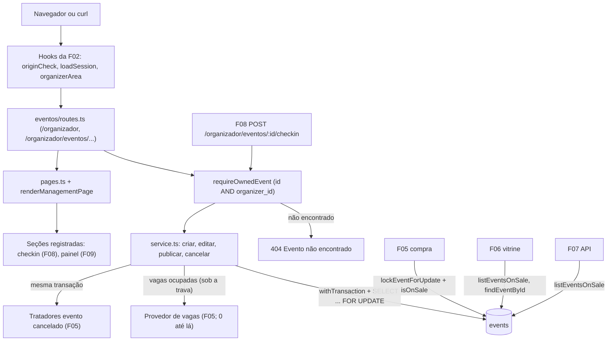

# Spec: F04 — Gestão de eventos

## 1. Visão técnica

**O quê.** A F04 cria o evento da Catraca e a área do organizador que o opera: a tabela `events` (id `evt_…`, dono, nome, início, local, lotação, preço em centavos, status `rascunho`/`publicado`/`cancelado`), a lista de `/organizador`, o formulário `Novo evento`, a página de gestão com URL própria (`/organizador/eventos/{id}`) com edição, `Publicar` e `Cancelar evento` (com confirmação), e o isolamento entre organizadores (R13): todo acesso a um evento passa por uma única consulta "id **e** dono", e evento alheio, inexistente ou com id inválido respondem o mesmo `404` `Evento não encontrado`. Além das telas, a F04 publica em `app/src/features/eventos/public.ts` a API que as features seguintes consomem: consultas de evento (por id, à venda, trava da linha), o ponto de extensão das vagas ocupadas (lotação mínima), o evento de domínio "evento cancelado" executado na mesma transação do cancelamento, o registro de seções da página de gestão e a convenção (com o guarda `requireOwnedEvent`) para rotas de ação sob `/organizador/eventos/:id/...`.

**Por quê.** F05 (compra), F06 (vitrine), F07 (API), F08 (check-in) e F09 (painel) dependem do evento e de três garantias que só a F04 pode dar na origem: (1) uma definição única de "à venda" (status `publicado`), usada igualmente pela vitrine, pela API e pela compra (R02, R11); (2) um protocolo de trava por evento (`SELECT … FOR UPDATE` na linha de `events`) que serializa edição de lotação, cancelamento e — na F05 — compras do mesmo evento, de modo que a lotação nunca fique abaixo das vagas ocupadas (R03, R05) e o cancelamento afete os ingressos na mesma transação (R11); (3) isolamento do organizador aplicado num único ponto e herdado pelas rotas e seções que F08 e F09 vão acrescentar (R13). Os pontos de extensão existem para que F05, F08 e F09 (waves 4–6, F06–F08 em paralelo) acrescentem arquivos próprios sem editar o template nem as rotas da F04.

**Complexidade:** `medium` — 8 rotas HTML, uma tabela nova com restrições de estado, serviço transacional com trava de linha, quatro pontos de extensão consumidos por cinco features e isolamento por dono.

### Escopo

**Incluído:**
- Migration da tabela `events` com `CHECK`s de formato, faixas e coerência de status, e índices para a lista do organizador e para os eventos à venda (seção 6).
- Módulo `eventos` (`app/src/features/eventos/`, `loadOrder` 30, `fastify-plugin` com nome `eventos`), que assume o `GET /organizador` do módulo mínimo `organizador` da F02 (o módulo `app/src/features/organizador/` é removido).
- Rotas da área do organizador (5.1): lista, novo, criação, página de gestão, edição, publicação, confirmação e execução do cancelamento.
- Leitura dos campos: data e hora em `DD/MM/AAAA HH:MM` ou `AAAA-MM-DDTHH:MM` no fuso `America/Sao_Paulo`; preço em reais com vírgula ou ponto (`100,00`, `100.00`), guardado em centavos; lotação inteira (5.2).
- Transições sob trava da linha: `rascunho` → `publicado`; `publicado` → `cancelado` (irreversível); edição só em `rascunho` e `publicado`; lotação nunca abaixo das vagas ocupadas (5.7–5.9).
- Isolamento R13: guarda `requireOwnedEvent` e página `404` `Evento não encontrado` idêntica para evento alheio, inexistente ou id inválido (5.10).
- API pública e pontos de extensão (5.11, 5.12): `findEventById`, `findEventsByIds`, `listEventsOnSale`, `lockEventForUpdate`, `isOnSale`, `isEventId`; `app.events.setOccupiedSeatsProvider`, `app.events.onEventCancelled`, `app.events.addManagementSection`, `app.events.renderManagementPage`; `requireOwnedEvent`, `ownedEvent`, `replyEventNotFound`, `eventManagementPath`, `EVENT_ROUTE_PREFIX`.
- Auxiliar de testes `app/test/helpers/events.ts` (`insertTestEvent`) para os testes de F05–F09.
- Testes em `app/test/f04/`, inclusive a pendência da F01 "a seed não cria eventos".
- Acréscimos pontuais em `README.md` e `AGENTS.md` (5.14).

**Excluído (e quem entrega):**
- Ingressos, vagas ocupadas reais, compra, preço pago gravado na compra, estorno/cancelamento dos ingressos no cancelamento do evento, resposta tardia do gateway: F05 (registra o provedor de vagas e o tratador de cancelamento definidos aqui).
- Vitrine, página pública do evento, "Meus ingressos": F06. API de parceiros: F07. Seção e rota de check-in: F08. Seção do painel: F09.
- Navegação: o link `Área do organizador` no topo já é da F02; a F04 não acrescenta contribuição de navegação.
- Exclusão, duplicação, eventos recorrentes, cancelamento de rascunho, "despublicar" (PRD, Fora de escopo; ver P22).

### Consome

| Item | De | Uso na F04 |
|---|---|---|
| Módulos em `app/src/features/<nome>/index.ts` com `loadOrder`, `fastify-plugin` | F01 (`app/src/core/modules.ts`) | Módulo `eventos`, `loadOrder` 30 |
| `reply.page`, `html`/`raw`, `PageMessage` | F01 (`app/src/core/layout.ts`, `html.ts`) | Todas as páginas; mensagens de sucesso e erro no topo |
| `app.db`, `withTransaction`, `Db`/`DbClient`/`Queryable` | F01 (`app/src/db/`) | Consultas e transações com trava |
| `newId('evt')`, `formatBRL`, `formatDateTimeBR`, `productOffset`, `PRODUCT_TIMEZONE` | F01 (`app/src/core/ids.ts`, `format.ts`) | IDs, preço e data exibidos, conversão do fuso |
| Runner de migrations com timestamp | F01 | Migration `…_create_events.sql` |
| Tabela `users` e contas da seed | F01 | Dono do evento (`organizer_id`) |
| `request.user` (`SessionUser`), `requireOrganizer`, `currentUser`, hook `organizerArea` (tudo sob `/organizador` protegido), `originCheck` em `POST` | F02 (`app/src/features/contas/public.ts`) | Dono sempre da sessão; visitante → `/entrar`, participante → `403` `Acesso negado` (CF03) |
| Módulo mínimo `organizador` (`GET /organizador` com `<h1>Área do organizador</h1>`) | F02 | Assumido: removido e substituído pela lista da F04 (P02) |
| `createTestApp`, `testDb`, `resetDatabase`, `seedAccounts`, `loginAs`, `sessionCookieFor` | F01, F02 (`app/test/helpers/`) | Testes em `app/test/f04/` |

### Provê (contratos de saída e pontos de extensão)

| Item provido | Onde | Consumidores |
|---|---|---|
| Evento `EventRecord` (`id` `evt_…`, `organizerId`, `name`, `startsAt`, `location`, `capacity`, `priceCents` vigente, `status`, `publishedAt`, `cancelledAt`, `createdAt`, `updatedAt`) e a tabela `events` (leitura por `SELECT`/`JOIN` liberada; escrita só pela F04) | `types.ts`, seção 6 | F05, F06, F07, F08, F09 |
| `findEventById(db, id)`, `findEventsByIds(db, ids)` | `public.ts` | F05, F06, F08, F09 |
| `listEventsOnSale(db)` — publicados (e portanto não cancelados), por `starts_at`, `id` | `public.ts` | F06, F07 |
| `isOnSale(event)` — a única definição de "à venda" (`status = 'publicado'`) | `public.ts` | F05, F06, F07 |
| `lockEventForUpdate(client, id)` — `SELECT … FOR UPDATE` da linha do evento (protocolo de trava, 5.12.4) | `public.ts` | F05 (compra) |
| `app.events.setOccupiedSeatsProvider(provider)` — vagas ocupadas para a validação de lotação mínima, chamado sob a trava; sem provedor = 0 | decorator `app.events` | F05 |
| `app.events.onEventCancelled(handler)` — evento de domínio "evento cancelado", tratadores executados na mesma transação e sob a trava | decorator `app.events` | F05 |
| `app.events.addManagementSection(section)` — seções da página de gestão, renderizadas abaixo do conteúdo da F04 em qualquer status | decorator `app.events` | F08 (`checkin`), F09 (`painel`) |
| `app.events.renderManagementPage(request, reply, event, options?)` — responde a página de gestão com mensagens no topo e estado por seção | decorator `app.events` | F08 (resultado do check-in) |
| `requireOwnedEvent` (preHandler), `ownedEvent(request)`, `replyEventNotFound(reply)`, `eventManagementPath(id, action?)`, `EVENT_ROUTE_PREFIX` | `public.ts` | F08 (e qualquer rota de ação futura) |
| `EVENT_STATUS_LABELS`, `EVENT_NOT_FOUND_MESSAGE` (`Evento não encontrado`) | `public.ts` | F06, F08, F09 |
| `insertTestEvent(db, dados)` | `app/test/helpers/events.ts` | testes de F05–F09 |

### Como as consumidoras usam (orientação para as specs seguintes)

- **F05 (Compra e ciclo do ingresso).** Módulo com `loadOrder` maior que 30 (sugestão: 40), envolvido por `fastify-plugin` com `dependencies: ['eventos', 'gateway']`. No registro: `app.events.setOccupiedSeatsProvider(async (client, eventId) => <pendentes + confirmados do evento>)` e `app.events.onEventCancelled(async (event, client) => <confirmados → refunded, pendentes → cancelled, usando client>)`. Na compra: `withTransaction(db, async (client) => { const event = await lockEventForUpdate(client, eventId); if (!event || !isOnSale(event)) → event_not_available; conta vagas ocupadas; ocupadas >= event.capacity → sold_out; grava o ingresso com valor pago = event.priceCents; solicita o gateway })` — a trava da linha do evento é a mesma da edição e do cancelamento (5.12.4). A CLI `compra:simular` usa as mesmas funções com o próprio pool. A tabela de ingressos referencia `events (id)`.
- **F06 (Vitrine).** `/`: `listEventsOnSale(app.db)`; `/eventos/:id`: `findEventById` + `isOnSale` (senão `404` com `EVENT_NOT_FOUND_MESSAGE`); "Meus ingressos": `JOIN events` ou `findEventsByIds` (inclusive eventos cancelados).
- **F07 (API).** `GET /api/partner/events`: `listEventsOnSale` com `startsAt` por `toIsoWithOffset(event.startsAt)` e `priceCents` do registro; a compra passa pela F05.
- **F08 (Check-in).** Módulo próprio; `app.events.addManagementSection({ name: 'checkin', order: 100, render })`; rota ``app.post(`${EVENT_ROUTE_PREFIX}/checkin`, { preHandler: requireOwnedEvent }, handler)``; o handler usa `ownedEvent(request)` (status `cancelado` → `Evento cancelado`, R10) e responde `app.events.renderManagementPage(request, reply, event, { messages, sectionState: { checkin: … } })`.
- **F09 (Painel).** `app.events.addManagementSection({ name: 'painel', order: 200, render })`, lendo `event.capacity`/`event.status` do contexto e os ingressos da F05.

### Regras e invariantes

- **Regras do brief implementadas:** R01 (campos e data no futuro ao criar e ao editar), R02 (nasce rascunho; "à venda" = publicado e não cancelado, definido aqui), R03 (lotação nunca abaixo das vagas ocupadas — validação sob trava com o provedor da F05; preço vigente atualizado no evento, sem efeito retroativo porque a F05 grava o valor pago), R04 (página de gestão com URL própria, extensível para check-in e painel), R11 (lado do evento: cancelamento só de publicado, irreversível, sem edição nem republicação, sai de "à venda"; os efeitos nos ingressos são da F05, na mesma transação), R13 (cada organizador só vê e opera os próprios eventos, inclusive pela URL direta).
- **Invariantes compartilhadas que a F04 sustenta ou não pode quebrar:**
  - *Lotação sob concorrência (R05–R07):* toda mudança de lotação, status e (na F05) toda compra acontece com a linha do evento travada (`FOR UPDATE`); a validação "lotação ≥ ocupadas" lê as vagas ocupadas sob essa trava, portanto não corre com compras.
  - *Cancelamento (R10, R11):* `cancelado` é terminal (nenhuma rota sai dele; `CHECK` no banco amarra `cancelled_at`); `isOnSale` é falso para `cancelado` e `rascunho`; os tratadores de cancelamento rodam na mesma transação do `UPDATE` de status — ou tudo acontece, ou nada.
  - *Receita (R03, R12):* a F04 só guarda o preço vigente; nunca altera valores de compras (a F05 copia o preço sob a trava no momento da compra).
  - *API igual à vitrine:* `listEventsOnSale`/`isOnSale` são a única definição de "à venda", usada pela vitrine, pela API e pela compra.
  - *Isolamento (R13):* o dono vem sempre da sessão (`currentUser(request).id`), nunca de campo de formulário; o evento é carregado por `id AND organizer_id` numa única consulta; evento alheio, inexistente e id inválido produzem a mesma resposta; seções e rotas de ação de outras features só recebem eventos já verificados.
  - *Resposta tardia do gateway:* não afetada (a F04 não toca ingressos nem tentativas de pagamento).

### Requisitos (capacidades do PRD → decisões desta spec)

| Capacidade (PRD F04) | Como esta spec atende |
|---|---|
| Nome 1–120, início no futuro (criar e editar), local 1–200, lotação inteira ≥ 1, preço > 0 com até 2 casas, em centavos | 5.2 (regras e mensagens), `CHECK`s da seção 6 |
| Todo evento nasce `rascunho`; publicar `rascunho` → `publicado` | `INSERT` sem status (padrão `rascunho`); 5.8 |
| Edição em `rascunho`/`publicado`, nunca em `cancelado`; lotação ≥ vagas ocupadas; preço novo só para compras futuras | 5.7 sob trava, provedor de vagas (5.12.2) |
| Cancelamento só de `publicado`, irreversível; efeitos nos ingressos na mesma transação | 5.9; tratadores `onEventCancelled` (5.12.3) |
| Página de gestão com URL própria (editar, publicar, cancelar, check-in, painel) | 5.6 + seções registradas (5.12.1) |
| Isolamento: lista só do organizador logado; página e ações de outro → `404` `Evento não encontrado`, sem dados | 5.3 (lista por dono), 5.10 (`requireOwnedEvent`) |
| IDs `evt_` + aleatório | `newId('evt')` (16 caracteres `[a-z0-9]`), `CHECK` de formato |
| Datas exibidas `05/12/2026 21:00`, fuso `America/Sao_Paulo` | `formatDateTimeBR` da F01; entrada interpretada no mesmo fuso (5.2) |

### Fluxos (experiência do PRD)

1. **Lista:** organizador abre `/organizador` → tabela com Nome (link para a página de gestão), Data e Status (`Rascunho`/`Publicado`/`Cancelado`) só dos próprios eventos, e o link `Novo evento`.
2. **Criação:** `/organizador/eventos/novo` → Nome, Data e hora de início, Local, Lotação, Preço (R$) → `Salvar` → `302` para `/organizador/eventos/{id}?ok=criado` → página de gestão com `Evento criado` e status `Rascunho`. Erro → `422`, mensagens acima do formulário e valores digitados repostos.
3. **Gestão:** dados e status; em `rascunho`, formulário de edição e `Publicar`; em `publicado`, formulário de edição e `Cancelar evento`; em `cancelado`, só o status `Cancelado`. Abaixo, as seções registradas (check-in, painel).
4. **Edição:** `Salvar alterações` → `302` `?ok=atualizado` (`Evento atualizado`); erro → `422` com a página de gestão, mensagens no topo e o formulário com os valores digitados.
5. **Publicação:** `Publicar` → `302` `?ok=publicado` (`Evento publicado`).
6. **Cancelamento:** `Cancelar evento` → página de confirmação com `Cancelar é irreversível. Confirmar?` e o botão `Confirmar cancelamento` → `302` `?ok=cancelado` (`Evento cancelado com sucesso`), status `Cancelado`, sem formulários.
7. **Outro organizador / visitante / participante:** `404` `Evento não encontrado` / `302` `/entrar` / `403` `Acesso negado` (os dois últimos pela F02).

## 2. Impacto na arquitetura

```
app/
├── migrations/<AAAAMMDDHHMMSS>_create_events.sql   # timestamp gerado na implementação
├── src/features/
│   ├── eventos/
│   │   ├── index.ts        # plugin (fastify-plugin "eventos"), loadOrder 30: decorators, hook onReady, rotas
│   │   ├── public.ts       # API pública (única porta de entrada para outras features)
│   │   ├── types.ts        # EventRecord, EventStatus, tipos de extensão, augmentation do Fastify
│   │   ├── messages.ts     # textos exatos (mensagens de erro, sucesso, rótulos)
│   │   ├── input.ts        # leitura de data/hora, preço e lotação; formatos de pré-preenchimento
│   │   ├── validation.ts   # validação do formulário completo (ordem e mensagens)
│   │   ├── repository.ts   # SQL da tabela events
│   │   ├── service.ts      # criar, editar, publicar, cancelar (transação + trava + extensões)
│   │   ├── extensions.ts   # registros (seções, provedor de vagas, tratadores) e renderManagementPage
│   │   ├── access.ts       # requireOwnedEvent, ownedEvent, replyEventNotFound, isEventId, caminhos
│   │   ├── pages.ts        # HTML: lista, novo, gestão, confirmação, 404
│   │   └── routes.ts       # rotas da área do organizador
│   └── organizador/index.ts   # REMOVIDO (módulo mínimo da F02, assumido pela F04)
└── test/
    ├── helpers/events.ts      # insertTestEvent (para F05–F09)
    └── f04/                   # testes da F04 (seção 7)
```

Documentação (fase final, acréscimos pontuais): `README.md`, `AGENTS.md`, `docs/state.json` (só a entrada F04), seção 10 desta spec.



**Sequência de waves.** A F04 é a única feature da Wave 3: pode editar arquivos compartilhados quando a spec diz (remoção do módulo `organizador` da F02). Para a Wave 5 paralela (F06, F07, F08), os pontos de extensão garantem que cada uma só crie arquivos no próprio módulo: nenhuma delas edita `eventos/`.

## 3. Decisões técnicas

| Decisão | Abordagem escolhida | Alternativa considerada | Trade-off |
|---|---|---|---|
| Serialização por evento | Trava pessimista da linha (`SELECT … FOR UPDATE` em `events`) em toda transição, edição de lotação e compra (F05) | Isolamento `SERIALIZABLE` com retentativas; trava consultiva por evento | Compras do mesmo evento esperam umas às outras (milissegundos), em troca de uma regra simples, sem retentativa e compartilhada pelas features; eventos diferentes não se bloqueiam |
| Lotação mínima antes da F05 | Provedor de vagas ocupadas registrado pela F05 (`setOccupiedSeatsProvider`), chamado sob a trava; sem provedor = 0 | A F04 consultar uma tabela de ingressos que ainda não existe; a F05 editar o serviço da F04 | A F04 não conhece ingressos; a F05 só registra uma função; um único provedor evita duas fontes da verdade |
| "Evento cancelado" | Tratadores síncronos (`onEventCancelled`) chamados na transação do cancelamento, depois do `UPDATE` de status, em ordem de registro; exceção desfaz tudo | Fila/outbox processada depois do commit | Efeito nos ingressos atômico e imediato (bem dentro dos 10 s de R11); um tratador lento atrasa a resposta do cancelamento |
| Registros de extensão | Por instância da aplicação (decorator `app.events`, como o `app.gateway` da F03), congelados no `onReady` | Registro global em módulo | Sem estado vazando entre apps de teste; registrar tarde vira erro explícito |
| Página de gestão extensível | Seções `{ name, order, render(context) }` renderizadas pela F04 abaixo do próprio conteúdo, embrulhadas em `<section class="gestao-secao" data-secao="…">`; `renderManagementPage` exportado para respostas de ações de outras features | Cada feature com a própria página; template com "slots" editado por todos | F08/F09 não tocam no template; a resposta do check-in mostra a página inteira com a mensagem em destaque |
| Isolamento | Uma consulta `WHERE id = $1 AND organizer_id = $2`; ausência → mesma página `404` para alheio, inexistente e id inválido | Buscar por id e comparar o dono no código (`403` para alheio) | Nenhum sinal de existência do evento de outro organizador (status, corpo e caminho de código iguais) |
| Mensagens de sucesso | Redirecionamento `302` para `/organizador/eventos/{id}?ok=<código>`; a página mapeia o código para um texto fixo | "Flash" em sessão/cookie | Sem estado novo; recarregar a página repete a mensagem (inofensivo); nenhum texto livre vem da URL |
| Confirmação do cancelamento | Página de confirmação no servidor (`GET …/cancelar`) e `POST` com `confirmar=sim`; sem o campo, só mostra a confirmação | `confirm()` em JavaScript | Verificável por `curl` e sem JavaScript; um clique a mais |
| Entrada de data | Campo de texto (`DD/MM/AAAA HH:MM`, também `AAAA-MM-DDTHH:MM`), fuso fixo do produto | `<input type="datetime-local">` | Mesmo formato da exibição e mensagens sempre do servidor (como a P13 da F02); sem seletor de data do navegador |

## 4. Componentes

**Módulo `eventos` (`app/src/features/eventos/`):**

| Arquivo | Novo/Modificado | Propósito | Responsabilidades |
|---|---|---|---|
| `index.ts` | Novo | Plugin da feature | `export const loadOrder = 30`; `default` envolvido por `fastify-plugin` (nome `eventos`, `dependencies: ['contas']`): `app.decorate('events', createEventsExtensions(app))`, `app.decorateRequest('ownedEvent', null)`, hook `onReady` que congela os registros, `registerEventRoutes(app)` |
| `public.ts` | Novo | API pública | Reexporta exatamente os itens de 5.11 (e importa `types.ts` para levar a augmentation do Fastify a quem importa) |
| `types.ts` | Novo | Tipos | `EventStatus`, `EventRecord`, `EVENT_STATUS_LABELS`, `EVENT_ID_PATTERN`, `OccupiedSeatsProvider`, `EventCancelledHandler`, `ManagementSection`, `ManagementSectionContext`, `ManagementPageOptions`, `EventsExtensions`; `declare module 'fastify'` com `FastifyInstance.events` e `FastifyRequest.ownedEvent` |
| `messages.ts` | Novo | Textos | Constantes com todas as mensagens de 5.2, 5.6–5.10 (byte a byte) e o mapa `SUCCESS_MESSAGES` (`criado`, `atualizado`, `publicado`, `cancelado`) |
| `input.ts` | Novo | Leitura de campos | `parseStartsAt(texto) → Date \| null`; `parsePriceCents(texto) → { ok: true, cents } \| { ok: false, reason: 'formato' \| 'casas' \| 'nao_positivo' \| 'maximo' }`; `parseCapacity(texto) → { ok: true, value } \| { ok: false, reason: 'invalida' \| 'maximo' }`; `formatStartsAtInput(date)` (`DD/MM/AAAA HH:MM`); `formatPriceInput(cents)` (`150,00`) |
| `validation.ts` | Novo | Formulário | `readEventForm(body)` (campo ausente, repetido ou não-texto = vazio); `validateEventForm(form, now = new Date())` → `{ ok: true, values: EventInput } \| { ok: false, messages: string[] }` na ordem Nome, Data, Local, Lotação, Preço (5.2) |
| `repository.ts` | Novo | SQL | `insertEvent`, `findEventById`, `findEventsByIds`, `findOwnedEvent`, `lockEventForUpdate`, `lockOwnedEventForUpdate`, `listEventsByOrganizer`, `listEventsOnSale`, `updateEventDetails`, `markPublished`, `markCancelled`; `toEventRecord(row)` (seção 6) |
| `service.ts` | Novo | Regras de estado | `createEvent`, `updateEvent`, `publishEvent`, `cancelEvent`: cada um numa `withTransaction` com `lockOwnedEventForUpdate`, devolvendo `{ ok: true, event }` ou `{ ok: false, code, status, message }` (5.7–5.9); chama o provedor de vagas e os tratadores de cancelamento de `app.events` |
| `extensions.ts` | Novo | Pontos de extensão | `createEventsExtensions(app)` → `EventsExtensions` (5.12): registros de seções, provedor e tratadores; `occupiedSeats`; `runCancelledHandlers`; `renderManagementPage`; `freeze()` |
| `access.ts` | Novo | Isolamento | `requireOwnedEvent`, `ownedEvent`, `replyEventNotFound`, `isEventId`, `eventManagementPath`, `EVENT_ROUTE_PREFIX` (5.10) |
| `pages.ts` | Novo | HTML | `organizerHomeContent`, `newEventContent`, `managementContent`, `cancelConfirmationContent`, `notFoundContent`, `eventFormFields`; tudo com `html` da F01 (5.3–5.10) |
| `routes.ts` | Novo | Rotas | As 8 rotas de 5.1 |

**Módulo removido:**

| Arquivo | Operação | Motivo |
|---|---|---|
| `app/src/features/organizador/index.ts` | Removido (com a pasta) | Módulo mínimo da F02 (`GET /organizador`), assumido pela F04: a rota passa a ser do `eventos`, mantendo `<h1>Área do organizador</h1>` e `requireOrganizer` (P02) |

**Banco:**

| Migration | Tabelas | Operação | Notas |
|---|---|---|---|
| `app/migrations/<AAAAMMDDHHMMSS>_create_events.sql` | `events` | CREATE | Timestamp de `date -u +%Y%m%d%H%M%S` na implementação (maior que os das migrations da F01–F03 já integradas) |

**Testes:**

| Arquivo | Novo/Modificado | Propósito |
|---|---|---|
| `app/test/helpers/events.ts` | Novo | `insertTestEvent(db, { organizerId, name?, startsAt?, location?, capacity?, priceCents?, status? }) → Promise<EventRecord>`: insere direto no banco com `published_at`/`cancelled_at` coerentes. Padrões: nome `Evento de teste <aleatório>`, início daqui a 30 dias, local `Local de teste`, lotação 10, preço 10000, status `publicado` |
| `app/test/f04/*.test.ts` | Novo | Seção 7 |

## 5. Contratos de API e interfaces

Todas as páginas são HTML (`text/html; charset=utf-8`) renderizadas por `reply.page` da F01, com o layout e a navegação da F02. Formulários `application/x-www-form-urlencoded`; um `POST` sem corpo é tratado como formulário vazio. Redirecionamentos `302` com `location` relativo. Nomes de campo em pt-BR. Nenhum atributo de validação do navegador (`required`, `min`, `maxlength`, `type="number"`, `type="datetime-local"`): as mensagens exibidas são sempre as do servidor.

### 5.1 Rotas

Todas ficam sob `/organizador` e por isso já passam pelo hook `organizerArea` da F02 (visitante → `302` `location: /entrar`; participante → `403` `Acesso negado`) antes de qualquer código da F04. Além disso, cada rota declara o guarda indicado.

| Método | Caminho | Guarda | Sucesso | Erros |
|---|---|---|---|---|
| `GET` | `/organizador` | `requireOrganizer` | `200` lista (5.3) | — |
| `GET` | `/organizador/eventos/novo` | `requireOrganizer` | `200` formulário (5.4) | — |
| `POST` | `/organizador/eventos` | `requireOrganizer` | `302` → `/organizador/eventos/{id}?ok=criado` (5.5) | `422` |
| `GET` | `/organizador/eventos/:id` | `requireOwnedEvent` | `200` página de gestão (5.6) | `404` |
| `POST` | `/organizador/eventos/:id/editar` | `requireOwnedEvent` | `302` → `…?ok=atualizado` (5.7) | `404`, `409`, `422` |
| `POST` | `/organizador/eventos/:id/publicar` | `requireOwnedEvent` | `302` → `…?ok=publicado` (5.8) | `404`, `409` |
| `GET` | `/organizador/eventos/:id/cancelar` | `requireOwnedEvent` | `200` confirmação (5.9) | `404`, `409` |
| `POST` | `/organizador/eventos/:id/cancelar` | `requireOwnedEvent` | `302` → `…?ok=cancelado` com `confirmar=sim`; `200` confirmação sem ele (5.9) | `404`, `409` |

A rota estática `/organizador/eventos/novo` tem precedência sobre `/organizador/eventos/:id` (roteador do Fastify). Ações reservadas pela F04 sob `/organizador/eventos/:id/`: `editar`, `publicar`, `cancelar`.

### 5.2 Campos do evento, leitura e validação

Campos ausentes, repetidos (array) ou não-texto valem texto vazio. Cada campo produz no máximo uma mensagem (a primeira regra que falhar); as mensagens são juntadas na ordem Nome, Data e hora de início, Local, Lotação, Preço e exibidas todas.

| Campo (rótulo) | Nome | Regras, na ordem | Mensagem |
|---|---|---|---|
| Nome | `nome` | Espaços das pontas removidos; vazio → erro; mais de 120 caracteres (pontos de código) → erro | `Informe o nome do evento`; `O nome pode ter no máximo 120 caracteres` |
| Data e hora de início | `inicio` | Espaços das pontas removidos; formato e data de calendário válidos (abaixo), senão erro; instante resultante menor ou igual ao instante atual do servidor → erro | `Informe a data e hora de início no formato DD/MM/AAAA HH:MM`; `A data de início precisa estar no futuro` |
| Local | `local` | Espaços das pontas removidos; vazio → erro; mais de 200 caracteres → erro | `Informe o local do evento`; `O local pode ter no máximo 200 caracteres` |
| Lotação | `lotacao` | Espaços das pontas removidos; precisa casar com `^\d+$` e valer pelo menos 1, senão erro (vazio, `0`, `1,5`, `1.5`, `-1`, `abc`); acima de 1.000.000 → erro | `A lotação precisa ser um número inteiro maior ou igual a 1`; `A lotação pode ser no máximo 1.000.000` |
| Preço (R$) | `preco` | Espaços das pontas removidos; prefixo opcional `R$` (com ou sem espaço depois) descartado; precisa casar com `^-?\d+([.,]\d+)?$`, senão erro (vazio, `abc`); mais de 2 casas depois do separador → erro (`10,999`, `1.000`); valor em centavos ≤ 0 → erro (`0`, `0,00`, `-5`); acima de 100.000.000 centavos → erro | `O preço precisa ser maior que zero` (formato inválido e valor ≤ 0); `O preço pode ter no máximo 2 casas decimais`; `O preço pode ser no máximo R$ 1.000.000,00` |

**Data e hora de início (`parseStartsAt`).** Formatos aceitos:
1. `DD/MM/AAAA HH:MM` — `^(\d{1,2})/(\d{1,2})/(\d{4})\s+(\d{1,2}):(\d{2})$` (dia, mês e hora com 1 ou 2 dígitos);
2. `AAAA-MM-DDTHH:MM` ou `AAAA-MM-DD HH:MM`, com segundos opcionais — `^(\d{4})-(\d{2})-(\d{2})[T ](\d{2}):(\d{2})(?::(\d{2}))?$`.

Mês 1–12, dia existente no mês (anos bissextos), hora 0–23, minuto e segundo 0–59. O horário digitado é interpretado no fuso `America/Sao_Paulo`: instante = `Date.UTC(campos) − offset`, com o offset do fuso naquele instante (`productOffset` da F01; hoje sempre `-03:00`); se o instante, formatado de volta no fuso, não reproduz os mesmos campos (horário inexistente numa eventual mudança de horário de verão), a data é inválida. Exemplos: `15/12/2026 21:00`, `2026-12-15T21:00` e `2026-12-15 21:00:00` → `2026-12-16T00:00:00Z`.

**Preço (`parsePriceCents`).** `100,00`, `100.00`, `100`, `R$ 100,00` → `10000`; `42,5` → `4250`; `0,01` → `1`. Sem separador de milhar.

**Pré-preenchimento do formulário de edição:** nome e local como guardados; início em `DD/MM/AAAA HH:MM` (`formatDateTimeBR`); lotação em decimal; preço em reais com vírgula e duas casas, sem `R$` nem milhar (`formatPriceInput`: `15000` → `150,00`, `123456` → `1234,56`). Depois de um erro, o formulário repõe os valores exatamente como digitados (sem remover espaços), escapados.

**Campos do formulário (HTML exato, usado na criação e na edição; `{…}` = valor escapado):**

```html
<label for="nome">Nome</label>
<input id="nome" name="nome" type="text" value="{nome}">
<label for="inicio">Data e hora de início</label>
<input id="inicio" name="inicio" type="text" placeholder="DD/MM/AAAA HH:MM" value="{inicio}">
<small>Horário de Brasília (America/Sao_Paulo).</small>
<label for="local">Local</label>
<input id="local" name="local" type="text" value="{local}">
<label for="lotacao">Lotação</label>
<input id="lotacao" name="lotacao" type="text" inputmode="numeric" value="{lotacao}">
<label for="preco">Preço (R$)</label>
<input id="preco" name="preco" type="text" inputmode="decimal" placeholder="100,00" value="{preco}">
```

Campos extras (`organizer_id`, `status`, `id`, `price_cents`…) são ignorados: o dono é sempre `currentUser(request).id` e o status inicial é sempre `rascunho`.

### 5.3 `GET /organizador`

`200`, título `Área do organizador`. Conteúdo, nesta ordem:
- `<h1>Área do organizador</h1>`
- `<p><a href="/organizador/eventos/novo">Novo evento</a></p>`
- Sem eventos: `<p>Você ainda não tem eventos.</p>`. Com eventos: `<table>` com `<thead><tr><th>Nome</th><th>Data</th><th>Status</th></tr></thead>` e, no `<tbody>`, uma linha por evento **do organizador logado** (`WHERE organizer_id = $1`), ordenadas por `starts_at`, `created_at`, `id`, cada uma exatamente numa linha do HTML:
  `<tr><td><a href="/organizador/eventos/{id}">{nome}</a></td><td>{DD/MM/AAAA HH:MM}</td><td>{Rascunho|Publicado|Cancelado}</td></tr>`

Sem paginação.

### 5.4 `GET /organizador/eventos/novo`

`200`, título `Novo evento`. Conteúdo: `<h1>Novo evento</h1>`; `<form method="post" action="/organizador/eventos">` com os campos de 5.2 vazios e `<button type="submit">Salvar</button>`; `<p><a href="/organizador">Voltar para meus eventos</a></p>`.

### 5.5 `POST /organizador/eventos`

**Processamento:** `validateEventForm`; com mensagens → `422`, sem consultar o banco. Sem mensagens → `INSERT` com `id = newId('evt')`, `organizer_id = currentUser(request).id`, status padrão `rascunho`; log `eventos: evento criado`.

| Situação | Status | Cabeçalhos | Corpo |
|---|---|---|---|
| Sucesso | `302` | `location: /organizador/eventos/{id}?ok=criado` | — |
| Erro de validação | `422` | — | Página `Novo evento` com cada mensagem em `reply.page({ messages: [{ kind: 'error', text }] })` (antes do `<h1>` e do formulário) e os valores repostos como digitados |

Exemplo:

```
POST /organizador/eventos
Content-Type: application/x-www-form-urlencoded

nome=Jazz+no+Por%C3%A3o&inicio=05%2F12%2F2026+21%3A00&local=Bar+do+Centro&lotacao=2&preco=100%2C00

302
location: /organizador/eventos/evt_8f2kq0x7m1c9z3ab?ok=criado
```

Linha criada: `status = 'rascunho'`, `capacity = 2`, `price_cents = 10000`, `starts_at = 2026-12-06T00:00:00Z` (21:00 em São Paulo), `published_at` e `cancelled_at` nulos.

### 5.6 `GET /organizador/eventos/:id` — página de gestão

**Guarda:** `requireOwnedEvent` (5.10). **Query:** `ok` opcional; `criado` → `Evento criado`, `atualizado` → `Evento atualizado`, `publicado` → `Evento publicado`, `cancelado` → `Evento cancelado com sucesso`, cada um como mensagem `success` no topo; qualquer outro valor é ignorado.

**Resposta:** `200`, título `{nome}`. Conteúdo (ordem fixa; cada linha abaixo é uma linha do HTML):

```html
<h1>{nome}</h1>
<p>Status: <strong data-status="{status}">{Rascunho|Publicado|Cancelado}</strong></p>
<dl>
<dt>Data e hora de início</dt><dd>{DD/MM/AAAA HH:MM}</dd>
<dt>Local</dt><dd>{local}</dd>
<dt>Lotação</dt><dd>{lotação}</dd>
<dt>Preço</dt><dd>{R$ 1.234,56}</dd>
</dl>
```

Depois, conforme o status:

| Status | Bloco | HTML |
|---|---|---|
| `rascunho`, `publicado` | Edição | `<section data-secao="edicao">`, `<h2>Editar evento</h2>`, `<form method="post" action="/organizador/eventos/{id}/editar">` com os campos de 5.2 pré-preenchidos e `<button type="submit">Salvar alterações</button>`, `</form>`, `</section>` |
| `rascunho` | Publicar | `<form method="post" action="/organizador/eventos/{id}/publicar"><button type="submit">Publicar</button></form>` |
| `publicado` | Cancelar | `<form method="get" action="/organizador/eventos/{id}/cancelar"><button type="submit">Cancelar evento</button></form>` |
| `cancelado` | — | Nenhum formulário: nem edição, nem publicação, nem cancelamento (a indicação é o status `Cancelado`) |

Em seguida, em qualquer status, cada seção registrada (5.12.1), na ordem, como `<section class="gestao-secao" data-secao="{name}">{HTML da seção}</section>`; e por fim `<p><a href="/organizador">Voltar para meus eventos</a></p>`.

Nenhum outro lugar da página contém os textos `Publicar`, `Cancelar evento`, `Salvar alterações` ou `Este evento foi cancelado e não pode mais ser alterado` além dos descritos (as mensagens de erro de 5.7–5.9 aparecem uma vez, no topo).

### 5.7 `POST /organizador/eventos/:id/editar`

**Ordem de processamento:**
1. `requireOwnedEvent` → `404` se não for do organizador.
2. Evento `cancelado` → `409` com `Este evento foi cancelado e não pode mais ser alterado`.
3. `validateEventForm` (todos os campos, inclusive início no futuro mesmo que não tenha mudado) → `422` com as mensagens.
4. `withTransaction`: `lockOwnedEventForUpdate(client, id, organizerId)` (ausente → `404`; `cancelado` → `409` como no passo 2, cobrindo a corrida com um cancelamento); `occupied = await app.events.occupiedSeats(client, id)`; `lotação < occupied` → `422` com `A lotação não pode ficar menor que as vagas ocupadas` (nada é alterado); senão `updateEventDetails` (nome, início, local, lotação, preço, `updated_at = now()`); commit.

| Situação | Status | Cabeçalhos / corpo |
|---|---|---|
| Sucesso | `302` | `location: /organizador/eventos/{id}?ok=atualizado` |
| Evento de outro organizador, inexistente ou id inválido | `404` | Página de 5.10 |
| Evento cancelado | `409` | Página de gestão (estado cancelado, sem formulários) com a mensagem no topo |
| Validação ou lotação abaixo das vagas ocupadas | `422` | Página de gestão com as mensagens no topo, `<dl>` com os valores guardados e o formulário com os valores digitados |

O preço novo vale só para compras futuras: a F04 só atualiza `price_cents`; a F05 grava o valor pago na compra (R03).

### 5.8 `POST /organizador/eventos/:id/publicar`

`requireOwnedEvent`; `withTransaction` + `lockOwnedEventForUpdate`:

| Status atual | Resultado |
|---|---|
| `rascunho` | `markPublished` (`status = 'publicado'`, `published_at = now()`, `updated_at = now()`) → `302` `location: /organizador/eventos/{id}?ok=publicado` |
| `publicado` | `409`, página de gestão com `Este evento já está publicado`; nada muda |
| `cancelado` | `409`, página de gestão com `Este evento foi cancelado e não pode mais ser alterado`; nada muda |

A publicação não revalida a data (R01 vale ao criar e ao editar; P17).

### 5.9 Cancelamento: `GET` e `POST /organizador/eventos/:id/cancelar`

Verificações comuns, nesta ordem: `requireOwnedEvent` (`404`); status `cancelado` → `409` com `Este evento foi cancelado e não pode mais ser alterado`; status `rascunho` → `409` com `Só evento publicado pode ser cancelado` (em ambos, a página de gestão com a mensagem no topo, nada muda).

**Página de confirmação** (`GET`, ou `POST` sem `confirmar=sim`, num evento `publicado`): `200`, título `Cancelar evento`, conteúdo:

```html
<h1>Cancelar evento</h1>
<p>Evento: <strong>{nome}</strong></p>
<p>Cancelar é irreversível. Confirmar?</p>
<form method="post" action="/organizador/eventos/{id}/cancelar"><input type="hidden" name="confirmar" value="sim"><button type="submit">Confirmar cancelamento</button></form>
<p><a href="/organizador/eventos/{id}">Voltar</a></p>
```

**Execução** (`POST` com `confirmar` igual a `sim`): `withTransaction`: `lockOwnedEventForUpdate` (refaz as verificações de status sob a trava); `markCancelled` (`status = 'cancelado'`, `cancelled_at = now()`, `updated_at = now()`); `runCancelledHandlers(event, client)` com o registro já cancelado; commit; log `eventos: evento cancelado`; `302` `location: /organizador/eventos/{id}?ok=cancelado`. Exceção de um tratador → rollback (o evento continua `publicado`), log `eventos: falha no tratador de cancelamento` e a página `500` da F01. Dois cancelamentos simultâneos: o segundo espera a trava, encontra `cancelado` e recebe `409`.

### 5.10 Isolamento: `requireOwnedEvent` e a página 404

`requireOwnedEvent(request, reply)` (preHandler, rota com parâmetro `:id`):
1. Aplica `requireOrganizer` da F02 (visitante → `302` `/entrar`; participante → `403`); se a resposta foi enviada, para.
2. Lê `request.params.id`; se não for texto no formato `^evt_[a-z0-9]{16}$` (`isEventId`) → página 404.
3. `findOwnedEvent(app.db, id, currentUser(request).id)` — `SELECT … FROM events WHERE id = $1 AND organizer_id = $2`; sem linha → página 404 e log `eventos: evento não encontrado para o organizador` (`userId`).
4. `request.ownedEvent = event`.

**Página 404** (`replyEventNotFound`): status `404`, título `Evento não encontrado`, conteúdo exatamente:

```html
<h1>Evento não encontrado</h1>
<p><a href="/organizador">Voltar para meus eventos</a></p>
```

O corpo é idêntico para evento de outro organizador, inexistente e id inválido: não repete o id, o nome, o status nem qualquer número do evento. Vale para todas as rotas de 5.1 com `:id` (inclusive `GET …/cancelar` e todos os `POST`) e para as rotas de ação que F08 e outras features acrescentarem com `requireOwnedEvent`.

### 5.11 API pública (`app/src/features/eventos/public.ts`)

Outras features importam somente deste arquivo (os testes podem importar internos).

| Export | Assinatura | Comportamento |
|---|---|---|
| `EventStatus` | `'rascunho' \| 'publicado' \| 'cancelado'` | — |
| `EventRecord` | `{ id: string; organizerId: string; name: string; startsAt: Date; location: string; capacity: number; priceCents: number; status: EventStatus; publishedAt: Date \| null; cancelledAt: Date \| null; createdAt: Date; updatedAt: Date }` | Registro completo da linha |
| `EVENT_STATUS_LABELS` | `Readonly<Record<EventStatus, string>>` | `{ rascunho: 'Rascunho', publicado: 'Publicado', cancelado: 'Cancelado' }` |
| `EVENT_NOT_FOUND_MESSAGE` | `'Evento não encontrado'` | Texto do 404 (reusado pela F06) |
| `findEventById` | `(db: Queryable, id: string) => Promise<EventRecord \| null>` | Qualquer status e qualquer dono; `null` se não existir ou se `id` não tiver o formato |
| `findEventsByIds` | `(db: Queryable, ids: readonly string[]) => Promise<Map<string, EventRecord>>` | Uma consulta (`id = ANY($1)`); ids ausentes não entram no mapa |
| `listEventsOnSale` | `(db: Queryable) => Promise<EventRecord[]>` | `status = 'publicado'`, de todos os organizadores, por `starts_at`, `id`; sem filtro de data (P19) |
| `lockEventForUpdate` | `(client: DbClient, id: string) => Promise<EventRecord \| null>` | `SELECT … FROM events WHERE id = $1 FOR UPDATE`; precisa estar dentro de `withTransaction`; segura a linha até o fim da transação |
| `isOnSale` | `(event: Pick<EventRecord, 'status'>) => boolean` | `event.status === 'publicado'` |
| `isEventId` | `(value: unknown) => value is string` | Texto no formato `^evt_[a-z0-9]{16}$` |
| `requireOwnedEvent` | `(request: FastifyRequest, reply: FastifyReply) => Promise<void>` | preHandler de 5.10 |
| `ownedEvent` | `(request: FastifyRequest) => EventRecord` | `request.ownedEvent`; se `null`, lança `Error('ownedEvent sem evento: use requireOwnedEvent na rota')` (vira `500` — erro de programação) |
| `replyEventNotFound` | `(reply: FastifyReply) => Promise<FastifyReply>` | Responde a página 404 de 5.10 |
| `eventManagementPath` | `(eventId: string, action?: string) => string` | `/organizador/eventos/{id}` ou `/organizador/eventos/{id}/{action}` |
| `EVENT_ROUTE_PREFIX` | `'/organizador/eventos/:id'` | Prefixo das rotas de ação |
| tipos de extensão | `OccupiedSeatsProvider`, `EventCancelledHandler`, `ManagementSection`, `ManagementSectionContext`, `ManagementPageOptions`, `EventsExtensions` | 5.12 |

**Decorators:** `app.events: EventsExtensions` (5.12) e `request.ownedEvent: EventRecord | null` (preenchido por `requireOwnedEvent`).

### 5.12 Pontos de extensão (`app.events`)

```ts
interface EventsExtensions {
  setOccupiedSeatsProvider(provider: OccupiedSeatsProvider): void;
  onEventCancelled(handler: EventCancelledHandler): void;
  addManagementSection(section: ManagementSection): void;
  renderManagementPage(request: FastifyRequest, reply: FastifyReply, event: EventRecord, options?: ManagementPageOptions): Promise<FastifyReply>;
  occupiedSeats(client: DbClient, eventId: string): Promise<number>; // uso interno da F04; as consumidoras usam as vagas da F05
}
```

Os métodos de registro só podem ser chamados antes de a aplicação ficar pronta (no registro do plugin da feature consumidora, que precisa ter `loadOrder` maior que 30, ou num teste antes do primeiro `inject`); depois do `onReady`, lançam `Error('eventos: registro de extensão depois de a aplicação ficar pronta')`.

#### 5.12.1 Seções da página de gestão

```ts
interface ManagementSection {
  name: string;   // único; [a-z][a-z0-9-]*; 'edicao' é reservado
  order: number;  // menor aparece antes; sugestão: checkin 100 (F08), painel 200 (F09)
  render(context: ManagementSectionContext): SafeHtml | Promise<SafeHtml>;
}
interface ManagementSectionContext {
  request: FastifyRequest;
  event: EventRecord;        // já verificado como do organizador logado
  organizer: SessionUser;
  db: Db;
  state: unknown;            // options.sectionState?.[section.name]
}
```

Nome repetido, reservado ou fora do formato → `Error` no registro. Empate de `order` → ordem de registro. As seções aparecem em todos os status (o check-in continua disponível em evento cancelado, PRD F08). Exceção numa seção → `500` da F01.

#### 5.12.2 Vagas ocupadas (lotação mínima)

```ts
type OccupiedSeatsProvider = (client: DbClient, eventId: string) => Promise<number>;
```

Um único provedor por aplicação (segundo registro → `Error`). `occupiedSeats(client, eventId)` chama o provedor com o `client` da transação da edição, com a linha do evento já travada; sem provedor, devolve `0`. Resultado que não seja inteiro seguro ≥ 0 → `Error` (erro de programação, `500`).

#### 5.12.3 Evento de domínio "evento cancelado"

```ts
type EventCancelledHandler = (event: EventRecord, client: DbClient) => Promise<void>;
```

Vários tratadores, chamados em sequência, na ordem de registro, dentro da transação do cancelamento, depois do `UPDATE` de status (o `event` recebido já tem `status = 'cancelado'` e `cancelledAt`), com a linha do evento travada. Todas as escritas do tratador usam o `client` recebido. Exceção → a transação inteira é desfeita (5.9). Os tratadores não podem travar outros eventos (evita deadlock).

#### 5.12.4 Protocolo de trava do evento

Toda operação que muda status, lotação ou preço do evento, ou que cria/altera ingressos que ocupam vaga, roda numa transação cuja primeira operação sobre o evento é travar a linha dele (`lockEventForUpdate` ou, na F04, `lockOwnedEventForUpdate`) e só então lê vagas ocupadas, compara e escreve. Ordem de travas: primeiro a linha do evento, depois linhas de ingressos. Consequências: uma redução de lotação e uma compra do mesmo evento nunca se intercalam; o cancelamento e os efeitos nos ingressos acontecem juntos; compras depois do commit do cancelamento encontram `cancelado` (`isOnSale` falso).

#### 5.12.5 `renderManagementPage` e rotas de ação de outras features

```ts
interface ManagementPageOptions {
  status?: number;                                    // padrão 200
  messages?: readonly PageMessage[];                  // topo da página, "em destaque"
  sectionState?: Readonly<Record<string, unknown>>;   // repassado a cada seção pelo nome
}
```

Responde a página de gestão de 5.6 (mesmo conteúdo, mensagens no topo). Se `event.organizerId` for diferente de `request.user?.id`, lança `Error` (erro de programação: o evento precisa vir de `ownedEvent(request)`).

**Convenção para rotas de ação** (ex.: check-in da F08): no módulo da própria feature, ``app.post(`${EVENT_ROUTE_PREFIX}/<acao>`, { preHandler: requireOwnedEvent }, handler)``; `<acao>` em minúsculas, diferente de `editar`, `publicar` e `cancelar`; o handler obtém o evento com `ownedEvent(request)`, faz o próprio trabalho (com `lockEventForUpdate` se mexer com vagas) e responde com `app.events.renderManagementPage(...)` ou com um `302` para `eventManagementPath(id)`. Nenhuma feature registra `GET /organizador/eventos/:id` nem edita arquivos de `eventos/`.

### 5.13 Logs

Prefixo `eventos:`, pelo `request.log` do Fastify; nunca o corpo do formulário.

| Evento | Nível | Mensagem (campos) |
|---|---|---|
| Criação | `info` | `eventos: evento criado` (`eventId`, `organizerId`) |
| Edição | `info` | `eventos: evento atualizado` (`eventId`) |
| Publicação | `info` | `eventos: evento publicado` (`eventId`) |
| Cancelamento | `info` | `eventos: evento cancelado` (`eventId`, `handlers`) |
| Ação recusada por estado ou vagas | `info` | `eventos: ação recusada` (`eventId`, `action`, `code`) |
| Evento alheio, inexistente ou id inválido | `info` | `eventos: evento não encontrado para o organizador` (`userId`) |
| Falha num tratador de cancelamento | `error` | `eventos: falha no tratador de cancelamento` (`eventId`, `err`) |

### 5.14 Documentação (fase final)

| Arquivo | Mudança (só acréscimos) |
|---|---|
| `README.md` | Em `## Endereços`: linha "Área do organizador: `$WEB/organizador` (organizadores da seed)". Em `## Decisões`: linha "Eventos e isolamento" — o evento é sempre carregado por id **e** dono na mesma consulta (evento de outro organizador = inexistente = `404`), e toda mudança de lotação/status (e, na F05, toda compra) trava a linha do evento (`SELECT … FOR UPDATE`) |
| `AGENTS.md` | Em "Convenções de código": linha "Eventos: importe só de `app/src/features/eventos/public.ts`; seções da página de gestão por `app.events.addManagementSection`, rotas de ação em `${EVENT_ROUTE_PREFIX}/<acao>` com `requireOwnedEvent`; quem mexe com vagas trava a linha do evento com `lockEventForUpdate`; nos testes, `insertTestEvent` de `app/test/helpers/events.ts`" |

## 6. Modelo de dados

**Tabela: `events`**

| Coluna | Tipo | Nulo | Padrão | Descrição |
|---|---|---|---|---|
| `id` | `text` | Não | — | `evt_` + 16 caracteres `[a-z0-9]` (`newId('evt')`); chave primária |
| `organizer_id` | `text` | Não | — | Dono (`users.id`, papel `organizador`) |
| `name` | `text` | Não | — | 1 a 120 caracteres |
| `starts_at` | `timestamptz` | Não | — | Início (instante; exibido no fuso `America/Sao_Paulo`) |
| `location` | `text` | Não | — | 1 a 200 caracteres |
| `capacity` | `integer` | Não | — | Lotação, 1 a 1.000.000 |
| `price_cents` | `integer` | Não | — | Preço vigente em centavos, 1 a 100.000.000 |
| `status` | `text` | Não | `'rascunho'` | `rascunho`, `publicado` ou `cancelado` |
| `published_at` | `timestamptz` | Sim | — | Momento da publicação; nulo só em `rascunho` |
| `cancelled_at` | `timestamptz` | Sim | — | Momento do cancelamento; preenchido só em `cancelado` |
| `created_at` | `timestamptz` | Não | `now()` | Criação |
| `updated_at` | `timestamptz` | Não | `now()` | Última alteração (edição, publicação, cancelamento) |

**Índices e restrições:**

| Nome | Tipo | Definição | Propósito |
|---|---|---|---|
| `events_pkey` | PRIMARY KEY | `id` | Busca por id e trava da linha |
| `events_organizer_id_fkey` | FOREIGN KEY | `organizer_id REFERENCES users (id)` (sem cascata) | Integridade do dono |
| `events_id_format` | CHECK | `id ~ '^evt_[a-z0-9]{16}$'` | Formato do id |
| `events_name_length` | CHECK | `char_length(name) BETWEEN 1 AND 120` | R01 |
| `events_location_length` | CHECK | `char_length(location) BETWEEN 1 AND 200` | R01 |
| `events_capacity_range` | CHECK | `capacity BETWEEN 1 AND 1000000` | R01 |
| `events_price_cents_range` | CHECK | `price_cents BETWEEN 1 AND 100000000` | R01 (preço > 0) |
| `events_status_check` | CHECK | `status IN ('rascunho', 'publicado', 'cancelado')` | Status do PRD |
| `events_published_at_status` | CHECK | `(status = 'rascunho') = (published_at IS NULL)` | Só rascunho não tem publicação |
| `events_cancelled_at_status` | CHECK | `(status = 'cancelado') = (cancelled_at IS NOT NULL)` | Cancelado sempre com momento; nenhum outro status com ele |
| `events_organizer_starts_idx` | INDEX | `(organizer_id, starts_at)` | Lista de `/organizador` |
| `events_on_sale_idx` | INDEX parcial | `(starts_at) WHERE status = 'publicado'` | `listEventsOnSale` (vitrine, API) |

A data no futuro (R01) não é `CHECK` (depende do relógio): é validada pela aplicação ao criar e ao editar.

**Migration `app/migrations/<AAAAMMDDHHMMSS>_create_events.sql`:**

```sql
CREATE TABLE events (
    id           text        PRIMARY KEY,
    organizer_id text        NOT NULL REFERENCES users (id),
    name         text        NOT NULL,
    starts_at    timestamptz NOT NULL,
    location     text        NOT NULL,
    capacity     integer     NOT NULL,
    price_cents  integer     NOT NULL,
    status       text        NOT NULL DEFAULT 'rascunho',
    published_at timestamptz,
    cancelled_at timestamptz,
    created_at   timestamptz NOT NULL DEFAULT now(),
    updated_at   timestamptz NOT NULL DEFAULT now(),
    CONSTRAINT events_id_format           CHECK (id ~ '^evt_[a-z0-9]{16}$'),
    CONSTRAINT events_name_length         CHECK (char_length(name) BETWEEN 1 AND 120),
    CONSTRAINT events_location_length     CHECK (char_length(location) BETWEEN 1 AND 200),
    CONSTRAINT events_capacity_range      CHECK (capacity BETWEEN 1 AND 1000000),
    CONSTRAINT events_price_cents_range   CHECK (price_cents BETWEEN 1 AND 100000000),
    CONSTRAINT events_status_check        CHECK (status IN ('rascunho', 'publicado', 'cancelado')),
    CONSTRAINT events_published_at_status CHECK ((status = 'rascunho') = (published_at IS NULL)),
    CONSTRAINT events_cancelled_at_status CHECK ((status = 'cancelado') = (cancelled_at IS NOT NULL))
);

CREATE INDEX events_organizer_starts_idx ON events (organizer_id, starts_at);
CREATE INDEX events_on_sale_idx ON events (starts_at) WHERE status = 'publicado';
```

**Consultas (SQL explícito, parâmetros posicionais; `{cols}` = `id, organizer_id, name, starts_at, location, capacity, price_cents, status, published_at, cancelled_at, created_at, updated_at`):**

| Função | SQL |
|---|---|
| `insertEvent` | `INSERT INTO events (id, organizer_id, name, starts_at, location, capacity, price_cents) VALUES ($1, $2, $3, $4, $5, $6, $7) RETURNING {cols}` |
| `findEventById` | `SELECT {cols} FROM events WHERE id = $1` |
| `findEventsByIds` | `SELECT {cols} FROM events WHERE id = ANY($1::text[])` |
| `findOwnedEvent` | `SELECT {cols} FROM events WHERE id = $1 AND organizer_id = $2` |
| `lockEventForUpdate` | `SELECT {cols} FROM events WHERE id = $1 FOR UPDATE` |
| `lockOwnedEventForUpdate` | `SELECT {cols} FROM events WHERE id = $1 AND organizer_id = $2 FOR UPDATE` |
| `listEventsByOrganizer` | `SELECT {cols} FROM events WHERE organizer_id = $1 ORDER BY starts_at, created_at, id` |
| `listEventsOnSale` | `SELECT {cols} FROM events WHERE status = 'publicado' ORDER BY starts_at, id` |
| `updateEventDetails` | `UPDATE events SET name = $2, starts_at = $3, location = $4, capacity = $5, price_cents = $6, updated_at = now() WHERE id = $1 AND status IN ('rascunho', 'publicado') RETURNING {cols}` |
| `markPublished` | `UPDATE events SET status = 'publicado', published_at = now(), updated_at = now() WHERE id = $1 AND status = 'rascunho' RETURNING {cols}` |
| `markCancelled` | `UPDATE events SET status = 'cancelado', cancelled_at = now(), updated_at = now() WHERE id = $1 AND status = 'publicado' RETURNING {cols}` |

Os `UPDATE`s repetem a condição de status como defesa extra (sob a trava ela já foi conferida). `toEventRecord` converte `snake_case` em `camelCase` (`timestamptz` chega como `Date`; `integer` como `number`). `resetDatabase` dos testes já trunca `events` (todas as tabelas de `public`).

## 7. Estratégia de testes

Integração com `createTestApp` + `app.inject()` e sessões de `loginAs`/`sessionCookieFor` (F02); unitários para a leitura dos campos. Datas relativas ao momento do teste (amanhã, mês seguinte, ontem), nunca fixas. Cada teste ligado a critério leva o ID no nome. Arquivos em `app/test/f04/`; rodam pelo `npm run gates`.

**`entrada.test.ts`** (unidade)

| Teste | Asserções |
|---|---|
| `F04-CA01 data em DD/MM/AAAA HH:MM e AAAA-MM-DDTHH:MM é lida no fuso America/Sao_Paulo` | `15/12/2026 21:00`, `2026-12-15T21:00`, `2026-12-15 21:00:00`, `5/1/2027 9:05` → instantes UTC esperados (`…T00:00:00Z` no dia seguinte etc.) |
| `data inexistente ou fora do formato é inválida` | `31/02/2027 10:00`, `2027-13-01T10:00`, `15/12/2026`, `amanhã`, `25:00` → `null` |
| `F04-CA03 preço com vírgula, ponto, sem casas e com R$ vira centavos` | `100,00`, `100.00`, `100`, `R$ 100,00`, `R$100` → 10000; `42,5` → 4250; `0,01` → 1 |
| `F04-CA03 preço zero, negativo, vazio ou texto não é positivo` | `0,00`, `0`, `-5`, texto vazio, `abc` → motivo que leva a `O preço precisa ser maior que zero` |
| `preço com mais de 2 casas ou acima do máximo é rejeitado` | `10,999`, `1.000` → casas; `1000000,01` → máximo; `1000000,00` aceito |
| `F04-CA03 lotação 0, 1,5, -1 e texto são rejeitadas; 1 e 007 são aceitas` | motivos e valores |
| `formatos de pré-preenchimento` | `formatPriceInput(15000)` → `150,00`; `formatStartsAtInput` → `15/12/2026 21:00` |

**`criacao.test.ts`**

| Teste | Asserções |
|---|---|
| `F04-CA01 organizador cria evento que nasce Rascunho com id evt_ e vai para a página de gestão` | `302`, `location` `^/organizador/eventos/evt_[a-z0-9]{16}\?ok=criado$`; linha com `status = rascunho`, `capacity = 2`, `price_cents = 10000`, `organizer_id` = A, `published_at` nulo |
| `F04-CA01 a página de gestão mostra Evento criado, status, data, local, lotação e preço` | HTML de 5.6 com `Evento criado`, `Rascunho`, `<dd>15/MM/AAAA 21:00</dd>`, `<dd>R$ 100,00</dd>`, `Publicar`, sem `Cancelar evento` |
| `F04-CA01 o evento aparece na lista de /organizador com nome, data e status` | linha `<tr>` exata de 5.3 |
| `F04-CA02 data de ontem é rejeitada sem criar evento` | `422`, `A data de início precisa estar no futuro`, contagem de `events` inalterada |
| `F04-CA03 lotação 0 e 1,5 são rejeitadas com a mensagem exata` | `422`, `A lotação precisa ser um número inteiro maior ou igual a 1`, nenhum evento |
| `F04-CA03 preço 0,00 é rejeitado com a mensagem exata` | `422`, `O preço precisa ser maior que zero`, nenhum evento |
| `erros aparecem antes do formulário, na ordem dos campos, com os valores digitados` | posições no HTML; `value` repostos como digitados |
| `nome e local com HTML aparecem escapados` | `<b>x</b>` → `&lt;b&gt;x&lt;/b&gt;` na lista e na página |
| `campos extras não mudam dono nem status` | `organizer_id`, `status=publicado` no corpo → dono = sessão, `rascunho` |
| `lista vazia mostra a mensagem e o link Novo evento` | `Você ainda não tem eventos.`, `href="/organizador/eventos/novo"` |

**`edicao.test.ts`**

| Teste | Asserções |
|---|---|
| `F04-CA02 editar para data passada é rejeitado e nada muda` | rascunho e publicado: `422`, mensagem exata, linha idêntica (inclusive `updated_at`) |
| `F04-CA05 evento publicado sem compras aceita preço R$ 150,00 e lotação 3` | `302` `?ok=atualizado`; página com `Evento atualizado`, `<dd>R$ 150,00</dd>`, `<dd>3</dd>`, `value="150,00"`; `price_cents = 15000`, `capacity = 3`, status `publicado` |
| `F04-CA05 rascunho também pode ser editado` | `302`; valores novos |
| `lotação abaixo das vagas ocupadas do provedor é rejeitada e nada muda` | provedor de teste devolvendo 5: lotação 4 → `422` `A lotação não pode ficar menor que as vagas ocupadas`, linha idêntica; lotação 5 e 6 → `302` |
| `provedor de vagas é chamado com a linha do evento travada, na transação da edição` | dentro do provedor, `SELECT … FOR UPDATE NOWAIT` em outra conexão falha com `55P03` |
| `sem provedor registrado as vagas ocupadas são zero` | lotação 1 aceita |
| `erro de validação na edição mostra a página de gestão com os valores guardados e os digitados` | `<dl>` antigo, `value` digitado |

**`publicacao.test.ts`**

| Teste | Asserções |
|---|---|
| `F04-CA04 Publicar muda o rascunho para Publicado` | `302` `?ok=publicado`; `Evento publicado`; `status = publicado`, `published_at` preenchido; página com `Cancelar evento` e sem `Publicar`; lista com `Publicado` |
| `publicar de novo responde 409 Este evento já está publicado e nada muda` | `409`, mensagem, linha idêntica |

**`cancelamento.test.ts`**

| Teste | Asserções |
|---|---|
| `F04-CA06 cancelar pede confirmação: GET e POST sem confirmar não mudam o status` | `200` com `Cancelar é irreversível. Confirmar?` e o formulário com `confirmar=sim`; status `publicado` |
| `F04-CA06 cancelar com confirmação muda para Cancelado e a página deixa de oferecer editar, publicar e cancelar` | `302` `?ok=cancelado`; `Evento cancelado com sucesso`; `cancelado`, `cancelled_at` preenchido; sem `…/editar`, `…/publicar`, `…/cancelar`, `Salvar alterações`, `Publicar`, `Cancelar evento` |
| `F04-CA06 edição, publicação e novo cancelamento em evento cancelado são rejeitados sem alterar dados` | `POST editar`, `POST publicar`, `POST cancelar`, `GET cancelar` → `409` `Este evento foi cancelado e não pode mais ser alterado`; linha idêntica |
| `F04-CA07 rascunho não oferece cancelar e POST de cancelamento é rejeitado` | página sem `Cancelar evento`; `POST`/`GET cancelar` → `409` `Só evento publicado pode ser cancelado`; `rascunho` |
| `tratadores de evento cancelado rodam em ordem, na mesma transação, com o evento já cancelado` | dois tratadores registrados; recebem `status = cancelado`; dentro deles outra conexão ainda lê `publicado`; ordem de chamada |
| `falha de um tratador desfaz o cancelamento inteiro` | `500`; status `publicado`; nenhuma escrita do primeiro tratador persiste |
| `cancelamentos simultâneos do mesmo evento: um 302 e um 409` | `Promise.all`; tratador chamado uma vez |

**`isolamento.test.ts`**

| Teste | Asserções |
|---|---|
| `F04-CA08 lista de B não mostra eventos de A` | nome e id do evento de A ausentes; evento de B presente |
| `F04-CA08 página de gestão de evento de A aberta por B responde 404 sem dados` | `404`, `<h1>Evento não encontrado</h1>`, sem nome, local, preço, lotação nem id |
| `F04-CA08 POSTs de edição, publicação e cancelamento de B em evento de A respondem 404 sem alterar nada` | rascunho e publicado de A; linha idêntica |
| `404 de evento alheio é idêntico ao de evento inexistente e ao de id inválido` | corpos iguais byte a byte |
| `rota de ação acrescentada com requireOwnedEvent herda o isolamento` | rota de teste `POST ${EVENT_ROUTE_PREFIX}/teste` registrada antes do `inject`: dono → handler com `ownedEvent`; B → `404` sem chamar o handler |

**`cf03-acesso.test.ts`**

| Teste | Asserções |
|---|---|
| `CF03 visitante é redirecionado para /entrar em todas as rotas de eventos` | as 8 rotas de 5.1 (com um evento real) → `302` `location: /entrar`; nada criado nem alterado |
| `CF03 participante recebe 403 Acesso negado em todas as rotas de eventos, sem dados de evento` | `403`, `<h1>Acesso negado</h1>`, sem nome do evento; nada alterado |
| `CF03 organizador B não vê nem opera eventos de A pela lista nem pela URL direta` | lista + GETs + POSTs (resumo dos testes de isolamento, com sessões reais de `loginAs`) |

**`extensoes.test.ts`**

| Teste | Asserções |
|---|---|
| `seções registradas aparecem depois do conteúdo da F04, na ordem, em rascunho, publicado e cancelado` | `<section class="gestao-secao" data-secao="…">` na ordem de `order`; depois do `<dl>` e antes do link de volta |
| `seção recebe evento, organizador, banco e o estado da requisição` | `renderManagementPage(..., { sectionState: { x: 1 } })` → `state` = 1 |
| `nome de seção repetido, reservado ou inválido lança erro` | `edicao`, nome duplicado, `Check In` |
| `segundo provedor de vagas lança erro` | `Error` |
| `registro depois de a aplicação ficar pronta lança erro` | após `app.ready()` |
| `renderManagementPage mostra mensagens no topo e recusa evento de outro organizador` | mensagem antes do `<h1>`; evento de B com sessão de A → `500` |

**`consultas.test.ts`**

| Teste | Asserções |
|---|---|
| `findEventById devolve todos os campos e null para inexistente ou id inválido` | campos de `EventRecord` com tipos certos |
| `listEventsOnSale traz só publicados de todos os organizadores, por data` | rascunho e cancelado fora; A e B juntos; ordem `starts_at`, `id` |
| `findEventsByIds devolve só os existentes` | mapa |
| `isOnSale só é verdadeiro para publicado` | três status |
| `lockEventForUpdate segura a linha até o fim da transação` | segunda transação com `lock_timeout` curto falha com `55P03` enquanto a primeira não termina; passa depois do commit |

**`modelo.test.ts`**

| Teste | Asserções |
|---|---|
| `restrições da tabela events recusam dados inválidos` | `INSERT`s diretos: lotação 0, preço 0, status inválido, id fora do formato, `publicado` sem `published_at`, `rascunho` com `cancelled_at`, nome de 121 caracteres → erro `23514`; organizador inexistente → `23503` |

**`seed.test.ts`**

| Teste | Asserções |
|---|---|
| `a seed não cria eventos (pendência da F01)` | banco limpo → `runSeed` duas vezes → `count(*) FROM events` = 0 e 3 contas |

**Cobertura dos critérios:**

| Critério | Testes automatizados | Contrato |
|---|---|---|
| F04-CA01 | `criacao.test.ts`, `entrada.test.ts` | C02, C03, C04 |
| F04-CA02 | `criacao.test.ts`, `edicao.test.ts` | C05, C06 |
| F04-CA03 | `criacao.test.ts`, `entrada.test.ts` | C07 |
| F04-CA04 | `publicacao.test.ts` | C08 |
| F04-CA05 | `edicao.test.ts` | C09 |
| F04-CA06 | `cancelamento.test.ts` | C10, C11 |
| F04-CA07 | `cancelamento.test.ts` | C12 |
| F04-CA08 | `isolamento.test.ts` | C13 |
| CF03 (F02 → F04) | `cf03-acesso.test.ts`, `isolamento.test.ts` | C13, C14, C15 |
| F01 "a seed não cria eventos" (pendência do contrato da F01) | `seed.test.ts` | C01 |

**Critérios cross-feature em que a F04 é provedora** (CF05, CF06 → F05; CF08 → F06; CF10 → F07; CF14 → F08; CF16 → F09): pertencem às consumidoras. Os testes de extensão e de consultas acima garantem o lado da F04; as consumidoras usam `insertTestEvent` e os pontos de extensão reais.

## 8. Tratamento de erros

| Situação | Onde | Comportamento |
|---|---|---|
| Nome/local vazios ou longos, data inválida, lotação ou preço inválidos | `POST /organizador/eventos`, `POST …/editar` | `422`, mensagens de 5.2 no topo na ordem dos campos, valores digitados repostos, nada gravado |
| Data no passado (criação e edição) | idem | `422`, `A data de início precisa estar no futuro` |
| Lotação abaixo das vagas ocupadas | `POST …/editar` (sob trava) | `422`, `A lotação não pode ficar menor que as vagas ocupadas`, nada alterado |
| Ação sobre evento cancelado (editar, publicar, cancelar, abrir confirmação) | 5.7–5.9 | `409`, `Este evento foi cancelado e não pode mais ser alterado`, nada alterado |
| Cancelar rascunho | 5.9 | `409`, `Só evento publicado pode ser cancelado`, nada alterado |
| Publicar evento já publicado | 5.8 | `409`, `Este evento já está publicado`, nada alterado |
| Cancelar sem `confirmar=sim` | 5.9 | `200`, página de confirmação, nada alterado |
| Evento de outro organizador, inexistente ou id inválido | `requireOwnedEvent` | `404`, `Evento não encontrado`, sem nenhum dado do evento, nada alterado |
| Visitante / participante | hook da F02 + `requireOrganizer` | `302` `/entrar` / `403` `Acesso negado` |
| Corrida entre edição e cancelamento, ou dois cancelamentos | trava da linha | O segundo vê o estado final e recebe `409` |
| Tratador de cancelamento lança erro | 5.9 | Rollback completo, `500` da F01, log `error` |
| Registro de extensão inválido ou tardio; `ownedEvent`/`renderManagementPage` mal usados | `extensions.ts`, `access.ts` | `Error` de programação (`500` em requisição; falha de boot no registro) |
| Banco indisponível | qualquer rota | Erro propagado → `500` da F01 |

## 9. Premissas e decisões do modo não interativo

Decisões tomadas pela política de auto-aceite (spec-writer, Batch Mode, "Auto-Accept Policy") onde o PRD, o brief, o briefing técnico e as specs da F01–F03 não fixam o detalhe. Revisáveis antes do commit do contrato.

| # | Premissa / decisão | Linha da política |
|---|---|---|
| P01 | Complexidade `medium`; plano em 4 fases (a última, Documentação). | Recomendação clara |
| P02 | Um único módulo `eventos` (domínio, API pública e telas da área do organizador), `loadOrder` 30 (depois de `contas` 10 e `gateway` 20), `fastify-plugin` com nome `eventos`. O módulo mínimo `organizador` da F02 é removido e o `GET /organizador` passa ao `eventos`, mantendo `<h1>Área do organizador</h1>` e `requireOrganizer` (a spec da F02 previa que a F04 "assume o módulo"). | Recomendação clara |
| P03 | Identificadores em inglês (`findEventById`, `onEventCancelled`…), seguindo a F01 (P28), o `AGENTS.md` e a F02; a F03 usou nomes em português — prevalece o padrão mais frequente. Textos de interface e logs em pt-BR; campos de formulário em pt-BR (`nome`, `inicio`, `local`, `lotacao`, `preco`, `confirmar`), como na F02. | Padrões conflitantes |
| P04 | Pontos de extensão por instância da aplicação, no decorator `app.events` (como `app.gateway` da F03), congelados no `onReady`; consumidoras registram no próprio plugin com `loadOrder` maior que 30. | Recomendação clara |
| P05 | Protocolo de trava: `SELECT … FOR UPDATE` na linha do evento em toda transição, edição e compra (F05); primeiro o evento, depois ingressos. | Recomendação clara |
| P06 | Tratadores de "evento cancelado": vários, em ordem de registro, síncronos na transação do cancelamento, depois do `UPDATE`; exceção desfaz tudo e mostra a página `500` da F01. | Recomendação clara |
| P07 | Provedor de vagas ocupadas: exatamente um; segundo registro é erro; sem provedor = 0. | Recomendação clara |
| P08 | Mensagens de sucesso por `?ok=<código>` no redirecionamento (`criado`, `atualizado`, `publicado`, `cancelado`), sem armazenamento de "flash". | Detalhe parcial do PRD |
| P09 | Status HTTP: `302` nos sucessos; `422` em validação (inclusive lotação abaixo das ocupadas); `409` em conflito de estado (cancelado, já publicado, cancelar rascunho); `404` para alheio/inexistente/id inválido; `200` na confirmação. | Detalhe parcial do PRD |
| P10 | Confirmação do cancelamento no servidor: `GET …/cancelar` mostra `Cancelar é irreversível. Confirmar?`; só `POST` com `confirmar=sim` cancela; `POST` sem ele reexibe a confirmação. Sem JavaScript. O botão `Cancelar evento` é um formulário `GET` para a página de confirmação. | Detalhe parcial do PRD |
| P11 | Ordem das verificações: dono (`404`) → status (`409`) → campos (`422`) → vagas ocupadas sob trava (`422`); no cancelamento, status antes da confirmação. | Recomendação clara |
| P12 | Data e hora em campo de texto, aceitando `DD/MM/AAAA HH:MM` (dia, mês e hora com 1 ou 2 dígitos) e `AAAA-MM-DD[T ]HH:MM[:SS]`, interpretadas em `America/Sao_Paulo`; o formulário de edição vem em `DD/MM/AAAA HH:MM`; segundos informados são guardados e não exibidos. | Detalhe parcial do PRD |
| P13 | Preço: `100,00`, `100.00`, `100`, `42,5`, prefixo `R$` opcional; sem separador de milhar; até 2 casas; máximo R$ 1.000.000,00. Lotação: só dígitos, de 1 a 1.000.000. | Detalhe parcial do PRD |
| P14 | Mensagens novas (o PRD não as define): `Informe o nome do evento`, `O nome pode ter no máximo 120 caracteres`, `Informe o local do evento`, `O local pode ter no máximo 200 caracteres`, `Informe a data e hora de início no formato DD/MM/AAAA HH:MM`, `O preço pode ter no máximo 2 casas decimais`, `O preço pode ser no máximo R$ 1.000.000,00`, `A lotação pode ser no máximo 1.000.000`, `Este evento já está publicado`. | Descrição vaga |
| P15 | "Preço inválido" do PRD (vazio, texto, zero, negativo) usa `O preço precisa ser maior que zero`; "lotação inválida" (vazia, não inteira, ≤ 0) usa `A lotação precisa ser um número inteiro maior ou igual a 1`. | Detalhe parcial do PRD |
| P16 | Várias mensagens de erro juntas, uma por campo, na ordem do formulário (mesmo padrão da F02). | Recomendação clara |
| P17 | "No futuro" = estritamente depois do instante atual do servidor na validação. A publicação não revalida a data (R01 fala de criar e editar). | Detalhe parcial do PRD |
| P18 | A edição envia e valida todos os campos; a data precisa estar no futuro mesmo sem mudança. | Detalhe parcial do PRD |
| P19 | "À venda" = `status = 'publicado'` (cancelado é status), sem filtro de data (o brief não exclui eventos passados; o fluxo usa datas futuras); ordem `starts_at`, `id`. A mesma definição vale para vitrine, API e compra. | Detalhe parcial do PRD |
| P20 | Lista do organizador por `starts_at`, `created_at`, `id`, sem paginação; colunas Nome, Data, Status (PRD Experiência 1). `Novo evento` é um link. | Detalhe parcial do PRD |
| P21 | Página `404` idêntica para evento alheio, inexistente e id inválido; dono conferido na mesma consulta; o id não é repetido no corpo. | Recomendação clara |
| P22 | Sem exclusão, duplicação, "despublicar" nem republicação; nenhuma transição sai de `cancelado`. | PRD Fora de escopo |
| P23 | A tabela `events` pode ser lida (`SELECT`/`JOIN`) pelas consumidoras; toda escrita é da F04. | Recomendação clara |
| P24 | `CHECK`s de coerência (`published_at` nulo só em rascunho, `cancelled_at` só em cancelado) e limites (lotação ≤ 1.000.000, preço ≤ 100.000.000 centavos) também no banco. | Recomendação clara |
| P25 | O contrato roda na pasta do commit avaliado com o ambiente de `npm run up` (como F02/F03), com funções auxiliares num arquivo `aux.sh` carregado no início de cada bloco (como a F03) e dados únicos pelo sufixo `$U`; a pendência "a seed não cria eventos" é verificada num banco temporário criado pelo próprio item. | Recomendação clara |
| P26 | Se algum teste existente fixar a lista exata de módulos carregados ou o parágrafo provisório de `/organizador` da F02, a F04 ajusta só essa asserção e registra em Desvios. | Padrões conflitantes |
| P27 | Auxiliar `app/test/helpers/events.ts` (`insertTestEvent`, status padrão `publicado`) para os testes das consumidoras. | Recomendação clara |
| P28 | Seções: wrapper `<section class="gestao-secao" data-secao="{name}">`; nome `[a-z][a-z0-9-]*`, `edicao` reservado; ordens sugeridas `checkin` 100 e `painel` 200; renderizadas em todos os status. | Recomendação clara |
| P29 | `renderManagementPage` exportado para as respostas das ações de outras features (o check-in mostra o resultado na própria página de gestão, sem redirecionamento nem "flash"). | Recomendação clara |
| P30 | Nenhuma contribuição de navegação nova (o link `Área do organizador` é da F02). | Recomendação clara |
| P31 | Timestamp da migration gerado na implementação (`date -u +%Y%m%d%H%M%S`). | Recomendação clara |
| P32 | `updated_at` muda em toda edição, publicação e cancelamento bem-sucedidos (inclusive edição sem mudança de valor); é usado pelo contrato para provar "nada mudou". | Recomendação clara |

**Conflitos PRD × brief:** nenhum. Observação: o `docs/plano-de-execucao.md` põe a F09 na wave 5, o PRD na wave 6; não afeta a F04 (os pontos de extensão servem às duas leituras).

## 10. Desvios da implementação

Preenchido pelo implementador na fase Documentação: cada diferença entre esta spec e o que foi implementado, com o motivo.

A API pública (`app/src/features/eventos/public.ts`, 5.11) e os pontos de extensão (`app.events`, 5.12) saíram exatamente como especificados: mesmos nomes, assinaturas, mensagens de erro e comportamento. Os desvios abaixo são internos ao módulo ou acréscimos.

| # | Onde | Diferença | Motivo |
|---|---|---|---|
| D01 | Migration | Nome final: `app/migrations/20261126030942_create_events.sql` (SQL da seção 6, com um comentário de cabeçalho) | Timestamp gerado na implementação (P31) |
| D02 | Fases | A fase 1 já criou `index.ts` (plugin vazio com `loadOrder` 30 e nome `eventos`) e `public.ts` (só as consultas); a fase 2 criou `pages.ts` e `access.ts` junto com `extensions.ts`; a fase 3 completou `index.ts` (rotas) e `public.ts` (guardas, caminhos, constantes e tipos) | O carregador da F01 exige `index.ts` em toda pasta de `src/features/`; `renderManagementPage` (fase 2) precisa do HTML da página de gestão e o guarda, da página 404 |
| D03 | `validation.ts` (5.2) | Nome ou local com caractere de controle (U+0000–U+001F, U+007F) → `Informe o nome do evento` / `Informe o local do evento` | O PostgreSQL recusa U+0000 em `text` (viraria `500`); mesma regra do D03 da F02 |
| D04 | `parsePriceCents` (5.2) | O prefixo `R$` aceita qualquer quantidade de espaços depois (`^R\$\s*`) | "Com ou sem espaço depois": a leitura mais tolerante não muda nenhum caso da spec |
| D05 | `types.ts` | `isOnSale` mora em `types.ts` (a spec não fixava o arquivo); `public.ts` o reexporta | Função pura do domínio, sem dependências |
| D06 | `extensions.ts` (5.12) | O objeto interno (`EventsExtensionsInternal`) tem também `renderPage` (aceita `formValues`, usado no `422` da edição para repor os valores digitados), `runCancelledHandlers` (devolve quantos tratadores rodaram, para o log `handlers`), `sections()`, `freeze()` e `publicApi()`; `app.events` expõe só os 5 métodos de 5.12. O registro de seção também exige `order` numérico finito e `render` função | Repor os valores digitados sem mudar a assinatura pública de `renderManagementPage`; impedir que consumidoras chamem os métodos internos |
| D07 | `service.ts` | As recusas devolvem o estado atual do evento (lido sob a trava), e a rota responde a página de gestão com ele; `stateRefusal` e `logRefusal` são usados também nas verificações das rotas antes da transação (5.7 passo 2, 5.9) | Na corrida edição × cancelamento, o `409` mostra o evento já cancelado (sem formulários), como pede 5.7 |
| D08 | `repository.ts` | `findOwnedEvent`, `lockEventForUpdate`, `lockOwnedEventForUpdate` e `findEventsByIds` também ignoram ids sem o formato `evt_…` sem consultar o banco (como `findEventById`); `findEventsByIds` com lista vazia não consulta | Mesmo resultado (`null` / fora do mapa) com uma consulta a menos |
| D09 | `requireOwnedEvent` (5.10) | O log `eventos: evento não encontrado para o organizador` sai também para id inválido | Tabela 5.13 ("alheio, inexistente ou id inválido") |
| D10 | `messages.ts` | `successMessageFor(code)` só aceita os quatro códigos como propriedade própria do mapa (`?ok=toString` é ignorado) | Evitar ler protótipo do objeto a partir da URL |
| D11 | Testes | Arquivo de apoio `app/test/f04/support.ts`; testes além da seção 7 (lista ordenada por data, campo repetido, formulário sem atributos de validação do navegador, pré-preenchimento da edição, exceção numa seção → `500`, valor inválido do provedor de vagas, `ownedEvent` sem guarda → `500`, rota de ação acrescentada por participante e visitante). O teste "provedor chamado com a linha travada" usa `FOR UPDATE NOWAIT` noutra conexão e confere `txid_current_if_assigned()` no `client` recebido | Cobertura das regras de 5.10–5.12 que não tinham teste próprio |
| D12 | P26 | Nenhum teste da F01/F02/F03 precisou de ajuste: os da F02 só conferem `<h1>Área do organizador</h1>` e o status, e os de módulos usam `expect.arrayContaining`. O módulo `app/src/features/organizador/` foi removido | — |
