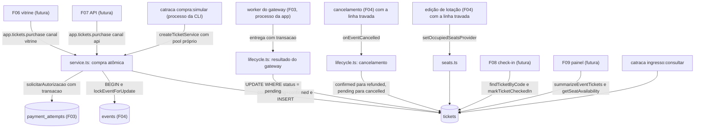
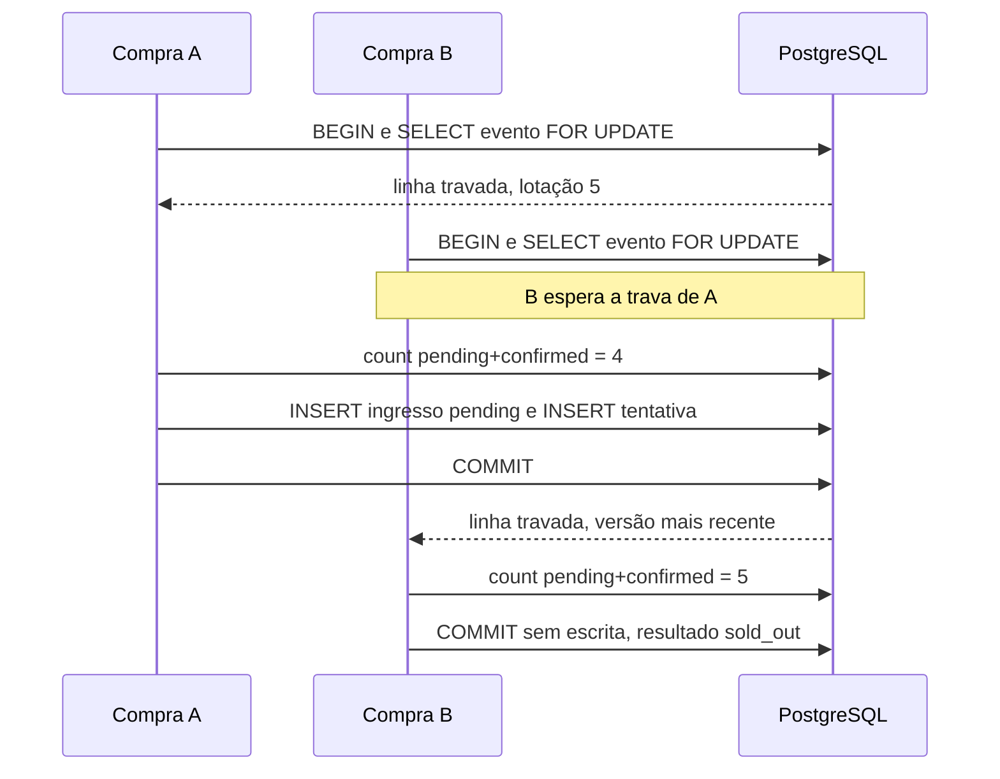

# Spec: F05 — Compra e ciclo do ingresso

## 1. Visão técnica

**O quê.** A F05 cria o ingresso da Catraca e todo o ciclo dele: a tabela `tickets` (id `tkt_…`, evento, código de 8 caracteres único no sistema, status `pending`/`confirmed`/`declined`/`cancelled`/`refunded`, `checked_in`, valor pago, canal `vitrine`/`api`, comprador); o **serviço de compra** único para vitrine e API, que valida, reserva a vaga e cria o ingresso `pending` com a tentativa de pagamento numa só transação, serializada por evento (R05–R07), e responde sem esperar o gateway (R06); o **tratador do resultado do gateway** (aprovado → `confirmed`, recusado → `declined`, só se ainda `pending`, R08); o **tratador de "evento cancelado"** que, na transação do cancelamento da F04, leva `confirmed` → `refunded` e `pending` → `cancelled` (R11); o **provedor de vagas ocupadas** que a validação de lotação mínima da F04 passa a usar (R03); as consultas que F06–F09 consomem; e os comandos de diagnóstico `catraca compra:simular` e `catraca ingresso:consultar`, que são a superfície do avaliador antes de existirem vitrine e API.

**Por quê.** É a feature onde a primeira tentativa quebrou ("um show de 100 lugares vendeu 112 ingressos", "evento cancelado continuava deixando gente entrar"). Três garantias só podem nascer aqui e precisam valer para todos os canais: (1) a lotação nunca é ultrapassada, nem com dezenas de compras simultâneas pela vitrine e pela API (R07) — resolvida com a trava da linha do evento que a F04 já usa para editar e cancelar, e contagem exata sob essa trava; (2) o ingresso só muda de `pending` uma vez, e uma resposta do gateway que chega depois do cancelamento não muda nada (R08, R11) — resolvida com `UPDATE … WHERE status = 'pending'` dentro da transação de entrega do gateway, mais uma guarda no banco; (3) o preço pago é o vigente no instante da compra (R03), copiado da linha travada. A F05 não tem rotas HTTP: F06 (vitrine) e F07 (API) chamam o mesmo serviço; F08 e F09 leem os ingressos pelas consultas daqui.

**Complexidade:** `complex` — nenhuma rota HTTP, mas a maior concentração de garantias do produto: serviço transacional com trava de linha e contagem sob concorrência real, integração com três pontos de extensão de duas features (tratador do gateway da F03; provedor de vagas e tratador de cancelamento da F04), tabela com restrições e gatilho de guarda de transições, dois comandos de diagnóstico (um deles disparando rajadas paralelas), API pública para quatro consumidoras da wave seguinte e itens de contrato com os tempos reais do gateway (esperas de até 45 s).

**Sequência de waves.** A F05 é a única feature da Wave 4: pode fazer ajustes mínimos em arquivos compartilhados quando esta spec manda (só `createPool` da F01, P16). A Wave 5 (F06, F07, F08 em paralelo) e a Wave 6 (F09) só **importam** de `app/src/features/ingressos/public.ts`: nenhuma delas edita arquivos de `ingressos/` nem escreve na tabela `tickets` por SQL próprio (o check-in usa a operação da F05, 5.7).

### Escopo

**Incluído:**
- Migration da tabela `tickets` com `CHECK`s de formato e coerência, índice único do código, índices para contagem de vagas por evento e para "Meus ingressos", e o gatilho `tickets_guard_update` que recusa transições de status inválidas e mudança de campos imutáveis (seção 6).
- Módulo `ingressos` (`app/src/features/ingressos/`, `loadOrder` 40, `fastify-plugin` com nome `ingressos`, `dependencies: ['eventos', 'gateway']`), sem rotas: decorator `app.tickets`, registro do tratador do gateway, do provedor de vagas e do tratador de cancelamento.
- Serviço de compra `createTicketService({ db, gateway, log })` (5.2) com recusa tipada `invalid_request` / `event_not_available` / `sold_out`, na ordem cartão → comprador → evento → vaga.
- Garantia de R07 por trava da linha do evento + contagem `pending + confirmed` na mesma transação que insere o ingresso e registra a tentativa de pagamento (5.3).
- Ciclo do ingresso: resultado do gateway (5.4), cancelamento do evento (5.5), check-in atômico para a F08 (5.7).
- Vagas ocupadas e disponíveis por evento e em lote (5.6); consultas de ingresso por id, por código normalizado, por conta e por evento; resumo por status para o painel (5.1).
- Código do ingresso: 8 caracteres de `A-Z0-9`, gerado com `crypto`, unicidade garantida pelo índice único com nova tentativa (5.8).
- Comandos `catraca compra:simular` (uma ou N compras simultâneas) e `catraca ingresso:consultar` (5.9, 5.10).
- `createPool` da F01 com tamanho máximo opcional (para a rajada da CLI e dos testes) — mudança mínima e compatível.
- Auxiliar de testes `app/test/helpers/tickets.ts` para F06–F09 (5.14) e os testes em `app/test/f05/`.
- Acréscimos pontuais em `README.md` (decisões "R07 sob concorrência" e o lado F05 da "resposta assíncrona do gateway"; comandos de diagnóstico) e `AGENTS.md` (5.15).

**Excluído (e quem entrega):**
- Formulário de compra, página do evento, `Ingressos esgotados`, "Meus ingressos": F06. Rotas `/api/partner/...`, `X-Api-Key`, JSON e códigos HTTP `202`/`422`/`404`/`409`: F07. Mensagens e ordem do check-in (R10) e a seção na página de gestão: F08. Números do painel (R12): F09.
- Status do evento, cancelamento irreversível, edição de preço e lotação, página de gestão: F04 (a F05 só registra o provedor de vagas e o tratador de cancelamento).
- Sorteio, prazos, worker e entrega única do resultado do gateway: F03 (a F05 só registra o tratador).
- Devolução real de dinheiro, desfazer check-in, mais de um ingresso por compra, cancelamento pelo participante: fora de escopo (PRD seção 7).

### Consome

| Item | De | Uso na F05 |
|---|---|---|
| Módulos com `loadOrder` e `fastify-plugin`; `app.db`, `app.log`, `app.config` | F01 (`app/src/core/modules.ts`, `app/src/app.ts`) | Módulo `ingressos`, `loadOrder` 40 |
| `withTransaction`, `Db`/`DbClient`/`Queryable`, `createPool` | F01 (`app/src/db/transaction.ts`, `app/src/db/pool.ts`) | Transação da compra; pool próprio da rajada na CLI (`max`, P16) |
| `newId('tkt')`, `randomBytes` (via `node:crypto`), `toIsoWithOffset`, `formatBRL` | F01 (`app/src/core/ids.ts`, `app/src/core/format.ts`) | Id do ingresso; datas e valores da CLI |
| CLI `catraca` (`app/src/cli/commands/` com `name`, `description`, `run`) | F01 (`app/src/cli/index.ts`) | `compra:simular`, `ingresso:consultar` |
| Tabela `users` (id, e-mail, papel) e contas da seed | F01/F02 | Comprador da vitrine (conta de participante); `--conta` da CLI |
| `app.gateway.solicitarAutorizacao({ referencia, numeroCartao }, { transacao })`, `app.gateway.aoReceberResultado(tratador)`, `criarGatewaySimulado({ db, config, log })`, tipos `GatewaySimulado`, `EntregaResultado`; tabela `payment_attempts` (leitura) | F03 (`app/src/features/gateway/public.ts`) | Tentativa de pagamento na transação da compra; tratador do resultado; gateway da CLI; linha `pagamento:` do `ingresso:consultar` |
| `lockEventForUpdate`, `findEventById`, `isOnSale`, `isEventId`, `EventRecord`, `EventStatus` | F04 (`app/src/features/eventos/public.ts`) | Trava e leitura do evento na compra; vagas; CLI |
| `app.events.setOccupiedSeatsProvider`, `app.events.onEventCancelled` | F04 (decorator `app.events`) | Lotação mínima com vagas reais (R03); efeitos do cancelamento nos ingressos (R11) |
| `createTestApp`, `testDb`, `testDatabaseUrl`, `resetDatabase`, `seedAccounts` | F01 (`app/test/helpers/`) | Testes |
| `loginAs`/`sessionCookieFor` | F02 (`app/test/helpers/session.ts`) | Testes de edição e cancelamento pela página de gestão (CF05, CF06) |
| `vencerTentativas`, `entregarVencidas`, `aguardarEntrega` | F03 (`app/test/helpers/gateway.ts`) | Testes do ciclo sem esperar os prazos reais |
| `insertTestEvent` | F04 (`app/test/helpers/events.ts`) | Eventos dos testes |

### Provê (contratos de saída e pontos de extensão)

| Item provido | Onde | Consumidores |
|---|---|---|
| Serviço de compra `app.tickets.purchase(input)` → `{ ok: true, ticket }` ou `{ ok: false, reason: 'invalid_request' \| 'event_not_available' \| 'sold_out' }`; fábrica `createTicketService` (fora do Fastify) | `public.ts`, decorator `app.tickets` | F06 (vitrine), F07 (API) |
| Vagas: `countOccupiedSeats`, `countOccupiedSeatsByEvent`, `computeAvailableSeats`, `getSeatAvailability`, `getSeatAvailabilityForEvents` | `public.ts` | F06, F07, F09 |
| Ingresso `TicketRecord` (id, código, evento, status, `checkedIn`, `checkedInAt`, valor pago, canal, conta, e-mail, datas) e consultas `findTicketById`, `findTicketByCode` (código normalizado), `listTicketsByBuyer`, `listTicketsByEvent`, `summarizeEventTickets` | `public.ts` | F06, F07, F08, F09 |
| Check-in atômico `markTicketCheckedIn(db, ticketId)` — a única escrita de check-in permitida (5.7) | `public.ts` | F08 |
| Constantes e validações: `TICKET_STATUSES`, `TICKET_STATUS_LABELS` (`pendente`…), `OCCUPYING_STATUSES`, `isValidCardNumber`, `isValidBuyerEmail`, `isTicketId`, `isTicketCode`, `normalizeTicketCode` | `public.ts` | F06, F07, F08 |
| Tabela `tickets`: leitura por `SELECT`/`JOIN` liberada; **escrita só pela F05** | seção 6 | F06–F09 |
| Comandos `catraca compra:simular`, `catraca ingresso:consultar` | `app/src/cli/commands/` | avaliador, agentes |
| Auxiliares de teste `insertTestTicket`, `settlePayments` | `app/test/helpers/tickets.ts` | testes de F06–F09 |

### Regras e invariantes

- **Regras do brief implementadas:** R05 (ocupadas = `pending` + `confirmed`; disponíveis = lotação − ocupadas; 0 em evento cancelado), R06 (compra de um ingresso, nasce `pending`, já ocupa vaga, responde sem esperar o gateway), R07 (sem vaga → `sold_out`; ocupadas nunca passam da lotação, nem com compras simultâneas), R08 (aprovado → `confirmed`; recusado → `declined`, liberando a vaga), R09 (código único usado no check-in), R11 (lado dos ingressos: `confirmed` → `refunded`, `pending` → `cancelled` na transação do cancelamento; resposta tardia não muda nada), R03 (preço vigente gravado; lotação mínima com vagas ocupadas reais), R02 (só evento publicado e não cancelado aceita compra — `isOnSale` da F04).
- **Invariantes compartilhadas que a F05 sustenta:**
  - *Lotação sob concorrência (R05–R07):* para todo evento e em todo instante, `count(pending + confirmed) ≤ capacity`. Toda inserção de ingresso acontece com a linha do evento travada (mesmo protocolo da F04, 5.12.4 da spec da F04); decisões que só liberam vaga (recusa, cancelamento) não precisam da trava.
  - *Cancelamento (R10, R11):* nenhum ingresso `pending` ou `confirmed` sobrevive ao commit do cancelamento; nenhuma compra é criada depois dele (a compra seguinte trava a linha já `cancelado` e recebe `event_not_available`).
  - *Resposta tardia (R11):* o resultado do gateway só altera ingresso `pending`; `cancelled`, `refunded` e `declined` são terminais (a guarda no banco recusa qualquer saída deles), `confirmed` só sai para `refunded`.
  - *Receita (R03, R12):* `price_paid_cents` é imutável (guarda no banco) e vem do preço da linha travada; `declined`/`cancelled` não contam vaga; `refunded` nunca volta a `confirmed`.
  - *API igual à vitrine:* um único serviço, uma única tabela, a mesma trava e as mesmas regras para os dois canais; o canal só define quem é o comprador.
  - *Isolamento (R13):* não afetado — a F05 não tem telas; a F08/F09 recebem o evento já verificado pela F04.

### Requisitos (capacidades do PRD → decisões desta spec)

| Capacidade (PRD F05) | Como esta spec atende |
|---|---|
| Status `pending`/`confirmed`/`declined`/`cancelled`/`refunded` com rótulos; `checkedIn` à parte | `TicketStatus`, `TICKET_STATUS_LABELS`; colunas `status` e `checked_in`/`checked_in_at` (seção 6) |
| Vagas (R05) | `countOccupiedSeats` sob a trava na compra; `getSeatAvailability*` para exibição (5.6) |
| Compra de um ingresso, nasce `pending`, ocupa vaga, responde sem esperar (< 1 s) | Uma transação curta (trava, contagem, `INSERT` do ingresso, `INSERT` da tentativa) e retorno; o resultado vem depois pelo worker da F03 (5.2–5.4) |
| Ordem: cartão 16 dígitos → evento disponível → vaga | 5.2: cartão e comprador (`invalid_request`) antes de abrir transação; evento sob a trava (`event_not_available`); vaga sob a trava (`sold_out`) |
| Lotação sob concorrência, serializada por evento, vitrine e API | 5.3 (trava da linha do evento + contagem em READ COMMITTED; sem contador) |
| Resultado do gateway só altera `pending` | 5.4 (`UPDATE … WHERE status = 'pending'`; ignorado e registrado em log) |
| Código 8 caracteres `A-Z0-9`, único no sistema | 5.8 (`crypto`, índice único, `ON CONFLICT DO NOTHING` + nova tentativa) |
| Preço vigente gravado; lotação mínima da F04 com vagas reais | `price_paid_cents = event.priceCents` da linha travada; `setOccupiedSeatsProvider(countOccupiedSeats)` (5.6) |
| Cancelamento na mesma transação, resposta tardia ignorada | `onEventCancelled` (5.5) + 5.4 + gatilho de guarda |
| Comandos `compra:simular` e `ingresso:consultar` no container, sem HTTP | 5.9, 5.10 |
| Falha ao registrar a tentativa desfaz a compra inteira | A tentativa é gravada com `{ transacao: client }`; erro → `ROLLBACK` de tudo (5.2) |

### Fluxos (experiência do PRD)

1. **Compra (F06/F07 ou CLI):** o canal chama `purchase({ eventId, buyer, cardNumber, channel })`. O serviço valida o cartão e o comprador; abre a transação; trava a linha do evento; confere `publicado`; conta `pending + confirmed`; compara com a lotação; insere o ingresso `pending` com código e valor pago; registra a tentativa de pagamento na mesma transação; faz commit e devolve o ingresso. Tempo típico: milissegundos.
2. **Resultado:** 2–5 s ou 30–40 s depois (tabela do brief), o worker da F03 entrega `aprovado`/`recusado` ao tratador da F05 dentro da transação de entrega; o ingresso vira `confirmed` ou `declined` se ainda estiver `pending`. Quem consulta (página, API ou CLI) vê o novo status ao recarregar.
3. **Cancelamento (F04):** o organizador confirma o cancelamento; na mesma transação (linha do evento travada), o tratador da F05 muda `confirmed` → `refunded` e `pending` → `cancelled`. A resposta do gateway que chegar depois encontra `cancelled` e é ignorada (log).
4. **Diagnóstico:** `docker compose exec -T app catraca compra:simular --evento <id> --cartao 4000000000000001 --paralelas 30` dispara 30 compras simultâneas e imprime uma linha por compra, o resumo e as vagas; `catraca ingresso:consultar <id|código>` mostra o ingresso, a tentativa de pagamento e as vagas do evento.

## 2. Impacto na arquitetura

```
app/
├── migrations/<AAAAMMDDHHMMSS>_create_tickets.sql      # timestamp gerado na implementação
├── src/
│   ├── db/pool.ts                                       # MODIFICADO: createPool aceita max opcional (padrão 10)
│   ├── features/ingressos/
│   │   ├── index.ts        # plugin (fastify-plugin "ingressos"), loadOrder 40: decorator e registros
│   │   ├── public.ts       # API pública (única porta de entrada para outras features)
│   │   ├── types.ts        # TicketRecord, TicketStatus, PurchaseInput/Result, SeatAvailability, augmentation
│   │   ├── validation.ts   # cartão, e-mail do comprador, id e código do ingresso
│   │   ├── code.ts         # gerador do código (A-Z0-9, 8 caracteres)
│   │   ├── repository.ts   # SQL da tabela tickets (inserção, consultas, transições)
│   │   ├── seats.ts        # vagas ocupadas e disponíveis (unitário e em lote)
│   │   ├── service.ts      # createTicketService: compra atômica (R05–R07)
│   │   └── lifecycle.ts    # tratador do gateway, tratador do cancelamento, check-in
│   └── cli/commands/
│       ├── compra-simular.ts
│       └── ingresso-consultar.ts
└── test/
    ├── helpers/tickets.ts  # insertTestTicket, settlePayments (para F06–F09)
    └── f05/*.test.ts
```

Documentação (fase final, acréscimos pontuais): `README.md`, `AGENTS.md`, `docs/state.json` (só a entrada F05), seção 10 desta spec.



## 3. Decisões técnicas

| Decisão | Abordagem escolhida | Alternativa considerada | Trade-off |
|---|---|---|---|
| Garantia de R07 | Trava pessimista da linha do evento (`lockEventForUpdate`, `SELECT … FOR UPDATE`) e `count(*)` de `pending + confirmed` na mesma transação READ COMMITTED que insere o ingresso e a tentativa | `INSERT … SELECT … WHERE (SELECT count) < capacity` sem trava; `SERIALIZABLE` com retentativas; trava consultiva por hash do evento | Compras do mesmo evento entram em fila (milissegundos cada), sem retentativa nem falha de serialização; eventos diferentes não se bloqueiam; um único protocolo de trava para F04 e F05 |
| Vagas ocupadas | Contagem exata no momento (índice `(event_id, status)`), sem coluna denormalizada | Contador `occupied_seats` em `events` com `UPDATE … WHERE occupied < capacity` | Uma única fonte da verdade (os ingressos); a recusa e o cancelamento não precisam ajustar contador; custo O(lotação) por compra, irrelevante para eventos pequenos |
| Resultado do gateway | `UPDATE tickets … WHERE id = $1 AND status = 'pending'` na transação de entrega da F03; 0 linhas → log e retorno normal | Comparar status em memória antes de atualizar; tratar o cancelamento apagando a tentativa | Idempotente e sem corrida com o cancelamento (a reavaliação do `WHERE` sob a trava da linha decide); a tentativa fica entregue uma única vez |
| Guarda no banco | Gatilho `BEFORE UPDATE` recusa transições fora de `pending→{confirmed,declined,cancelled}` e `confirmed→refunded`, mudança de campos imutáveis e desfazer check-in | Só confiar no SQL da aplicação | Defesa em profundidade para a regra mais cara do produto; F06–F09 não conseguem corromper o ciclo nem por engano |
| Cancelamento dos ingressos | Tratador síncrono `onEventCancelled` com um único `UPDATE … SET status = CASE …` usando o `client` da transação da F04; `status_changed_at = now()` (instante da transação = `cancelled_at` do evento) | Job assíncrono depois do commit | Efeito atômico e imediato (bem dentro dos 10 s); o `now()` igual ao `cancelled_at` prova a mesma transação |
| Código do ingresso | 8 caracteres do alfabeto `A-Z0-9` (36) com `crypto.randomBytes` e rejeição de viés; `INSERT … ON CONFLICT (code) DO NOTHING` e nova tentativa (até 5) | Derivar do id; alfabeto sem caracteres ambíguos | Formato exato do PRD; colisão praticamente impossível (36⁸ ≈ 2,8 × 10¹²) e tratada sem abortar a transação |
| Superfície de diagnóstico | Comandos da CLI que chamam o mesmo serviço com pool próprio; rajada dentro de um processo com N conexões pré-abertas e disparo simultâneo | Rota HTTP de diagnóstico; N processos `docker compose exec` | Nenhuma superfície HTTP antes de F06/F07; concorrência real no banco (N transações em N conexões) sem o custo de N processos Node |
| Check-in | A F05 é a única escritora de `tickets`: `markTicketCheckedIn` faz `UPDATE … WHERE status = 'confirmed' AND NOT checked_in` | A F08 escreve `checked_in` com SQL próprio | Uma só regra de atomicidade (dois check-ins simultâneos → um só atualiza); a guarda no banco vale para todos; a F08 mantém a ordem das mensagens de R10 |
| Interface para F06/F07 | Decorator `app.tickets` (uma instância por aplicação) + fábrica `createTicketService` para a CLI | Funções soltas com dependências globais | Mesmo padrão de `app.gateway` (F03) e `app.events` (F04); sem estado global entre apps de teste |

## 4. Componentes

**Módulo `ingressos` (`app/src/features/ingressos/`):**

| Arquivo | Novo/Modificado | Propósito | Responsabilidades |
|---|---|---|---|
| `index.ts` | Novo | Plugin da feature | `export const loadOrder = 40`; `default` envolvido por `fastify-plugin` (nome `ingressos`, `dependencies: ['eventos', 'gateway']`): `app.decorate('tickets', createTicketService({ db: app.db, gateway: app.gateway, log: app.log }))`; `app.events.setOccupiedSeatsProvider(countOccupiedSeats)`; `app.events.onEventCancelled(...)` (5.5); `app.gateway.aoReceberResultado(...)` (5.4). Nenhuma rota |
| `public.ts` | Novo | API pública | Reexporta exatamente os itens de 5.1 (e importa `types.ts` para levar a augmentation `app.tickets`) |
| `types.ts` | Novo | Tipos | `TicketStatus`, `TicketChannel`, `TicketRecord`, `PurchaseBuyer`, `PurchaseInput`, `PurchaseRejectionReason`, `PurchaseResult`, `SeatAvailability`, `EventTicketSummary`, `CheckInWrite`, `TicketService`, `TicketServiceDeps`; constantes `TICKET_STATUSES`, `OCCUPYING_STATUSES`, `TICKET_STATUS_LABELS`; `declare module 'fastify'` com `FastifyInstance.tickets` |
| `validation.ts` | Novo | Entradas | `isValidCardNumber`, `isValidBuyerEmail`, `normalizeBuyerEmail`, `isTicketId`, `isTicketCode`, `normalizeTicketCode` (5.1, 5.2) |
| `code.ts` | Novo | Código | `TICKET_CODE_ALPHABET`, `TICKET_CODE_LENGTH = 8`, `RESERVED_TICKET_CODES = ['ZZZZZZZZ']`, `generateTicketCode(random = randomBytes)` (5.8) |
| `repository.ts` | Novo | SQL | `insertTicket`, `findTicketById`, `findTicketByCode`, `listTicketsByBuyer`, `listTicketsByEvent`, `summarizeEventTickets`, `findPurchaseAccount`, `applyPaymentResultRow`, `cancelTicketsOfEvent`, `markCheckedInRow`, `toTicketRecord(row)` (seção 6) |
| `seats.ts` | Novo | Vagas | `countOccupiedSeats`, `countOccupiedSeatsByEvent`, `computeAvailableSeats`, `getSeatAvailability`, `getSeatAvailabilityForEvents` (5.6) |
| `service.ts` | Novo | Compra | `createTicketService({ db, gateway, log, generateCode? })` → `TicketService` com `purchase(input)` (5.2, 5.3); `PURCHASE_LOCK_TIMEOUT = '5s'`; `MAX_CODE_ATTEMPTS = 5` |
| `lifecycle.ts` | Novo | Ciclo | `handlePaymentResult(log)` → `TratadorResultado` (5.4); `handleEventCancelled(log)` → `EventCancelledHandler` (5.5); `markTicketCheckedIn(db, ticketId)` (5.7) |

**CLI:**

| Arquivo | Novo/Modificado | Propósito | Responsabilidades |
|---|---|---|---|
| `app/src/cli/commands/compra-simular.ts` | Novo | `catraca compra:simular` | `name = 'compra:simular'`, `description = 'Cria uma ou N compras simultâneas num evento e mostra o resultado de cada uma'`; leitura das opções; pool próprio com `max = N + 1`, pré-aquecido; gateway `criarGatewaySimulado({ db: pool, config, log: silencioso })`; serviço `createTicketService`; disparo simultâneo; saída de 5.9 |
| `app/src/cli/commands/ingresso-consultar.ts` | Novo | `catraca ingresso:consultar` | `name = 'ingresso:consultar'`, `description = 'Mostra um ingresso por id (tkt_…) ou código'`; busca por id ou código normalizado; tentativa de pagamento (leitura de `payment_attempts`); vagas do evento; saída de 5.10 |

**Banco e F01:**

| Arquivo | Operação | Notas |
|---|---|---|
| `app/migrations/<AAAAMMDDHHMMSS>_create_tickets.sql` | CREATE (tabela, índices, função e gatilho) | Seção 6. Timestamp de `date -u +%Y%m%d%H%M%S` na implementação (maior que os das migrations de F01–F04 já integradas) |
| `app/src/db/pool.ts` | Modificado (mínimo) | `createPool(config: { databaseUrl: string; max?: number })`; `max` padrão 10 (comportamento atual inalterado); nenhum outro arquivo da F01 muda (P16) |

**Testes:**

| Arquivo | Novo/Modificado | Propósito |
|---|---|---|
| `app/test/helpers/tickets.ts` | Novo | `insertTestTicket`, `settlePayments` (5.14) |
| `app/test/f05/*.test.ts` | Novo | Seção 7 |

## 5. Contratos de interfaces

Não há rotas HTTP. As interfaces são a API TypeScript do módulo (consumida por F06–F09 e pela CLI), os tratadores registrados em F03/F04, os comandos da CLI e as mensagens de log.

### 5.1 API pública (`app/src/features/ingressos/public.ts`)

Outras features importam somente deste arquivo (os testes podem importar internos).

**Tipos e constantes:**

| Export | Definição |
|---|---|
| `TicketStatus` | `'pending' \| 'confirmed' \| 'declined' \| 'cancelled' \| 'refunded'` |
| `TICKET_STATUSES` | `readonly TicketStatus[]` na ordem acima |
| `OCCUPYING_STATUSES` | `['pending', 'confirmed'] as const` — os que ocupam vaga (R05) |
| `TICKET_STATUS_LABELS` | `{ pending: 'pendente', confirmed: 'confirmado', declined: 'recusado', cancelled: 'cancelado', refunded: 'estornado' }` (rótulos exatos do brief) |
| `TicketChannel` | `'vitrine' \| 'api'` |
| `TicketRecord` | `{ id: string; code: string; eventId: string; status: TicketStatus; checkedIn: boolean; checkedInAt: Date \| null; pricePaidCents: number; channel: TicketChannel; buyerUserId: string \| null; buyerEmail: string; createdAt: Date; statusChangedAt: Date }` |
| `PurchaseBuyer` | `{ type: 'account'; userId: string } \| { type: 'email'; email: string }` |
| `PurchaseInput` | `{ eventId: string; buyer: PurchaseBuyer; cardNumber: string; channel: TicketChannel }` |
| `PurchaseRejectionReason` | `'invalid_request' \| 'event_not_available' \| 'sold_out'` (valores exatos da API do brief) |
| `PurchaseResult` | `{ ok: true; ticket: TicketRecord } \| { ok: false; reason: PurchaseRejectionReason; field?: 'cardNumber' \| 'buyer' \| 'channel' }` (`field` só em `invalid_request`) |
| `TicketService` | `{ purchase(input: PurchaseInput): Promise<PurchaseResult> }` |
| `TicketServiceDeps` | `{ db: Db; gateway: Pick<GatewaySimulado, 'solicitarAutorizacao'>; log: TicketLogger; generateCode?: () => string }` (`TicketLogger` = `info`/`warn`/`error` no formato do logger do Fastify) |
| `SeatAvailability` | `{ eventId: string; eventStatus: EventStatus; capacity: number; occupied: number; available: number }` |
| `EventTicketSummary` | `{ pending: number; confirmed: number; declined: number; cancelled: number; refunded: number; confirmedCheckedIn: number; confirmedPaidCents: number }` |
| `CheckInWrite` | `{ updated: true; ticket: TicketRecord } \| { updated: false; ticket: TicketRecord \| null }` |

**Funções:**

| Export | Assinatura | Comportamento |
|---|---|---|
| `createTicketService` | `(deps: TicketServiceDeps) => TicketService` | Serviço de compra (5.2); usado pelo plugin (`app.tickets`) e pela CLI |
| `app.tickets` | `TicketService` (decorator) | Instância com `app.db`, `app.gateway`, `app.log` — **o caminho das features F06 e F07** |
| `isValidCardNumber` | `(value: unknown) => value is string` | Texto que casa com `^[0-9]{16}$` (sem trim, sem remover espaços) |
| `isValidBuyerEmail` | `(value: unknown) => boolean` | Texto que, sem espaços nas pontas, casa com `^[^\s@]+@[^\s@]+\.[^\s@]+$` e tem no máximo 254 caracteres (mesma regra da F02) |
| `isTicketId` | `(value: unknown) => value is string` | `^tkt_[a-z0-9]{16}$` |
| `isTicketCode` | `(value: unknown) => value is string` | `^[A-Z0-9]{8}$` (exato, já normalizado) |
| `normalizeTicketCode` | `(value: string) => string` | Remove espaços das pontas e passa para maiúsculas (` k7q2m9xa ` → `K7Q2M9XA`) |
| `findTicketById` | `(db: Queryable, id: string) => Promise<TicketRecord \| null>` | `null` se não existir ou se `id` não tiver o formato (sem consultar) |
| `findTicketByCode` | `(db: Queryable, code: string) => Promise<TicketRecord \| null>` | Normaliza; `null` sem consultar se o resultado não casar com `isTicketCode`; senão busca pelo índice único (qualquer evento — a F08 compara `eventId`) |
| `listTicketsByBuyer` | `(db: Queryable, userId: string) => Promise<TicketRecord[]>` | Ingressos com `buyer_user_id = userId` (por construção, só os da vitrine), do mais recente para o mais antigo (`created_at DESC, id DESC`) |
| `listTicketsByEvent` | `(db: Queryable, eventId: string) => Promise<TicketRecord[]>` | Todos os canais, `created_at, id` |
| `summarizeEventTickets` | `(db: Queryable, eventId: string) => Promise<EventTicketSummary>` | Uma consulta agregada: contagem por status, `confirmed` com `checked_in`, soma de `price_paid_cents` dos `confirmed`; evento sem ingressos → tudo 0 |
| `countOccupiedSeats` | `(db: Queryable, eventId: string) => Promise<number>` | `pending + confirmed` do evento (é também o provedor registrado na F04) |
| `countOccupiedSeatsByEvent` | `(db: Queryable, eventIds: readonly string[]) => Promise<Map<string, number>>` | Uma consulta agrupada; ids sem ingresso → 0 no mapa |
| `computeAvailableSeats` | `(event: Pick<EventRecord, 'capacity' \| 'status'>, occupied: number) => number` | `cancelado` → 0; senão `max(0, capacity − occupied)` (R05) |
| `getSeatAvailability` | `(db: Queryable, eventId: string) => Promise<SeatAvailability \| null>` | Evento + ocupadas numa consulta; `null` se o evento não existir (ou id fora do formato) |
| `getSeatAvailabilityForEvents` | `(db: Queryable, events: readonly Pick<EventRecord, 'id' \| 'capacity' \| 'status'>[]) => Promise<Map<string, SeatAvailability>>` | Para listas (vitrine, API): uma consulta de ocupadas para todos |
| `markTicketCheckedIn` | `(db: Queryable, ticketId: string) => Promise<CheckInWrite>` | 5.7 |

Exemplo de `PurchaseResult` (datas mostradas em ISO só para ilustrar; no TypeScript são `Date`):

```json
{
  "ok": true,
  "ticket": {
    "id": "tkt_51xqk2m9a0c7d3ef",
    "code": "K7Q2M9XA",
    "eventId": "evt_8f2kq0x7m1c9z3ab",
    "status": "pending",
    "checkedIn": false,
    "checkedInAt": null,
    "pricePaidCents": 10000,
    "channel": "api",
    "buyerUserId": null,
    "buyerEmail": "ana@example.com",
    "createdAt": "2026-11-25T23:40:01.123-03:00",
    "statusChangedAt": "2026-11-25T23:40:01.123-03:00"
  }
}
```

```json
{ "ok": false, "reason": "invalid_request", "field": "cardNumber" }
{ "ok": false, "reason": "event_not_available" }
{ "ok": false, "reason": "sold_out" }
```

### 5.2 Serviço de compra (`purchase`)

**Entrada:**

| Campo | Tipo | Obrigatório | Validação | Recusa |
|---|---|---|---|---|
| `cardNumber` | `string` | Sim | `isValidCardNumber` (exatamente 16 dígitos; espaços, hífens, letras ou outro tamanho são inválidos) | `invalid_request`, `field: 'cardNumber'` |
| `channel` | `'vitrine' \| 'api'` | Sim | `vitrine` exige `buyer.type = 'account'`; `api` exige `buyer.type = 'email'`; outro valor é inválido | `invalid_request`, `field: 'channel'` |
| `buyer` (`email`) | `{ type: 'email'; email }` | No canal `api` | `isValidBuyerEmail`; guardado sem espaços nas pontas e em minúsculas | `invalid_request`, `field: 'buyer'` |
| `buyer` (`account`) | `{ type: 'account'; userId }` | No canal `vitrine` | Conta existente com papel `participante` (`SELECT id, email, role FROM users WHERE id = $1`); o e-mail da conta, em minúsculas, vira `buyer_email` | `invalid_request`, `field: 'buyer'` |
| `eventId` | `string` | Sim | `isEventId` (F04); depois, sob a trava: existe e `isOnSale` | `event_not_available` |

Valores de tipo errado em tempo de execução (ex.: `cardNumber` número, `buyer` ausente) seguem as mesmas recusas (o serviço é defensivo; F07 recebe JSON).

**Ordem das verificações (PRD; brief "API de parceiros"):**
1. Cartão → `invalid_request` (nada é lido nem gravado).
2. Canal e comprador → `invalid_request` (só a leitura da conta, fora de transação).
3. Formato do `eventId` → `event_not_available` (sem abrir transação).
4. Transação (5.3): trava do evento → inexistente ou não `publicado` → `event_not_available`; vagas → `sold_out`; senão cria.

Toda recusa acontece antes de qualquer escrita: nenhum ingresso e nenhuma tentativa de pagamento são gravados (a transação que recusa faz `COMMIT` sem escrita).

**Saída de sucesso:** o `TicketRecord` recém-criado (`status: 'pending'`, `checkedIn: false`, `pricePaidCents` = preço vigente, `createdAt = statusChangedAt`). O serviço nunca espera o resultado do pagamento.

**Erros (não são recusas):** falha de banco, `lock_timeout` estourado (5 s), falha ao registrar a tentativa de pagamento (`ErroGateway` ou erro de SQL), 5 colisões de código seguidas → a transação inteira é desfeita (nenhum ingresso, nenhuma tentativa) e o erro é relançado (F06/F07 respondem `500` pela F01; a CLI imprime `erro`).

### 5.3 Compra atômica e a garantia de R07

**Transação da compra** (`withTransaction(db, …)` da F01, isolamento padrão READ COMMITTED — obrigatório):

1. `SET LOCAL lock_timeout = '5s'`.
2. `event = await lockEventForUpdate(client, eventId)` — `SELECT … FROM events WHERE id = $1 FOR UPDATE`. Se outra transação segura a linha (outra compra, uma edição ou o cancelamento do mesmo evento), esta espera; ao obter a trava, recebe a **versão mais recente** da linha (status, lotação e preço já com o que a outra confirmou).
3. `!event || !isOnSale(event)` → resultado `event_not_available`.
4. `occupied = await countOccupiedSeats(client, eventId)` — `SELECT count(*) FROM tickets WHERE event_id = $1 AND status IN ('pending', 'confirmed')`.
5. `occupied >= event.capacity` → resultado `sold_out`.
6. `insertTicket(client, { id: newId('tkt'), eventId, code: generateCode(), pricePaidCents: event.priceCents, channel, buyerUserId, buyerEmail })` com `ON CONFLICT (code) DO NOTHING` e nova tentativa de código (5.8).
7. `await gateway.solicitarAutorizacao({ referencia: ticket.id, numeroCartao: cardNumber }, { transacao: client })` — a tentativa nasce e morre com esta transação.
8. `COMMIT` → `{ ok: true, ticket }`. Erro em qualquer passo → `ROLLBACK` e erro relançado.

**Por que isso serializa as compras do mesmo evento.** A trava `FOR UPDATE` da linha do evento é exclusiva entre transações que pedem a mesma trava e fica presa até o `COMMIT`/`ROLLBACK`. Duas compras do mesmo evento nunca estão ao mesmo tempo entre os passos 2 e 8: a segunda só passa do passo 2 depois que a primeira terminou. O passo 4 é uma instrução nova, executada depois de obter a trava; em READ COMMITTED cada instrução enxerga tudo o que foi confirmado antes de ela começar — portanto a contagem da segunda compra já inclui o ingresso que a primeira acabou de confirmar. Sem essa ordem (contar sem trava, ou contar antes de travar), duas compras simultâneas leriam a mesma contagem e ambas inseririam: é exatamente o "112 ingressos num show de 100 lugares".

**Por que não bloqueia outros eventos.** A trava é de uma linha (`events.id = $1`); o PostgreSQL não escala travas de linha, então compras de eventos diferentes travam linhas diferentes e correm em paralelo. A contagem usa leitura comum (MVCC), que não espera nem bloqueia ninguém; o `INSERT` em `tickets` só toma a trava de chave estrangeira (`FOR KEY SHARE`) da linha do próprio evento, que a transação já possui. Leituras de vagas para exibição (vitrine, API, painel) nunca esperam a trava.

**Por que sem contador denormalizado.** A serialização já é dada pela trava; com ela, a contagem é exata e barata (índice `tickets_event_status_idx`, no máximo `capacity` linhas ocupantes por evento). Um contador em `events` seria uma segunda fonte da verdade que precisaria ser ajustada na compra, na recusa do gateway e no cancelamento — e a tabela `events` é escrita só pela F04. A alternativa sem trava (`INSERT … WHERE (SELECT count) < capacity`) não é segura em READ COMMITTED; `SERIALIZABLE` seria correto, mas uma rajada de 30 compras geraria falhas de serialização e exigiria laço de retentativa.

**Interação com a validação de lotação da F04 (mesma trava).** A edição da F04 trava a mesma linha (`lockOwnedEventForUpdate`) e, sob ela, chama o provedor registrado pela F05 (`countOccupiedSeats(client, eventId)`), que conta `pending + confirmed` confirmados até ali. Uma redução de lotação e uma compra do mesmo evento nunca se intercalam: ou a compra entra primeiro (e a edição vê a vaga ocupada e recusa com `A lotação não pode ficar menor que as vagas ocupadas`), ou a edição entra primeiro (e a compra seguinte lê a lotação nova no passo 2). O preço segue a mesma regra: a compra grava o `price_cents` da linha travada, então uma mudança de preço vale exatamente para as compras que obtêm a trava depois dela (R03).

**Interação com o cancelamento (mesma trava).** O cancelamento da F04 trava a linha, grava `cancelado` e chama o tratador da F05 (5.5) na mesma transação. Compras que já fizeram commit têm o ingresso alcançado pelo tratador (`pending` → `cancelled`, `confirmed` → `refunded`); compras que estavam esperando a trava recebem, no passo 2, a linha já `cancelado` e terminam com `event_not_available`. Não existe janela em que um ingresso seja criado num evento cancelado.

**Interação com o resultado do gateway (sem trava do evento).** A recusa (`pending` → `declined`) só libera vaga e a aprovação (`pending` → `confirmed`) não muda a ocupação; nenhuma das duas pode fazer a ocupação passar da lotação, então o tratador não trava o evento. Uma compra que contou antes de a recusa confirmar vê a vaga ainda ocupada e recebe `sold_out` — correto naquele instante (R07).

**Ordem de travas e ausência de deadlock.** Compra: linha do evento → ingresso novo → tentativa nova. Cancelamento (F04 + F05): linha do evento → linhas de ingressos do evento. Entrega do gateway (F03 + F05): linha de `payment_attempts` → linha de um ingresso. Check-in (F08, 5.7): linha do evento (recomendado) → linha de um ingresso. Nenhuma transação trava uma linha de evento depois de travar um ingresso, e o cancelamento não toca em `payment_attempts`: não há ciclo.



**Invariante verificável:** para todo evento e em todo instante, `SELECT count(*) FROM tickets WHERE event_id = $1 AND status IN ('pending','confirmed')` ≤ `capacity`. Como ingressos nunca são apagados e uma recusa não grava nada, depois de uma rajada `count(*)` de ingressos do evento = criados; se ele é igual à lotação, as ocupadas nunca passaram dela.

### 5.4 Resultado do gateway (tratador registrado na F03)

`app.gateway.aoReceberResultado(handlePaymentResult(app.log))`; o worker da F03 chama `(entrega, transacao)` uma única vez por tentativa, dentro da transação que marca a entrega (`lock_timeout = 2s`, `statement_timeout = 5s` da F03).

1. `novo = entrega.resultado === 'aprovado' ? 'confirmed' : 'declined'`.
2. `UPDATE tickets SET status = $2, status_changed_at = clock_timestamp() WHERE id = $1 AND status = 'pending' RETURNING {cols}` com `id = entrega.referencia`, usando `transacao`.
3. Uma linha → log `ingressos: resultado do gateway aplicado` (info) e retorno.
4. Nenhuma linha → `SELECT status FROM tickets WHERE id = $1` (mesma `transacao`): ingresso existe → log `ingressos: resultado do gateway ignorado` (info) com o status atual; não existe → log `ingressos: resultado do gateway sem ingresso` (warn). Em ambos os casos retorna normalmente (a tentativa fica entregue; nada é relançado).

Concorrência com o cancelamento: se o cancelamento já mudou o ingresso, o `WHERE status = 'pending'` falha (passo 4). Se as duas transações disputam a mesma linha, a segunda espera a trava da linha e reavalia o `WHERE` (READ COMMITTED): resultado depois do cancelamento → ignorado; cancelamento depois da aprovação → o `CASE` do cancelamento vê `confirmed` e grava `refunded`. Em nenhuma ordem um ingresso cancelado ou estornado volta a `confirmed`. O tratador nunca toca em `payment_attempts`, não faz `COMMIT`/`ROLLBACK` e é idempotente (uma reentrega após falha encontra o ingresso já alterado e cai no passo 4).

### 5.5 Cancelamento do evento (tratador registrado na F04)

`app.events.onEventCancelled(handleEventCancelled(app.log))`; a F04 chama `(event, client)` na transação do cancelamento, depois do `UPDATE` de status e com a linha do evento travada.

`UPDATE tickets SET status = CASE status WHEN 'confirmed' THEN 'refunded' ELSE 'cancelled' END, status_changed_at = now() WHERE event_id = $1 AND status IN ('pending', 'confirmed') RETURNING status` com o `client` recebido; log `ingressos: ingressos do evento cancelado atualizados` (info) com as contagens. `declined` (e `cancelled`/`refunded`, que não existem antes do cancelamento) não mudam; `checked_in` é preservado (um ingresso que passou pelo check-in vira `refunded` com `checkedIn: true`).

`status_changed_at = now()` = instante de início da transação do cancelamento = `events.cancelled_at` gravado pela F04 na mesma transação. A igualdade é a prova observável de "mesma transação" (contrato). Consequência aceita: se uma compra estava na fila da trava quando o cancelamento começou, o ingresso dela pode ter `created_at` posterior a esse instante; por isso a tabela não tem `CHECK (status_changed_at >= created_at)`.

Erro no tratador → a F04 desfaz a transação inteira (o evento continua `publicado` e os ingressos como estavam). Efeito em até 10 s (R11): é imediato, no commit do cancelamento.

### 5.6 Vagas e lotação mínima

- **Definição (R05):** ocupadas = `count(*)` de `pending` + `confirmed`; disponíveis = `computeAvailableSeats(event, occupied)` = 0 se `cancelado`, senão `max(0, capacity − occupied)`. Em `rascunho` (sem compras possíveis) as disponíveis são a lotação.
- **Provedor da F04:** `app.events.setOccupiedSeatsProvider(countOccupiedSeats)` — chamado pela F04 com o `client` da edição, sob a trava; a validação de lotação mínima passa a usar as vagas reais (CF05).
- **Leitura para exibição:** `getSeatAvailability` (uma consulta: evento + subconsulta de ocupadas) e `getSeatAvailabilityForEvents` (uma consulta agrupada para a lista) leem sem trava; o valor é o do instante (recarregar atualiza).

### 5.7 Check-in (operação para a F08)

Decisão: **a F08 não escreve em `tickets`**; usa `markTicketCheckedIn(db, ticketId)`:

1. `UPDATE tickets SET checked_in = true, checked_in_at = clock_timestamp() WHERE id = $1 AND status = 'confirmed' AND NOT checked_in RETURNING {cols}`.
2. Uma linha → `{ updated: true, ticket }`.
3. Nenhuma → `{ updated: false, ticket: await findTicketById(db, ticketId) }` (estado atual, lido no mesmo `db`/transação).

Dois check-ins simultâneos do mesmo código: a linha é travada pelo primeiro `UPDATE`; o segundo reavalia o `WHERE` e não atualiza → `{ updated: false, ticket: { checkedIn: true … } }` (`Ingresso já utilizado` na F08). A F05 não escolhe mensagens: a ordem de R10 é da F08. Recomendação para a F08 (5.13): fazer o check-in numa `withTransaction` que trava o evento com `lockEventForUpdate` (status fresco, serializado com o cancelamento) e chamar `markTicketCheckedIn(client, ticket.id)` só depois das verificações 1–4 de R10.

### 5.8 Código do ingresso

- Alfabeto `ABCDEFGHIJKLMNOPQRSTUVWXYZ0123456789` (36 símbolos), 8 caracteres, `crypto.randomBytes` com rejeição dos bytes ≥ 252 (sem viés, como `randomToken` da F01).
- `ZZZZZZZZ` nunca é gerado (sorteia de novo): é o "código inexistente" do Fluxo do avaliador e do F08-CA05.
- Unicidade global: índice único `tickets_code_key`. A inserção usa `ON CONFLICT (code) DO NOTHING RETURNING …`; sem linha devolvida (código já usado, inclusive por uma transação concorrente que confirmou), gera outro código e tenta de novo, até `MAX_CODE_ATTEMPTS = 5`; na 2ª tentativa em diante loga `ingressos: código repetido, gerando outro` (warn). Esgotou → `Error('ingressos: não foi possível gerar um código único')` e a compra é desfeita. Colisão de `id` (`tkt_` + 16) não é tratada (probabilidade desprezível; vira erro).
- Busca por código: `normalizeTicketCode` (trim + maiúsculas) antes de consultar; a F08 recebe o código digitado como está.

### 5.9 Comando `catraca compra:simular`

**Uso:** `docker compose exec -T app catraca compra:simular --evento <id> --cartao <número> [--email <e-mail> | --conta <e-mail de participante>] [--paralelas <N>]` (opções em qualquer ordem, cada uma uma vez, sempre com valor separado por espaço).

| Opção | Obrigatória | Significado |
|---|---|---|
| `--evento` | Sim | Id do evento, repassado como está ao serviço (`evt_…` inexistente ou texto qualquer → `event_not_available`) |
| `--cartao` | Sim | Número do cartão, repassado **sem validação** ao serviço (para que `invalid_request` seja observável); nunca é impresso |
| `--email` | Não | Comprador por e-mail (canal `api`); padrão `simulacao-<i>@example.com`, com `<i>` = índice da compra (1…N); com `--email`, todas as N compras usam o mesmo e-mail |
| `--conta` | Não | E-mail de uma conta com papel `participante` (canal `vitrine`, comprador `{ type: 'account', userId }`); exclusiva com `--email` |
| `--paralelas` | Não | N entre 1 e 50 (padrão 1) |

**Comportamento:** cria um pool próprio `createPool({ databaseUrl, max: N + 1 })`, abre N conexões ao mesmo tempo e as devolve (pré-aquecimento); cria `criarGatewaySimulado({ db: pool, config, log: silencioso })` e `createTicketService({ db: pool, gateway, log: silencioso })`; dispara as N chamadas `purchase` no mesmo instante (`Promise.all`, sem `await` entre elas), cada uma numa conexão própria; mede a duração de cada chamada no processo (`performance.now()`); espera todas; imprime as linhas abaixo (compras na ordem do índice); lê as vagas com `getSeatAvailability`; fecha o pool. A CLI não roda worker: os resultados do gateway são entregues pelo worker da aplicação no ar.

**Saída (stdout), linhas nesta ordem:**

| Linha | Formato |
|---|---|
| Cabeçalho | `simulando <N> compra(s) simultânea(s) no evento <evento> pelo canal <api\|vitrine>` |
| Uma por compra, `i` = 1…N | `compra <i>/<N>: criada <tkt_id> código <CÓDIGO> status pending valor <centavos> em <S> s` · `compra <i>/<N>: recusada <invalid_request\|event_not_available\|sold_out> em <S> s` · `compra <i>/<N>: erro <mensagem> em <S> s` |
| Resumo | `resumo: criadas <a>, sold_out <b>, event_not_available <c>, invalid_request <d>, erros <e>` |
| Vagas | `vagas: lotação <capacity>, ocupadas <occupied>, disponíveis <available> (evento <rascunho\|publicado\|cancelado>)` ou `vagas: evento não encontrado` |

`<S>` = segundos com duas casas e vírgula (`0,04`). Expressões para conferência: `^compra [0-9]+/[0-9]+: criada tkt_[a-z0-9]{16} código [A-Z0-9]{8} status pending valor [0-9]+ em [0-9]+,[0-9]{2} s$` e `^compra [0-9]+/[0-9]+: recusada (invalid_request|event_not_available|sold_out) em [0-9]+,[0-9]{2} s$`.

Exemplo (`--paralelas 30` num evento de lotação 5):

```
simulando 30 compra(s) simultânea(s) no evento evt_8f2kq0x7m1c9z3ab pelo canal api
compra 1/30: recusada sold_out em 0,21 s
compra 2/30: criada tkt_51xqk2m9a0c7d3ef código K7Q2M9XA status pending valor 1000 em 0,03 s
…
resumo: criadas 5, sold_out 25, event_not_available 0, invalid_request 0, erros 0
vagas: lotação 5, ocupadas 5, disponíveis 0 (evento publicado)
```

| Situação | Saída | Código |
|---|---|---|
| Todas as compras terminaram com ingresso ou recusa tipada | linhas acima | 0 |
| Alguma compra terminou com erro inesperado | linhas acima, com `erro` | 1 |
| Opção ausente, repetida, desconhecida, sem valor, argumento solto, `--email` com `--conta`, `--paralelas` fora de 1–50 (stderr) | `Uso: catraca compra:simular --evento <id> --cartao <número> [--email <e-mail> \| --conta <e-mail de participante>] [--paralelas <1 a 50>]` | 2 |
| `--conta` sem conta de participante com aquele e-mail (comparação sem maiúsculas) (stderr) | `Conta de participante não encontrada: <e-mail>` | 2 |
| Erro fora das compras (ex.: banco indisponível) | tratado pela CLI da F01: `[catraca] compra:simular: <mensagem>` (stderr) | 1 |

### 5.10 Comando `catraca ingresso:consultar`

**Uso:** `docker compose exec -T app catraca ingresso:consultar <id do ingresso ou código>`. O argumento sem espaços nas pontas que começa com `tkt_` é buscado como id (`findTicketById`); qualquer outro, como código (`findTicketByCode`, normalizado: ` k7q2m9xa ` encontra `K7Q2M9XA`).

**Saída (stdout), linhas nesta ordem:**

```
ingresso: tkt_51xqk2m9a0c7d3ef
código: K7Q2M9XA
evento: evt_8f2kq0x7m1c9z3ab (publicado)
status: confirmed (confirmado)
check-in: não
valor pago: 10000 centavos
canal: api
comprador: ana@example.com
conta: -
criado em: 2026-11-25T23:40:01-03:00
status desde: 2026-11-25T23:40:04-03:00
pagamento: pay_3k9x0a7m2c1d5e8f (cartão final 0001, aprovado, entregue 3,4 s após a solicitação)
vagas do evento: lotação 5, ocupadas 1, disponíveis 4
```

| Linha | Valores |
|---|---|
| `evento:` | id e status do evento (`rascunho`, `publicado`, `cancelado`) |
| `status:` | valor da API e rótulo entre parênteses (`pending (pendente)`, `confirmed (confirmado)`, `declined (recusado)`, `cancelled (cancelado)`, `refunded (estornado)`) |
| `check-in:` | `não` ou `sim em <toIsoWithOffset(checkedInAt)>` |
| `conta:` | `-` (API) ou o id `usr_…` (vitrine) |
| `criado em:`, `status desde:` | `toIsoWithOffset` da F01 (segundos e `-03:00`) |
| `pagamento:` | `<pay_id> (cartão final <NNNN>, aguardando o gateway)` enquanto `delivered_at` é nulo; `<pay_id> (cartão final <NNNN>, <aprovado\|recusado>, entregue <S> s após a solicitação)` depois (`<S>` = `delivered_at − requested_at`, uma casa, vírgula); `nenhum` se não houver tentativa. O resultado sorteado não é mostrado antes da entrega |
| `vagas do evento:` | `getSeatAvailability` do evento do ingresso |

| Situação | Saída | Código |
|---|---|---|
| Encontrado | linhas acima | 0 |
| Não encontrado (stderr) | `Ingresso não encontrado: <valor normalizado>` (ex.: `Ingresso não encontrado: ZZZZZZZZ`) | 1 |
| Sem argumento ou com mais de um (stderr) | `Uso: catraca ingresso:consultar <id do ingresso (tkt_…) ou código>` | 2 |

### 5.11 Logs (logger JSON do Fastify no processo da aplicação; nunca o número do cartão)

| Mensagem (`msg`) | Nível | Campos | Quando |
|---|---|---|---|
| `ingressos: compra registrada` | info | `ticketId`, `eventId`, `channel` | Compra criada (commit) |
| `ingressos: compra recusada` | info | `eventId`, `reason`, `channel` | Recusa tipada |
| `ingressos: código repetido, gerando outro` | warn | `eventId`, `tentativa` | Colisão de código |
| `ingressos: resultado do gateway aplicado` | info | `ticketId`, `resultado`, `status` | 5.4 passo 3 |
| `ingressos: resultado do gateway ignorado` | info | `ticketId`, `resultado`, `statusAtual` | 5.4 passo 4 (resposta tardia) |
| `ingressos: resultado do gateway sem ingresso` | warn | `referencia`, `resultado` | 5.4 passo 4 (referência desconhecida) |
| `ingressos: ingressos do evento cancelado atualizados` | info | `eventId`, `refunded`, `cancelled` | 5.5 |

Na CLI o serviço usa logger silencioso (a saída do comando é só a de 5.9/5.10).

### 5.12 Ciclo de vida no processo

`loadOrder = 40`: depois de `contas` (10), `gateway` (20) e `eventos` (30), antes dos módulos com o padrão 100. Boot depois da F05: `[catraca] módulos: contas, gateway, eventos, ingressos, health, vitrine`. Os registros em `app.events` e `app.gateway` acontecem no registro do plugin (antes do `onReady`, como exigem F03 e F04). Nos testes (`backgroundJobs: false`), o worker da F03 não roda: os testes chamam `entregarVencidas(app)` ou `app.gateway.iniciarWorker(...)`.

### 5.13 Como as consumidoras usam (orientação para as specs seguintes)

- **F06 (Vitrine e Meus ingressos).** `/`: `listEventsOnSale(app.db)` (F04) + `getSeatAvailabilityForEvents(app.db, eventos)`; `/eventos/:id`: `findEventById` + `isOnSale` + `getSeatAvailability` (`available === 0` → `Ingressos esgotados` no lugar do formulário). Compra: `app.tickets.purchase({ eventId, buyer: { type: 'account', userId: currentUser(request).id }, cardNumber, channel: 'vitrine' })` → `invalid_request` = `Número de cartão inválido`; `event_not_available` = `Evento não encontrado`; `sold_out` = `Ingressos esgotados`; sucesso → "Meus ingressos" com `Compra registrada`. Se quiser aceitar espaços no número digitado, a F06 os remove antes de chamar (o serviço exige 16 dígitos exatos). "Meus ingressos": `listTicketsByBuyer(app.db, userId)` + `findEventsByIds` (F04) + `TICKET_STATUS_LABELS`.
- **F07 (API de parceiros).** `GET /api/partner/events`: `listEventsOnSale` + `getSeatAvailabilityForEvents` → `availableSeats`. `POST …/purchases`: JSON malformado, corpo que não é objeto ou campo ausente/não-texto → `422` antes de chamar; senão `app.tickets.purchase({ eventId: params.eventId, buyer: { type: 'email', email: body.buyerEmail }, cardNumber: body.cardNumber, channel: 'api' })` → `invalid_request` `422`, `event_not_available` `404`, `sold_out` `409`, sucesso `202` com `{ ticketId: ticket.id, code: ticket.code, status: ticket.status }`. A ordem `422` → `404` → `409` do brief já é a do serviço. `GET /api/partner/tickets/:id`: `findTicketById` → `{ ticketId, code, eventId, status, checkedIn }`.
- **F08 (Check-in).** `withTransaction(app.db, async (client) => { const event = await lockEventForUpdate(client, ownedEvent.id); const ticket = await findTicketByCode(client, codigoDigitado); … ordem de R10 com ticket.eventId, event.status, ticket.status, ticket.checkedIn …; const r = await markTicketCheckedIn(client, ticket.id); r.updated → Entrada liberada; senão decide pela r.ticket })`. Código em branco é da F08 (não chama a F05).
- **F09 (Painel).** `summarizeEventTickets(app.db, event.id)` → Confirmados = `confirmed`, Pendentes = `pending`, Check-ins = `confirmedCheckedIn`, Receita = `confirmedPaidCents`, Estornados = `refunded`; Vagas disponíveis = `computeAvailableSeats(event, pending + confirmed)` (ou `getSeatAvailability`).

### 5.14 Auxiliares de teste (`app/test/helpers/tickets.ts`)

| Função | Contrato |
|---|---|
| `insertTestTicket(db, { eventId, status?, channel?, buyerUserId?, buyerEmail?, pricePaidCents?, code?, checkedIn?, createdAt? }) → Promise<TicketRecord>` | Insere direto no banco (sem gateway, sem trava). Padrões: `status` `pending`, `channel` `api` (ou `vitrine` se `buyerUserId` vier), `buyerEmail` `teste-<aleatório>@example.com` (ou o e-mail da conta), `pricePaidCents` 10000, `code` gerado, `checkedIn` false (`true` exige `status` `confirmed` ou `refunded` e grava `checked_in_at`) |
| `settlePayments(app, { ticketIds? }) → Promise<number>` | `vencerTentativas(app.db, { referencias: ticketIds })` + `entregarVencidas(app)` (F03): entrega agora os resultados pendentes; devolve quantas tentativas foram vencidas |

### 5.15 Documentação (fase final)

| Arquivo | Mudança (pontual) |
|---|---|
| `README.md` | Em `## Decisões`: substituir "R07 sob concorrência: a completar na F05." por um parágrafo curto (trava `FOR UPDATE` da linha do evento + contagem `pending + confirmed` + inserção do ingresso + tentativa de pagamento na mesma transação READ COMMITTED; por que serializa o mesmo evento e não bloqueia outros; sem contador; mesma trava da edição de lotação e do cancelamento; como foi provado: rajada de 30 em lotação 5 repetida em eventos novos, nos testes e no contrato) e completar o lado F05 da "resposta assíncrona do gateway" (efeito no ingresso só se `pending`; cancelamento na mesma transação; resposta tardia ignorada e registrada; guarda no banco). Em `## Comandos de diagnóstico`: linhas `docker compose exec app catraca compra:simular --evento <id> --cartao 4000000000000001 [--paralelas 30]` e `docker compose exec app catraca ingresso:consultar <id ou código>` |
| `AGENTS.md` | Tabela de comandos: as duas linhas acima. Em "Convenções de código": "Ingressos: importe só de `app/src/features/ingressos/public.ts`; compre com `app.tickets.purchase`; ninguém escreve em `tickets` fora da F05 (check-in por `markTicketCheckedIn`); nos testes, `insertTestTicket`/`settlePayments` de `app/test/helpers/tickets.ts`" |
| `docs/state.json` | Só a entrada F05 (`aguardando_avaliacao` ao final da implementação) |

## 6. Modelo de dados

**Tabela: `tickets`**

| Coluna | Tipo | Nulo | Padrão | Descrição |
|---|---|---|---|---|
| `id` | `text` | Não | — | `tkt_` + 16 `[a-z0-9]` (`newId('tkt')`); chave primária |
| `event_id` | `text` | Não | — | Evento (`events.id`) |
| `code` | `text` | Não | — | Código de 8 caracteres `A-Z0-9`, único no sistema |
| `status` | `text` | Não | `'pending'` | `pending`, `confirmed`, `declined`, `cancelled`, `refunded` |
| `checked_in` | `boolean` | Não | `false` | Passou pelo check-in (não é status) |
| `checked_in_at` | `timestamptz` | Sim | — | Momento do check-in |
| `price_paid_cents` | `integer` | Não | — | Preço vigente no momento da compra, em centavos (imutável) |
| `channel` | `text` | Não | — | `vitrine` ou `api` |
| `buyer_user_id` | `text` | Sim | — | Conta do participante (só na vitrine; nulo na API) |
| `buyer_email` | `text` | Não | — | E-mail do comprador em minúsculas (da conta, na vitrine; o informado, na API) |
| `created_at` | `timestamptz` | Não | `clock_timestamp()` | Instante real do `INSERT` (não o início da transação) |
| `status_changed_at` | `timestamptz` | Não | `clock_timestamp()` | Última mudança de status: = `created_at` na criação; `clock_timestamp()` no resultado do gateway; `now()` (= `cancelled_at` do evento) no cancelamento |

**Índices e restrições:**

| Nome | Tipo | Definição | Propósito |
|---|---|---|---|
| `tickets_pkey` | PRIMARY KEY | `id` | Busca por id |
| `tickets_event_id_fkey` | FOREIGN KEY | `event_id REFERENCES events (id)` (sem cascata) | Integridade |
| `tickets_buyer_user_id_fkey` | FOREIGN KEY | `buyer_user_id REFERENCES users (id)` (sem cascata) | Integridade |
| `tickets_code_key` | UNIQUE INDEX | `(code)` | R09: código único global; alvo do `ON CONFLICT`; busca por código |
| `tickets_event_status_idx` | INDEX | `(event_id, status)` | Contagem de vagas ocupadas sob a trava; lista e resumo por evento; `UPDATE` do cancelamento |
| `tickets_buyer_idx` | INDEX parcial | `(buyer_user_id, created_at DESC, id DESC) WHERE buyer_user_id IS NOT NULL` | "Meus ingressos" |
| `tickets_id_format` | CHECK | `id ~ '^tkt_[a-z0-9]{16}$'` | Formato do id |
| `tickets_code_format` | CHECK | `code ~ '^[A-Z0-9]{8}$'` | R09 |
| `tickets_status_check` | CHECK | `status IN ('pending', 'confirmed', 'declined', 'cancelled', 'refunded')` | Valores do brief |
| `tickets_channel_check` | CHECK | `channel IN ('vitrine', 'api')` | Canais |
| `tickets_buyer_by_channel` | CHECK | `(channel = 'vitrine') = (buyer_user_id IS NOT NULL)` | Vitrine sempre com conta; API nunca vinculada a conta |
| `tickets_buyer_email_format` | CHECK | `char_length(buyer_email) BETWEEN 3 AND 254 AND buyer_email = lower(buyer_email) AND buyer_email ~ '^[^\s@]+@[^\s@]+\.[^\s@]+$'` | E-mail normalizado |
| `tickets_price_paid_range` | CHECK | `price_paid_cents BETWEEN 1 AND 100000000` | Mesmos limites do preço do evento (F04) |
| `tickets_checked_in_at` | CHECK | `checked_in = (checked_in_at IS NOT NULL)` | Coerência |
| `tickets_checked_in_status` | CHECK | `NOT checked_in OR status IN ('confirmed', 'refunded')` | Só confirmado entra; o estorno preserva o check-in |
| `tickets_guard_update` | TRIGGER `BEFORE UPDATE FOR EACH ROW` | função `tickets_guard_update()` | Transições e imutabilidade (abaixo) |

**Gatilho `tickets_guard_update`** (erros com `ERRCODE = 'check_violation'`, mensagens fixas):

| Regra | Mensagem |
|---|---|
| `id`, `event_id`, `code`, `price_paid_cents`, `channel`, `buyer_user_id`, `buyer_email`, `created_at` não mudam | `ingressos: campo imutável alterado no ingresso <id>` |
| Status só muda de `pending` para `confirmed`/`declined`/`cancelled` ou de `confirmed` para `refunded` | `ingressos: transição de status inválida (<antigo> -> <novo>) no ingresso <id>` |
| `checked_in` não volta de `true` para `false` | `ingressos: check-in não pode ser desfeito no ingresso <id>` |
| `checked_in` só passa a `true` num ingresso `confirmed` que continua `confirmed` no mesmo `UPDATE` | `ingressos: check-in só de ingresso confirmado (<id>)` |

**Migration `app/migrations/<AAAAMMDDHHMMSS>_create_tickets.sql`:**

```sql
CREATE TABLE tickets (
    id                text        PRIMARY KEY,
    event_id          text        NOT NULL REFERENCES events (id),
    code              text        NOT NULL,
    status            text        NOT NULL DEFAULT 'pending',
    checked_in        boolean     NOT NULL DEFAULT false,
    checked_in_at     timestamptz,
    price_paid_cents  integer     NOT NULL,
    channel           text        NOT NULL,
    buyer_user_id     text        REFERENCES users (id),
    buyer_email       text        NOT NULL,
    created_at        timestamptz NOT NULL DEFAULT clock_timestamp(),
    status_changed_at timestamptz NOT NULL DEFAULT clock_timestamp(),
    CONSTRAINT tickets_id_format          CHECK (id ~ '^tkt_[a-z0-9]{16}$'),
    CONSTRAINT tickets_code_format        CHECK (code ~ '^[A-Z0-9]{8}$'),
    CONSTRAINT tickets_status_check       CHECK (status IN ('pending', 'confirmed', 'declined', 'cancelled', 'refunded')),
    CONSTRAINT tickets_channel_check      CHECK (channel IN ('vitrine', 'api')),
    CONSTRAINT tickets_buyer_by_channel   CHECK ((channel = 'vitrine') = (buyer_user_id IS NOT NULL)),
    CONSTRAINT tickets_buyer_email_format CHECK (char_length(buyer_email) BETWEEN 3 AND 254
                                                 AND buyer_email = lower(buyer_email)
                                                 AND buyer_email ~ '^[^\s@]+@[^\s@]+\.[^\s@]+$'),
    CONSTRAINT tickets_price_paid_range   CHECK (price_paid_cents BETWEEN 1 AND 100000000),
    CONSTRAINT tickets_checked_in_at      CHECK (checked_in = (checked_in_at IS NOT NULL)),
    CONSTRAINT tickets_checked_in_status  CHECK (NOT checked_in OR status IN ('confirmed', 'refunded'))
);

CREATE UNIQUE INDEX tickets_code_key ON tickets (code);
CREATE INDEX tickets_event_status_idx ON tickets (event_id, status);
CREATE INDEX tickets_buyer_idx ON tickets (buyer_user_id, created_at DESC, id DESC) WHERE buyer_user_id IS NOT NULL;

CREATE FUNCTION tickets_guard_update() RETURNS trigger LANGUAGE plpgsql AS $$
BEGIN
    IF NEW.id <> OLD.id OR NEW.event_id <> OLD.event_id OR NEW.code <> OLD.code
       OR NEW.price_paid_cents <> OLD.price_paid_cents OR NEW.channel <> OLD.channel
       OR NEW.buyer_user_id IS DISTINCT FROM OLD.buyer_user_id OR NEW.buyer_email <> OLD.buyer_email
       OR NEW.created_at <> OLD.created_at THEN
        RAISE EXCEPTION 'ingressos: campo imutável alterado no ingresso %', OLD.id USING ERRCODE = 'check_violation';
    END IF;
    IF NEW.status <> OLD.status AND NOT (
           (OLD.status = 'pending' AND NEW.status IN ('confirmed', 'declined', 'cancelled'))
        OR (OLD.status = 'confirmed' AND NEW.status = 'refunded')) THEN
        RAISE EXCEPTION 'ingressos: transição de status inválida (% -> %) no ingresso %', OLD.status, NEW.status, OLD.id
            USING ERRCODE = 'check_violation';
    END IF;
    IF OLD.checked_in AND NOT NEW.checked_in THEN
        RAISE EXCEPTION 'ingressos: check-in não pode ser desfeito no ingresso %', OLD.id USING ERRCODE = 'check_violation';
    END IF;
    IF NOT OLD.checked_in AND NEW.checked_in AND NOT (OLD.status = 'confirmed' AND NEW.status = 'confirmed') THEN
        RAISE EXCEPTION 'ingressos: check-in só de ingresso confirmado (%)', OLD.id USING ERRCODE = 'check_violation';
    END IF;
    RETURN NEW;
END
$$;

CREATE TRIGGER tickets_guard_update BEFORE UPDATE ON tickets
    FOR EACH ROW EXECUTE FUNCTION tickets_guard_update();
```

O runner da F01 executa o arquivo inteiro numa única chamada (`client.query(conteúdo)`), então o corpo `$$ … $$` é aceito.

**Consultas (SQL explícito, parâmetros posicionais; `{cols}` = `id, event_id, code, status, checked_in, checked_in_at, price_paid_cents, channel, buyer_user_id, buyer_email, created_at, status_changed_at`):**

| Função | SQL |
|---|---|
| `insertTicket` | `INSERT INTO tickets (id, event_id, code, price_paid_cents, channel, buyer_user_id, buyer_email, created_at, status_changed_at) SELECT $1, $2, $3, $4, $5, $6, $7, t.ts, t.ts FROM (SELECT clock_timestamp() AS ts) t ON CONFLICT (code) DO NOTHING RETURNING {cols}` |
| `countOccupiedSeats` | `SELECT count(*) AS occupied FROM tickets WHERE event_id = $1 AND status IN ('pending', 'confirmed')` |
| `countOccupiedSeatsByEvent` | `SELECT event_id, count(*) AS occupied FROM tickets WHERE event_id = ANY($1::text[]) AND status IN ('pending', 'confirmed') GROUP BY event_id` |
| `getSeatAvailability` | `SELECT e.id, e.status, e.capacity, (SELECT count(*) FROM tickets t WHERE t.event_id = e.id AND t.status IN ('pending', 'confirmed')) AS occupied FROM events e WHERE e.id = $1` |
| `findTicketById` / `findTicketByCode` | `SELECT {cols} FROM tickets WHERE id = $1` / `… WHERE code = $1` |
| `listTicketsByBuyer` | `SELECT {cols} FROM tickets WHERE buyer_user_id = $1 ORDER BY created_at DESC, id DESC` |
| `listTicketsByEvent` | `SELECT {cols} FROM tickets WHERE event_id = $1 ORDER BY created_at, id` |
| `summarizeEventTickets` | `SELECT count(*) FILTER (WHERE status = 'pending') AS pending, count(*) FILTER (WHERE status = 'confirmed') AS confirmed, count(*) FILTER (WHERE status = 'declined') AS declined, count(*) FILTER (WHERE status = 'cancelled') AS cancelled, count(*) FILTER (WHERE status = 'refunded') AS refunded, count(*) FILTER (WHERE status = 'confirmed' AND checked_in) AS confirmed_checked_in, coalesce(sum(price_paid_cents) FILTER (WHERE status = 'confirmed'), 0) AS confirmed_paid_cents FROM tickets WHERE event_id = $1` |
| `findPurchaseAccount` | `SELECT id, email, role FROM users WHERE id = $1` |
| `applyPaymentResultRow` | `UPDATE tickets SET status = $2, status_changed_at = clock_timestamp() WHERE id = $1 AND status = 'pending' RETURNING {cols}` |
| `cancelTicketsOfEvent` | `UPDATE tickets SET status = CASE status WHEN 'confirmed' THEN 'refunded' ELSE 'cancelled' END, status_changed_at = now() WHERE event_id = $1 AND status IN ('pending', 'confirmed') RETURNING status` |
| `markCheckedInRow` | `UPDATE tickets SET checked_in = true, checked_in_at = clock_timestamp() WHERE id = $1 AND status = 'confirmed' AND NOT checked_in RETURNING {cols}` |
| CLI: conta por e-mail | `SELECT id, email FROM users WHERE lower(email) = lower($1) AND role = 'participante'` |
| CLI: tentativa do ingresso | `SELECT id, card_last4, result, requested_at, delivered_at FROM payment_attempts WHERE origin = 'compra' AND reference = $1` |

`toTicketRecord` converte `snake_case` em `camelCase` (`timestamptz` → `Date`; `count`/`sum` chegam como `number` pelo parser de `int8` da F01). Ingressos nunca são apagados. `resetDatabase` dos testes trunca `tickets` (todas as tabelas de `public`; o `TRUNCATE … CASCADE` de `events` também alcança `tickets`).

## 7. Estratégia de testes

Todos rodam pelo `npm run gates` (banco `catraca_test`, `NODE_ENV=test`, arquivos em sequência). Cada teste ligado a critério leva o ID no nome. Eventos com `insertTestEvent` (F04) ou pela página de gestão com `loginAs` (F02) quando o teste é sobre a integração com a F04. O ciclo do pagamento usa `settlePayments`/`entregarVencidas` (sem esperar prazos), exceto `tempos.test.ts`. **Concorrência real:** os testes de rajada usam um pool próprio `createPool({ databaseUrl: testDatabaseUrl(), max: 40 })`, pré-aquecido, e disparam as compras com `Promise.all` — 30 transações em 30 conexões contra o PostgreSQL dos gates — repetindo em eventos novos.

**Estrutura:**

| Arquivo | Tipo | Alvo |
|---|---|---|
| `app/test/f05/modelo.test.ts` | Integração (banco) | Migration, restrições, gatilho |
| `app/test/f05/codigo.test.ts` | Unidade | `code.ts`, `validation.ts` |
| `app/test/f05/compra.test.ts` | Integração | `purchase`: sucesso, recusas, ordem, preço, comprador, falhas |
| `app/test/f05/concorrencia.test.ts` | Integração (concorrência real) | R07 sob rajada, isolamento entre eventos, corrida com edição e cancelamento |
| `app/test/f05/ciclo.test.ts` | Integração | Tratador do resultado do gateway |
| `app/test/f05/cancelamento.test.ts` | Integração (HTTP da F04) | Tratador de cancelamento pela página de gestão |
| `app/test/f05/lotacao.test.ts` | Integração (HTTP da F04) | Provedor de vagas na edição |
| `app/test/f05/consultas.test.ts` | Integração | Consultas, vagas, resumo, check-in |
| `app/test/f05/tempos.test.ts` | Integração (tempo real) | Janelas do gateway de ponta a ponta |
| `app/test/f05/cli.test.ts` | Integração | `compra:simular`, `ingresso:consultar` (via `runCli` da F01) |
| `app/test/f05/modulo.test.ts` | Integração | Carga do módulo e registros |

**`modelo.test.ts`**

| Teste | Asserções |
|---|---|
| `a migration cria tickets com as restrições, os índices e o gatilho da spec` | `pg_constraint`, `pg_indexes`, `pg_trigger` com os nomes da seção 6; `tickets_code_key` único |
| `restrições recusam dados inválidos` | `INSERT`s diretos: código minúsculo ou com 7 caracteres, status `paid`, canal `site`, vitrine sem conta, API com conta, e-mail com maiúsculas, preço 0, `checked_in` sem data, `checked_in` em `pending` → `23514`; código repetido → `23505`; evento inexistente → `23503` |
| `F05-CA08 a guarda recusa transições inválidas` | `cancelled→confirmed`, `refunded→confirmed`, `declined→confirmed`, `confirmed→pending`, `pending→refunded`, `cancelled→pending` → erro com `transição de status inválida`; as válidas passam |
| `a guarda recusa mudança de campos imutáveis e desfazer check-in` | `price_paid_cents`, `code`, `event_id`, `channel`, `buyer_email`; `checked_in` true→false; check-in em `pending` |

**`codigo.test.ts`**

| Teste | Asserções |
|---|---|
| `F05-CA06 o código tem 8 caracteres de A-Z0-9 e usa o alfabeto inteiro` | 20 000 códigos casam com `^[A-Z0-9]{8}$`; os 36 símbolos aparecem; nenhum símbolo com frequência fora de ±15 % da média |
| `ZZZZZZZZ nunca é gerado` | gerador com bytes injetados que produziriam `ZZZZZZZZ` sorteia de novo |
| `normalizeTicketCode e isTicketCode` | ` k7q2m9xa ` → `K7Q2M9XA`; `K7Q2M9X`, `K7Q2M9XA1`, `k7q2m9xa` não são códigos |
| `F05-CA03 isValidCardNumber exige exatamente 16 dígitos` | 15, 17, letras, espaços, hífens, número (tipo), vazio → falso; `4000000000000001` → verdadeiro |
| `isValidBuyerEmail segue a regra da F02` | `ana@example.com`, ` ana@example.com ` válidos; `nao-e-um-email`, `a@b`, `a b@c.d`, 255 caracteres inválidos |

**`compra.test.ts`**

| Teste | Asserções |
|---|---|
| `F05-CA01 compra com cartão 0001 responde em menos de 1 s com pending, id tkt_ e código, sem esperar o gateway` | duração < 1 s; `ok`; `status pending`; `^tkt_[a-z0-9]{16}$`; `^[A-Z0-9]{8}$`; tentativa com `delivered_at` nulo |
| `ingresso e tentativa de pagamento nascem na mesma transação` | `payment_attempts.reference = ticket.id`, `origin = compra`, `card_last4 = 0001`; outra conexão não vê nenhum dos dois antes do commit (gateway com espera injetada) |
| `F05-CA03 cartão com 15, 17 dígitos ou não numérico é invalid_request e nada é gravado` | `reason invalid_request`, `field cardNumber`; contagens de `tickets` e `payment_attempts` inalteradas |
| `F05-CA03 invalid_request vem antes de event_not_available e de sold_out` | cartão inválido em rascunho, inexistente, cancelado e lotado → `invalid_request` |
| `comprador e canal inválidos são invalid_request` | e-mail mal formado; conta inexistente; conta de organizador; vitrine com e-mail; API com conta; canal `site` → `invalid_request` com o `field` certo |
| `F05-CA04 evento sem vaga recusa como sold_out sem criar ingresso` | lotação 1 com 1 `pending` → `sold_out`; com 1 `confirmed` → `sold_out`; contagem inalterada |
| `F05-CA02 pending ocupa vaga; declined, cancelled e refunded não` | lotação 2: `pending` deixa 1 disponível; ingressos `declined`/`cancelled`/`refunded` inseridos não ocupam |
| `F05-CA07 CF05 a compra grava o preço vigente: 10000, 10000 e 15000 depois da mudança de preço` | duas compras, `UPDATE` do preço pela página de gestão (`loginAs`), terceira compra; `price_paid_cents` na ordem |
| `F05-CA09 evento cancelado recusa como event_not_available e tem 0 vagas` | `insertTestEvent({ status: 'cancelado' })`; `getSeatAvailability.available = 0` |
| `F05-CA10 CF05 evento em rascunho, inexistente ou com id inválido recusa como event_not_available` | três casos; nenhum ingresso |
| `vitrine grava a conta e o e-mail da conta em minúsculas; API grava só o e-mail normalizado` | `buyer_user_id`, `buyer_email` (` Ana@Example.com ` → `ana@example.com`) |
| `falha ao registrar a tentativa de pagamento desfaz a compra inteira` | gateway que lança → erro propagado; nenhum ingresso, nenhuma tentativa |
| `colisão de código gera outro código; cinco colisões desfazem a compra` | `generateCode` injetado repetindo um código existente; log `código repetido`; com 5 repetições → erro e nada gravado |
| `a transação da compra desiste depois de 5 s esperando a trava` | outra transação segura `lockEventForUpdate` por 6 s → a compra falha com `55P03` e nada é gravado |

**`concorrencia.test.ts`**

| Teste | Asserções |
|---|---|
| `F05-CA05 30 compras simultâneas em lotação 5 criam exatamente 5 ingressos e 25 sold_out, em 5 rodadas com eventos novos` | por rodada: 5 `ok`, 25 `sold_out`, 0 outros; `count(*)` = 5; ocupadas = 5; 5 códigos distintos |
| `F05-CA05 as vagas ocupadas nunca passam da lotação durante a rajada` | outra conexão amostra `count(pending+confirmed)` a cada 2 ms durante a rajada; máximo ≤ 5 em todas as amostras |
| `F05-CA05 rajada mista vitrine e API respeita a lotação` | 15 com conta (`vitrine`) + 15 por e-mail (`api`) no mesmo `Promise.all`; total criado 5 |
| `F05-CA05 rajadas simultâneas em três eventos vendem exatamente a lotação de cada um` | 3 eventos (lotação 2, 5, 7), 30 compras em cada, todas juntas; criados 2, 5, 7 |
| `compra em outro evento não espera a trava do evento ocupado` | transação segura a trava do evento A; compra em B resolve em < 500 ms; compra em A continua pendente até o commit da trava e depois cria |
| `a compra que esperou a trava enxerga o ingresso de quem a segurava` | lotação 1: transação manual trava o evento, insere ingresso e confirma depois de 300 ms; compra concorrente → `sold_out` |
| `CF05 redução de lotação concorrente com a rajada nunca deixa ocupadas acima da lotação final` | rajada de 30 em lotação 5 + edição para 3 pela página de gestão ao mesmo tempo, 5 rodadas; edição `302` → ocupadas ≤ 3; `422` → lotação 5 e ocupadas ≤ 5 |
| `CF06 cancelamento concorrente com a rajada não deixa ingresso pending nem confirmed` | rajada de 30 + cancelamento pela página de gestão; ao fim: 0 `pending`/`confirmed`; recusas = `event_not_available` + `sold_out`; criados ≤ 5 |

**`ciclo.test.ts`**

| Teste | Asserções |
|---|---|
| `F05-CA01 CF04 resultado aprovado deixa o ingresso confirmed` | `settlePayments` com `…0001` → `confirmed`; `status_changed_at` > `created_at`; log `resultado do gateway aplicado` |
| `F05-CA02 CF04 resultado recusado deixa declined e libera a vaga` | lotação 2, `…0004`: antes 1 disponível; depois `declined` e 2 disponíveis |
| `F05-CA08 resultado tardio para ingresso cancelled ou refunded é ignorado e registrado em log` | ingresso cancelado/estornado antes da entrega; `entregarVencidas` → status e `status_changed_at` inalterados; tentativa entregue (`delivered_at`); log `resultado do gateway ignorado` com `statusAtual` |
| `reentrega do mesmo resultado não muda o ingresso de novo` | chamar o tratador duas vezes com a mesma entrega → uma mudança, um "ignorado" |
| `resultado para referência sem ingresso é ignorado com aviso` | tratador chamado com `tkt_` inexistente → sem erro; log `resultado do gateway sem ingresso` |

**`cancelamento.test.ts`**

| Teste | Asserções |
|---|---|
| `F05-CA08 CF06 cancelar pela página de gestão leva confirmed a refunded e pending a cancelled na mesma transação` | `POST /organizador/eventos/:id/cancelar` com `confirmar=sim` (`loginAs` A) → `302`; `refunded`/`cancelled`; `status_changed_at = events.cancelled_at` nos dois |
| `F05-CA08 CF06 resposta do gateway depois do cancelamento não muda o pendente cancelado` | `settlePayments` depois do cancelamento (`…0003` aprovado) → continua `cancelled` |
| `CF06 F05-CA09 evento cancelado tem 0 vagas e recusa compra como event_not_available` | `getSeatAvailability.available = 0`; `purchase` → `event_not_available` |
| `declined e ingressos com check-in seguem as regras no cancelamento` | `declined` continua `declined`; `confirmed` com check-in → `refunded` com `checkedIn: true` |

**`lotacao.test.ts`**

| Teste | Asserções |
|---|---|
| `CF05 reduzir a lotação abaixo das vagas ocupadas é rejeitado com a mensagem exata e nada muda` | 1 `confirmed` + 1 `pending`; editar para 1 → `422` com `A lotação não pode ficar menor que as vagas ocupadas`; `capacity` inalterada |
| `CF05 lotação igual às vagas ocupadas e maior são aceitas` | editar para 2 e para 4 → `302` |
| `CF05 declined, cancelled e refunded não contam na lotação mínima` | só ingressos desses status → editar para 1 aceito |

**`consultas.test.ts`**

| Teste | Asserções |
|---|---|
| `findTicketById devolve o registro completo e null para inexistente ou id inválido` | campos e tipos de `TicketRecord` |
| `F05-CA06 findTicketByCode normaliza espaços e minúsculas` | ` k7q2m9xa ` encontra; `ZZZZZZZZ` e texto inválido → `null` |
| `listTicketsByBuyer devolve só os ingressos da conta, do mais recente para o mais antigo, sem os da API` | ordem; ingressos de outra conta e da API ausentes |
| `listTicketsByEvent devolve os ingressos do evento de todos os canais` | vitrine + API |
| `getSeatAvailability e getSeatAvailabilityForEvents seguem R05` | publicado, rascunho, cancelado (0), inexistente (`null`/ausente) |
| `summarizeEventTickets conta por status, check-ins de confirmados e a soma paga dos confirmados` | mistura de status e preços; `refunded` com check-in não conta em `confirmedCheckedIn` |
| `markTicketCheckedIn marca só confirmed e só uma vez` | `pending`/`declined`/`refunded` → `updated: false`; segunda chamada → `updated: false` com `checkedIn: true` |
| `dois check-ins simultâneos do mesmo ingresso: um atualiza e o outro não` | `Promise.all` em duas conexões, 10 rodadas |

**`tempos.test.ts`** (worker real da F03 com intervalo padrão)

| Teste | Asserções |
|---|---|
| `F05-CA01 CF04 com a configuração padrão, 0001 confirma e 0002 recusa entre 2 e 5 s depois da compra` | `createTestApp({ backgroundJobs: true })` sem variáveis de gateway; aos 1,9 s os dois `pending`; `status_changed_at − created_at` em [2,0; 5,0] s; `0002` libera a vaga |
| `F05-CA02 CF04 com escala 0,1, 0003 e 0004 ficam pending aos 2,9 s e são resolvidos entre 3,0 e 4,0 s` | `GATEWAY_DELAY_SCALE=0.1`; `confirmed`/`declined`; vaga liberada no `0004` |

**`cli.test.ts`** (`runCli` da F01 com o banco de teste; entregas por `settlePayments`)

| Teste | Asserções |
|---|---|
| `F05-CA01 compra:simular imprime cabeçalho, compra criada, resumo e vagas no formato literal` | 4 linhas; regex de 5.9; `valor 10000`; código 0 |
| `F05-CA05 compra:simular --paralelas 30 em lotação 5 imprime 5 criadas e 25 sold_out` | 30 linhas de compra; `resumo: criadas 5, sold_out 25, event_not_available 0, invalid_request 0, erros 0`; `vagas: lotação 5, ocupadas 5, disponíveis 0 (evento publicado)` |
| `compra:simular --conta compra pelo canal vitrine com a conta do participante` | cabeçalho `pelo canal vitrine`; `buyer_user_id` da conta |
| `F05-CA03 compra:simular repassa o cartão sem validar e mostra invalid_request; nunca imprime o número` | `recusada invalid_request`; stdout/stderr sem o número |
| `compra:simular com uso inválido sai com 2 sem gravar nada` | casos de 5.9; mensagem de uso; contagens 0 |
| `ingresso:consultar por id e por código normalizado mostra os campos, o pagamento e as vagas` | 13 linhas de 5.10; `pagamento` antes e depois da entrega |
| `ingresso:consultar de ingresso inexistente sai com 1; sem argumento sai com 2` | mensagens exatas |
| `catraca help lista compra:simular e ingresso:consultar` | presentes |

**`modulo.test.ts`**

| Teste | Asserções |
|---|---|
| `o módulo carrega com loadOrder 40 depois de eventos e gateway e decora app.tickets` | `app.featureModules` contém `ingressos` depois de `eventos`; `typeof app.tickets.purchase === 'function'` |
| `registra o provedor de vagas, o tratador de cancelamento e o tratador do gateway` | edição recusa lotação abaixo das ocupadas; cancelamento muda ingressos; `entregarVencidas` aplica resultados |

**Cobertura dos critérios:**

| Critério | Testes automatizados | Contrato |
|---|---|---|
| F05-CA01 | `compra`, `ciclo`, `tempos`, `cli` | C01 |
| F05-CA02 | `compra`, `ciclo`, `tempos` | C02 |
| F05-CA03 | `codigo`, `compra`, `cli` | C03 |
| F05-CA04 | `compra` | C04 |
| F05-CA05 | `concorrencia`, `cli` | C05, C06, C07, C15 |
| F05-CA06 | `codigo`, `consultas`, `concorrencia` | C08 |
| F05-CA07 | `compra` | C09 |
| F05-CA08 | `ciclo`, `cancelamento`, `modelo` | C12 |
| F05-CA09 | `compra`, `cancelamento` | C12, C13 |
| F05-CA10 | `compra` | C11 |
| CF04 (F03 → F05) | `ciclo`, `tempos` | C14 (e C01, C02) |
| CF05 (F04 → F05) | `lotacao`, `compra`, `concorrencia` | C09, C10, C11 |
| CF06 (F04 → F05) | `cancelamento`, `concorrencia` | C12 |

**Critérios cross-feature em que a F05 é provedora** (CF09 → F06; CF11, CF12, CF13 → F07; CF15 → F08; CF17 → F09): pertencem às consumidoras. Os testes de consultas, vagas, check-in e concorrência acima garantem o lado da F05; as consumidoras usam `app.tickets`, as consultas reais e `insertTestTicket`/`settlePayments`.

## 8. Tratamento de erros

| Situação | Onde | Comportamento |
|---|---|---|
| Cartão sem 16 dígitos | `purchase` | `{ ok: false, reason: 'invalid_request', field: 'cardNumber' }`; nada lido nem gravado |
| E-mail inválido, conta inexistente ou não participante, canal incompatível | `purchase` | `invalid_request` com `field`; nada gravado |
| Evento com id inválido, inexistente, em rascunho ou cancelado (inclusive cancelado enquanto a compra esperava a trava) | `purchase` | `event_not_available`; nada gravado |
| Sem vaga (inclusive na corrida entre compras simultâneas) | `purchase` sob a trava | `sold_out`; nada gravado |
| Trava do evento não obtida em 5 s | `purchase` | `55P03` → `ROLLBACK`, erro relançado (`500` em F06/F07; `erro` na CLI) |
| Falha ao registrar a tentativa de pagamento | `purchase` | `ROLLBACK` da compra inteira (ingresso e tentativa), erro relançado |
| Código repetido | `insertTicket` | Nova tentativa (até 5); esgotou → erro e `ROLLBACK` |
| Resultado do gateway para ingresso que não está `pending` | tratador (5.4) | Ignorado, log `ingressos: resultado do gateway ignorado`; a tentativa fica entregue |
| Resultado para referência sem ingresso | tratador (5.4) | Log `warn`; retorno normal |
| Erro de banco no tratador do gateway | F03 | A F03 desfaz a entrega e reentrega (o tratador é idempotente) |
| Erro no tratador de cancelamento | F04 | A F04 desfaz o cancelamento inteiro (`500`); ingressos e evento como estavam |
| `UPDATE` direto que quebra o ciclo (transição inválida, campo imutável, desfazer check-in) | gatilho | `check_violation` com a mensagem da seção 6; nada muda |
| Check-in de ingresso não confirmado ou já usado | `markTicketCheckedIn` | `{ updated: false, ticket }` (a F08 escolhe a mensagem) |
| CLI: uso inválido / conta não encontrada / compra com erro / ingresso inexistente | `compra-simular.ts`, `ingresso-consultar.ts` | Tabelas de 5.9 e 5.10 (códigos 2, 2, 1, 1) |

## 9. Premissas e decisões do modo não interativo

Decisões tomadas pela política de auto-aceite (spec-writer, Batch Mode, "Auto-Accept Policy") onde o PRD, o brief, o briefing técnico e as specs de F01–F04 não fixam o detalhe. Revisáveis antes do commit do contrato.

| # | Premissa / decisão | Linha da política |
|---|---|---|
| P01 | Complexidade `complex`; plano em 5 fases (a última, Documentação). | Recomendação clara |
| P02 | Módulo `ingressos`, `loadOrder` 40, `fastify-plugin` com nome `ingressos` e `dependencies: ['eventos', 'gateway']`; identificadores em inglês (padrão de F01, F02 e F04); API pública em `public.ts`; decorator `app.tickets` (como `app.gateway` e `app.events`). | Padrões conflitantes (F03 usou pt-BR; prevalece o mais frequente) |
| P03 | Comprador como união `{ type: 'account', userId } \| { type: 'email', email }`; o canal precisa casar (`vitrine` ↔ conta, `api` ↔ e-mail) e a conta precisa existir com papel `participante`; senão `invalid_request` com `field`. | Descrição vaga |
| P04 | Ordem: cartão → comprador/canal → formato do id do evento → (sob a trava) evento à venda → vaga. Todas as causas de `invalid_request` vêm antes de `event_not_available` (ordem da API do brief). | Detalhe parcial do PRD |
| P05 | Cartão válido = exatamente `^[0-9]{16}$`, sem trim nem remoção de espaços; normalizar a digitação é decisão do canal (F06). | Detalhe parcial do brief |
| P06 | E-mail do comprador: regra da F02 (`^[^\s@]+@[^\s@]+\.[^\s@]+$`, até 254, sem espaços nas pontas), gravado em minúsculas; na vitrine, o e-mail da conta no momento da compra. | Detalhe parcial do PRD |
| P07 | R07 por `lockEventForUpdate` (a mesma trava da F04) + `count(*)` em READ COMMITTED na mesma transação do `INSERT` do ingresso e da tentativa; sem contador; `lock_timeout = 5s` na transação da compra. | Recomendação clara |
| P08 | Código: alfabeto `A-Z0-9` completo, 8 caracteres, `crypto` com rejeição de viés; `ZZZZZZZZ` reservado (nunca gerado); colisão → `ON CONFLICT (code) DO NOTHING` e nova tentativa, até 5. | Detalhe parcial do PRD |
| P09 | Tempos: `created_at` = `clock_timestamp()` do `INSERT`; `status_changed_at` = `clock_timestamp()` no resultado do gateway e `now()` no cancelamento (igual ao `cancelled_at` da F04, sem `CHECK` de ordem com `created_at`). | Recomendação clara |
| P10 | Gatilho `tickets_guard_update` (transições, imutabilidade, check-in) como defesa em profundidade. | Recomendação clara |
| P11 | Check-in: a F05 é a única escritora de `tickets`; a F08 usa `markTicketCheckedIn` (`UPDATE … WHERE status = 'confirmed' AND NOT checked_in`) e é orientada a travar o evento na transação do check-in. | Decisão pedida pelo orquestrador |
| P12 | Resultado do gateway para referência sem ingresso: log `warn` e retorno normal (sem reentrega infinita). | Recomendação clara |
| P13 | Logs com mensagens fixas (5.11), sem dado de cartão; `info` para "resultado ignorado" (situação esperada após cancelamento). | Recomendação clara |
| P14 | `compra:simular`: opções `--evento`, `--cartao`, `--email`/`--conta`, `--paralelas` (1–50); e-mail padrão `simulacao-<i>@example.com`; cartão repassado sem validação; pool próprio pré-aquecido com `N + 1` conexões e disparo simultâneo; linhas por índice depois de todas terminarem; resumo e vagas literais; códigos 0/1/2. | Detalhe parcial do PRD |
| P15 | `ingresso:consultar`: id (`tkt_…`) ou código normalizado; 13 linhas fixas com a tentativa de pagamento (sem revelar o resultado antes da entrega) e as vagas do evento; códigos 0/1/2. | Detalhe parcial do PRD |
| P16 | `createPool` da F01 ganha `max` opcional (padrão 10) — única edição em arquivo da F01, compatível, necessária para a rajada real da CLI e dos testes. | Recomendação clara |
| P17 | Auxiliares `app/test/helpers/tickets.ts` (`insertTestTicket`, `settlePayments`) para as consumidoras. | Recomendação clara |
| P18 | Vagas disponíveis = `max(0, capacity − occupied)`, 0 em `cancelado`; em `rascunho`, a lotação. | Detalhe parcial do brief |
| P19 | Contrato: eventos pela interface da F04 (cookie do organizador A) e compras pelo `compra:simular`; janelas de tempo conferidas no relógio do banco (`created_at`, `status_changed_at`, `payment_attempts`), com esperas reais do brief; rajada de R07 em 3 rodadas com monitor de ocupadas em paralelo; dados únicos pelo sufixo `$U`; funções em `/tmp/catraca-f05/aux.sh` (padrão dos contratos de F03/F04). | Recomendação clara |
| P20 | Resultado `aprovado` → `confirmed`, `recusado` → `declined` (vocabulário da F03 → valores da API). | Recomendação clara |
| P21 | Nenhuma rota HTTP na F05 (nem de diagnóstico): compra e consulta por HTTP são de F06/F07. | PRD |
| P22 | `summarizeEventTickets` provido para a F09 (contagens por status, check-ins de confirmados, soma paga dos confirmados); a definição dos números do painel continua da F09. | Recomendação clara |
| P23 | Se algum teste existente fixar a lista exata de módulos carregados ou de comandos do `help`, a F05 ajusta só essa asserção para "contém" e registra em Desvios. | Padrões conflitantes |
| P24 | Documentação: completar os marcadores do README ("R07 sob concorrência" e o lado F05 do gateway assíncrono), duas linhas em `## Comandos de diagnóstico`; `AGENTS.md` com as duas linhas de comando e a convenção de ingressos. | Recomendação clara |
| P25 | A F05 não toca em `payment_attempts` (só lê, no `ingresso:consultar`); o cancelamento não apaga tentativas: a resposta tardia é entregue uma vez e ignorada. | Spec da F03 |
| P26 | Leituras de vagas para exibição sem trava (MVCC), valor do instante; consultas em lote para listas (uma consulta agrupada). | Recomendação clara |
| P27 | Timestamp da migration gerado na implementação (`date -u +%Y%m%d%H%M%S`). | Recomendação clara |

**Conflitos PRD × brief:** nenhum. Observação: o `docs/plano-de-execucao.md` põe a F09 na wave 5 e o PRD na wave 6; não afeta a F05 (a API pública serve às duas leituras).

## 10. Desvios da implementação

Preenchido pelo implementador na fase Documentação: cada diferença entre esta spec e o que foi implementado, com o motivo.
