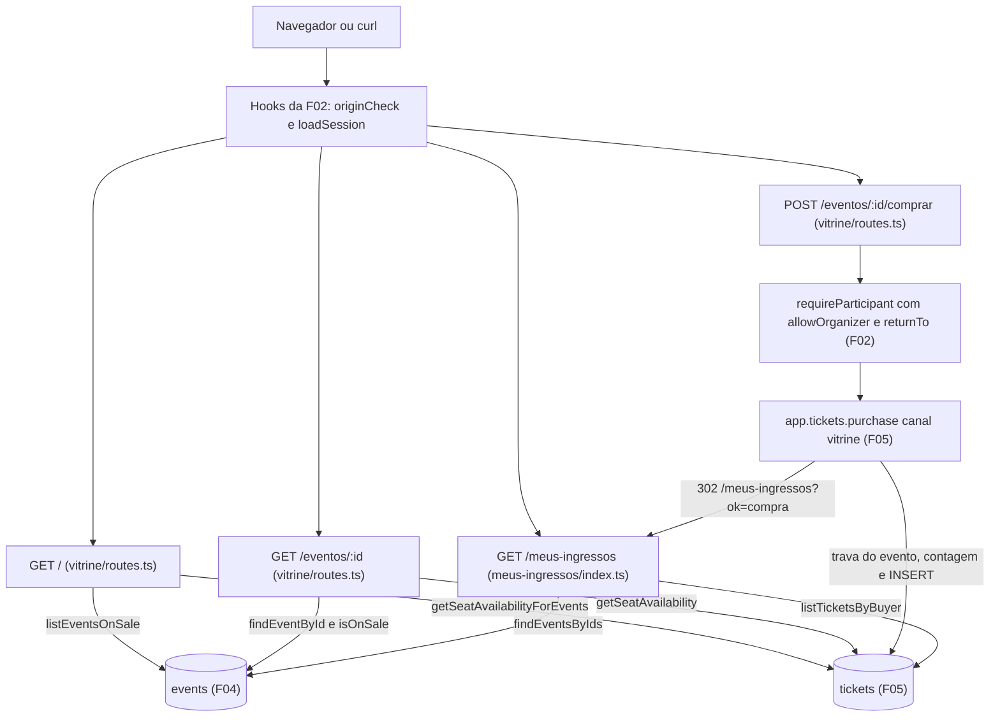

# Spec: F06 — Vitrine e Meus ingressos

## 1. Visão técnica

**O quê.** A F06 entrega a superfície do visitante e do participante: a vitrine (`/`) com os eventos à venda ordenados pela data de início (nome, data e hora `05/12/2026 21:00`, local, preço `R$ 100,00` e vagas disponíveis), a página pública do evento (`/eventos/{id}`) com o bloco de compra que muda conforme quem olha e as vagas (formulário com o campo Número do cartão, `Ingressos esgotados`, `Entrar para comprar` ou `Compras são feitas com uma conta de participante`), a compra pela vitrine (`POST /eventos/{id}/comprar`), que passa pelo serviço de compra da F05 com `channel: 'vitrine'`, e "Meus ingressos" (`/meus-ingressos`), com os ingressos comprados pela vitrine com a conta logada, do mais recente para o mais antigo (nome do evento — inclusive de evento cancelado —, data do evento, rótulo do status e código). A F06 assume dois módulos provisórios: a vitrine da F01 (`app/src/features/vitrine/`) e a página mínima de "Meus ingressos" da F02 (`app/src/features/meus-ingressos/`), mantendo títulos, `<h1>`, textos de vazio e guardas que testes e contratos anteriores conferem.

**Por quê.** É onde três features se encontram do lado do participante: a sessão e o guarda de participante (F02), a definição única de "à venda" (F04) e o serviço de compra com a garantia de lotação (F05). A F06 não pode ter regra própria de vaga, de status ou de evento à venda: tudo vem das APIs públicas de F04 e F05, para que a vitrine e a API de parceiros (F07, em paralelo) se comportem exatamente igual (R02, R05–R07). O trabalho próprio da F06 é traduzir o resultado do serviço em páginas e mensagens exatas do brief (`Ingressos esgotados`, `Número de cartão inválido`, `Evento não encontrado`, `Compra registrada`) e garantir que "Meus ingressos" de uma conta nunca mostre ingressos de outra nem compras feitas pela API (R09).

**Complexidade:** `medium` — quatro rotas HTML, nenhuma mudança de banco, integração com três features (F02, F04, F05), um formulário com regras de acesso por papel e itens de contrato com tempos reais do gateway e rajada de compras simultâneas.

**Sequência de waves.** A F06 é da Wave 5, em paralelo com F07 (API de parceiros) e F08 (check-in). Ela só cria e edita arquivos dos próprios módulos (`vitrine/`, `meus-ingressos/`), seus testes (`app/test/f06/`), uma linha do README e a própria spec; não edita `contas/`, `eventos/`, `ingressos/` nem arquivos da F01. O contrato não usa a API de parceiros nem o check-in.

### Escopo

**Incluído:**
- Vitrine `GET /`: eventos à venda (`listEventsOnSale` da F04) com vagas disponíveis (`getSeatAvailabilityForEvents` da F05), ordenados por data de início; mensagem de vazio da F01 preservada (5.2).
- Página do evento `GET /eventos/:id`: dados do evento, vagas e o bloco de compra com quatro variantes; `404` `Evento não encontrado` para rascunho, cancelado, inexistente ou id inválido (5.3).
- Compra `POST /eventos/:id/comprar`: `requireParticipant({ allowOrganizer: true, returnTo })` da F02; número do cartão com espaços removidos; `app.tickets.purchase` com `channel: 'vitrine'`; respostas `302`/`422`/`409`/`404`/`403` (5.4).
- "Meus ingressos" `GET /meus-ingressos`: `listTicketsByBuyer` (F05) + `findEventsByIds` (F04) + `TICKET_STATUS_LABELS` (F05); mensagem `Compra registrada` depois da compra (5.5).
- Assunção dos módulos provisórios `vitrine` (F01) e `meus-ingressos` (F02), sem quebrar o que os testes deles conferem (P02).
- Testes em `app/test/f06/` (seção 7) e uma linha em `README.md` (5.8).

**Excluído (e quem entrega):**
- Regras de vaga, de compra, de status do ingresso e do resultado do gateway: F05 (a F06 só chama `app.tickets.purchase` e lê as consultas).
- Definição de "à venda", criação, publicação e cancelamento de eventos: F04.
- Cadastro, login, sessão, navegação no topo (link `Meus ingressos`), checagem de origem em `POST`: F02.
- API de parceiros (`/api/partner/...`): F07. Check-in: F08. Painel (inclusive a soma das vendas da vitrine com as da API, CF19): F09.
- Cancelamento ou transferência de ingresso pelo participante, mais de um ingresso por compra, busca, filtros e paginação na vitrine, atualização em tempo real (PRD, Fora de escopo).

### Consome

| Item | De | Uso na F06 |
|---|---|---|
| Módulos em `app/src/features/<nome>/index.ts`, `reply.page` (mensagens no topo, `status`), `html`, `formatBRL`, `formatDateTimeBR` | F01 (`app/src/core/`) | Páginas, preço `R$ 1.234,56`, data `DD/MM/AAAA HH:MM` no fuso do produto |
| Módulo provisório `vitrine` (`GET /` com título e `<h1>` `Eventos à venda` e `Nenhum evento à venda no momento.`) | F01 | Assumido e ampliado (P02) |
| `request.user` (`SessionUser`), `requireParticipant(options)`, `currentUser`, `loginPath`, hook `originCheck`, navegação de conta | F02 (`app/src/features/contas/public.ts`) | Guarda da compra (visitante → `/entrar?voltar=…`; organizador segue para a mensagem) e de "Meus ingressos"; botão `Entrar para comprar` |
| Módulo mínimo `meus-ingressos` (`GET /meus-ingressos` com `<h1>Meus ingressos</h1>`, `Você ainda não tem ingressos.` e `requireParticipant()`) | F02 | Assumido e ampliado (P02) |
| `listEventsOnSale`, `findEventById`, `findEventsByIds`, `isOnSale`, `isEventId`, `EventRecord`, `EVENT_NOT_FOUND_MESSAGE` | F04 (`app/src/features/eventos/public.ts`) | Vitrine, página do evento, nomes e datas em "Meus ingressos" (inclusive de evento cancelado) |
| `app.tickets.purchase`, `PurchaseResult`, `getSeatAvailability`, `getSeatAvailabilityForEvents`, `listTicketsByBuyer`, `TICKET_STATUS_LABELS`, `TicketRecord` | F05 (`app/src/features/ingressos/public.ts`) | Compra, vagas disponíveis, ingressos da conta e rótulos |
| `createTestApp`, `testDb`, `seedAccounts` (F01); `loginAs`, `sessionCookieFor` (F02); `insertTestEvent` (F04); `insertTestTicket`, `settlePayments` (F05) | `app/test/helpers/` | Testes |

Nenhum acréscimo é necessário nas APIs de F02, F04 ou F05: tudo o que a F06 usa já está nas specs delas (P17).

### Provê

Nada para outras features (PRD: é a superfície final do visitante e do participante). As rotas `/`, `/eventos/:id`, `/eventos/:id/comprar` e `/meus-ingressos` ficam reservadas à F06.

### Regras e invariantes

- **Regras do brief implementadas (lado da vitrine):** R02 (só evento publicado e não cancelado aparece e aceita compra — pela definição da F04), R05 (vagas disponíveis exibidas = as da F05), R06 (compra de um ingresso pelo participante, que nasce `pendente` — pelo serviço da F05), R07 (`Ingressos esgotados` no lugar da compra e como resposta à tentativa), R08 (o novo status aparece ao recarregar "Meus ingressos"), R09 (evento, status e código de cada ingresso comprado, só da própria conta), R11 (evento cancelado sai da vitrine e sua página responde `404`).
- **Invariantes compartilhadas que a F06 não pode quebrar:**
  - *Lotação sob concorrência (R05–R07):* a F06 nunca decide se há vaga para vender; só o serviço da F05 (trava da linha do evento) decide. As vagas exibidas são leitura do instante; a compra que encontra o evento sem vaga recebe `sold_out` e mostra `Ingressos esgotados`, sem criar ingresso.
  - *Cancelamento (R10, R11):* a página do evento e a compra usam `isOnSale` (F04); um evento cancelado entre abrir a página e enviar a compra é recusado pelo serviço (`event_not_available`) e a vitrine responde `Evento não encontrado`.
  - *Receita (R03, R12):* a F06 não grava preço; o valor pago é gravado pela F05 no momento da compra.
  - *API igual à vitrine:* mesma consulta de eventos à venda, mesmas vagas e mesmo serviço de compra que a F07 usa; o canal só define o comprador (conta na vitrine).
  - *Isolamento (R13):* não afetado — a F06 não tem páginas da área do organizador; "Meus ingressos" filtra pela conta da sessão (`currentUser(request).id`), nunca por parâmetro.
  - *Resposta tardia do gateway:* não afetada (a F06 só lê o status).

### Requisitos (capacidades do PRD → decisões desta spec)

| Capacidade (PRD F06) | Como esta spec atende |
|---|---|
| Vitrine com eventos publicados e não cancelados, por data de início, com nome, data e hora, local, preço `R$ 100,00` e vagas | 5.2: `listEventsOnSale` (ordem `starts_at`, `id`) + `getSeatAvailabilityForEvents`; `formatDateTimeBR`, `formatBRL` |
| Página do evento com os mesmos dados e, para participante logado com vaga, o formulário com Número do cartão (16 dígitos) | 5.3: bloco `formulario`; campo `cartao`, espaços removidos antes do serviço (5.4) |
| Sem vaga: `Ingressos esgotados` no lugar do formulário e como resposta à tentativa | 5.3 (bloco `esgotado`) e 5.4 (`409` com a mensagem no topo) |
| Visitante: `Entrar para comprar` → `/entrar` e volta ao evento; organizador: `Compras são feitas com uma conta de participante` | 5.3 (blocos `entrar` e `organizador`), 5.4 (guarda com `returnTo` e `allowOrganizer`) |
| "Meus ingressos" só da vitrine com a conta logada, do mais recente para o mais antigo, com nome do evento, rótulo do status e código; compras pela API não aparecem | 5.5: `listTicketsByBuyer` (só `buyer_user_id` da sessão, ordem `created_at DESC, id DESC`) |
| Evento cancelado sai da vitrine e sua página responde `404` `Evento não encontrado` | 5.2 e 5.3 (`isOnSale`) |
| Erros: cartão inválido, sem vaga no envio, evento cancelado ou despublicado no envio, sessão expirada no envio | 5.4 (tabela de respostas) e seção 8 |

### Fluxos (experiência do PRD)

1. **Vitrine:** qualquer pessoa abre `/` e vê a tabela dos eventos à venda; cada linha leva à página do evento (`Comprar`) ou mostra `Ingressos esgotados` quando não há vaga.
2. **Página do evento como visitante:** dados do evento e o link `Entrar para comprar` → `/entrar?voltar=%2Feventos%2F{id}` → depois do login como participante, volta a `/eventos/{id}` com o formulário.
3. **Compra:** o participante informa o número do cartão e clica em `Comprar` → `302` para `/meus-ingressos?ok=compra` → `Compra registrada` e o ingresso `pendente` com o código; recarregando, `confirmado` ou `recusado` quando o gateway responde.
4. **Erros na compra:** cartão inválido → a página do evento com `Número de cartão inválido` e o formulário (campo vazio); sem vaga → a página do evento com `Ingressos esgotados`; evento cancelado no meio do caminho → `Evento não encontrado`; sessão expirada → `/entrar` com volta ao evento, sem ingresso.
5. **Organizador:** vê a vitrine e a página do evento com `Compras são feitas com uma conta de participante` no lugar do formulário; um envio direto da compra responde `403` com a mesma página; `/meus-ingressos` continua `403` `Acesso negado` (F02).
6. **Esgotamento:** quando as vagas acabam (inclusive por compras pendentes de terceiros), a vitrine mostra `0` e `Ingressos esgotados`, e a página do evento troca o formulário por `Ingressos esgotados`; se uma recusa do gateway libera a vaga, o formulário volta.

## 2. Impacto na arquitetura

```
app/
├── src/features/
│   ├── vitrine/
│   │   ├── index.ts      # MODIFICADO: plugin (assume a vitrine provisória da F01); confere app.events e app.tickets; registra as rotas
│   │   ├── routes.ts     # GET /, GET /eventos/:id, POST /eventos/:id/comprar
│   │   ├── purchase.ts   # leitura do cartão, escolha do bloco de compra, tradução do resultado do serviço
│   │   ├── pages.ts      # HTML: vitrine, página do evento, blocos de compra, 404
│   │   └── messages.ts   # textos exatos e caminhos da vitrine
│   └── meus-ingressos/
│       ├── index.ts      # MODIFICADO: GET /meus-ingressos com os ingressos (assume o módulo mínimo da F02)
│       ├── pages.ts      # HTML da lista
│       └── messages.ts   # Compra registrada, código ok=compra, texto de vazio
└── test/f06/
    ├── support.ts        # auxiliares dos testes da F06
    └── *.test.ts         # seção 7
```

Documentação (fase final): uma linha em `README.md` (5.8), `docs/state.json` (só a entrada F06) e a seção 10 desta spec.



## 3. Decisões técnicas

| Decisão | Abordagem escolhida | Alternativa considerada | Trade-off |
|---|---|---|---|
| Módulos | Manter os dois módulos provisórios e ampliá-los: `vitrine` (vitrine, página do evento e compra) e `meus-ingressos` (lista), ambos com `loadOrder` padrão (100), sem `fastify-plugin` | Juntar tudo num módulo novo `vitrine` e apagar `meus-ingressos` (como a F04 fez com `organizador`) | Nenhuma linha de boot nem teste de lista de módulos muda (menos conflito com F07/F08 na mesma wave); os dois módulos compartilham só constantes de texto |
| Bloco de compra | Uma seção `<section data-compra="…">` com quatro variantes, escolhida nesta precedência: organizador → `organizador`; vagas 0 → `esgotado`; visitante → `entrar`; participante → `formulario` | Esconder o bloco e mostrar mensagens soltas; mostrar o formulário sempre e deixar o serviço recusar | A página diz sempre uma só coisa sobre a compra; organizador nunca vê `Entrar para comprar`; visitante não é convidado a entrar num evento esgotado |
| Rota de compra | `POST /eventos/:id/comprar` com `requireParticipant({ allowOrganizer: true, returnTo })` | `POST /eventos/:id` | Ação explícita no caminho; o guarda da F02 cuida de visitante e sessão expirada com volta ao evento |
| Erros da compra | Responder a própria página do evento com status próprio (`422`, `409`, `403`) e a mensagem no topo; sucesso com `302` | Redirecionar sempre com um código na URL | O formulário continua na página do evento no erro (PRD); recarregar não reenvia a compra no sucesso (padrão PRG) |
| Mensagem de sucesso | `302` para `/meus-ingressos?ok=compra`; a página mapeia o código para `Compra registrada` (mesmo padrão `?ok=` da F04) | "Flash" em sessão ou cookie | Sem estado novo; nenhum texto livre vem da URL |
| Número do cartão | O canal remove todos os espaços em branco digitados antes de chamar o serviço (que exige 16 dígitos exatos); o campo nunca é devolvido preenchido nem registrado em log | Validar na F06 com outra regra; devolver o valor digitado no erro | Uma única regra de validade (a da F05); o número completo não reaparece em HTML |
| Dados | Só APIs públicas de F04 e F05, sem SQL próprio | `JOIN` próprio entre `tickets` e `events` | Uma fonte da verdade para "à venda", vagas e ingressos da conta, igual à da API de parceiros |

## 4. Componentes

**Módulo `vitrine` (`app/src/features/vitrine/`):**

| Arquivo | Novo/Modificado | Propósito | Responsabilidades |
|---|---|---|---|
| `index.ts` | Modificado | Plugin da feature | `default` = plugin assíncrono (sem `fastify-plugin`, sem `loadOrder`); no registro, se `app.hasDecorator('tickets')` ou `app.hasDecorator('events')` for falso, lança `Error('vitrine: os módulos eventos (F04) e ingressos (F05) precisam carregar antes')`; `registerShowcaseRoutes(app)` |
| `routes.ts` | Novo | Rotas | `GET /` (5.2), `GET /eventos/:id` (5.3), `POST /eventos/:id/comprar` (5.4); `replyShowcaseEventNotFound(reply)` (página 404 de 5.3, usada pelas duas rotas do evento) |
| `purchase.ts` | Novo | Lógica do canal | `readCardNumber(body) → string` (campo `cartao`; ausente, repetido ou não-texto = `''`; remove todo caractere de espaço em branco, `/\s/gu`); `purchaseBlockKind(user, available) → 'organizador' \| 'esgotado' \| 'entrar' \| 'formulario'` (precedência de 5.3); `purchaseReturnPath(id) → '/eventos/' + encodeURIComponent(id)` |
| `pages.ts` | Novo | HTML | `showcaseContent(rows)`, `eventPageContent(event, available, kind)`, `purchaseBlock(kind, eventId)`, `eventNotFoundContent()`; tudo pelo `html` da F01 (valores escapados), com as linhas exatas de 5.2–5.4 |
| `messages.ts` | Novo | Textos | `SHOWCASE_TITLE` (`Eventos à venda`), `EMPTY_SHOWCASE_MESSAGE` (`Nenhum evento à venda no momento.`), `SOLD_OUT_MESSAGE` (`Ingressos esgotados`), `INVALID_CARD_MESSAGE` (`Número de cartão inválido`), `ORGANIZER_PURCHASE_MESSAGE` (`Compras são feitas com uma conta de participante`), `LOGIN_TO_BUY_LABEL` (`Entrar para comprar`); `eventPagePath(id)`, `purchasePath(id)` |

**Módulo `meus-ingressos` (`app/src/features/meus-ingressos/`):**

| Arquivo | Novo/Modificado | Propósito | Responsabilidades |
|---|---|---|---|
| `index.ts` | Modificado | Rota | `GET /meus-ingressos` com `preHandler: requireParticipant()` (inalterado) e a lista (5.5) |
| `pages.ts` | Novo | HTML | `myTicketsContent(rows)` com as linhas exatas de 5.5 |
| `messages.ts` | Novo | Textos | `MY_TICKETS_TITLE` (`Meus ingressos`), `NO_TICKETS_MESSAGE` (`Você ainda não tem ingressos.`), `PURCHASE_OK_CODE` (`compra`), `PURCHASE_REGISTERED_MESSAGE` (`Compra registrada`), `myTicketsAfterPurchasePath()` → `/meus-ingressos?ok=compra` (importado pela vitrine: importação interna entre os dois módulos da própria F06) |

**Banco:** nenhuma migration.

**Testes:**

| Arquivo | Novo/Modificado | Propósito |
|---|---|---|
| `app/test/f06/support.ts` | Novo | `signupParticipant(app, { name?, email? }) → Promise<{ userId, email, cookie }>` (via `POST /cadastro`); `postPurchase(app, cookie \| null, eventId, cartao?)`; `showcaseRow(body, eventId) → string \| null`; `purchaseBlock(body) → { kind, html } \| null`; `ticketRows(body) → { event, date, status, label, code }[]` |
| `app/test/f06/*.test.ts` | Novo | Seção 7 |

## 5. Contratos de API e interfaces

Todas as páginas são HTML (`text/html; charset=utf-8`) renderizadas por `reply.page` da F01, com o layout e a navegação da F02. O formulário de compra é `application/x-www-form-urlencoded`; um `POST` sem corpo é tratado como formulário vazio. Redirecionamentos `302` com `location` relativo. Nenhum atributo de validação do navegador (`required`, `pattern`, `maxlength`, `type="number"`): as mensagens exibidas são sempre as do servidor. Nos blocos de HTML abaixo, cada linha é uma linha do HTML gerado; `{…}` = valor escapado.

### 5.1 Rotas

| Método | Caminho | Guarda | Sucesso | Erros |
|---|---|---|---|---|
| `GET` | `/` | nenhuma | `200` vitrine (5.2) | — |
| `GET` | `/eventos/:id` | nenhuma | `200` página do evento (5.3) | `404` |
| `POST` | `/eventos/:id/comprar` | `originCheck` (F02) + `requireParticipant({ allowOrganizer: true, returnTo: (r) => purchaseReturnPath(r.params.id) })` | `302` → `/meus-ingressos?ok=compra` (5.4) | `302` → `/entrar?voltar=…`, `403`, `404`, `409`, `422` |
| `GET` | `/meus-ingressos` | `requireParticipant()` (inalterado) | `200` lista (5.5) | `302` → `/entrar?voltar=%2Fmeus-ingressos`; `403` organizador |

### 5.2 `GET /` — vitrine

**Dados:** `events = await listEventsOnSale(app.db)` (publicados, de todos os organizadores, ordem `starts_at`, `id`, sem filtro de data — F04 P19); `seats = await getSeatAvailabilityForEvents(app.db, events)`; vagas de cada evento = `seats.get(event.id)?.available ?? event.capacity`. Leitura sem trava (valor do instante).

**Resposta:** `200`, título `Eventos à venda`. Conteúdo:

Sem eventos à venda:

```html
<h1>Eventos à venda</h1>
<p>Nenhum evento à venda no momento.</p>
```

Com eventos:

```html
<h1>Eventos à venda</h1>
<table>
<thead><tr><th>Evento</th><th>Data e hora</th><th>Local</th><th>Preço</th><th>Vagas disponíveis</th><th>Compra</th></tr></thead>
<tbody>
<tr data-evento="{id}"><td><a href="/eventos/{id}">{nome}</a></td><td>{DD/MM/AAAA HH:MM}</td><td>{local}</td><td>{R$ 1.234,56}</td><td>{vagas}</td><td>{compra}</td></tr>
</tbody>
</table>
```

Uma linha `<tr>` por evento, cada uma exatamente numa linha do HTML, na ordem da consulta. `{DD/MM/AAAA HH:MM}` = `formatDateTimeBR(event.startsAt)`; preço = `formatBRL(event.priceCents)` (preço vigente); `{vagas}` = inteiro decimal; `{compra}` = `<a href="/eventos/{id}">Comprar</a>` quando vagas > 0, ou o texto `Ingressos esgotados` quando vagas = 0. Evento esgotado continua na vitrine (só sai quando deixa de estar à venda).

### 5.3 `GET /eventos/:id` — página do evento

**Carregamento:** `isEventId(id)` falso → página 404; `event = await findEventById(app.db, id)`; `null` ou `!isOnSale(event)` → página 404. Vagas: `(await getSeatAvailability(app.db, id))?.available ?? 0`.

**Bloco de compra** (`purchaseBlockKind(request.user, vagas)`, primeira regra verdadeira):
1. Usuário logado com papel `organizador` → `organizador`.
2. Vagas = 0 → `esgotado`.
3. Visitante (`request.user === null`) → `entrar`.
4. Participante → `formulario`.

**Resposta:** `200`, título `{nome}`. Conteúdo:

```html
<h1>{nome}</h1>
<dl>
<dt>Data e hora</dt><dd>{DD/MM/AAAA HH:MM}</dd>
<dt>Local</dt><dd>{local}</dd>
<dt>Preço</dt><dd>{R$ 1.234,56}</dd>
<dt>Vagas disponíveis</dt><dd>{vagas}</dd>
</dl>
<section data-compra="{formulario|esgotado|entrar|organizador}">
{linhas do bloco}
</section>
<p><a href="/">Voltar para a vitrine</a></p>
```

**Linhas de cada bloco** (entre `<section …>` e `</section>`):

| Bloco | Linhas |
|---|---|
| `formulario` | `<h2>Comprar ingresso</h2>`<br>`<form method="post" action="/eventos/{id}/comprar">`<br>`<label for="cartao">Número do cartão</label>`<br>`<input id="cartao" name="cartao" type="text" inputmode="numeric" autocomplete="cc-number" placeholder="16 dígitos">`<br>`<button type="submit">Comprar</button>`<br>`</form>` |
| `esgotado` | `<p><strong>Ingressos esgotados</strong></p>` |
| `entrar` | `<p><a href="{loginPath('/eventos/' + id)}">Entrar para comprar</a></p>` — ex.: `<p><a href="/entrar?voltar=%2Feventos%2Fevt_8f2kq0x7m1c9z3ab">Entrar para comprar</a></p>` |
| `organizador` | `<p>Compras são feitas com uma conta de participante</p>` |

O `<input>` do cartão nunca tem `value` (nem depois de um erro). Nenhum outro lugar da página contém `Entrar para comprar`, `Compras são feitas com uma conta de participante` ou `action="/eventos/{id}/comprar"` além do bloco; `Ingressos esgotados` e `Número de cartão inválido` só aparecem no bloco e/ou na mensagem do topo (5.4).

**Página 404** (`replyShowcaseEventNotFound`): status `404`, título `Evento não encontrado` (`EVENT_NOT_FOUND_MESSAGE` da F04), conteúdo exatamente:

```html
<h1>Evento não encontrado</h1>
<p><a href="/">Voltar para a vitrine</a></p>
```

O corpo é idêntico (para o mesmo estado de sessão) para rascunho, cancelado, inexistente e id inválido; não repete id, nome nem nenhum dado do evento.

### 5.4 `POST /eventos/:id/comprar` — compra pela vitrine

**Requisição:**

| Campo | Tipo | Obrigatório | Validação | Descrição |
|---|---|---|---|---|
| `cartao` | texto | Sim | Ausente, repetido ou não-texto = texto vazio; todos os caracteres de espaço em branco (`\s`, inclusive nas pontas e no meio) são removidos; o resultado vai ao serviço como está (o serviço exige exatamente 16 dígitos) | Número do cartão |
| qualquer outro | — | — | Ignorado (o comprador vem sempre da sessão) | — |

Exemplo:

```
POST /eventos/evt_8f2kq0x7m1c9z3ab/comprar
Content-Type: application/x-www-form-urlencoded
Cookie: catraca_sessao=<sessão de participante>

cartao=4000+0000+0000+0001

302
location: /meus-ingressos?ok=compra
```

**Ordem de processamento:**
1. `originCheck` (F02): `POST` de outra origem → `403` `Requisição bloqueada`, nada processado.
2. `requireParticipant({ allowOrganizer: true, returnTo })` (F02): visitante (sem cookie, sessão expirada ou cookie adulterado) → `302` `location: /entrar?voltar=%2Feventos%2F{id}` (com o cookie limpo pela F02 quando havia um inválido), nada processado.
3. Evento: `isEventId` + `findEventById` + `isOnSale` → senão página 404 (5.3).
4. Organizador → `403` com a página do evento (bloco `organizador`, vagas do instante), sem chamar o serviço.
5. `cardNumber = readCardNumber(request.body)`.
6. `result = await app.tickets.purchase({ eventId: event.id, buyer: { type: 'account', userId: currentUser(request).id }, cardNumber, channel: 'vitrine' })`.
7. Tradução do resultado (abaixo). Nas respostas com a página do evento, as vagas e o bloco são lidos de novo depois da tentativa (`getSeatAvailability`), e a mensagem vai no topo por `reply.page({ messages: [{ kind: 'error', text }] })`.

| Situação | Status | Cabeçalhos | Corpo |
|---|---|---|---|
| `ok: true` | `302` | `location: /meus-ingressos?ok=compra` | — |
| `invalid_request` com `field: 'cardNumber'` | `422` | — | Página do evento com `Número de cartão inválido` no topo e o bloco do instante (normalmente `formulario`, campo vazio) |
| `sold_out` | `409` | — | Página do evento com `Ingressos esgotados` no topo e o bloco do instante (normalmente `esgotado`) |
| `event_not_available` (evento cancelado ou deixou de estar à venda enquanto a compra esperava) | `404` | — | Página 404 de 5.3 |
| `invalid_request` com outro `field` (conta ausente ou sem papel de participante — só numa corrida) | `500` | — | Página `500` da F01 (lança `Error('vitrine: comprador recusado pelo serviço de compra')`) |
| Erro do serviço (banco, `lock_timeout`, falha ao registrar o pagamento) | `500` | — | Página `500` da F01 (nenhum ingresso fica gravado: a F05 desfaz a transação) |
| Visitante / sessão expirada ou adulterada | `302` | `location: /entrar?voltar=%2Feventos%2F{id}` | — |
| Organizador | `403` | — | Página do evento com o bloco `organizador` |
| Rascunho, cancelado, inexistente ou id inválido | `404` | — | Página 404 de 5.3 |
| Outra origem (F02) | `403` | — | `Requisição bloqueada` |

Mensagem no topo, HTML gerado pelo layout da F01: `<p class="msg msg-error" role="alert">Número de cartão inválido</p>` ou `<p class="msg msg-error" role="alert">Ingressos esgotados</p>`.

Mesma conta pode comprar mais de uma vez (cada compra é de um ingresso; o brief não limita compras por conta — P22).

### 5.5 `GET /meus-ingressos`

**Guarda:** `requireParticipant()` (como na F02): visitante → `302` `location: /entrar?voltar=%2Fmeus-ingressos` (com a query, se houver, codificada no `voltar`); organizador → `403` `Acesso negado` com `Esta página é exclusiva para participantes.`.

**Query:** `ok` opcional; exatamente `compra` → mensagem `success` `Compra registrada` no topo (`<p class="msg msg-success" role="status">Compra registrada</p>`); qualquer outro valor (inclusive repetido) é ignorado.

**Dados:** `tickets = await listTicketsByBuyer(app.db, currentUser(request).id)` (só ingressos com `buyer_user_id` da conta — por construção, só compras da vitrine; compras pela API ficam sem conta, mesmo com o e-mail da conta; ordem `created_at DESC, id DESC`); `events = await findEventsByIds(app.db, ids distintos)` (qualquer status, inclusive cancelado).

**Resposta:** `200`, título `Meus ingressos`. Conteúdo:

Sem ingressos:

```html
<h1>Meus ingressos</h1>
<p>Você ainda não tem ingressos.</p>
```

Com ingressos:

```html
<h1>Meus ingressos</h1>
<table>
<thead><tr><th>Evento</th><th>Data do evento</th><th>Status</th><th>Código</th></tr></thead>
<tbody>
<tr><td>{nome do evento}</td><td>{DD/MM/AAAA HH:MM}</td><td data-status="{pending|confirmed|declined|cancelled|refunded}">{pendente|confirmado|recusado|cancelado|estornado}</td><td><code>{CÓDIGO}</code></td></tr>
</tbody>
</table>
```

Uma linha `<tr>` por ingresso, cada uma exatamente numa linha do HTML, na ordem da consulta. Rótulo = `TICKET_STATUS_LABELS[ticket.status]` (F05); `checkedIn` não é mostrado (não é status). O evento sempre existe (chave estrangeira sem cascata); se faltar no mapa, é erro de programação (`Error`, `500`).

### 5.6 Textos exatos

| Texto | Onde |
|---|---|
| `Eventos à venda` | Título e `<h1>` da vitrine (mantidos da F01) |
| `Nenhum evento à venda no momento.` | Vitrine vazia (mantido da F01) |
| `Comprar` | Link da linha da vitrine e botão do formulário |
| `Ingressos esgotados` | Linha da vitrine sem vaga, bloco `esgotado`, mensagem do `409` (R07, byte a byte do brief) |
| `Número do cartão` | Rótulo do campo |
| `Número de cartão inválido` | Mensagem do `422` |
| `Entrar para comprar` | Bloco `entrar` |
| `Compras são feitas com uma conta de participante` | Bloco `organizador` |
| `Evento não encontrado` | Título e `<h1>` do 404 (`EVENT_NOT_FOUND_MESSAGE` da F04) |
| `Compra registrada` | Mensagem de sucesso em "Meus ingressos" |
| `Meus ingressos` | Título e `<h1>` (mantidos da F02) |
| `Você ainda não tem ingressos.` | "Meus ingressos" vazio (mantido da F02) |
| `pendente`, `confirmado`, `recusado`, `cancelado`, `estornado` | Rótulos do status (brief, via `TICKET_STATUS_LABELS`) |

### 5.7 Logs

A F06 não acrescenta mensagens de log: o serviço da F05 já registra `ingressos: compra registrada` e `ingressos: compra recusada` com `channel: 'vitrine'`. O número do cartão e o corpo do formulário nunca são registrados.

### 5.8 Documentação (fase final)

| Arquivo | Mudança (só acréscimo) |
|---|---|
| `README.md` | Na tabela de `## Endereços`, uma linha: "Vitrine, página do evento e Meus ingressos | `http://localhost:3000/`, `http://localhost:3000/eventos/{id}`, `http://localhost:3000/meus-ingressos` (participante)" |
| `AGENTS.md` | Nenhuma (a F06 não acrescenta comandos, variáveis nem convenções) |
| `docs/state.json` | Só a entrada F06 (`aguardando_avaliacao` ao final da implementação) |

## 6. Modelo de dados

Sem mudanças: nenhuma migration, nenhuma tabela nova, nenhum SQL próprio. A F06 lê `events` e `tickets` só pelas funções públicas de F04 (`listEventsOnSale`, `findEventById`, `findEventsByIds`) e F05 (`getSeatAvailability`, `getSeatAvailabilityForEvents`, `listTicketsByBuyer`) e escreve só pelo serviço de compra da F05 (`app.tickets.purchase`). Índices usados (criados por F04/F05): `events_on_sale_idx` (vitrine), `tickets_event_status_idx` (vagas), `tickets_buyer_idx` ("Meus ingressos").

## 7. Estratégia de testes

Integração com `createTestApp` + `app.inject()`; sessões reais pelo `POST /cadastro` (`signupParticipant`) e por `loginAs`/`sessionCookieFor` (F02); eventos com `insertTestEvent` (F04) ou pela gestão da F04 quando o teste é de integração (CF08); ingressos pelo serviço real (`postPurchase`) ou por `insertTestTicket` (F05) quando o teste é de exibição; resultados do gateway por `settlePayments` (F05), exceto no teste de tempo real. Datas relativas ao momento do teste. Cada teste ligado a critério leva o ID no nome. Arquivos em `app/test/f06/`; rodam pelo `npm run gates`.

**`vitrine.test.ts`**

| Teste | Asserções |
|---|---|
| `F06-CA01 deslogado, a vitrine lista o evento publicado com nome, data e hora, local, preço e vagas disponíveis` | `200`; título e `<h1>` `Eventos à venda`; linha `<tr data-evento=…>` exata de 5.2 com `15/MM/AAAA 21:00`, `R$ 100,00`, vagas `2` e o link `Comprar` |
| `F06-CA01 rascunho e cancelado não aparecem na vitrine` | id e nome ausentes |
| `F06-CA01 eventos de todos os organizadores, ordenados pela data de início` | três eventos criados fora de ordem (A e B) aparecem por `starts_at` |
| `preço com milhar e centavos usa o formato do produto` | `123456` → `R$ 1.234,56` |
| `vitrine sem eventos à venda mantém a mensagem da F01` | `Nenhum evento à venda no momento.`, sem `<table>` |
| `nome e local com HTML aparecem escapados` | `<b>x</b>` → `&lt;b&gt;x&lt;/b&gt;` |
| `F06-CA07 vagas disponíveis = lotação − pendentes − confirmados; recusados não contam` | lotação 5 com 1 `pending`, 1 `confirmed`, 2 `declined` (`insertTestTicket`) → `3` |
| `evento sem vagas mostra 0 e Ingressos esgotados na linha` | célula `0` e `Ingressos esgotados`, sem o link `Comprar` |

**`evento.test.ts`**

| Teste | Asserções |
|---|---|
| `página do evento mostra nome, data e hora, local, preço e vagas` | HTML de 5.3 |
| `F06-CA05 visitante vê Entrar para comprar com volta para o evento` | bloco `entrar` com `href="/entrar?voltar=%2Feventos%2F{id}"`; sem formulário |
| `F06-CA05 organizador logado vê Compras são feitas com uma conta de participante no lugar do formulário` | organizador dono e organizador B: bloco `organizador`; sem formulário nem `Entrar para comprar` |
| `participante com vaga vê o formulário com o campo Número do cartão` | bloco `formulario` exato; `<input>` sem `value` |
| `F06-CA03 com 0 vagas a página mostra Ingressos esgotados no lugar do formulário` | participante e visitante: bloco `esgotado`; `<dd>0</dd>`; sem `action="/eventos/{id}/comprar"` |
| `CF08 rascunho, cancelado, inexistente e id inválido respondem 404 Evento não encontrado com o mesmo corpo` | `404`; corpos iguais byte a byte; sem nome nem id |

**`compra.test.ts`**

| Teste | Asserções |
|---|---|
| `F06-CA02 compra com 4000000000000001 leva a /meus-ingressos com Compra registrada` | `302` `location: /meus-ingressos?ok=compra`; ingresso `pending`, canal `vitrine`, `buyer_user_id` da conta, `price_paid_cents` = preço do evento; a página seguinte mostra `Compra registrada` |
| `espaços digitados no número do cartão são removidos antes da compra` | `4000 0000 0000 0001` e ` 4000000000000001 ` → `302` e ingresso criado; tentativa com final `0001` |
| `F06-CA04 cartão com menos de 16 dígitos mostra Número de cartão inválido e não cria ingresso` | 15 dígitos, 17 dígitos, letra, hífens, vazio e campo ausente → `422`, mensagem no topo, bloco `formulario`, número digitado ausente do HTML; contagem de ingressos inalterada |
| `F06-CA03 compra enviada depois de as vagas acabarem mostra Ingressos esgotados e não cria ingresso` | lotação 1; outra compra ocupa a vaga; envio → `409`, mensagem no topo, bloco `esgotado`; contagem 1 |
| `evento cancelado ou em rascunho entre abrir a página e comprar responde 404 Evento não encontrado` | cancelamento pela F04 depois do `GET`; `404`; nenhum ingresso |
| `F06-CA05 organizador que envia a compra recebe 403 com a mensagem e nenhum ingresso` | `403`; bloco `organizador`; serviço não chamado (contagem 0) |
| `CF07 visitante ou sessão expirada no envio vai para /entrar com volta ao evento, sem criar ingresso` | sem cookie e com cookie adulterado → `302` `location: /entrar?voltar=%2Feventos%2F{id}`; nenhum ingresso |
| `compra de outra origem é bloqueada pela F02 sem criar ingresso` | `Origin: http://evil.example` → `403` `Requisição bloqueada`; nenhum ingresso |

**`concorrencia.test.ts`**

| Teste | Asserções |
|---|---|
| `F06-CA03 30 compras simultâneas pela vitrine em lotação 5 resultam em 5 redirecionamentos e 25 Ingressos esgotados, em 3 rodadas com eventos novos` | por rodada (`Promise.all` de 30 `inject` com a mesma sessão de participante): 5 × `302`, 25 × `409` com `Ingressos esgotados`; 5 ingressos no evento; vitrine com vagas `0` |

**`meus-ingressos.test.ts`**

| Teste | Asserções |
|---|---|
| `F06-CA02 o ingresso aparece pendente com nome do evento e código e, depois da aprovação, confirmado` | logo após a compra: linha com nome, `pendente`, código do banco; `settlePayments` → `confirmado` |
| `F06-CA06 mostra só os ingressos da vitrine da conta logada` | duas contas; compra pela API (`purchase` com `channel: 'api'` e o e-mail da conta) e compra de outra conta ausentes |
| `ingressos do mais recente para o mais antigo` | três compras → ordem inversa |
| `rótulos pendente, confirmado, recusado, cancelado e estornado; evento cancelado continua com o nome` | `insertTestTicket` nos cinco status, num evento cancelado e em publicados |
| `Compra registrada só aparece com ok=compra` | sem query e com `ok=outra` → ausente |
| `sem ingressos mostra Você ainda não tem ingressos.` | texto e `<h1>Meus ingressos</h1>` |
| `visitante vai para /entrar?voltar=%2Fmeus-ingressos e organizador recebe 403` | comportamentos da F02 preservados |

**`cf07-acesso.test.ts`**

| Teste | Asserções |
|---|---|
| `CF07 visitante clica em Entrar para comprar, entra como participante e volta ao evento com o formulário` | `href` do bloco → `GET` com `voltar` no campo oculto → `POST /entrar` → `302` `location: /eventos/{id}` → bloco `formulario` |
| `CF07 Meus ingressos de uma conta nunca mostra ingressos de outra` | duas contas criadas por `/cadastro`, cada uma compra; códigos cruzados ausentes |

**`cf08-status-do-evento.test.ts`**

| Teste | Asserções |
|---|---|
| `CF08 pela gestão da F04: rascunho não aparece, publicado aparece e cancelado sai da vitrine` | `loginAs` organizador A; criar → ausente e página `404`; publicar → linha e página `200`; cancelar com confirmação → ausente e página `404` |

**`cf09-servico-de-compra.test.ts`**

| Teste | Asserções |
|---|---|
| `CF09 com o worker real e os tempos padrão, a compra pela vitrine nasce pendente e fica confirmado em até 5 s` | `createTestApp({ backgroundJobs: true })` sem variáveis do gateway; `pendente` logo depois; consulta a cada 250 ms; `confirmado` antes de 5 s da compra |
| `CF09 quando o serviço indica 0 vagas, a vitrine exibe Ingressos esgotados; a recusa libera a vaga e o formulário volta` | lotação 1 com compra pendente `…0004` por e-mail (canal `api`); vitrine `0` + `Ingressos esgotados`, bloco `esgotado`; `settlePayments` (recusado) → vagas `1`, bloco `formulario` |

**Testes de outras features:** os testes da F01 (`F01-CA01 GET / responde a vitrine provisória dentro do layout`, banco vazio) e da F02 (`/meus-ingressos` com `<h1>Meus ingressos</h1>`, `403` para organizador, `302` para visitante) continuam válidos sem mudança, porque os textos e guardas que eles conferem foram mantidos (P02).

**Cobertura dos critérios:**

| Critério | Testes automatizados | Contrato |
|---|---|---|
| F06-CA01 | `vitrine.test.ts` | C01, C02 |
| F06-CA02 | `compra.test.ts`, `meus-ingressos.test.ts`, `cf09-servico-de-compra.test.ts` | C03, C09 |
| F06-CA03 | `evento.test.ts`, `compra.test.ts`, `concorrencia.test.ts` | C03, C05, C06 |
| F06-CA04 | `compra.test.ts` | C04 |
| F06-CA05 | `evento.test.ts`, `compra.test.ts`, `cf07-acesso.test.ts` | C07 |
| F06-CA06 | `meus-ingressos.test.ts`, `cf07-acesso.test.ts` | C08, C09 |
| F06-CA07 | `vitrine.test.ts` | C10, C01 |
| CF07 (F02 → F06) | `cf07-acesso.test.ts`, `compra.test.ts` | C07, C08 |
| CF08 (F04 → F06) | `cf08-status-do-evento.test.ts`, `vitrine.test.ts`, `evento.test.ts` | C02, C09 |
| CF09 (F05 → F06) | `cf09-servico-de-compra.test.ts`, `meus-ingressos.test.ts` | C03, C05, C10 |

## 8. Tratamento de erros

| Situação | Onde | Comportamento |
|---|---|---|
| Evento em rascunho, cancelado, inexistente ou id inválido | `GET /eventos/:id`, `POST …/comprar` | `404`, `Evento não encontrado`, sem nenhum dado do evento |
| Cartão sem exatamente 16 dígitos depois de remover espaços (15, 17, letras, hífens, vazio, campo ausente) | `POST …/comprar` | `422`, `Número de cartão inválido` no topo, formulário na página do evento com o campo vazio; nenhum ingresso |
| Sem vaga no envio (inclusive na corrida entre compras simultâneas) | `POST …/comprar` | `409`, `Ingressos esgotados` no topo e bloco do instante; nenhum ingresso |
| Evento cancelado ou despublicado entre abrir a página e comprar | `POST …/comprar` | `404`, `Evento não encontrado`; nenhum ingresso |
| Sessão ausente, expirada ou adulterada no envio | guarda da F02 | `302` para `/entrar?voltar=%2Feventos%2F{id}`; volta ao evento depois do login; nenhum ingresso |
| Organizador envia a compra | `POST …/comprar` | `403`, página do evento com `Compras são feitas com uma conta de participante`; serviço não é chamado |
| Organizador abre "Meus ingressos" | guarda da F02 | `403` `Acesso negado` |
| `POST` de outra origem | `originCheck` da F02 | `403` `Requisição bloqueada`; nada processado |
| Erro do serviço de compra (banco, trava, pagamento) ou comprador recusado numa corrida | `POST …/comprar` | `500` da F01; a F05 garante que nada ficou gravado |
| Módulos `eventos`/`ingressos` ausentes no boot | `vitrine/index.ts` | `Error` no registro (a aplicação não sobe) |
| Banco indisponível | qualquer rota | Erro propagado → `500` da F01 |

## 9. Premissas e decisões do modo não interativo

Decisões tomadas pela política de auto-aceite (spec-writer, Batch Mode, "Auto-Accept Policy") onde o PRD, o brief e as specs de F01–F05 não fixam o detalhe. Revisáveis antes do commit do contrato.

| # | Premissa / decisão | Linha da política |
|---|---|---|
| P01 | Complexidade `medium`; plano em 4 fases (a última, Documentação). | Recomendação clara |
| P02 | A F06 assume os dois módulos provisórios mantendo-os como módulos separados (`vitrine` e `meus-ingressos`, `loadOrder` padrão 100, sem `fastify-plugin`): a linha de boot com a lista de módulos não muda. Mantém o título e o `<h1>` `Eventos à venda`, o texto `Nenhum evento à venda no momento.` (vitrine vazia), o `<h1>Meus ingressos</h1>`, o texto `Você ainda não tem ingressos.` e o `requireParticipant()` de `/meus-ingressos` (organizador continua `403`). Com isso nenhum teste da F01/F02 precisa mudar; se algum fixar texto provisório que esta spec altere, a F06 ajusta só essa asserção e registra em Desvios. | Recomendação clara (pedido do orquestrador) |
| P03 | Identificadores em inglês, textos de interface em pt-BR, campo do formulário `cartao` (padrão de F02/F04). | Padrões conflitantes (mais frequente) |
| P04 | Vitrine em tabela com colunas Evento, Data e hora, Local, Preço, Vagas disponíveis e Compra; a coluna Compra mostra `Comprar` (link para a página do evento) ou `Ingressos esgotados`; evento esgotado continua listado com vagas `0`. | Detalhe parcial do PRD |
| P05 | Página do evento com `<dl>` (Data e hora, Local, Preço, Vagas disponíveis) e um único bloco de compra; precedência organizador → esgotado → visitante → participante. | Detalhe parcial do PRD |
| P06 | `Entrar para comprar` é um link para `loginPath('/eventos/{id}')` (`/entrar?voltar=%2Feventos%2F{id}`); a volta ao evento é a do login da F02. | Recomendação clara |
| P07 | Compra em `POST /eventos/:id/comprar`; ordem: origem (F02) → sessão (F02, `returnTo` = página do evento) → evento à venda (`404`) → organizador (`403`) → cartão e serviço. | Recomendação clara |
| P08 | O canal remove todos os espaços em branco do número digitado (pontas e meio) antes de chamar o serviço; hífens, pontos e letras não são removidos (viram `Número de cartão inválido`). O campo nunca volta preenchido e o número nunca é registrado em log. | Detalhe parcial do PRD (pedido do orquestrador) |
| P09 | Status HTTP: `302` no sucesso; `422` cartão inválido; `409` sem vaga; `404` evento indisponível; `403` organizador; `500` erro do serviço. | Detalhe parcial do PRD |
| P10 | Nos erros, a resposta é a própria página do evento com a mensagem no topo e o bloco recalculado com as vagas do instante (por isso, no `409`, `Ingressos esgotados` aparece no topo e, em regra, também no bloco). | Recomendação clara |
| P11 | Sucesso: `302` para `/meus-ingressos?ok=compra` → `Compra registrada` (padrão `?ok=` da F04); recarregar sem o parâmetro não mostra a mensagem. | Detalhe parcial do PRD |
| P12 | "Meus ingressos" com colunas Evento, Data do evento, Status (rótulo, com `data-status` = valor da API) e Código; só `buyer_user_id` da sessão (compras pela API com o mesmo e-mail não aparecem); ordem `created_at DESC, id DESC`; nome do evento mesmo cancelado; sem link para o evento; `checkedIn` não mostrado. | Detalhe parcial do PRD |
| P13 | A vitrine mostra eventos de todos os organizadores, sem filtro de data (F04 P19). | Spec da F04 |
| P14 | Página `404` `Evento não encontrado` idêntica para rascunho, cancelado, inexistente e id inválido, com link `Voltar para a vitrine`. | Recomendação clara |
| P15 | Sem logs próprios: os da F05 (`channel: 'vitrine'`) bastam. | Recomendação clara |
| P16 | Nenhuma migration e nenhum SQL próprio: só as APIs públicas de F04 e F05. | Recomendação clara |
| P17 | Nenhum acréscimo nas APIs de F02, F04 ou F05: `requireParticipant({ allowOrganizer, returnTo })`, `loginPath`, `listEventsOnSale`, `findEventById`, `findEventsByIds`, `isOnSale`, `isEventId`, `EVENT_NOT_FOUND_MESSAGE`, `app.tickets.purchase`, `getSeatAvailability`, `getSeatAvailabilityForEvents`, `listTicketsByBuyer`, `TICKET_STATUS_LABELS` e os auxiliares de teste já estão nas specs delas. | Specs das dependências |
| P18 | Contrato por `curl` com cookie jar contra o ambiente de `npm run up`: eventos criados, publicados e cancelados pela interface da F04 (organizadores A e B); contas novas por `/cadastro`; compras de terceiros pelo `catraca compra:simular` da F05 (`--email` = canal `api`, sem conta; `--conta` = canal `vitrine`); tempos no relógio do banco, com as esperas reais do brief; rajada de R07 pela vitrine em 3 rodadas com eventos novos; funções em `/tmp/catraca-f06/aux.sh` (padrão dos contratos de F04/F05); dados únicos pelo sufixo `$U`. O passo 6 do Fluxo do avaliador (compra pela API) é substituído por `compra:simular` com o mesmo cartão, porque a API de parceiros é da mesma wave. | Recomendação clara (pedido do orquestrador) |
| P19 | Documentação: só uma linha na tabela de Endereços do README (menos conflito com F07/F08); `AGENTS.md` inalterado. | Recomendação clara |
| P20 | O módulo `vitrine` confere no registro que `app.events` e `app.tickets` existem e falha o boot com mensagem clara se não existirem. | Recomendação clara |
| P21 | Visitante num evento esgotado vê `Ingressos esgotados` (não `Entrar para comprar`); organizador sempre vê a mensagem de participante, mesmo esgotado. | Descrição vaga |
| P22 | A mesma conta pode fazer várias compras do mesmo evento (cada compra é de um ingresso); a rajada do contrato usa uma só conta de participante. | Brief (sem limite por conta) |

**Conflitos PRD × brief:** nenhum. Observação: o brief diz que a vitrine exibe `Ingressos esgotados` "no lugar da compra ou como resposta à tentativa"; esta spec faz as duas coisas (bloco e mensagem do `409`) e também marca a linha da vitrine.

## 10. Desvios da implementação

Preenchido pelo implementador na fase Documentação: cada diferença entre esta spec e o que foi implementado, com o motivo.
