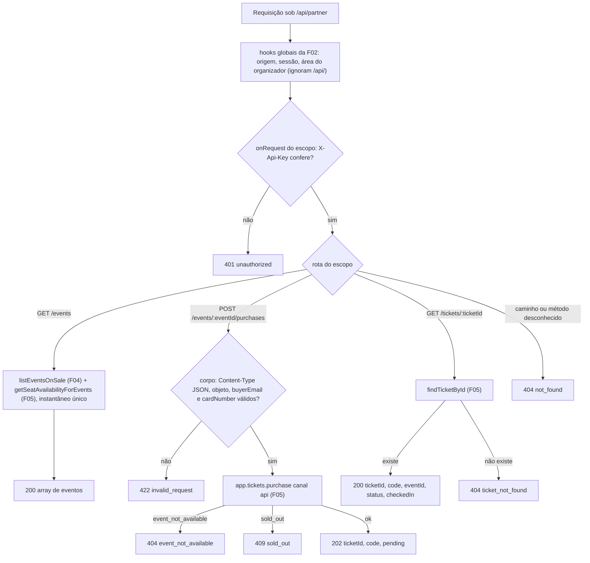
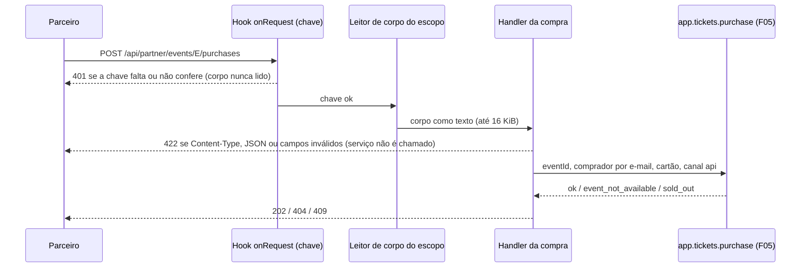

# Spec: F07 — API de parceiros

## 1. Visão técnica

**O quê.** A F07 entrega a superfície HTTP do parceiro: as três rotas do contrato fixo do brief — `GET /api/partner/events`, `POST /api/partner/events/{eventId}/purchases` e `GET /api/partner/tickets/{ticketId}` —, autenticadas pelo cabeçalho `X-Api-Key` (chave `PARTNER_API_KEY`, padrão `parceiro-catraca-dev`), com rotas, campos, status HTTP, corpos de erro e ordem de verificação copiados do brief. A feature vive num módulo novo, `parceiros`, que abre um escopo encapsulado do Fastify com prefixo `/api/partner` e, dentro dele: um hook `onRequest` que confere a chave antes de qualquer outra coisa (antes da leitura do corpo, dos parâmetros e do banco); um leitor de corpo próprio que entrega o corpo cru ao handler, para que JSON malformado e `Content-Type` não suportado virem `422 {"error":"invalid_request"}` em vez do `400`/`415` padrão do Fastify; um tratador de erros e um tratador 404 próprios; e os três handlers, que só traduzem HTTP ↔ APIs públicas de F04 e F05. A F07 não tem tabela, migration nem SQL próprio.

**Por quê.** O parceiro é um sistema externo que conversa com a Catraca por um contrato fixo — o avaliador usa `curl` com `$API` e `$KEY` (passos 2, 4, 6, 7, 8, 13, 15 e 16 do Fluxo do avaliador). Duas garantias que nascem fora da F07 precisam chegar intactas pela API: a lotação sob concorrência (R07: a rajada de 30 compras simultâneas do passo 15 dá exatamente 5 × `202` e 25 × `409`) e o efeito do cancelamento (R11: o evento sai da listagem, a compra responde `404` e os ingressos aparecem `refunded`/`cancelled` na consulta). Por isso a F07 não decide nada que é da F05 ou da F04: não confere vaga antes de comprar, não guarda estado, não tem cache — cada compra é uma chamada a `app.tickets.purchase` com `channel: 'api'`, a listagem vem de `listEventsOnSale` (F04) e das vagas da F05, e a consulta vem de `findTicketById` (F05). O que é da F07 é o contrato HTTP: a chave antes de tudo, `422 → 404 → 409` na compra, exatamente os campos do brief em cada resposta, `Content-Type: application/json` em todas.

**Complexidade:** `simple` — três rotas, nenhuma mudança no banco, nenhuma integração externa; o cuidado está na precisão do contrato HTTP (a ordem entre hook, leitura do corpo e handler, que o Fastify não dá pronta) e nos itens do contrato com tempos reais do gateway e rajadas.

**Sequência de waves.** Wave 5, em paralelo com F06 (vitrine) e F08 (check-in). A F07 só acrescenta arquivos próprios (`app/src/features/parceiros/`, `app/test/f07/`, `app/test/helpers/partner.ts`) e faz acréscimos pontuais em `README.md` e `AGENTS.md` na fase final. Não edita arquivo nenhum de F01–F05 nem das features paralelas, e não usa vitrine nem check-in — nem no código, nem nos testes, nem no contrato: o ingresso "comprado pela vitrine" do F07-CA08 é criado pelo canal `vitrine` do serviço da F05 (`app.tickets.purchase` com conta nos testes; `catraca compra:simular --conta` no contrato).

### Escopo

**Incluído:**
- Módulo `parceiros` (`app/src/features/parceiros/`), envolvido por `fastify-plugin` com `encapsulate: true`, nome `parceiros` e `dependencies: ['eventos', 'ingressos']`; `loadOrder` padrão (100). Escopo filho com prefixo `/api/partner` (5.1).
- Autenticação por `X-Api-Key` num hook `onRequest` do escopo, com comparação em tempo constante (5.2).
- Leitura do corpo como texto no escopo (todos os leitores herdados removidos; leitor coringa com limite de 16 KiB) e validação do corpo da compra na borda (5.4).
- `GET /api/partner/events` (5.3), `POST /api/partner/events/{eventId}/purchases` (5.4), `GET /api/partner/tickets/{ticketId}` (5.5).
- Tratador 404 do escopo (rotas e métodos desconhecidos sob `/api/partner`, sempre depois da chave; delegação de parâmetros longos) e tratador de erros do escopo (5.6).
- Cabeçalhos comuns: `content-type: application/json; charset=utf-8` e `cache-control: no-store` em toda resposta do escopo (5.7).
- Logs sem chave, cartão nem e-mail (5.8).
- Auxiliar de testes `app/test/helpers/partner.ts` para a F09 (CF19, CF20) (5.9) e os testes em `app/test/f07/`.
- Acréscimos pontuais em `README.md` e `AGENTS.md` (5.10).

**Excluído (e quem entrega):**
- Serviço de compra, vagas, código do ingresso, ciclo `pending → confirmed/declined`, cancelamento dos ingressos, garantia de R07: F05 (a F07 só chama). Definição de "à venda", status do evento, preço vigente e cancelamento irreversível: F04.
- Vitrine, "Meus ingressos" e `Ingressos esgotados`: F06. Check-in e `checkedIn` verdadeiro: F08. Painel com as vendas da API: F09 (CF19, CF20).
- Cadastro de parceiros, várias chaves, rotação pela interface, webhooks, CORS, paginação e qualquer rota além das três (PRD seção 7).

### Consome

| Item | De | Uso na F07 |
|---|---|---|
| Carregador de módulos (`loadOrder`, plugin `default`), `app.config.partnerApiKey`, `app.db`, `app.log`; `withTransaction` com `isolation`; `toIsoWithOffset` | F01 (`app/src/core/modules.ts`, `app/src/config.ts`, `app/src/db/transaction.ts`, `app/src/core/format.ts`) | Módulo, chave, instantâneo da listagem, `startsAt` |
| `isApiPath` nos hooks globais (`originCheck`, `loadSession`, `organizerArea`), que não atuam em `/api/` | F01/F02 (`app/src/core/errors.ts`, `app/src/features/contas/guards.ts`) | Nada a fazer: a API não passa pela checagem de origem (CSRF) nem pela sessão |
| `listEventsOnSale(db)`, `EventRecord` (`id`, `name`, `startsAt`, `capacity`, `priceCents`, `status`) | F04 (`app/src/features/eventos/public.ts`) | Listagem (publicados = à venda; rascunho e cancelado fora) |
| `app.tickets.purchase(input)` → `PurchaseResult`; `getSeatAvailabilityForEvents`, `computeAvailableSeats`; `findTicketById`; `isValidBuyerEmail`, `isValidCardNumber`; tipos `TicketRecord`, `PurchaseResult` | F05 (`app/src/features/ingressos/public.ts`, decorator `app.tickets`) | Compra pelo canal `api`, `availableSeats`, consulta, validação do corpo |
| `createTestApp`, `testDb`, `resetDatabase`, `seedAccounts`; `loginAs`; `vencerTentativas`/`entregarVencidas`; `insertTestEvent`; `insertTestTicket`, `settlePayments` | F01, F02, F03, F04, F05 (`app/test/helpers/`) | Testes |

### Provê

| Item | Onde | Consumidores |
|---|---|---|
| As três rotas do contrato fixo sob `/api/partner`, com `X-Api-Key` | HTTP (`$API`) | Parceiros; Fluxo do avaliador; contrato da F09 (CF19, CF20) |
| `partnerHeaders`, `partnerEvents`, `partnerPurchase`, `partnerTicket` | `app/test/helpers/partner.ts` | Testes da F09 (vendas da API no painel, check-in de ingresso da API) |

Nenhum código de produção de outra feature importa da F07 (PRD: "Nada para outras features"); por isso o módulo não tem `public.ts`.

### Regras e invariantes

- **Regras do brief implementadas (lado HTTP):** R02 (só publicado e não cancelado aparece na listagem e aceita compra — pela definição única da F04), R05 (`availableSeats` = vagas disponíveis da F05), R06 (compra de um ingresso, `202` com `pending`, respondida sem esperar o gateway), R07 (`409 sold_out`; a rajada pela API respeita a lotação), R08 (a consulta mostra `confirmed`/`declined` quando o gateway responde), R09 (o `code` único devolvido na compra e na consulta), R11 (evento cancelado sai da listagem, compra `404 event_not_available`, consulta mostra `refunded`/`cancelled`), além das seções "API de parceiros (contrato fixo)" e "Status do ingresso" do brief.
- **Invariantes compartilhadas que a F07 não pode quebrar:**
  - *Lotação sob concorrência (R05–R07):* a F07 nunca decide `sold_out` nem consulta vagas antes de comprar; a única decisão é a do serviço da F05, sob a trava da linha do evento. Nenhum estado em memória, nenhuma fila, nenhum cache entre requisições.
  - *API igual à vitrine:* a compra pela API é `app.tickets.purchase` com `buyer: { type: 'email' }` e `channel: 'api'` — o mesmo serviço, a mesma tabela e as mesmas regras da vitrine; campos extras do corpo nunca mudam canal, comprador, evento nem status (P07).
  - *Cancelamento (R11):* a listagem usa `listEventsOnSale` (cancelado nunca aparece) e a compra passa pelo serviço (cancelado → `event_not_available`); a consulta mostra o status gravado pela F05, sem cache.
  - *Receita (R03, R12):* a F07 não grava valor pago; `priceCents` da listagem é o preço vigente lido da F04 no instante da requisição.
  - *Isolamento (R13):* a API não expõe organizador, local, lotação, valor pago, comprador nem conta — só os campos do brief.
  - *Sem sessão:* nenhuma resposta da API lê, cria ou limpa o cookie de sessão; a checagem de origem da F02 não se aplica a `/api/`.

### Requisitos (capacidades do PRD → decisões desta spec)

| Capacidade (PRD F07) | Como esta spec atende |
|---|---|
| Toda rota exige `X-Api-Key`; sem ele ou inválido → `401 {"error":"unauthorized"}` antes de qualquer outra verificação | Hook `onRequest` do escopo (5.2), que roda antes da leitura do corpo; tratador 404 no mesmo escopo, então vale para qualquer método e caminho sob `/api/partner` (5.6) |
| Chave do README, padrão `parceiro-catraca-dev`, configurável por variável de ambiente | `app.config.partnerApiKey` da F01 (`PARTNER_API_KEY`); comparação em tempo constante (5.2) |
| `GET /api/partner/events` com exatamente `id`, `name`, `startsAt` (ISO 8601 com offset), `priceCents`, `availableSeats`; só publicados e não cancelados | `listEventsOnSale` + `getSeatAvailabilityForEvents` num instantâneo único; `toIsoWithOffset`; objeto montado com as cinco chaves na ordem do brief (5.3) |
| `POST …/purchases` → `202` com `ticketId`, `code`, `"status":"pending"` | Validação na borda + `app.tickets.purchase` canal `api` (5.4) |
| Erros da compra nesta ordem: `422 invalid_request` (campo faltando, e-mail mal formado, cartão sem 16 dígitos, JSON malformado) → `404 event_not_available` → `409 sold_out` | 5.1 (matriz de precedência) e 5.4: corpo validado antes de chamar o serviço; o serviço já decide evento antes de vaga |
| `GET /api/partner/tickets/{ticketId}` → `ticketId`, `code`, `eventId`, `status`, `checkedIn`; qualquer canal; `404 ticket_not_found` | `findTicketById` (5.5) |
| Compras pela API não se vinculam a contas, mas valem para lotação, painel, check-in e cancelamento | Mesmo serviço e mesma tabela da F05 (`buyer_user_id` nulo no canal `api`) |

### Fluxos (experiência do PRD)

1. **Listar:** `curl -s -H "X-Api-Key: $KEY" "$API/api/partner/events"` → `200` com o array de eventos à venda; o parceiro guarda o `id`.
2. **Comprar:** `POST $API/api/partner/events/$E/purchases` com `Content-Type: application/json` e `{"buyerEmail":"…","cardNumber":"…"}` → em milissegundos, `202` com `ticketId`, `code` e `"status":"pending"`; ou `422`, `404`, `409` conforme 5.4.
3. **Acompanhar:** `GET $API/api/partner/tickets/$T` repetido até `status` sair de `pending` (`confirmed` em 2–5 s com final `0001`; `declined` em 30–40 s com `0004` etc., pela tabela do gateway). Depois de um cancelamento do evento, `refunded` ou `cancelled`.
4. **Erro de autenticação:** qualquer requisição sob `/api/partner` sem a chave certa → `401 {"error":"unauthorized"}`, sem nenhum efeito.

## 2. Impacto na arquitetura

```
app/
├── src/features/parceiros/
│   ├── index.ts       # plugin (fastify-plugin, encapsulate, "parceiros", deps eventos+ingressos): registra o escopo /api/partner
│   ├── auth.ts        # chave: digest da chave configurada, comparação em tempo constante, hook onRequest
│   ├── body.ts        # leitura do corpo (limite, Content-Type JSON) e validação do corpo da compra
│   ├── responses.ts   # códigos de erro do brief, envio de erro, montagem dos três formatos de resposta
│   └── routes.ts      # escopo: leitor coringa, hooks, tratador de erros, três rotas, tratador 404
└── test/
    ├── helpers/partner.ts   # auxiliares HTTP da API para os testes da F09
    └── f07/*.test.ts
```

Documentação (fase final, acréscimos pontuais): `README.md`, `AGENTS.md`, seção 10 desta spec. O `docs/state.json` (só a entrada F07) é atualizado pelo implementador ao final, como manda o plano.





## 3. Decisões técnicas

| Decisão | Abordagem escolhida | Alternativa considerada | Trade-off |
|---|---|---|---|
| Onde verificar a chave | Hook `onRequest` registrado num escopo encapsulado com prefixo `/api/partner`, mais um tratador 404 no mesmo escopo (o Fastify aplica ao 404 de um prefixo os hooks do escopo) | Hook global (`fastify-plugin`) que compara o caminho com `/api/partner`; `preHandler` em cada rota | O escopo decide pela rota casada (não por texto da URL) e roda antes da leitura do corpo; o 404 do prefixo leva o mesmo hook, então qualquer método e caminho sob `/api/partner` responde `401` sem chave. Custo: depender da ordem de registro dentro do escopo (5.1), coberta por testes |
| Comparação da chave | SHA-256 do valor recebido e da chave configurada, comparados com `crypto.timingSafeEqual` | `===`; `timingSafeEqual` direto nos valores | Tempo independente do conteúdo e do tamanho do valor recebido; `timingSafeEqual` direto lançaria com tamanhos diferentes e vazaria o tamanho da chave |
| JSON malformado e `Content-Type` errado | Remover no escopo todos os leitores de corpo herdados e registrar um leitor coringa que entrega o corpo como texto; o handler exige `Content-Type` `application/json` e faz o `JSON.parse` | Manter o leitor JSON do Fastify e converter no tratador de erros os `400`/`415` em `422` | Uma única função decide o que é corpo inválido, na ordem certa e sem depender de códigos de erro internos do Fastify; o tratador de erros fica só para falhas de leitura (limite, tamanho incoerente) |
| Validação do corpo | Na borda (estrutura, tipos e formatos com `isValidBuyerEmail`/`isValidCardNumber` da F05) antes de chamar o serviço; `invalid_request` do serviço também vira `422` | Só o serviço valida | Corpo inválido nunca toca o banco nem o serviço; os formatos continuam definidos num só lugar (as funções da F05) |
| Campos extras no corpo | Ignorados | Rejeitar com `422` | Brief só lista campo faltando, e-mail mal formado, cartão inválido e JSON malformado como inválidos; leitor tolerante (como o cadastro da F02 com `papel`); nenhum campo extra muda canal, comprador ou evento |
| Rotas e métodos desconhecidos sob o prefixo | `401` sem chave; com chave, `404 {"error":"not_found"}` (o corpo do 404 de API da F01) | Deixar o 404 da raiz | O 404 da raiz não roda o hook do escopo: sem a chave, um caminho errado devolveria `not_found` e revelaria a existência de rotas antes de autenticar |
| Formato das respostas | Objetos montados à mão com as chaves na ordem do brief, serializados pelo Fastify | Esquema de resposta (`fast-json-stringify`) | Exatidão de campos e ordem visível no código; nenhuma coerção silenciosa de tipos |
| Listagem | `listEventsOnSale` e `getSeatAvailabilityForEvents` numa transação `repeatable read` (um instantâneo) | Duas leituras soltas; SQL próprio juntando `events` e `tickets` | Um cancelamento entre as duas leituras não produz um item "publicado" com as vagas de um evento já cancelado; a F07 continua sem SQL próprio |

## 4. Componentes

**Módulo `parceiros` (`app/src/features/parceiros/`):**

| Arquivo | Novo/Modificado | Propósito | Responsabilidades |
|---|---|---|---|
| `index.ts` | Novo | Plugin da feature | `default` = `fp(parceiros, { name: 'parceiros', dependencies: ['eventos', 'ingressos'], encapsulate: true })`; sem `loadOrder` (padrão 100, depois de `ingressos`, 40); `app.register(partnerScope, { prefix: '/api/partner' })`; nenhum hook, decorator ou rota fora do escopo |
| `auth.ts` | Novo | Chave | `PARTNER_KEY_HEADER = 'x-api-key'`; `digestKey(value: string): Buffer` (SHA-256 do UTF-8); `partnerKeyMatches(received: unknown, expectedDigest: Buffer): boolean` (texto não vazio e `timingSafeEqual` dos digests); `requirePartnerKey(expectedKey)` → hook `onRequest` (5.2) |
| `body.ts` | Novo | Corpo | `PURCHASE_BODY_LIMIT = 16384`; `isJsonContentType(header: unknown): boolean`; `parsePurchaseBody(contentType: unknown, rawBody: unknown)` → `{ ok: true; buyerEmail: string; cardNumber: string } \| { ok: false; reason: 'content_type' \| 'json' \| 'objeto' \| 'buyerEmail' \| 'cardNumber' }` (5.4) |
| `responses.ts` | Novo | Formatos | `PartnerErrorCode` = `'unauthorized' \| 'invalid_request' \| 'event_not_available' \| 'sold_out' \| 'ticket_not_found' \| 'not_found' \| 'internal_error'`; `sendPartnerError(reply, status, code)`; `toPartnerEvent(event, available)`; `toPurchaseAccepted(ticket)`; `toPartnerTicket(ticket)`; tipos `PartnerEvent`, `PurchaseAccepted`, `PartnerTicket` |
| `routes.ts` | Novo | Escopo | `partnerScope(scope)`: na ordem de 5.1 — leitores de corpo, hooks, tratador de erros, as três rotas, tratador 404 (com a delegação de 5.6); handlers `listEvents`, `purchase`, `getTicket` |

**Testes:**

| Arquivo | Novo/Modificado | Propósito |
|---|---|---|
| `app/test/helpers/partner.ts` | Novo | Auxiliares HTTP da API (5.9) |
| `app/test/f07/*.test.ts` | Novo | Seção 7 |

**Banco:** nenhuma migration (seção 6).

## 5. Contratos de API

Todas as rotas ficam sob `/api/partner`, no mesmo servidor das páginas (`$API` = `$WEB` = `http://localhost:3000`). IDs são texto (`evt_…`, `tkt_…`). Toda resposta do escopo tem `content-type: application/json; charset=utf-8`, corpo JSON compacto (sem espaços nem quebra de linha, UTF-8 sem escapar acentos, como o `JSON.stringify` do Fastify) e as chaves na ordem mostrada aqui, que é a do brief.

### 5.1 Escopo e ordem de processamento

Registro, dentro de `partnerScope`, nesta ordem (o tratador 404 por último, para herdar tudo):

1. `scope.removeAllContentTypeParsers()` e `scope.addContentTypeParser('*', { parseAs: 'string', bodyLimit: PURCHASE_BODY_LIMIT }, …)` que devolve o texto recebido sem interpretar — vale para qualquer `Content-Type`, inclusive ausente.
2. `scope.addHook('onRequest', requirePartnerKey(app.config.partnerApiKey))`.
3. `scope.addHook('onSend', …)`: `cache-control: no-store` quando a resposta ainda não tem o cabeçalho.
4. `scope.setErrorHandler(…)` (5.6).
5. Rotas: `GET /events`, `POST /events/:eventId/purchases` e `GET /tickets/:ticketId` (com o `HEAD` automático do Fastify nas duas `GET`). Sem esquemas de validação do Fastify (nenhum `400` automático).
6. `scope.setNotFoundHandler(…)` (5.6).

Ordem de processamento de toda requisição cujo caminho casa com o escopo (`/api/partner`, `/api/partner/` e tudo abaixo):

1. Hooks globais da F02 (`originCheck`, `loadSession`, `organizerArea`): não atuam em `/api/` — nada de checagem de origem, sessão lida ou `set-cookie`.
2. `onRequest` do escopo: chave ausente ou inválida → `401 {"error":"unauthorized"}`; fim. O corpo não é lido, o banco não é consultado.
3. Leitura do corpo (só nos métodos em que o Fastify lê corpo): o texto chega ao handler; corpo acima de 16 KiB ou com tamanho incoerente → tratador de erros → `422 {"error":"invalid_request"}`.
4. Handler da rota (5.3–5.5) ou tratador 404 do escopo (5.6).
5. `onSend` do escopo.

**Precedência na compra (copiada do brief, com a chave antes de tudo):**

| Chave | Corpo | Evento | Vagas | Resposta |
|---|---|---|---|---|
| ausente ou errada | qualquer | qualquer | qualquer | `401 {"error":"unauthorized"}` |
| certa | inválido (5.4) | qualquer: inexistente, id inválido, rascunho, cancelado, lotado ou com vaga | qualquer | `422 {"error":"invalid_request"}` |
| certa | válido | inexistente, id em formato inválido, rascunho ou cancelado (inclusive cancelado que estava lotado) | — | `404 {"error":"event_not_available"}` |
| certa | válido | publicado | 0 disponíveis | `409 {"error":"sold_out"}` |
| certa | válido | publicado | ≥ 1 disponível | `202 {"ticketId":"…","code":"…","status":"pending"}` |

### 5.2 Autenticação

- **Cabeçalho:** `X-Api-Key` (o nome não diferencia maiúsculas, como todo cabeçalho HTTP; o Node entrega o valor em `request.headers['x-api-key']`, já sem espaços em volta).
- **Válido:** texto não vazio exatamente igual a `app.config.partnerApiKey` (diferencia maiúsculas). Inválido: ausente, vazio, com qualquer diferença (`PARCEIRO-CATRACA-DEV`, sufixo, prefixo), repetido (o Node junta repetições com `, `), enviado em outro cabeçalho (`Authorization: Bearer …`), na query string ou no corpo.
- **Tempo constante:** `expectedDigest = digestKey(app.config.partnerApiKey)` calculado uma vez no registro; para cada requisição, `timingSafeEqual(digestKey(recebido), expectedDigest)` — dois buffers de 32 bytes, qualquer que seja o tamanho do valor recebido. Nunca `===`, `startsWith` ou `timingSafeEqual` direto nos valores.
- **Configuração:** `PARTNER_API_KEY` (F01, `app/src/config.ts`): sem variável (ou vazia), `parceiro-catraca-dev`. A chave é lida uma vez por aplicação; trocar exige reiniciar o container.
- **Resposta inválida:** `reply.code(401).send({ error: 'unauthorized' })` e o hook devolve `reply` (o ciclo para ali). Corpo exato: `{"error":"unauthorized"}`. Sem `WWW-Authenticate` (P11).
- **Log:** `parceiros: requisição sem chave válida` (warn) com `motivo` (`ausente` ou `invalida`), `method` e `caminho` (a URL sem a query string). Nunca o valor recebido nem a chave configurada.

### 5.3 `GET /api/partner/events`

- **Autenticação:** `X-Api-Key`.
- **Processamento:** `withTransaction(app.db, fn, { isolation: 'repeatable read' })`, com `fn(client)`: `events = await listEventsOnSale(client)`; `seats = await getSeatAvailabilityForEvents(client, events)`; resposta = `events.map((e) => toPartnerEvent(e, seats.get(e.id)?.available ?? computeAvailableSeats(e, 0)))`. As duas leituras veem o mesmo instante; nenhuma trava (leitura MVCC), então a listagem nunca espera compras nem as atrasa. Ordem do array: a de `listEventsOnSale` (`starts_at`, `id`). Query string ignorada. Sem paginação.
- **Resposta `200`:** array (vazio → `[]`), cada elemento com exatamente estas chaves, nesta ordem:

| Campo | Tipo | Origem |
|---|---|---|
| `id` | `string` | `event.id` (`evt_` + 16 caracteres `[a-z0-9]`) |
| `name` | `string` | `event.name`, como guardado |
| `startsAt` | `string` | `toIsoWithOffset(event.startsAt)` da F01: `AAAA-MM-DDTHH:MM:SS-03:00` (segundos sempre presentes, fuso `America/Sao_Paulo`) |
| `priceCents` | `integer` | `event.priceCents` — preço vigente no instante da leitura |
| `availableSeats` | `integer` | Vagas disponíveis de R05 (F05): lotação − (`pending` + `confirmed`), mínimo 0 |

Exemplo (o do brief):

```json
[
  {
    "id": "evt_8f2kq0x7m1c9z3ab",
    "name": "Jazz no Porão",
    "startsAt": "2026-12-05T21:00:00-03:00",
    "priceCents": 10000,
    "availableSeats": 2
  }
]
```

Bytes reais: `[{"id":"evt_8f2kq0x7m1c9z3ab","name":"Jazz no Porão","startsAt":"2026-12-05T21:00:00-03:00","priceCents":10000,"availableSeats":2}]`.

| Situação | Status | Corpo |
|---|---|---|
| Chave ausente ou errada | `401` | `{"error":"unauthorized"}` |
| Sucesso | `200` | Array acima |
| Erro inesperado (banco) | `500` | `{"error":"internal_error"}` |

### 5.4 `POST /api/partner/events/{eventId}/purchases`

- **Autenticação:** `X-Api-Key`.
- **Parâmetro `eventId`:** texto como veio no caminho (decodificado pelo roteador). Formato, existência, status e vagas são decididos pelo serviço da F05 — a F07 não testa o id.
- **Cabeçalho `Content-Type`:** precisa ser `application/json`: o tipo de mídia (o texto antes do primeiro `;`, sem espaços nas pontas, comparado sem diferenciar maiúsculas) é `application/json`; parâmetros como `; charset=utf-8` são aceitos e ignorados (o corpo é sempre lido como UTF-8). Ausente, `text/plain`, `application/x-www-form-urlencoded`, `multipart/form-data`, `application/vnd.api+json` etc. → `422`.
- **Corpo:**

| Campo | Tipo | Obrigatório | Validação | Descrição |
|---|---|---|---|---|
| `buyerEmail` | `string` | Sim | `isValidBuyerEmail` da F05 (sem espaços nas pontas, `^[^\s@]+@[^\s@]+\.[^\s@]+$`, até 254 caracteres) | E-mail do comprador; a F05 grava sem espaços nas pontas e em minúsculas; não vincula a conta |
| `cardNumber` | `string` | Sim | `isValidCardNumber` da F05 (exatamente `^[0-9]{16}$`, sem remover espaços ou hífens) | Número do cartão; nunca gravado inteiro nem registrado em log |

Exemplo (o do brief): `{ "buyerEmail": "ana@example.com", "cardNumber": "4000000000000001" }`.

- **Validação (`parsePurchaseBody`)**, na ordem (a primeira falha define o `reason` do log; a resposta é sempre a mesma):
  1. `content_type`: `isJsonContentType(request.headers['content-type'])` falso.
  2. `json`: corpo ausente, vazio ou que `JSON.parse` recusa (inclusive JSON truncado, texto qualquer, BOM).
  3. `objeto`: o valor não é objeto (`null`, array, número, texto, booleano).
  4. `buyerEmail`: propriedade própria ausente, não-texto (`null`, número) ou recusada por `isValidBuyerEmail`.
  5. `cardNumber`: propriedade própria ausente, não-texto (o número JSON `4000000000000001` é inválido) ou recusada por `isValidCardNumber`.
  6. Demais propriedades: ignoradas (P07), inclusive `eventId`, `channel`, `status`, `buyerUserId`, `quantity` e `__proto__` (lidas só por `Object.hasOwn`; nada é mesclado em outro objeto).
- **Corpo inválido:** log `parceiros: corpo da compra inválido` (info, `eventId` como veio no caminho e `motivo`, sem valores do corpo) e `422 {"error":"invalid_request"}`. O serviço não é chamado; nada é gravado.
- **Corpo válido:** `result = await app.tickets.purchase({ eventId, buyer: { type: 'email', email: buyerEmail }, cardNumber, channel: 'api' })`.

| `PurchaseResult` (F05) | Status | Corpo |
|---|---|---|
| `{ ok: true, ticket }` | `202` | `{"ticketId":"<ticket.id>","code":"<ticket.code>","status":"pending"}` (`status` = `ticket.status`, sempre `pending` num ingresso novo) |
| `{ ok: false, reason: 'invalid_request' }` (defensivo; a borda já validou) | `422` | `{"error":"invalid_request"}` |
| `{ ok: false, reason: 'event_not_available' }` | `404` | `{"error":"event_not_available"}` |
| `{ ok: false, reason: 'sold_out' }` | `409` | `{"error":"sold_out"}` |
| Exceção (banco, `lock_timeout` de 5 s, falha ao registrar a tentativa) | `500` | `{"error":"internal_error"}` (tratador de erros, 5.6; a F05 já desfez a compra) |

Exemplo de sucesso (o do brief):

```
POST /api/partner/events/evt_8f2kq0x7m1c9z3ab/purchases
X-Api-Key: parceiro-catraca-dev
Content-Type: application/json

{ "buyerEmail": "ana@example.com", "cardNumber": "4000000000000001" }

202
content-type: application/json; charset=utf-8
cache-control: no-store

{"ticketId":"tkt_51xqk2m9a0c7d3ef","code":"K7Q2M9XA","status":"pending"}
```

| Situação | Status | Corpo |
|---|---|---|
| Chave ausente ou errada | `401` | `{"error":"unauthorized"}` |
| `Content-Type` não JSON; JSON malformado; corpo vazio ou que não é objeto; `buyerEmail` ou `cardNumber` faltando, não-texto ou mal formado; corpo acima de 16 KiB | `422` | `{"error":"invalid_request"}` |
| Evento inexistente, id em formato inválido, rascunho ou cancelado | `404` | `{"error":"event_not_available"}` |
| Evento publicado sem vaga (inclusive na corrida da rajada) | `409` | `{"error":"sold_out"}` |
| Compra criada | `202` | `{"ticketId":"tkt_…","code":"…","status":"pending"}` |
| Erro inesperado | `500` | `{"error":"internal_error"}` |

A resposta sai sem esperar o gateway (R06): o tempo é o da transação curta da F05 (milissegundos; sempre menos de 1 s fora de contenção extrema).

### 5.5 `GET /api/partner/tickets/{ticketId}`

- **Autenticação:** `X-Api-Key`.
- **Processamento:** `ticket = await findTicketById(app.db, ticketId)` (F05: `null` sem consultar o banco se o id não tiver o formato `^tkt_[a-z0-9]{16}$`). Ingresso de qualquer canal (`api` ou `vitrine`) e de evento em qualquer status. Busca só por id: um código (`K7Q2M9XA`) no lugar do id, ou o id em maiúsculas, é ingresso inexistente.
- **Resposta `200`** com exatamente estas chaves, nesta ordem:

| Campo | Tipo | Origem |
|---|---|---|
| `ticketId` | `string` | `ticket.id` |
| `code` | `string` | `ticket.code` (8 caracteres `A-Z0-9`) |
| `eventId` | `string` | `ticket.eventId` |
| `status` | `string` | `ticket.status`: `pending`, `confirmed`, `declined`, `cancelled` ou `refunded` (valores da API do brief) |
| `checkedIn` | `boolean` | `ticket.checkedIn` (`false` até o check-in da F08) |

Exemplo (o do brief): `{"ticketId":"tkt_51xqk2m9a0c7d3ef","code":"K7Q2M9XA","eventId":"evt_8f2kq0x7m1c9z3ab","status":"confirmed","checkedIn":false}`.

| Situação | Status | Corpo |
|---|---|---|
| Chave ausente ou errada | `401` | `{"error":"unauthorized"}` |
| Ingresso inexistente, id em formato inválido, código no lugar do id | `404` | `{"error":"ticket_not_found"}` |
| Encontrado | `200` | Objeto acima |
| Erro inesperado | `500` | `{"error":"internal_error"}` |

### 5.6 Rotas desconhecidas, parâmetros longos e erros do escopo

**Tratador 404 do escopo** (`setNotFoundHandler`, registrado por último dentro do escopo — o Fastify associa ao prefixo `/api/partner` e a tudo abaixo dele, e aplica os hooks do escopo):
- Recebe toda requisição sob `/api/partner` que não casou com uma rota: caminho desconhecido (`/api/partner`, `/api/partner/`, `/api/partner/nada`, `/api/partner/events/` com barra final), método não suportado (`DELETE /api/partner/events`, `PUT /api/partner/tickets/…`, `POST /api/partner/events`, `OPTIONS …`).
- Como roda depois do hook da chave: sem chave válida → `401 {"error":"unauthorized"}`.
- Com chave válida:
  1. `POST` em `/api/partner/events/<segmento>/purchases` (casa só quando o segmento passa do limite de 100 caracteres de parâmetro do roteador do Fastify): chama o mesmo handler da compra com `eventId` = `decodeURIComponent(segmento)` (se a decodificação falhar, o segmento cru) — corpo inválido → `422`; corpo válido → o serviço recusa o id → `404 event_not_available`.
  2. `GET`/`HEAD` em `/api/partner/tickets/<segmento>` (mesmo motivo): mesmo handler da consulta → `404 ticket_not_found`.
  3. Qualquer outro: `404 {"error":"not_found"}` (o mesmo corpo do 404 de API da F01).
- Fora do escopo (`/api/partnerx`, `/api/outra`) vale o 404 de API da F01 (`{"error":"not_found"}`, sem exigir chave): não é rota de parceiro.

**Tratador de erros do escopo** (`setErrorHandler`):
- Erro com `statusCode` entre 400 e 499 (gerado pelo Fastify na leitura do corpo: corpo acima de 16 KiB, `413`; `Content-Length` incoerente, `400`; requisição abortada) → log `parceiros: corpo da compra inválido` (info, `motivo: 'leitura'`) e `422 {"error":"invalid_request"}`.
- Qualquer outro erro → log `parceiros: erro inesperado` (error, com `err`) e `500 {"error":"internal_error"}` (o mesmo corpo do 500 de API da F01).

**Limitação conhecida:** um caminho com codificação percentual inválida (ex.: `/api/partner/tickets/%`) é recusado pelo roteador antes de qualquer hook, com o `400` padrão do Fastify; tratar exigiria a opção `frameworkErrors` na criação do servidor (arquivo da F01). Não é rota do contrato (P10).

### 5.7 Cabeçalhos e formato

| Cabeçalho | Valor | Onde |
|---|---|---|
| `content-type` | `application/json; charset=utf-8` | Toda resposta do escopo (inclusive `401`, `404`, `422`, `500` e `HEAD`) |
| `cache-control` | `no-store` | Toda resposta do escopo (status de ingresso não pode vir de cache) |
| `set-cookie` | — | Nunca (a API não usa sessão) |
| CORS (`access-control-*`) | — | Nunca: parceiros são servidores; `OPTIONS` segue a tabela de 5.6 |

### 5.8 Logs

Logger JSON do Fastify (o registro automático de cada requisição já traz método, URL e status; nunca cabeçalhos nem corpo). Mensagens da F07 — nenhuma com chave, cartão, e-mail ou corpo:

| Mensagem (`msg`) | Nível | Campos | Quando |
|---|---|---|---|
| `parceiros: requisição sem chave válida` | warn | `motivo` (`ausente`/`invalida`), `method`, `caminho` | `401` |
| `parceiros: corpo da compra inválido` | info | `eventId`, `motivo` (`content_type`, `json`, `objeto`, `buyerEmail`, `cardNumber`, `leitura`) | `422` |
| `parceiros: erro inesperado` | error | `err` | `500` |

Compras criadas e recusas tipadas já são registradas pela F05 (`ingressos: compra registrada` / `ingressos: compra recusada`, com `channel: 'api'`).

### 5.9 Auxiliar de testes (`app/test/helpers/partner.ts`)

| Função | Contrato |
|---|---|
| `partnerHeaders(app, extra?)` | `{ 'x-api-key': app.config.partnerApiKey, 'content-type': 'application/json', ...extra }` |
| `partnerEvents(app)` | `app.inject` `GET /api/partner/events` com a chave → `{ statusCode, body }` (corpo já interpretado) |
| `partnerPurchase(app, eventId, { buyerEmail?, cardNumber? })` | `POST …/purchases` com a chave e o JSON (padrões `api.<aleatório>@example.com` e `4000000000000001`) → `{ statusCode, body }` |
| `partnerTicket(app, ticketId)` | `GET /api/partner/tickets/:id` com a chave → `{ statusCode, body }` |

Uso previsto: testes da F09 (CF19, CF20) e os da própria F07.

### 5.10 Documentação (fase final)

| Arquivo | Mudança (pontual) |
|---|---|
| `README.md` | Em `## Endereços`: trocar "as rotas da API de parceiros ficam sob `/api/` (entregues pela F07)" pelas três rotas sob `/api/partner/` e um exemplo `curl -s -H "X-Api-Key: $KEY" "$API/api/partner/events"`. Em `## Credenciais`: tirar "(a API de parceiros é entregue pela F07)" da linha da chave. Em `## Decisões`: uma linha "API de parceiros" (escopo `/api/partner` com a chave verificada antes de tudo, em tempo constante; corpo lido como texto para que JSON malformado e `Content-Type` errado virem `422`; mesmo serviço de compra da vitrine, canal `api`) |
| `AGENTS.md` | Em "Convenções de código": "API de parceiros: rotas só no módulo `parceiros`, sob `/api/partner` (chave, leitor de corpo e erros do escopo valem para todas); compra sempre por `app.tickets.purchase` com `channel: 'api'`; nos testes, `app/test/helpers/partner.ts`" |
| `docs/state.json` | Só a entrada F07 (`aguardando_avaliacao` ao final da implementação) |

## 6. Modelo de dados

Sem mudanças: nenhuma migration, nenhuma tabela, nenhum SQL próprio. Leituras e escritas passam pelas APIs públicas:

| Dado | Como a F07 obtém | Tabela (dona) |
|---|---|---|
| Eventos à venda | `listEventsOnSale(client)` | `events` (F04) |
| Vagas disponíveis | `getSeatAvailabilityForEvents(client, events)` | `tickets` (F05) |
| Compra | `app.tickets.purchase` (ingresso + tentativa de pagamento na transação da F05) | `tickets` (F05), `payment_attempts` (F03) |
| Ingresso por id | `findTicketById(app.db, id)` | `tickets` (F05) |

A listagem abre uma transação `repeatable read` só de leitura (5.3); a compra usa a transação `read committed` da F05 com a trava da linha do evento.

## 7. Estratégia de testes

Todos rodam pelo `npm run gates` (banco `catraca_test`, `NODE_ENV=test`, arquivos em sequência). Cada teste ligado a critério leva o ID no nome. Requisições por `app.inject` (o ciclo completo do Fastify: hooks, leitor de corpo, tratadores), exceto a rajada, que usa HTTP real: `app.listen({ host: '127.0.0.1', port: 0 })` e 30 `fetch` disparados juntos (`Promise.all`) — 30 requisições TCP concorrentes, cada uma numa transação da F05. Eventos com `insertTestEvent` (F04) ou pela página de gestão com `loginAs` quando o teste é sobre a integração com a F04 (CF10, CF13); ingressos com a própria API, com `app.tickets.purchase` (canal `vitrine`) ou `insertTestTicket`; pagamentos resolvidos com `settlePayments` (sem esperar), exceto em `tempos.test.ts`.

**Estrutura:**

| Arquivo | Tipo | Alvo |
|---|---|---|
| `app/test/f07/autenticacao.test.ts` | Integração + unidade | Chave, `401` antes de tudo, qualquer rota sob o prefixo |
| `app/test/f07/corpo.test.ts` | Unidade | `isJsonContentType`, `parsePurchaseBody` |
| `app/test/f07/eventos.test.ts` | Integração | Listagem |
| `app/test/f07/compra.test.ts` | Integração | Compra: sucesso, `422`, `404`, `409`, ordem, origem |
| `app/test/f07/ingressos.test.ts` | Integração | Consulta do ingresso |
| `app/test/f07/ciclo.test.ts` | Integração (F04 + F05) | Resultado do gateway e cancelamento vistos pela API |
| `app/test/f07/rajada.test.ts` | Integração (HTTP real, concorrência) | R07 pela API |
| `app/test/f07/tempos.test.ts` | Integração (worker real) | Tempos do gateway pela consulta |
| `app/test/f07/modulo.test.ts` | Integração | Carga do módulo, rotas, cabeçalhos, sessão |

**`autenticacao.test.ts`**

| Teste | Asserções |
|---|---|
| `F07-CA09 sem X-Api-Key as três rotas respondem 401 unauthorized` | `GET /events`, `POST …/purchases` (corpo válido, evento com vaga), `GET /tickets/<existente>` → `401`, corpo exatamente `{"error":"unauthorized"}`, `content-type` JSON |
| `F07-CA09 chave errada, vazia, em maiúsculas, com sufixo, repetida, no Authorization ou na query responde 401` | cada variante nas três rotas → `401` |
| `F07-CA09 a chave é verificada antes do corpo, do evento e da vaga` | sem chave: JSON malformado, `text/plain`, corpo de 20 KiB, cartão `123` em evento cancelado, evento lotado, ingresso inexistente → `401`; `app.tickets.purchase` substituído por um espião não é chamado; contagem de `tickets` inalterada |
| `F07-CA09 qualquer método e caminho sob /api/partner exige a chave` | sem chave: `GET /api/partner`, `/api/partner/`, `/api/partner/nada`, `DELETE /api/partner/events`, `PUT /api/partner/tickets/<id>`, `OPTIONS /api/partner/events`, `HEAD /api/partner/events` → `401`; com chave → `404 {"error":"not_found"}` (o `HEAD /events` com chave → `200`); `/api/partnerx` sem chave → `404 {"error":"not_found"}` da F01 |
| `F07-CA09 o nome do cabeçalho não diferencia maiúsculas` | `X-API-KEY`, `x-api-key` → `200` |
| `PARTNER_API_KEY configurada substitui a chave padrão` | `createTestApp({ config: { PARTNER_API_KEY: 'chave-de-teste-f07' } })`: `parceiro-catraca-dev` → `401`; `chave-de-teste-f07` → `200` |
| `partnerKeyMatches compara digests e não lança com tamanhos diferentes` | igual → verdadeiro; vazio, `undefined`, número, mais curto, mais longo, um caractere diferente → falso, sem exceção |
| `o 401 registra o motivo e nunca o valor recebido` | logs capturados: `parceiros: requisição sem chave válida` com `motivo` `ausente`/`invalida`; o texto `chave-errada-f07` não aparece em nenhuma linha de log |

**`corpo.test.ts`**

| Teste | Asserções |
|---|---|
| `F07-CA03 isJsonContentType aceita só application/json, com ou sem parâmetros` | `application/json`, `application/json; charset=utf-8`, `Application/JSON` → verdadeiro; `undefined`, vazio, `text/plain`, `application/x-www-form-urlencoded`, `application/vnd.api+json`, `application/jsonx` → falso |
| `F07-CA03 parsePurchaseBody recusa cada forma de corpo inválido com o motivo certo` | tabela: `content_type`, `json` (vazio, truncado, texto, BOM), `objeto` (`null`, `[]`, `1`, `"x"`, `true`), `buyerEmail` (faltando, `null`, número, `nao-e-um-email`, 255 caracteres), `cardNumber` (faltando, número JSON, `123`, 15, 17, letra, espaços, hífens) |
| `F07-CA02 parsePurchaseBody aceita o corpo do brief e ignora campos extras` | `{"buyerEmail":"ana@example.com","cardNumber":"4000000000000001","quantity":3,"eventId":"evt_x","__proto__":{"a":1}}` → `ok` com os dois valores, sem outros campos |

**`eventos.test.ts`**

| Teste | Asserções |
|---|---|
| `F07-CA01 lista só eventos publicados com exatamente id, name, startsAt, priceCents e availableSeats` | rascunho, publicado e cancelado de dois organizadores; só os publicados; `Object.keys` de cada um = `['id','name','startsAt','priceCents','availableSeats']`; corpo cru igual ao `JSON.stringify` esperado |
| `F07-CA01 startsAt é ISO 8601 com segundos e -03:00` | `starts_at = 2026-12-06T00:00:00Z` → `2026-12-05T21:00:00-03:00`; com segundos (`…T00:00:30Z`) → `…21:00:30-03:00` |
| `F07-CA01 availableSeats segue R05` | lotação 5 com 1 `pending`, 1 `confirmed`, 1 `declined`, 1 `cancelled` → `3`; lotação 1 com 1 `pending` → `0` |
| `F07-CA01 sem eventos à venda a listagem é []` | corpo exatamente `[]` |
| `F07-CA01 CF10 evento criado e publicado pela página de gestão aparece com priceCents 10000 e, depois de mudar o preço para R$ 150,00, 15000` | `loginAs` organizador A; `POST /organizador/eventos` (lotação 2, `100,00`) → ausente; publicar → `priceCents 10000`, `availableSeats 2`; editar preço `150,00` → `15000` |
| `CF10 rascunho e evento cancelado pela página de gestão não aparecem` | cancelar pela página de gestão (`confirmar=sim`) → ausente |

**`compra.test.ts`**

| Teste | Asserções |
|---|---|
| `F07-CA02 corpo válido responde 202 com exatamente ticketId, code e status pending, sem esperar o gateway` | `202`; corpo cru casa `^\{"ticketId":"tkt_[a-z0-9]{16}","code":"[A-Z0-9]{8}","status":"pending"\}$`; duração < 1 s; ingresso no banco com canal `api`, `buyer_user_id` nulo, `buyer_email` em minúsculas, valor pago = preço; tentativa de pagamento com `delivered_at` nulo |
| `F07-CA02 Content-Type com charset e campos extras são aceitos; extras não mudam canal nem evento` | `application/json; charset=utf-8` → `202`; extras `eventId` de outro evento, `channel: 'vitrine'`, `status: 'confirmed'` → `202`, ingresso no evento do caminho, canal `api`, `pending` |
| `F07-CA03 corpo inválido responde 422 invalid_request sem criar ingresso` | `it.each` com os 19 corpos/`Content-Type` do contrato (C03) → `422 {"error":"invalid_request"}`; contagens de `tickets` e `payment_attempts` inalteradas |
| `F07-CA03 corpo acima de 16 KiB responde 422` | 20 KiB com os dois campos válidos → `422` |
| `F07-CA04 CF10 evento inexistente, em rascunho, cancelado ou com id inválido responde 404 event_not_available` | `evt_0000000000000000`, rascunho, cancelado, `nao-e-um-evento` → `404 {"error":"event_not_available"}`; nada criado |
| `F07-CA04 id de evento com mais de 100 caracteres segue a mesma ordem` | 150 caracteres: corpo inválido → `422`; válido → `404 event_not_available` |
| `F07-CA05 sem vaga responde 409 sold_out` | lotação 1 com 1 `confirmed` → `409 {"error":"sold_out"}`; com 1 `pending` → `409`; nada criado |
| `F07-CA06 a ordem dos erros é 401, 422, 404 e 409` | matriz de 5.1: corpo inválido em evento lotado, cancelado, rascunho e inexistente → `422`; corpo válido em evento cancelado que estava lotado → `404`; lotado → `409` |
| `a checagem de origem da F02 não se aplica à API` | `origin: https://parceiro.example`, `sec-fetch-site: cross-site` → `202` |
| `erro inesperado do serviço responde 500 internal_error em JSON` | `app.tickets.purchase` substituído por função que lança → `500 {"error":"internal_error"}`; log `parceiros: erro inesperado` |

**`ingressos.test.ts`**

| Teste | Asserções |
|---|---|
| `F07-CA08 consulta responde 200 com exatamente ticketId, code, eventId, status e checkedIn false num ingresso novo` | compra pela API; `GET` → corpo cru igual a `{"ticketId":…,"code":…,"eventId":…,"status":"pending","checkedIn":false}` |
| `F07-CA08 ingresso comprado pela vitrine aparece na consulta` | `app.tickets.purchase` com `buyer: { type: 'account' }` do participante da seed, canal `vitrine` → `200` com os mesmos campos |
| `F07-CA08 status e checkedIn refletem o ingresso` | `insertTestTicket` com cada status; `confirmed` com `checkedIn: true` → `"checkedIn":true` |
| `F07-CA08 ingresso inexistente, id inválido, código no lugar do id ou id em maiúsculas responde 404 ticket_not_found` | quatro casos → `404 {"error":"ticket_not_found"}` |
| `F07-CA08 id de ingresso com mais de 100 caracteres responde 404 ticket_not_found` | `GET` com 150 caracteres |

**`ciclo.test.ts`**

| Teste | Asserções |
|---|---|
| `F07-CA10 CF11 a consulta mostra confirmed com 0001 e declined com 0004, e a recusa devolve a vaga` | lotação 2 com 1 `confirmed` (vitrine); compra `0004` → `availableSeats 0`; compra seguinte → `409 sold_out`; `settlePayments` → `declined` na consulta e `availableSeats 1`; compra `0001` → `202`; `settlePayments` → `confirmed` |
| `F07-CA04 CF13 depois de cancelar pela página de gestão a consulta mostra refunded e cancelled e a compra responde 404` | `0001` confirmado e `0003` pendente comprados pela API; cancelar com `loginAs` A → listagem sem o evento; compra → `404 event_not_available`; consultas → `refunded` e `cancelled`; `settlePayments` (gateway aprova o `0003`) → continua `cancelled` |

**`rajada.test.ts`** (HTTP real)

| Teste | Asserções |
|---|---|
| `F07-CA07 CF12 30 compras simultâneas pela API em lotação 5 dão exatamente 5 respostas 202 e 25 409, em 5 rodadas com eventos novos` | por rodada: contagem por status `{202: 5, 409: 25}`; corpos `409` = `{"error":"sold_out"}`; 5 ingressos no banco, 5 ocupando vaga, 5 códigos distintos; listagem com `availableSeats 0` |
| `CF12 rajadas simultâneas em dois eventos vendem exatamente a lotação de cada um` | lotação 5 e 3, 30 compras em cada, todas juntas → `202` 5 e 3 |
| `CF12 rajada pela API junto com compras pelo canal vitrine respeita a lotação` | 15 `fetch` + 15 `app.tickets.purchase` com conta (canal `vitrine`) no mesmo `Promise.all`, lotação 5 → 5 criados no total |

**`tempos.test.ts`** (worker real da F03)

| Teste | Asserções |
|---|---|
| `F07-CA10 F07-CA11 com a configuração padrão, a compra pela API com 0001 aparece confirmed na consulta em até 5 s` | `createTestApp({ backgroundJobs: true })` sem nenhuma variável de gateway nem de chave; compra; consulta a cada 200 ms; `confirmed` observado com no máximo 5,0 s desde o envio da compra |
| `F07-CA10 com escala 0,1, 0004 continua pending aos 2,9 s e fica declined até 4,5 s` | `GATEWAY_DELAY_SCALE=0.1` |

**`modulo.test.ts`**

| Teste | Asserções |
|---|---|
| `o módulo parceiros carrega depois de eventos e ingressos e registra as três rotas` | `app.featureModules` contém `parceiros` depois de `ingressos`; `hasRoute` para as três |
| `toda resposta da API tem content-type JSON e cache-control no-store` | `200`, `202`, `401`, `404`, `409`, `422` |
| `a API não lê nem grava sessão` | cookie `catraca_sessao` inválido → nenhuma resposta tem `set-cookie` |

**Cobertura dos critérios:**

| Critério | Testes automatizados | Contrato |
|---|---|---|
| F07-CA01 | `eventos` | C01 |
| F07-CA02 | `compra`, `corpo` | C02, C03 |
| F07-CA03 | `compra`, `corpo` | C03, C06 |
| F07-CA04 | `compra`, `ciclo` | C04, C11 |
| F07-CA05 | `compra`, `ciclo` | C05, C10 |
| F07-CA06 | `compra` | C06 |
| F07-CA07 | `rajada` | C07, C13 |
| F07-CA08 | `ingressos` | C08, C10 |
| F07-CA09 | `autenticacao` | C09 |
| F07-CA10 | `ciclo`, `tempos` | C10 |
| F07-CA11 | `tempos` (configuração padrão) | C12 |
| CF10 (F04 → F07) | `eventos`, `compra` | C01, C04 |
| CF11 (F05 → F07) | `ciclo` | C10 |
| CF12 (F05 → F07) | `rajada` | C07, C13 |
| CF13 (F05 → F07) | `ciclo` | C11 |

**Critérios cross-feature em que a F07 é envolvida mas não a última:** CF19 (F06, F07 → F09) e CF20 (F07, F08 → F09) pertencem ao contrato da F09; a F07 provê a superfície e o auxiliar `partner.ts`.

## 8. Tratamento de erros

| Situação | Onde | Comportamento |
|---|---|---|
| `X-Api-Key` ausente, vazio, diferente, repetido, em outro lugar | hook `onRequest` | `401 {"error":"unauthorized"}`; nada lido nem gravado; log warn com `motivo` |
| Caminho ou método desconhecido sob `/api/partner` | tratador 404 do escopo | Sem chave: `401`; com chave: `404 {"error":"not_found"}` (salvo a delegação de parâmetros longos) |
| `Content-Type` diferente de `application/json` (ou ausente) | `parsePurchaseBody` | `422 {"error":"invalid_request"}` |
| JSON malformado, corpo vazio, corpo que não é objeto | `parsePurchaseBody` | `422` |
| `buyerEmail`/`cardNumber` faltando, não-texto ou mal formado | `parsePurchaseBody` | `422` |
| Corpo acima de 16 KiB, `Content-Length` incoerente | tratador de erros do escopo | `422` |
| Evento inexistente, id inválido, rascunho, cancelado (inclusive cancelado enquanto a compra esperava a trava) | serviço da F05 | `404 {"error":"event_not_available"}` |
| Sem vaga (inclusive na rajada) | serviço da F05, sob a trava | `409 {"error":"sold_out"}` |
| Ingresso inexistente ou id inválido | `findTicketById` | `404 {"error":"ticket_not_found"}` |
| Banco indisponível, `lock_timeout`, falha ao registrar a tentativa | tratador de erros do escopo | `500 {"error":"internal_error"}`; log error; a F05 já desfez a compra |
| Caminho com codificação percentual inválida | roteador do Fastify (antes dos hooks) | `400` padrão do Fastify (limitação conhecida, P10) |

## 9. Premissas e decisões do modo não interativo

Decisões tomadas pela política de auto-aceite (spec-writer, Batch Mode, "Auto-Accept Policy") onde o PRD, o brief, o briefing técnico e as specs de F01–F05 não fixam o detalhe. Revisáveis antes do commit do contrato.

| # | Premissa / decisão | Linha da política |
|---|---|---|
| P01 | Complexidade `simple`; plano em 3 fases (a última, Documentação). | Recomendação clara |
| P02 | Módulo `parceiros` (pasta em pt-BR, como `contas`, `eventos`, `ingressos`), identificadores em inglês; `fastify-plugin` com `encapsulate: true`, `name: 'parceiros'` e `dependencies: ['eventos', 'ingressos']` (falha cedo se a F04/F05 faltar); `loadOrder` padrão 100. | Padrões conflitantes (mais frequente) |
| P03 | Tudo da API num escopo encapsulado com prefixo `/api/partner`: hook `onRequest` da chave, leitor de corpo, `onSend`, tratador de erros e tratador 404 próprios, nessa ordem de registro (5.1). Se o tratador 404 do prefixo não herdar o hook na versão do Fastify em uso, o implementador troca por rotas coringa do escopo (`ALL /` e `ALL /*`, com a mesma lógica) e registra em Desvios. | Recomendação clara |
| P04 | Chave só no cabeçalho `X-Api-Key`; valor exato (diferencia maiúsculas; o Node já remove espaços em volta); repetido = inválido; comparação por SHA-256 + `timingSafeEqual`; chave lida da configuração da F01 uma vez por aplicação. | Detalhe parcial do brief |
| P05 | `Content-Type` exigido: tipo de mídia `application/json` (sem diferenciar maiúsculas, parâmetros aceitos e ignorados); ausente ou outro → `422`. O brief mostra `Content-Type: application/json` na compra e o orquestrador pede `422` para `Content-Type` não suportado. | Detalhe parcial do brief |
| P06 | Corpo lido sempre como UTF-8, limite de 16 KiB (folgado para o corpo do brief, que tem menos de 100 bytes); acima → `422`. | Recomendação clara |
| P07 | Campos extras ignorados; `buyerEmail` e `cardNumber` precisam ser texto JSON (número no cartão é inválido); formatos pelas funções `isValidBuyerEmail`/`isValidCardNumber` da F05 (um só lugar). O e-mail é repassado como veio; a F05 normaliza (sem espaços nas pontas, minúsculas). | Descrição vaga |
| P08 | Caminho ou método desconhecido sob `/api/partner`: `401` sem chave; `404 {"error":"not_found"}` com chave (corpo do 404 de API da F01). Ids acima de 100 caracteres (limite de parâmetro do roteador) são delegados pelo tratador 404 às rotas de compra e consulta, para manter a ordem `422 → 404` e os códigos `event_not_available`/`ticket_not_found`. | Recomendação clara |
| P09 | Erros de leitura do corpo (4xx do Fastify) → `422`; qualquer outro erro → `500 {"error":"internal_error"}` (corpo do 500 de API da F01). | Recomendação clara |
| P10 | Caminho com codificação percentual inválida fica com o `400` do Fastify (exigiria mudar a criação do servidor, arquivo da F01, numa wave paralela); fora do contrato. | Padrões conflitantes (não editar arquivo compartilhado) |
| P11 | Cabeçalhos: `content-type: application/json; charset=utf-8` (padrão do Fastify) e `cache-control: no-store` em toda resposta; sem `WWW-Authenticate` (o esquema não é padrão), sem CORS (parceiros são servidores). | Recomendação clara |
| P12 | Listagem na ordem do `listEventsOnSale` (`starts_at`, `id`), sem paginação nem filtro de data (P19 da F04); `startsAt` por `toIsoWithOffset` (segundos e `-03:00`); leituras numa transação `repeatable read` (instantâneo único, sem trava). | Recomendação clara |
| P13 | Chaves do JSON na ordem do brief; objetos montados à mão (sem esquema de resposta). | Recomendação clara |
| P14 | Nenhum SQL, tabela ou migration na F07; nenhum acréscimo às APIs públicas de F04/F05 é necessário (usa `listEventsOnSale`, `getSeatAvailabilityForEvents`, `computeAvailableSeats`, `findTicketById`, `isValidBuyerEmail`, `isValidCardNumber`, `app.tickets`). Se a implementação de F04/F05 tiver registrado nomes diferentes nos Desvios delas, a F07 usa os nomes implementados e registra aqui. | Recomendação clara |
| P15 | Logs com mensagens fixas (5.8), sem chave, cartão, e-mail nem corpo; o `401` em `warn`. | Recomendação clara |
| P16 | Contrato: eventos pela interface da F04 (cookie do organizador A, como nos contratos de F04/F05); ingresso "da vitrine" pelo canal `vitrine` do serviço (`catraca compra:simular --conta participante@catraca.test`, F05) porque a vitrine (F06) é da mesma wave; tempos conferidos pela consulta da API em idades medidas no relógio do banco (`created_at`) mais a janela gravada pela F05; rajada exatamente com o comando do passo 15, em 3 rodadas com eventos novos (o critério pede 2; a skill pede ao menos 3); `checkedIn: true` conferido com um `UPDATE` de check-in direto no banco (a F08 é da mesma wave), a única escrita fora das superfícies do produto; F07-CA11 num clone limpo do commit avaliado, sem `.env`, com nome de projeto e porta próprios passados só ao Compose (`COMPOSE_PROJECT_NAME`, `CATRACA_PORT`, que não chegam à aplicação), para não derrubar nem colidir com o ambiente da avaliação. | Recomendação clara |
| P17 | Auxiliar `app/test/helpers/partner.ts` para os testes da F09 (CF19, CF20). | Recomendação clara |
| P18 | `HEAD` das rotas `GET` pelo Fastify (mesmo hook, sem corpo); `OPTIONS` e demais métodos seguem o tratador 404 do escopo. | Recomendação clara |
| P19 | Documentação: rotas e exemplo `curl` no README (Endereços), ajuste da linha da chave (Credenciais), uma linha em Decisões; convenção da API no `AGENTS.md`. | Recomendação clara |

**Conflitos PRD × brief:** nenhum. Observações: (1) a lista de corpo inválido do brief não cita JSON malformado; o PRD (F07-CA03) cita — compatível. (2) F07-CA07 e CF12 pedem duas rodadas; o contrato roda três (skill: ao menos 3; métrica do PRD: 10 antes da entrega). (3) O brief não exige `Content-Type` na compra além do exemplo; P05 registra a decisão.

## 10. Desvios da implementação

Preenchido pelo implementador na fase Documentação: cada diferença entre esta spec e o que foi implementado, com o motivo.

| # | Desvio | Motivo |
|---|---|---|
| D1 | Além do tratador 404 do escopo (5.6), o escopo registra um coringa `ALL /*` (→ `/api/partner/*`) com a mesma função (`fallback` em `routes.ts`): ids acima de 100 caracteres na compra e na consulta são entregues aos mesmos handlers; o resto responde `404 {"error":"not_found"}`. O tratador 404 continua registrado e atende `/api/partner` (sem barra) e métodos que o roteador não conhece. | No Fastify 5.12.8 (find-my-way 9.10.2), um parâmetro acima de `maxParamLength` não cai no tratador 404 como a spec supunha: o roteador responde `414 FST_ERR_MAX_PARAM_LENGTH` direto (`onMaxParamLength`), antes de qualquer hook — inclusive sem a chave. Com o coringa, a busca volta (backtracking) ao nó coringa, a requisição entra no escopo e a ordem `401 → 422 → 404` vale também para ids longos. É a alternativa já prevista em P03; nenhum arquivo da F01 mudou. O comportamento observável é o de 5.6. |
| D2 | O log do `401` usa `motivo: 'ausente'` também para o cabeçalho presente e vazio (`X-Api-Key:` sem valor); `invalida` para qualquer outro valor. | Um cabeçalho vazio não traz chave nenhuma; a resposta é a mesma (`401`). |
| D3 | Exportações a mais, todas internas ao módulo: `pathOf` (`auth.ts`, a URL sem a query string para o log e para o coringa), `PARTNER_API_PREFIX` (`index.ts`), `PurchaseBodyFailure`/`ParsedPurchaseBody` (`body.ts`) e `PartnerErrorBody` (`responses.ts`, usado pelo auxiliar de testes). | Tipos e utilitários usados pelos testes e pelo auxiliar `partner.ts`; nenhum código de produção de outra feature importa do módulo. |
| D4 | `app/test/helpers/partner.ts` devolve `body` tipado como `T \| PartnerErrorBody` (corpo de sucesso ou `{ error }`). | Tipagem honesta para os testes da F09, sem `any`. |
| D5 | Arquivo de apoio `app/test/f07/support.ts` (não listado na seção 4): fábrica de eventos, chamadas cruas à API, contagens, compra pelo canal vitrine e captura das linhas de log (troca o destino do logger pino da aplicação de teste, pelo símbolo `pino.stream`, só nos testes de log). | Evitar repetição entre os arquivos de teste; o `LOG_LEVEL=silent` dos gates exige ligar o log e capturar as linhas nos dois testes que conferem mensagens. |
| D6 | `Content-Type` com tipo de mídia ilegível (ex.: `Content-Type: foo`) é recusado pelo Fastify com `415 FST_ERR_CTP_INVALID_MEDIA_TYPE` antes do leitor de corpo; o tratador de erros do escopo converte em `422 {"error":"invalid_request"}` (motivo `leitura` no log). | Já coberto pela regra "4xx do Fastify na leitura do corpo → 422" de 5.6; registrado porque o motivo do log é `leitura`, não `content_type`. |
