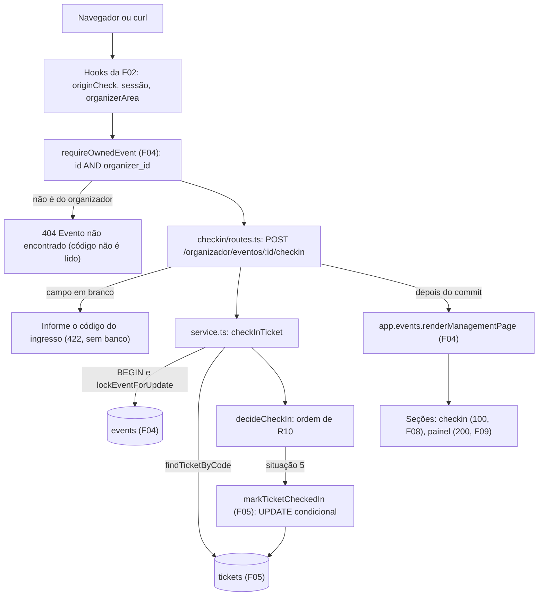
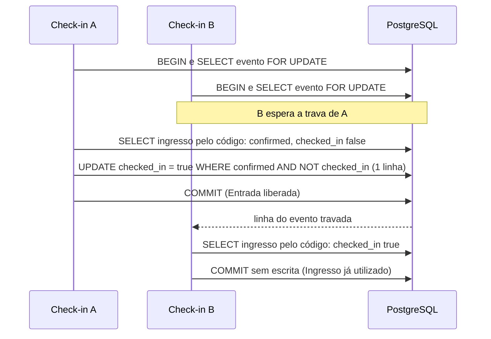

# Spec: F08 — Check-in

## 1. Visão técnica

**O quê.** A F08 põe o check-in na porta do evento: uma seção "Check-in" na página de gestão (`/organizador/eventos/{id}`), registrada pelo ponto de extensão da F04 (`app.events.addManagementSection`, ordem 100), com o campo `Código` e o botão `Validar`; a rota de ação `POST /organizador/eventos/:id/checkin`, protegida por `requireOwnedEvent` (F04); e o serviço que confere o código digitado contra a lista de R10, **na ordem exata**, e só na última situação (`Entrada liberada`) marca o ingresso — numa transação que trava a linha do evento (`lockEventForUpdate`, F04) e grava a marcação pela única escrita de check-in que existe (`markTicketCheckedIn`, F05, `UPDATE … WHERE status = 'confirmed' AND NOT checked_in`). O resultado aparece na própria página de gestão (`app.events.renderManagementPage`), em destaque, com o campo limpo para o próximo código.

**Por quê.** É o encontro que quebrou a primeira tentativa: "evento cancelado continuava deixando gente entrar". Três garantias só podem ser dadas aqui, no ponto onde F04 (status do evento) e F05 (status e código do ingresso) se encontram: (1) a ordem de R10 é uma função pura, testada em matriz, aplicada sobre dados lidos **sob a trava do evento** — o status `cancelado` lido é sempre o mais recente, e um cancelamento que confirma enquanto o check-in espera faz o check-in responder `Evento cancelado`; (2) dois check-ins simultâneos do mesmo código geram exatamente um `Entrada liberada` e um `Ingresso já utilizado` — a trava do evento serializa os check-ins do mesmo evento e o `UPDATE` condicional da F05 é a segunda barreira; (3) o check-in só existe na página de gestão do dono (R04, R13): a rota herda o isolamento de `requireOwnedEvent`, que responde `404` `Evento não encontrado` antes de qualquer leitura do código.

**Complexidade:** `simple` — duas rotas (a de ação e um redirecionamento), nenhuma tabela nova, um serviço transacional curto que reaproveita a trava da F04 e a escrita atômica da F05, uma seção de página. O peso está na ordem de R10 e na prova de atomicidade, não no tamanho.

**Sequência de waves.** Wave 5, em paralelo com F06 (vitrine) e F07 (API de parceiros). A F08 só cria arquivos novos (`app/src/features/checkin/`, `app/test/f08/`, `app/test/helpers/checkin.ts`) e acrescenta uma linha ao `README.md` e uma ao `AGENTS.md`; não edita `eventos/` nem `ingressos/` nem nada das features paralelas. O contrato não usa vitrine nem API: os ingressos vêm do `catraca compra:simular` da F05 (canal `vitrine` com `--conta` e canal `api` com `--email`).

### Escopo

**Incluído:**
- Módulo `checkin` (`app/src/features/checkin/`, `loadOrder` 50, `fastify-plugin` com nome `checkin`, `dependencies: ['contas', 'eventos', 'ingressos']`).
- Seção `checkin` (ordem 100) na página de gestão, em qualquer status do evento — inclusive `cancelado`, onde o campo continua disponível e vale a lista (5.5).
- `POST /organizador/eventos/:id/checkin` (resultado na própria página de gestão) e `GET /organizador/eventos/:id/checkin` (redireciona para a página de gestão) (5.1).
- Leitura e normalização do código: espaços das pontas removidos, maiúsculas; em branco → `Informe o código do ingresso`, sem consultar nada (5.2).
- Decisão na ordem de R10 (`decideCheckIn`, função pura) e operação atômica (`checkInTicket`) (5.3, 5.4).
- API pública (`public.ts`) com as mensagens, o serviço e o caminho da ação, para a F09 e para testes (5.7).
- Auxiliar de testes `app/test/helpers/checkin.ts` (`postCheckIn`) para a F09.
- Testes em `app/test/f08/` (seção 7) e acréscimos de uma linha em `README.md` e `AGENTS.md` (5.9).

**Excluído (e quem entrega):**
- Status do evento, página de gestão, isolamento por dono, cancelamento: F04. Status, código, `checked_in`/`checked_in_at` e a escrita `markTicketCheckedIn`: F05. Painel (Check-ins etc.): F09. Compra pela vitrine/API e o `checkedIn` da API: F06/F07.
- Desfazer check-in e check-in pela API de parceiros (PRD, Fora de escopo).

### Consome

| Item | De | Uso na F08 |
|---|---|---|
| Módulos com `loadOrder` e `fastify-plugin`; `app.db`; `reply.page`; `html`/`raw`/`SafeHtml`; classes `msg msg-success`/`msg msg-error` do layout | F01 (`app/src/core/modules.ts`, `layout.ts`, `html.ts`) | Módulo, HTML da seção, destaque da mensagem |
| `withTransaction`, `Db`/`DbClient`/`Queryable` | F01 (`app/src/db/transaction.ts`, `pool.ts`) | Transação do check-in (READ COMMITTED) |
| `request.user`, hooks `organizerArea` (visitante → `302` `/entrar`, participante → `403` `Acesso negado`) e `originCheck` | F02 (`app/src/features/contas/public.ts`) | Proteção herdada por estar sob `/organizador` |
| `requireOwnedEvent`, `ownedEvent`, `replyEventNotFound`, `EVENT_ROUTE_PREFIX`, `eventManagementPath`, `lockEventForUpdate`, `EventRecord` | F04 (`app/src/features/eventos/public.ts`) | Guarda de dono (`404` `Evento não encontrado`), trava da linha do evento, caminhos |
| `app.events.addManagementSection`, `app.events.renderManagementPage` (com `status` e `sectionState`) | F04 (decorator `app.events`, spec F04 5.12.1 e 5.12.5) | Seção `checkin` e a resposta da ação |
| `findTicketByCode`, `markTicketCheckedIn`, `normalizeTicketCode`, `isTicketCode`, `TicketRecord`, `CheckInWrite` | F05 (`app/src/features/ingressos/public.ts`) | Busca pelo código (índice único), escrita atômica da marcação |
| `createTestApp`, `testDb`, `testDatabaseUrl`, `seedAccounts`, `loginAs`, `sessionCookieFor`, `insertTestEvent`, `insertTestTicket`, `settlePayments` | F01, F02, F04, F05 (`app/test/helpers/`) | Testes |
| CLI `catraca compra:simular` (`--email`, `--conta`, `--paralelas`) e `catraca ingresso:consultar` | F05 | Contrato (criar e conferir ingressos) |

### Provê (contratos de saída)

| Item provido | Onde | Consumidores |
|---|---|---|
| **Marcação de check-in no ingresso**: `tickets.checked_in = true` e `tickets.checked_in_at` (instante da liberação), gravados só pelo check-in liberado (5.6) | colunas da F05; escritas pela F08 via `markTicketCheckedIn` | F09 (Check-ins do painel). A consulta da API (F07, mesma wave) lê a mesma coluna pela F05 (`TicketRecord.checkedIn`), sem depender da F08 |
| Seção `checkin` (ordem 100) na página de gestão | `app.events` (F04) | página de gestão; a F09 registra `painel` (ordem 200) abaixo dela |
| `checkInTicket(db, eventId, typedCode)` → `CheckInOutcome`; `decideCheckIn`; `readTypedCode`; `normalizeTypedCode` | `public.ts` | F09 (testes), contrato |
| `CHECKIN_MESSAGES`, `CheckInResult`, `CHECKIN_SECTION_NAME`, `CHECKIN_SECTION_ORDER`, `checkInPath(eventId)` | `public.ts` | F09 (testes) |
| `postCheckIn(app, cookie, eventId, code)` | `app/test/helpers/checkin.ts` | testes da F09 (CF18, CF20) |

### Como a F09 usa a marcação (orientação para a spec seguinte)

- **Onde está:** nas colunas `checked_in` (boolean) e `checked_in_at` (`timestamptz`) da tabela `tickets` da F05 — a F08 não cria tabela nem coluna. `TicketRecord.checkedIn`/`checkedInAt` (F05) as expõem.
- **Quem escreve:** só o check-in liberado da F08, pela operação `markTicketCheckedIn` da F05, dentro da transação com a linha do evento travada. Nenhuma outra situação de R10 (nem o código em branco) escreve nada.
- **Semântica:** `checked_in = true` só em ingresso `confirmed` (gatilho da F05); nunca volta a `false` (gatilho da F05); o estorno preserva a marcação (`refunded` com `checked_in = true`); `checked_in_at` = `clock_timestamp()` do `UPDATE` da liberação e nunca muda depois.
- **Leitura para o painel (R12):** Check-ins = ingressos `confirmed` com `checked_in` → `summarizeEventTickets(db, eventId).confirmedCheckedIn` (F05). Confirmados (`confirmed`) continua incluindo os que passaram pelo check-in. Um `refunded` com check-in não conta em Check-ins (não é `confirmed`). Tentativas recusadas não mudam nenhum número (CF18).
- **Na resposta do check-in:** a resposta do `POST …/checkin` é a página de gestão inteira, com todas as seções renderizadas **depois do commit** — a seção `painel` da F09 já mostra o número novo na própria resposta, sem recarregar. A F09 não depende de `sectionState` da F08.
- **Nos testes da F09:** `postCheckIn(app, cookieDoDono, eventId, código)` (HTTP real) ou `checkInTicket(app.db, eventId, código)` (serviço, sem HTTP); ambos devolvem o resultado (`liberada`, `ja_utilizado`…) e a mensagem exata.

### Regras e invariantes

- **Regras do brief implementadas:** R10 (lista e ordem das mensagens do check-in, campo disponível também em evento cancelado), R04 (o check-in fica na página de gestão do evento), R09 (o código único do ingresso é a chave do check-in), e os lados de R11 (evento cancelado nunca libera entrada) e R13 (só o dono opera o check-in) que tocam o check-in.
- **Invariantes compartilhadas que a F08 sustenta ou não pode quebrar:**
  - *Cancelamento (R10, R11):* nenhuma entrada é liberada num evento cujo cancelamento já confirmou. O status do evento é lido com a linha travada (`FOR UPDATE`), a mesma trava que o cancelamento da F04 usa; o check-in que espera a trava do cancelamento lê `cancelado` e responde `Evento cancelado`. Um check-in que confirmou antes do cancelamento continua marcado, e o ingresso vira `refunded` com `checked_in` (F05).
  - *Atomicidade:* só `Entrada liberada` escreve; a escrita é condicional (`status = 'confirmed' AND NOT checked_in`), e dois check-ins do mesmo código nunca liberam duas vezes.
  - *Isolamento (R13):* o evento vem sempre de `ownedEvent(request)` (dono conferido na mesma consulta pela F04); evento de outro organizador, inexistente ou id inválido → `404` `Evento não encontrado` sem ler o código; o código de um ingresso de outro evento — inclusive de outro organizador — responde `Ingresso inválido para este evento`, sem revelar nada do ingresso.
  - *API igual à vitrine:* ingressos dos dois canais passam pelo mesmo check-in (a busca é pelo código, sem olhar o canal).
  - *Lotação, receita, resposta tardia do gateway:* não afetadas — o check-in não muda status de ingresso nem de evento (a guarda da F05 recusa qualquer mudança de status junto com a marcação).

### Requisitos (capacidades do PRD → decisões desta spec)

| Capacidade (PRD F08) | Como esta spec atende |
|---|---|
| Na página de gestão, o organizador informa o código; a primeira situação verdadeira da lista define a mensagem | Seção `checkin` (5.5), `POST …/checkin` (5.1), `decideCheckIn` na ordem 1→5 (5.3) |
| Só `Entrada liberada` altera dados, com data e hora, numa operação atômica; dois check-ins simultâneos → um liberado e um já utilizado | Transação com `lockEventForUpdate` + `markTicketCheckedIn` (5.4) |
| Em evento cancelado, o campo continua disponível e vale a lista | Seção em todos os status (F04 5.12.1); situação 2 da lista (5.3) |
| Código aceito com espaços nas pontas e em minúsculas | `normalizeTypedCode` (5.2) |
| Ingressos de qualquer canal | Busca só pelo código (`findTicketByCode`) |
| Código em branco: `Informe o código do ingresso`, sem consultar nada | 5.2: decidido antes de abrir transação |
| Evento de outro organizador: `404` `Evento não encontrado`, sem processar o código | `requireOwnedEvent` como `preHandler` (5.1) |
| Check-in concorrente do mesmo código: só um é liberado | 5.4 |

### Fluxos (experiência do PRD)

1. **Abrir:** o organizador abre `/organizador/eventos/{id}`; abaixo do conteúdo da F04 aparece a seção "Check-in" com o campo `Código` e o botão `Validar`.
2. **Validar:** digita o código (com ou sem espaços, em minúsculas ou maiúsculas) e clica em `Validar` → `POST /organizador/eventos/{id}/checkin` → a resposta é a página de gestão com a mensagem do resultado em destaque dentro da seção, a linha `Código conferido: <CÓDIGO>` (quando o texto tem formato de código), o campo vazio e com foco para o próximo código.
3. **Próximo código:** digita e valida de novo; recarregar a página de gestão (`GET`) mostra a seção sem resultado.
4. **Outro organizador / visitante / participante:** `404` `Evento não encontrado` / `302` `/entrar` / `403` `Acesso negado`, sem tocar no ingresso.

## 2. Impacto na arquitetura

```
app/
├── src/features/checkin/
│   ├── index.ts      # plugin (fastify-plugin "checkin"), loadOrder 50: registra a seção e as rotas
│   ├── public.ts     # API pública (única porta de entrada para outras features)
│   ├── types.ts      # CheckInResult, CheckInOutcome, CheckInSectionState
│   ├── messages.ts   # mensagens exatas (R10 e código em branco), rótulos da seção
│   ├── service.ts    # readTypedCode, normalizeTypedCode, decideCheckIn, checkInTicket
│   ├── section.ts    # HTML da seção (com e sem resultado)
│   └── routes.ts     # POST e GET /organizador/eventos/:id/checkin
└── test/
    ├── helpers/checkin.ts   # postCheckIn (para a F09)
    └── f08/*.test.ts
```

Nenhuma migration. Documentação (fase final, acréscimos pontuais): `README.md`, `AGENTS.md`, `docs/state.json` (só a entrada F08), seção 10 desta spec.





## 3. Decisões técnicas

| Decisão | Abordagem escolhida | Alternativa considerada | Trade-off |
|---|---|---|---|
| Atomicidade do check-in | Transação READ COMMITTED: `lockEventForUpdate` (a mesma trava de compra, edição e cancelamento) → `findTicketByCode` → `decideCheckIn` → `markTicketCheckedIn` (`UPDATE … WHERE status = 'confirmed' AND NOT checked_in`) | Só o `UPDATE` condicional, sem travar o evento | Check-ins do mesmo evento entram em fila (milissegundos cada); em troca, o status do evento lido é sempre o mais recente (serializado com o cancelamento) e a decisão inteira acontece sobre um retrato consistente; o `UPDATE` condicional continua como segunda barreira |
| Ordem de R10 | Função pura `decideCheckIn(event, ticket)` com as cinco situações em sequência, chamada sob a trava; matriz completa nos testes | Condições espalhadas no handler | A ordem do brief fica num lugar só, testável sem banco |
| Onde aparece o resultado | Dentro da seção "Check-in", logo acima do campo, com as classes de mensagem do layout (`msg msg-success` para `Entrada liberada`, `msg msg-error` para as demais) e `autofocus` no campo depois de um envio | Mensagem no topo da página (`messages` do `renderManagementPage`) | O operador da porta vê o resultado junto do campo (o foco leva a página até ele); a mensagem aparece uma única vez na página |
| Resposta da ação | Página de gestão completa por `app.events.renderManagementPage` (`200` nas cinco situações de R10, `422` no código em branco), sem redirecionamento | Post/Redirect/Get com o resultado na URL | Sem estado novo e sem texto livre na URL; recarregar a resposta reenvia o código (resultado `Ingresso já utilizado`, inofensivo) |
| Código em branco | Decidido antes de qualquer acesso ao banco (o dono já foi conferido pelo guarda) | Tratar como código inexistente | Segue o PRD ("sem consultar nada") e dá uma mensagem útil |
| Isolamento | `requireOwnedEvent` como `preHandler`: o `404` acontece antes de ler o corpo | Conferir o dono dentro do serviço | Uma única regra de isolamento para todas as ações da página de gestão (F04) |
| Escrita da marcação | Só pela `markTicketCheckedIn` da F05 | SQL próprio da F08 na tabela `tickets` | A F05 continua a única escritora de `tickets`; a guarda do banco (gatilho) vale para a F08 |

## 4. Componentes

**Módulo `checkin` (`app/src/features/checkin/`):**

| Arquivo | Novo/Modificado | Propósito | Responsabilidades |
|---|---|---|---|
| `index.ts` | Novo | Plugin da feature | `export const loadOrder = 50`; `default` envolvido por `fastify-plugin` (nome `checkin`, `dependencies: ['contas', 'eventos', 'ingressos']`): `app.events.addManagementSection({ name: CHECKIN_SECTION_NAME, order: CHECKIN_SECTION_ORDER, render: renderCheckInSection })` e `registerCheckInRoutes(app)` |
| `public.ts` | Novo | API pública | Reexporta exatamente os itens de 5.7 |
| `types.ts` | Novo | Tipos | `CheckInResult`, `CheckInDecision`, `CheckInOutcome`, `CheckInSectionState` |
| `messages.ts` | Novo | Textos | `CHECKIN_MESSAGES` (byte a byte, 5.3), `CHECKIN_TEXTS` (título `Check-in`, rótulo `Código`, botão `Validar`, prefixo `Código conferido:`) |
| `service.ts` | Novo | Regra do check-in | `readTypedCode(body)`, `normalizeTypedCode(text)`, `decideCheckIn(event, ticket)`, `checkInTicket(db, eventId, typedCode)` (5.2–5.4); `CHECKIN_LOCK_TIMEOUT = '5s'` |
| `section.ts` | Novo | HTML | `renderCheckInSection(context: ManagementSectionContext): SafeHtml` — sem resultado quando `context.state` é `undefined`, com resultado quando é `CheckInSectionState` (5.5) |
| `routes.ts` | Novo | Rotas | `registerCheckInRoutes(app)`: `POST` e `GET` `${EVENT_ROUTE_PREFIX}/checkin` com `preHandler: requireOwnedEvent` (5.1, 5.6); logs (5.8) |

**Testes:**

| Arquivo | Novo/Modificado | Propósito |
|---|---|---|
| `app/test/helpers/checkin.ts` | Novo | `postCheckIn(app, cookie, eventId, code) → Promise<{ statusCode: number; result: CheckInResult \| null; message: string \| null; body: string }>`: `app.inject` do `POST` com `codigo` urlencoded; `result`/`message` lidos do elemento `data-checkin-resultado` (`null` se ausente) |
| `app/test/f08/*.test.ts` | Novo | Seção 7 |

**Banco:** nenhuma migration (a marcação usa `tickets.checked_in`/`checked_in_at` da F05; seção 6).

## 5. Contratos de interfaces

Páginas HTML (`text/html; charset=utf-8`) pelo layout da F01; formulário `application/x-www-form-urlencoded`; um `POST` sem corpo é tratado como formulário vazio. Nenhum atributo de validação do navegador (`required`, `pattern`, `maxlength`): as mensagens são sempre as do servidor.

### 5.1 Rotas

Ficam sob `/organizador`, portanto já passam pelos hooks da F02 (visitante → `302` `location: /entrar`; participante → `403` `Acesso negado`; origem estrangeira em `POST` → `403` da F02) antes de qualquer código da F08. Ação `checkin` registrada pela convenção da F04 (5.12.5 da spec da F04): ``app.post(`${EVENT_ROUTE_PREFIX}/checkin`, { preHandler: requireOwnedEvent }, handler)``.

| Método | Caminho | Guarda | Sucesso | Erros |
|---|---|---|---|---|
| `POST` | `/organizador/eventos/:id/checkin` | `requireOwnedEvent` | `200`, página de gestão com o resultado de R10 na seção (5.6) | `422` código em branco; `404` evento de outro organizador, inexistente ou id inválido (página da F04, código não lido) |
| `GET` | `/organizador/eventos/:id/checkin` | `requireOwnedEvent` | `302` `location: /organizador/eventos/{id}` (endereço da ação aberto direto ou favoritado) | `404` (página da F04) |

**Ordem de processamento do `POST`:** (1) hooks da F02; (2) `requireOwnedEvent` → `404` se o evento não é do organizador logado, sem ler `codigo`; (3) `readTypedCode(request.body)`; (4) `checkInTicket(app.db, ownedEvent(request).id, typed)`; (5) log (5.8); (6) `app.events.renderManagementPage(request, reply, outcome.event ?? ownedEvent(request), { status: outcome.result === 'codigo_vazio' ? 422 : 200, sectionState: { checkin: { result, message, code } } })` — depois do commit.

### 5.2 Campo `codigo`: leitura e normalização

| Passo | Regra |
|---|---|
| `readTypedCode(body)` | Valor do campo `codigo` do corpo; ausente, repetido (array), não-texto ou corpo vazio → `''` |
| Em branco | `typed.trim() === ''` (o `trim` do JavaScript: espaços, tabulações, quebras de linha) → resultado `codigo_vazio`, mensagem `Informe o código do ingresso`, **sem abrir transação nem consultar o banco** |
| `normalizeTypedCode(text)` | `t = text.trim()`; se `t` casa com `^[A-Za-z0-9]{8}$` → `t.toUpperCase()` (` k7q2m9xa ` → `K7Q2M9XA`, `k7Q2m9Xa` → `K7Q2M9XA`); senão → `null` (comprimento diferente de 8, hífen, espaço no meio, letra acentuada ou fora de ASCII) |
| Código com formato inválido | `null` não é ingresso: cai na situação 1 de R10 (`Ingresso inválido para este evento`); `findTicketByCode` da F05 não consulta o banco para formato inválido |

O valor digitado nunca é reposto no campo (o campo volta vazio) nem registrado em log. A linha `Código conferido` (5.5) mostra só o código normalizado, e só quando ele tem formato de código.

### 5.3 Ordem de R10 (`decideCheckIn`)

`decideCheckIn(event: Pick<EventRecord, 'id' | 'status'>, ticket: Pick<TicketRecord, 'eventId' | 'status' | 'checkedIn'> | null): CheckInDecision` — a primeira situação verdadeira, nesta ordem, define o resultado:

| # | Situação (brief R10) | Condição | `CheckInResult` | Mensagem (byte a byte) |
|---|---|---|---|---|
| 1 | O código não existe ou é de outro evento | `ticket === null` ou `ticket.eventId !== event.id` | `invalido` | `Ingresso inválido para este evento` |
| 2 | O evento está cancelado | `event.status === 'cancelado'` | `evento_cancelado` | `Evento cancelado` |
| 3 | O ingresso não está confirmado | `ticket.status !== 'confirmed'` | `nao_confirmado` | `Ingresso não confirmado` |
| 4 | O ingresso já passou pelo check-in | `ticket.checkedIn` | `ja_utilizado` | `Ingresso já utilizado` |
| 5 | Nenhuma das anteriores | — | `liberada` | `Entrada liberada` |
| — | Código em branco (antes da lista, 5.2) | — | `codigo_vazio` | `Informe o código do ingresso` |

Consequências da ordem (cobertas pela matriz de testes): ingresso de outro evento num evento cancelado → `invalido` (1 antes de 2); ingresso `pending`, `declined`, `cancelled`, `refunded` ou já com check-in num evento cancelado → `evento_cancelado` (2 antes de 3 e 4); evento `rascunho` não tem ingressos, então qualquer código dá `invalido`; `refunded` com check-in num evento não cancelado (dado incoerente, só possível por inserção direta) → `nao_confirmado` (3 antes de 4).

`CHECKIN_MESSAGES`:

```json
{
  "invalido": "Ingresso inválido para este evento",
  "evento_cancelado": "Evento cancelado",
  "nao_confirmado": "Ingresso não confirmado",
  "ja_utilizado": "Ingresso já utilizado",
  "liberada": "Entrada liberada",
  "codigo_vazio": "Informe o código do ingresso"
}
```

### 5.4 Operação atômica (`checkInTicket`)

`checkInTicket(db: Db, eventId: string, typedCode: string): Promise<CheckInOutcome>`; o evento já foi conferido como do organizador pela rota (o serviço não confere dono).

1. `typedCode.trim() === ''` → `{ result: 'codigo_vazio', message, code: null, ticket: null, event: null }` sem tocar no banco.
2. `code = normalizeTypedCode(typedCode)`.
3. `withTransaction(db, async (client) => { … })` (isolamento padrão READ COMMITTED — obrigatório, pela mesma razão da compra da F05: cada instrução depois da trava enxerga o que quem segurava a trava confirmou):
   1. `SET LOCAL lock_timeout = '5s'`.
   2. `event = await lockEventForUpdate(client, eventId)` — espera compras, edições, cancelamentos e outros check-ins do mesmo evento; devolve a versão mais recente da linha. `null` (impossível: eventos não são apagados) → `Error('checkin: evento não encontrado sob a trava')`.
   3. `ticket = code === null ? null : await findTicketByCode(client, code)`.
   4. `decision = decideCheckIn(event, ticket)`; diferente de `liberada` → retorna `{ result: decision, … }` (`COMMIT` sem escrita).
   5. `write = await markTicketCheckedIn(client, ticket.id)`; `write.updated` → `{ result: 'liberada', ticket: write.ticket }`.
   6. `write.updated === false` (inalcançável com a trava: ninguém marca nem muda `confirmed` sem travar o evento; existe como defesa) → `decision2 = decideCheckIn(event, write.ticket)`; `liberada` de novo → `Error('checkin: marcação não aplicada')`; senão retorna `decision2`.
4. Saída: `CheckInOutcome = { result, message: CHECKIN_MESSAGES[result], code, ticket, event }`, com `ticket` = o ingresso **só quando ele é deste evento** (situações 2–5; `null` na 1) e `event` = o registro lido sob a trava.

**Por que dois check-ins simultâneos do mesmo código dão um liberado e um já utilizado.** Os dois pedem `FOR UPDATE` da mesma linha de `events`; o segundo só passa do passo 3.2 depois do `COMMIT` do primeiro, e o `SELECT` do passo 3.3 (instrução nova, READ COMMITTED) já vê `checked_in = true` → situação 4. Mesmo sem a trava, o `UPDATE … WHERE status = 'confirmed' AND NOT checked_in` da F05 só atualiza uma vez (o segundo `UPDATE` espera a trava da linha do ingresso e reavalia o `WHERE`).

**Interação com o cancelamento (R11).** O cancelamento (F04 + tratador da F05) trava a mesma linha. Check-in depois do commit do cancelamento → lê `cancelado` → `Evento cancelado`. Check-in antes → liberado; o cancelamento então leva o ingresso a `refunded`, preservando `checked_in`. Não existe ordem em que uma entrada seja liberada num evento já cancelado.

**Interação com o gateway.** A entrega do resultado (`pending` → `confirmed`/`declined`) não trava o evento; o check-in lê o status do instante: `pending` → `Ingresso não confirmado`; depois da confirmação → `Entrada liberada`.

**Ordem de travas.** Linha do evento → linha do ingresso (a mesma da compra e do cancelamento; spec da F05 5.3): sem ciclo, sem deadlock.

### 5.5 HTML da seção `checkin`

Registrada com `{ name: 'checkin', order: 100, render: renderCheckInSection }`; a F04 a embrulha em `<section class="gestao-secao" data-secao="checkin">…</section>`, abaixo do conteúdo dela e acima das seções de ordem maior (painel, F09), em **todos** os status do evento (`rascunho`, `publicado`, `cancelado`). Cada linha abaixo é uma linha do HTML; `{id}` é o id do evento.

**Sem envio** (`GET` da página de gestão; `context.state` indefinido):

```html
<h2>Check-in</h2>
<form method="post" action="/organizador/eventos/{id}/checkin">
<label for="codigo">Código</label>
<input id="codigo" name="codigo" type="text" autocomplete="off" autocapitalize="characters" spellcheck="false" value="">
<button type="submit">Validar</button>
</form>
```

**Depois de um envio** (resposta do `POST`; `context.state` = `{ result, message, code }`):

```html
<h2>Check-in</h2>
<p class="msg {msg-success|msg-error}" role="{status|alert}" data-checkin-resultado="{result}">{message}</p>
<p class="checkin-codigo">Código conferido: <strong>{code}</strong></p>
<form method="post" action="/organizador/eventos/{id}/checkin">
<label for="codigo">Código</label>
<input id="codigo" name="codigo" type="text" autocomplete="off" autocapitalize="characters" spellcheck="false" value="" autofocus>
<button type="submit">Validar</button>
</form>
```

- `msg-success` e `role="status"` só para `liberada`; `msg-error` e `role="alert"` para `invalido`, `evento_cancelado`, `nao_confirmado`, `ja_utilizado` e `codigo_vazio`.
- A linha `Código conferido` só aparece quando `code` não é `null` (código com formato válido, já normalizado); nunca mostra o texto digitado.
- O campo sempre vem com `value=""` (limpo para o próximo código); `autofocus` só depois de um envio.
- A mensagem do resultado aparece **uma única vez** na página (a F08 não passa `messages` ao `renderManagementPage`). Nenhum outro lugar da página contém `data-checkin-resultado`.

Exemplo (`POST` com o código ` k7q2m9xa ` digitado, de um ingresso `confirmed` sem check-in, num evento publicado):

```
POST /organizador/eventos/evt_8f2kq0x7m1c9z3ab/checkin
Content-Type: application/x-www-form-urlencoded

codigo=%20k7q2m9xa%20

200
…
<section class="gestao-secao" data-secao="checkin"><h2>Check-in</h2>
<p class="msg msg-success" role="status" data-checkin-resultado="liberada">Entrada liberada</p>
<p class="checkin-codigo">Código conferido: <strong>K7Q2M9XA</strong></p>
<form method="post" action="/organizador/eventos/evt_8f2kq0x7m1c9z3ab/checkin">
…
```

### 5.6 Respostas do `POST /organizador/eventos/:id/checkin`

| Situação | Status | Corpo | Escrita |
|---|---|---|---|
| `Entrada liberada` | `200` | Página de gestão (status e dados atuais do evento, seções) com o resultado na seção | `checked_in = true`, `checked_in_at = clock_timestamp()` no ingresso |
| `Ingresso inválido para este evento`, `Evento cancelado`, `Ingresso não confirmado`, `Ingresso já utilizado` | `200` | Idem | Nenhuma |
| Código em branco | `422` | Idem, com `Informe o código do ingresso` | Nenhuma (nem consulta) |
| Evento de outro organizador, inexistente ou id inválido | `404` | Página `Evento não encontrado` da F04 (idêntica à de evento inexistente) | Nenhuma (código não lido) |
| Visitante / participante | `302` `location: /entrar` / `403` `Acesso negado` | Da F02 | Nenhuma |
| Trava do evento não obtida em 5 s; erro de banco | `500` | Página de erro da F01 | `ROLLBACK` |

A página da resposta é a mesma de `GET /organizador/eventos/{id}` (cabeçalho `<h1>{nome}</h1>`, status, dados e formulários da F04 conforme o status, seções), com o evento **lido sob a trava** — se um cancelamento confirmou antes, a resposta já mostra `Cancelado`.

### 5.7 API pública (`app/src/features/checkin/public.ts`)

| Export | Assinatura | Comportamento |
|---|---|---|
| `CheckInResult` | `'liberada' \| 'ja_utilizado' \| 'nao_confirmado' \| 'evento_cancelado' \| 'invalido' \| 'codigo_vazio'` | — |
| `CheckInDecision` | `Exclude<CheckInResult, 'codigo_vazio'>` | As cinco situações de R10 |
| `CHECKIN_MESSAGES` | `Readonly<Record<CheckInResult, string>>` | 5.3, congelado |
| `CheckInOutcome` | `{ result: CheckInResult; message: string; code: string \| null; ticket: TicketRecord \| null; event: EventRecord \| null }` | 5.4 |
| `CheckInSectionState` | `{ result: CheckInResult; message: string; code: string \| null }` | Estado passado à seção |
| `readTypedCode` | `(body: unknown) => string` | 5.2 |
| `normalizeTypedCode` | `(text: string) => string \| null` | 5.2 |
| `decideCheckIn` | `(event, ticket) => CheckInDecision` | 5.3 |
| `checkInTicket` | `(db: Db, eventId: string, typedCode: string) => Promise<CheckInOutcome>` | 5.4 (não confere dono) |
| `CHECKIN_SECTION_NAME` / `CHECKIN_SECTION_ORDER` | `'checkin'` / `100` | 5.5 |
| `checkInPath` | `(eventId: string) => string` | `eventManagementPath(eventId, 'checkin')` = `/organizador/eventos/{id}/checkin` |

### 5.8 Logs

Prefixo `checkin:`, pelo `request.log` do Fastify. Nunca o texto digitado nem o código do ingresso (o código é a credencial de entrada).

| Evento | Nível | Mensagem (campos) |
|---|---|---|
| Entrada liberada | `info` | `checkin: entrada liberada` (`eventId`, `ticketId`) |
| Qualquer outro resultado, inclusive código em branco | `info` | `checkin: entrada recusada` (`eventId`, `resultado`, `ticketId` — `null` em `invalido` e `codigo_vazio`) |

### 5.9 Documentação (fase final)

| Arquivo | Mudança (só acréscimos, uma linha cada, para não conflitar com F06/F07) |
|---|---|
| `README.md` | Em `## Decisões`: linha "Check-in atômico" — a decisão de R10 é tomada com a linha do evento travada (a mesma trava do cancelamento) e a marcação é um `UPDATE` condicional (`confirmed` e sem check-in), então dois check-ins simultâneos liberam uma vez só e um evento cancelado nunca libera entrada |
| `AGENTS.md` | Em "Convenções de código": "Check-in: importe só de `app/src/features/checkin/public.ts`; a marcação (`checked_in`/`checked_in_at`) só é escrita pelo check-in liberado, via `markTicketCheckedIn` da F05; nos testes, `postCheckIn` de `app/test/helpers/checkin.ts`" |

## 6. Modelo de dados

Nenhuma tabela, coluna ou migration nova. A F08 lê `events` (F04) e lê e marca `tickets` (F05) somente pelas funções públicas dessas features.

**Colunas usadas (tabela `tickets`, F05):**

| Coluna | Tipo | Uso na F08 |
|---|---|---|
| `code` | `text` (índice único `tickets_code_key`) | Busca do ingresso pelo código normalizado (`findTicketByCode`) |
| `event_id` | `text` | Situação 1 (ingresso de outro evento) |
| `status` | `text` | Situação 3 (`confirmed`?) |
| `checked_in` | `boolean`, padrão `false` | Situação 4; **marcação** escrita na situação 5 |
| `checked_in_at` | `timestamptz`, nulo até o check-in | **Data e hora da marcação** (`clock_timestamp()` do `UPDATE`) |

**Coluna usada (tabela `events`, F04):** `status` (`cancelado`? — situação 2), lida com `SELECT … FOR UPDATE`.

**Instruções executadas por check-in não vazio (todas pela API de F04/F05, na mesma transação):**

| Passo | Função | SQL (definido nas specs de origem) |
|---|---|---|
| Trava | `lockEventForUpdate` (F04) | `SELECT {cols} FROM events WHERE id = $1 FOR UPDATE` |
| Busca | `findTicketByCode` (F05) | `SELECT {cols} FROM tickets WHERE code = $1` (sem consulta se o código não tem formato) |
| Marcação | `markTicketCheckedIn` (F05) | `UPDATE tickets SET checked_in = true, checked_in_at = clock_timestamp() WHERE id = $1 AND status = 'confirmed' AND NOT checked_in RETURNING {cols}` |

**Garantias do banco que a F08 herda (F05):** `tickets_checked_in_at` (`checked_in = (checked_in_at IS NOT NULL)`), `tickets_checked_in_status` (`NOT checked_in OR status IN ('confirmed', 'refunded')`) e o gatilho `tickets_guard_update` (check-in só de `confirmed` que continua `confirmed`; check-in nunca desfeito; nenhum outro campo muda).

## 7. Estratégia de testes

Todos rodam pelo `npm run gates` (banco `catraca_test`). Cada teste ligado a critério leva o ID no nome. Eventos com `insertTestEvent` (F04) e ingressos com `insertTestTicket` (F05) para montar cada estado; integração real com a compra (`app.tickets.purchase` + `settlePayments`) e com o cancelamento pela página de gestão (`loginAs` + `POST …/cancelar`) nos testes cross-feature. Requisições por `app.inject` com o cookie de `loginAs`/`sessionCookieFor`. **Concorrência real:** os testes de simultaneidade disparam 10 check-ins do mesmo código com `Promise.all` — pelo HTTP (`postCheckIn`, cada requisição abre a própria transação numa conexão do pool da aplicação de teste) e pelo serviço (`checkInTicket` com um pool próprio `createPool({ databaseUrl: testDatabaseUrl(), max: 20 })`, F05 P16) — e repetem em ingressos novos.

| Arquivo | Tipo | Alvo |
|---|---|---|
| `app/test/f08/normalizacao.test.ts` | Unidade | `readTypedCode`, `normalizeTypedCode` |
| `app/test/f08/ordem.test.ts` | Unidade | `decideCheckIn` (matriz de R10), `CHECKIN_MESSAGES` |
| `app/test/f08/secao.test.ts` | Integração (HTTP) | Seção na página de gestão, resposta do `POST`, `GET …/checkin` |
| `app/test/f08/checkin.test.ts` | Integração (HTTP) | As situações de R10 com ingressos de cada estado e dos dois canais; código em branco |
| `app/test/f08/concorrencia.test.ts` | Integração (concorrência real) | Check-ins simultâneos; corrida com o cancelamento |
| `app/test/f08/isolamento.test.ts` | Integração (HTTP) | `404`/`403`/`302` sem processar o código |
| `app/test/f08/cf14-cancelamento.test.ts` | Integração (F04 real) | Cancelamento pela página de gestão e check-in |
| `app/test/f08/cf15-ciclo.test.ts` | Integração (F05 real) | Compra, resultado do gateway e check-in |
| `app/test/f08/marcacao.test.ts` | Integração | A marcação que a F09 lê |
| `app/test/f08/modulo.test.ts` | Integração | Carga do módulo, seção registrada |

**`normalizacao.test.ts`**

| Teste | Asserções |
|---|---|
| `F08-CA07 código com espaços nas pontas e minúsculas é normalizado` | ` k7q2m9xa ` → `K7Q2M9XA`; `k7Q2m9Xa` → `K7Q2M9XA`; `\tK7Q2M9XA\n` → `K7Q2M9XA` |
| `formato diferente de 8 letras ou dígitos ASCII não é código` | `K7Q2M9X`, `K7Q2M9XAB`, `K7Q2-M9X`, `K7Q2 M9X`, `ÁBCDEFGH`, `ıııııııı` → `null` |
| `readTypedCode lê o campo codigo e trata ausente, repetido ou não-texto como vazio` | `{ codigo: 'X' }` → `X`; `{}`, `{ codigo: ['a','b'] }`, `{ codigo: 1 }`, `undefined`, `null` → `''` |

**`ordem.test.ts`**

| Teste | Asserções |
|---|---|
| `F08-CA05 código inexistente ou de outro evento é inválido em qualquer status do evento` | `ticket null` e `eventId` diferente × evento `rascunho`/`publicado`/`cancelado` × os 5 status → `invalido` |
| `F08-CA06 evento cancelado vem antes de não confirmado e de já utilizado` | evento `cancelado` × `pending`/`confirmed`/`declined`/`cancelled`/`refunded` × `checkedIn` falso/verdadeiro → `evento_cancelado` |
| `F08-CA04 pending, declined, cancelled e refunded em evento publicado são não confirmados` | → `nao_confirmado`; inclusive `refunded` com `checkedIn` (3 antes de 4) |
| `F08-CA03 confirmado com check-in é já utilizado` | → `ja_utilizado` |
| `F08-CA02 confirmado sem check-in em evento publicado é liberado` | → `liberada` |
| `as mensagens são as do brief, byte a byte` | `CHECKIN_MESSAGES` igual ao JSON de 5.3 (comparação de bytes UTF-8) |

**`secao.test.ts`**

| Teste | Asserções |
|---|---|
| `F08-CA01 a página de gestão tem a seção Check-in com o campo Código e o botão Validar em rascunho, publicado e cancelado` | HTML exato de 5.5 (sem envio) dentro de `<section class="gestao-secao" data-secao="checkin">`; depois do `</dl>` da F04 e antes de `Voltar para meus eventos`; sem `data-checkin-resultado` nem `autofocus` |
| `F08-CA01 o POST responde a página de gestão com o resultado em destaque e o campo limpo` | `200`; `<h1>{nome}</h1>`; elemento de resultado exato de 5.5; `Código conferido: <strong>…</strong>`; `value="" autofocus`; o texto digitado não aparece em nenhum `value` |
| `a mensagem do resultado aparece uma única vez na página` | uma ocorrência de `>Entrada liberada<` e de `data-checkin-resultado` |
| `GET do endereço da ação redireciona para a página de gestão` | `302` `location: /organizador/eventos/{id}` |
| `código com formato inválido não mostra a linha Código conferido` | `ABC` → resultado `invalido` sem `checkin-codigo` |

**`checkin.test.ts`**

| Teste | Asserções |
|---|---|
| `F08-CA02 confirmado sem check-in resulta em Entrada liberada e marca checkedIn com data e hora` | `200`, `Entrada liberada`; linha com `checked_in = true`, `checked_in_at` preenchido, `status = confirmed`; demais campos iguais |
| `F08-CA03 o mesmo código de novo resulta em Ingresso já utilizado e nada muda` | segunda vez → `Ingresso já utilizado`; `checked_in_at` igual ao da primeira |
| `F08-CA04 pending e declined do evento resultam em Ingresso não confirmado sem marcar` | os dois; linhas idênticas |
| `F08-CA05 ZZZZZZZZ, código malformado e código de outro evento resultam em Ingresso inválido para este evento` | outro evento do mesmo organizador e de outro organizador; o ingresso do outro evento continua sem check-in |
| `F08-CA06 em evento cancelado, refunded, cancelled e refunded com check-in resultam em Evento cancelado; outro evento é inválido` | `insertTestEvent({ status: 'cancelado' })` com os ingressos; nada muda |
| `F08-CA07 código com espaços nas pontas e em minúsculas encontra o ingresso K7Q2M9XA` | código fixo via `insertTestTicket({ code: 'K7Q2M9XA' })`; `codigo= k7q2m9xa ` → `Entrada liberada` e `Código conferido: <strong>K7Q2M9XA</strong>` |
| `ingressos da vitrine e da API passam pelo mesmo check-in` | `channel` `vitrine` e `api` → `Entrada liberada` |
| `código em branco responde 422 com Informe o código do ingresso sem consultar o banco` | `''`, `'   '`, campo ausente, `POST` sem corpo → `422` e a mensagem; `checkInTicket` com um `Db` falso que lança em `connect`/`query` resolve `codigo_vazio` sem chamá-lo |
| `em rascunho qualquer código é inválido` | evento `rascunho` → `invalido` |

**`concorrencia.test.ts`**

| Teste | Asserções |
|---|---|
| `F08-CA02 F08-CA03 dez check-ins simultâneos do mesmo código liberam exatamente um, em 5 rodadas` | `Promise.all` de 10 `postCheckIn` por rodada, ingresso novo a cada rodada: 1 `Entrada liberada` e 9 `Ingresso já utilizado`; `checked_in_at` único |
| `F08-CA02 checkInTicket simultâneo em conexões separadas libera uma vez só` | 10 chamadas do serviço com o pool próprio: 1 `liberada`, 9 `ja_utilizado` |
| `F08-CA06 check-in concorrente com o cancelamento nunca libera entrada depois do cancelamento` | 10 rodadas: cancelamento pela página de gestão e check-in no mesmo `Promise.all`; se `liberada` → `checked_in_at < events.cancelled_at` e o ingresso fica `refunded` com check-in; se `evento_cancelado` → `checked_in = false` |
| `check-in de um evento não espera a trava de outro evento` | transação segurando `lockEventForUpdate` do evento A; check-in no evento B responde em < 500 ms |

**`isolamento.test.ts`**

| Teste | Asserções |
|---|---|
| `CF14 organizador B recebe 404 Evento não encontrado no check-in de evento de A, sem processar o código` | `POST` de B com código válido, com código em branco e `GET …/checkin` → `404`; corpo idêntico byte a byte ao de evento inexistente; ingresso sem check-in; nenhum log `checkin:` |
| `CF14 participante recebe 403 e visitante é redirecionado para /entrar` | `403` `Acesso negado`; `302` `location: /entrar`; ingresso sem check-in |
| `CF14 B no próprio evento com código de ingresso de A recebe Ingresso inválido para este evento` | `200`; ingresso de A sem check-in |
| `a página de gestão de B não mostra a seção de check-in de A` | `GET` de B → `404` sem `data-secao="checkin"` |

**`cf14-cancelamento.test.ts`**

| Teste | Asserções |
|---|---|
| `CF14 depois do cancelamento pela página de gestão, a seção continua e os ingressos do evento resultam em Evento cancelado` | `confirmed` com check-in, `confirmed` sem check-in, `pending`, `declined`; `POST …/cancelar` com `confirmar=sim`; seção presente; os quatro códigos → `Evento cancelado`; status `refunded`/`refunded`/`cancelled`/`declined`; nenhuma marcação nova |
| `CF14 em evento cancelado, código de outro evento resulta em Ingresso inválido para este evento` | ingresso confirmado de outro evento publicado; depois, no próprio evento → `Entrada liberada` |

**`cf15-ciclo.test.ts`**

| Teste | Asserções |
|---|---|
| `CF15 compra confirmada resulta em Entrada liberada e, de novo, Ingresso já utilizado` | `app.tickets.purchase` (`…0001`, canais `vitrine` e `api`) + `settlePayments` → `confirmed`; check-in → `Entrada liberada`; de novo → `Ingresso já utilizado` |
| `CF15 compra pendente resulta em Ingresso não confirmado e, depois de confirmada, em Entrada liberada` | `…0003` pendente → `Ingresso não confirmado`; `settlePayments` → `confirmed` → `Entrada liberada` |
| `CF15 compra recusada resulta em Ingresso não confirmado` | `…0002` + `settlePayments` → `declined` → `Ingresso não confirmado` |
| `CF15 código inexistente ou de compra de outro evento resulta em Ingresso inválido para este evento` | `ZZZZZZZZ`; código de compra em outro evento |

**`marcacao.test.ts`**

| Teste | Asserções |
|---|---|
| `a marcação de check-in é lida pela F05 como checkedIn e confirmedCheckedIn` | depois de `Entrada liberada`: `findTicketById` → `checkedIn: true`, `checkedInAt: Date`; `summarizeEventTickets` → `confirmedCheckedIn` +1 e `confirmed` igual |
| `tentativas recusadas não mudam nenhum número do resumo` | `summarizeEventTickets` idêntico antes e depois de `invalido`, `nao_confirmado`, `ja_utilizado`, `evento_cancelado` e `codigo_vazio` |
| `postCheckIn devolve o resultado e a mensagem do check-in` | auxiliar de teste para a F09 |

**`modulo.test.ts`**

| Teste | Asserções |
|---|---|
| `o módulo carrega depois de eventos e ingressos` | `app.featureModules` com `checkin` depois de `eventos` e `ingressos` |
| `F08-CA01 a seção checkin é registrada com ordem 100` | página de gestão com a seção; uma seção de teste de ordem 200 aparece depois dela |

**Cobertura dos critérios:**

| Critério | Testes automatizados | Contrato |
|---|---|---|
| F08-CA01 | `secao`, `modulo`, `checkin` | C01, C02, C05 |
| F08-CA02 | `ordem`, `checkin`, `concorrencia`, `cf15-ciclo` | C02, C08, C09 |
| F08-CA03 | `ordem`, `checkin`, `concorrencia`, `cf15-ciclo` | C02, C08, C09 |
| F08-CA04 | `ordem`, `checkin`, `cf15-ciclo` | C03, C09 |
| F08-CA05 | `ordem`, `checkin`, `cf15-ciclo` | C04, C09 |
| F08-CA06 | `ordem`, `checkin`, `concorrencia`, `cf14-cancelamento` | C06, C09 |
| F08-CA07 | `normalizacao`, `checkin` | C05 |
| CF14 (F04 → F08) | `isolamento`, `cf14-cancelamento` | C01, C06, C07, C09 |
| CF15 (F05 → F08) | `cf15-ciclo` | C02, C03, C04, C09 |

**Critérios cross-feature em que a F08 é provedora** (CF18 F08 → F09; CF20 F07, F08 → F09): pertencem ao contrato da F09 (implementada por último). O lado da F08 — só a liberação escreve, tentativas recusadas não mudam nada, a marcação é lida como `confirmedCheckedIn` — é coberto por `marcacao.test.ts`.

## 8. Tratamento de erros

| Situação | Onde | Comportamento |
|---|---|---|
| Código em branco (vazio, só espaços, campo ausente, `POST` sem corpo) | `checkInTicket` passo 1 | `422`, `Informe o código do ingresso` na seção, campo limpo; nenhuma consulta |
| Código inexistente, malformado ou de outro evento | situação 1 | `200`, `Ingresso inválido para este evento`; nada muda |
| Evento cancelado | situação 2 | `200`, `Evento cancelado`; nada muda; campo continua disponível |
| Ingresso `pending`/`declined` | situação 3 | `200`, `Ingresso não confirmado`; nada muda |
| Ingresso já com check-in | situação 4 | `200`, `Ingresso já utilizado`; `checked_in_at` não muda |
| Check-ins simultâneos do mesmo código | trava do evento + `UPDATE` condicional | Um `Entrada liberada`, os demais `Ingresso já utilizado` |
| Evento de outro organizador, inexistente ou id inválido | `requireOwnedEvent` | `404` `Evento não encontrado` da F04, sem ler o código |
| Visitante / participante / origem estrangeira | hooks da F02 | `302` `/entrar` / `403` `Acesso negado` / `403` da F02 |
| Trava do evento não obtida em 5 s | passo 3.1 | `55P03` → `ROLLBACK`, `500` da F01 |
| `markTicketCheckedIn` sem efeito numa situação 5 (inalcançável) | passo 3.6 | Decide de novo com o ingresso atual; nunca responde `Entrada liberada` sem escrita |
| Banco indisponível | qualquer passo | Erro propagado → `500` da F01 |

## 9. Premissas e decisões do modo não interativo

Decisões tomadas pela política de auto-aceite (spec-writer, Batch Mode, "Auto-Accept Policy") onde o PRD, o brief e as specs de F01–F05 não fixam o detalhe. Revisáveis antes do commit do contrato.

| # | Premissa / decisão | Linha da política |
|---|---|---|
| P01 | Complexidade `simple`; plano em 3 fases (a última, Documentação). | Recomendação clara |
| P02 | Módulo `checkin`, `loadOrder` 50 (depois de `eventos` 30 e `ingressos` 40), `fastify-plugin` com nome `checkin` e `dependencies: ['contas', 'eventos', 'ingressos']`; identificadores em inglês, textos em pt-BR (padrão de F01, F02, F04, F05). | Padrões conflitantes (prevalece o mais frequente) |
| P03 | Seção `checkin` com ordem 100 (sugestão da F04), visível em `rascunho`, `publicado` e `cancelado`; em evento cancelado o campo continua (o PRD escolheu essa opção do brief R10). | PRD |
| P04 | Resultado exibido dentro da seção, logo acima do campo, com as classes de mensagem do layout (`msg-success` para `Entrada liberada`, `msg-error` para as demais) e `autofocus` no campo depois de um envio; não usa as `messages` do topo da página (a mensagem aparece uma vez só). | Recomendação clara |
| P05 | Status HTTP: `200` nas cinco situações de R10 (são resultados, não erros); `422` no código em branco (validação, como F02/F04); `404`/`403`/`302` dos guardas. | Detalhe parcial do PRD |
| P06 | Normalização: `trim` do JavaScript (espaços, tabulações, quebras de linha) e maiúsculas; só `^[A-Za-z0-9]{8}$` depois do `trim` é código; qualquer outro texto não vazio cai na situação 1 (`Ingresso inválido para este evento`). | Detalhe parcial do PRD |
| P07 | Campo `codigo` ausente, repetido ou não-texto vale vazio (mesmo padrão de leitura da F04). | Recomendação clara |
| P08 | Linha `Código conferido: <CÓDIGO>` na resposta, só com o código normalizado de formato válido; o texto digitado nunca é reposto no campo nem registrado em log. | Recomendação clara |
| P09 | Atomicidade: transação READ COMMITTED com `lock_timeout = '5s'`, `lockEventForUpdate` (a mesma trava da compra, edição e cancelamento) antes de ler o ingresso, e a escrita pela `markTicketCheckedIn` da F05 (orientação da spec da F05, 5.7 e 5.13). | Recomendação clara |
| P10 | O guarda de dono (`404`) vem antes da validação do campo: o organizador B recebe `404` mesmo com código em branco. | PRD ("sem processar o código") |
| P11 | `GET /organizador/eventos/:id/checkin` redireciona (`302`) para a página de gestão (endereço da ação aberto direto); com o mesmo guarda de dono. | Recomendação clara |
| P12 | Nenhuma tabela, coluna ou migration: a marcação provida à F09 são as colunas `checked_in`/`checked_in_at` da F05, escritas só pelo check-in liberado da F08. | Spec da F05 (5.7, P11) |
| P13 | Auxiliar `app/test/helpers/checkin.ts` (`postCheckIn`) e `checkInTicket` exportado para os testes da F09. | Recomendação clara |
| P14 | Logs `checkin: entrada liberada` e `checkin: entrada recusada` com `eventId`, `resultado` e `ticketId`; nunca o código. | Recomendação clara |
| P15 | **Nenhum acréscimo nas APIs da F04 e da F05.** Premissas sobre o que elas já definem: (a) `renderManagementPage` aceita o `EventRecord` relido sob a trava (mesmo id e mesmo dono do `ownedEvent`), porque a F04 só exige `event.organizerId === request.user.id`; (b) `findTicketByCode` e `markTicketCheckedIn` aceitam o `DbClient` da transação (tipo `Queryable` da F01); (c) as seções são renderizadas em qualquer status e recebem `state` pelo nome. Se a implementação da F04 ou da F05 divergir, o implementador da F08 registra em Desvios e ajusta só o próprio módulo. | Recomendação clara |
| P16 | Contrato no padrão de F04/F05: roda na raiz do commit avaliado com o ambiente do `npm run up`, funções em `/tmp/catraca-f08/aux.sh`, dados únicos pelo sufixo `$U`; eventos pela interface da F04 (organizadores A e B), ingressos pelo `catraca compra:simular` com os **tempos reais do gateway** (`--conta` para o canal `vitrine`, `--email` para o `api`), conferência pelo `catraca ingresso:consultar` e por consultas SQL de leitura; esperas pelo relógio do banco (`created_at`). Nenhum item usa vitrine, API de parceiros ou painel. | Recomendação clara |
| P17 | Documentação: uma linha em `## Decisões` do `README.md` e uma em "Convenções de código" do `AGENTS.md` (acréscimos curtos para reduzir conflito com F06/F07 na mesma wave). | Recomendação clara |
| P18 | Em `rascunho` a seção aparece (a F04 renderiza seções em todos os status); sem ingressos possíveis, qualquer código é `Ingresso inválido para este evento`. | Detalhe parcial do PRD |

**Conflitos PRD × brief:** nenhum. O brief R10 permite mostrar `Evento cancelado` no lugar do campo; o PRD escolheu manter o campo e aplicar a lista — opção prevista pelo próprio brief ("se o campo continuar disponível, vale a lista").

## 10. Desvios da implementação

Preenchido pelo implementador na fase Documentação: cada diferença entre esta spec e o que foi implementado, com o motivo.
