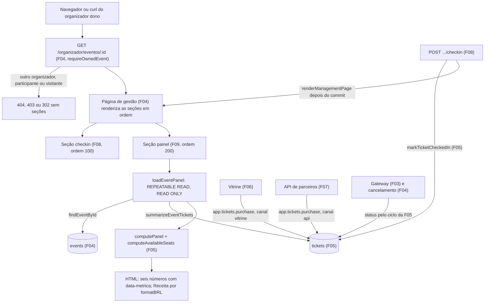

# Spec: F09 — Painel do evento

## 1. Visão técnica

**O quê.** A F09 acrescenta à página de gestão do evento (`/organizador/eventos/{id}`, F04) a seção **Painel**, com seis números calculados no momento da leitura a partir dos ingressos da F05: `Confirmados`, `Pendentes`, `Check-ins`, `Vagas disponíveis`, `Receita` e `Estornados`, com as definições de R12. É um módulo novo (`app/src/features/painel/`) sem rotas, sem tabelas e sem nenhuma escrita: registra a seção `painel` (ordem 200, abaixo do check-in da F08) pelo ponto de extensão `app.events.addManagementSection` da F04 e, a cada renderização, lê o evento (F04) e o resumo dos ingressos (F05) num único instantâneo do banco (transação `REPEATABLE READ` somente leitura), calcula as vagas com a função de R05 da F05 (`computeAvailableSeats`) e formata a receita com o formatador de dinheiro da F01 (`R$ 1.234,56`, com espaço comum). Cada número sai no HTML com o rótulo exato do brief e uma marcação estável (`data-metrica="…"`; `data-centavos` na receita) para o avaliador conferir número a número.

**Por quê.** O painel é a superfície onde todas as features se encontram e onde a primeira tentativa quebrou ("o painel somava estorno como receita"). Os números só são confiáveis se: (1) vierem de uma única fonte da verdade — a tabela de ingressos da F05, a mesma para vitrine e API, sem contadores próprios; (2) seguirem as definições do brief sem reinterpretar — receita só de `confirmed`, pelo valor pago gravado na compra (R03), estornos à parte, `declined` e `cancelled` fora de todos os números, vagas por R05 (0 em evento cancelado); (3) forem lidos de um mesmo instante — sem isso, um cancelamento que confirma entre a leitura do evento e a dos ingressos mostraria estornos com vagas ainda abertas; (4) aparecerem só para o dono, o que a F09 herda por construção ao ser uma seção da página que a F04 só entrega ao dono (R13).

**Complexidade:** `simple` — um módulo pequeno, sem rotas, sem migration e sem escrita; o peso está na integração (F04, F05, F06, F07, F08) e no contrato, que reproduz os números dos passos 9, 10, 14 e 15 do Fluxo do avaliador com as superfícies reais e os tempos reais do gateway.

**Sequência de waves.** A F09 é a única feature da Wave 6 e começa com F06, F07 e F08 integradas à `main`. Só cria arquivos em `app/src/features/painel/` e `app/test/f09/` e acrescenta uma linha ao `README.md` e uma ao `AGENTS.md`; não edita arquivos de outras features. Por ser a última das envolvidas, o contrato dela usa a vitrine (F06), a API de parceiros (F07) e o check-in (F08) para verificar CF19 e CF20.

### Escopo

**Incluído:**
- Módulo `painel` (`app/src/features/painel/`, `loadOrder` 60, `fastify-plugin` com nome `painel` e `dependencies: ['eventos', 'ingressos']`), sem rotas, decorators nem hooks: só registra a seção `painel` (ordem 200).
- Leitura `loadEventPanel(db, eventId)` num instantâneo único (5.4) e cálculo puro `computePanel(event, summary)` com as definições de 5.3.
- HTML da seção (5.2): título `Painel`, lista de definição com os seis rótulos exatos, `data-metrica` em cada valor, `data-centavos` na receita e a nota de atualização por recarga.
- Falha isolada (5.6): erro ao calcular → a seção mostra `Painel indisponível no momento. Recarregue a página.` sem nenhum número, registra o erro em log, e a página de gestão (com o check-in) continua respondendo `200`.
- Testes em `app/test/f09/` (seção 7), inclusive com as rotas reais de F04, F06, F07 e F08.
- Acréscimos pontuais em `README.md` e `AGENTS.md` (5.8).

**Excluído (e quem entrega):**
- Página de gestão, isolamento por dono (R13), página `404` `Evento não encontrado`, edição e cancelamento do evento: F04 (a F09 só acrescenta a seção).
- Ingressos, vagas ocupadas, compra, ciclo do pagamento, efeitos do cancelamento nos ingressos, resposta tardia do gateway: F05. Vitrine e "Meus ingressos": F06. API de parceiros: F07. Check-in e as mensagens de R10: F08.
- Atualização em tempo real (brief, Fora de escopo: recarregar a página basta), gráficos, histórico, exportação, números por canal, painel consolidado de vários eventos.

### Consome

| Item | De | Uso na F09 |
|---|---|---|
| Módulos com `loadOrder` e `fastify-plugin` | F01 (`app/src/core/modules.ts`) | Módulo `painel`, `loadOrder` 60 |
| `html`, `SafeHtml` | F01 (`app/src/core/html.ts`) | HTML da seção (tudo escapado) |
| `formatBRL` | F01 (`app/src/core/format.ts`) | Receita `R$ 1.234,56` com espaço comum (U+0020) |
| `withTransaction(db, fn, { isolation: 'repeatable read' })`, `Db`, `DbClient` | F01 (`app/src/db/transaction.ts`, `pool.ts`) | Instantâneo único da leitura |
| `app.events.addManagementSection`, `ManagementSection`, `ManagementSectionContext` (`request`, `event`, `organizer`, `db`, `state`) | F04 (`app/src/features/eventos/public.ts`) | Registro e renderização da seção (spec da F04, 5.12.1) |
| `findEventById`, `EventRecord` | F04 | Lotação e status do evento lidos no mesmo instantâneo dos ingressos |
| Proteção da página de gestão: `requireOwnedEvent` (`404` `Evento não encontrado` para evento de outro organizador, inexistente ou id inválido) e o hook da F02 (visitante → `/entrar`, participante → `403`) | F04, F02 | Isolamento herdado (CF16, R13): a seção só é renderizada para o dono |
| `summarizeEventTickets`, `EventTicketSummary` (`pending`, `confirmed`, `declined`, `cancelled`, `refunded`, `confirmedCheckedIn`, `confirmedPaidCents`) | F05 (`app/src/features/ingressos/public.ts`) | Contagens por status, check-ins de confirmados e soma paga dos confirmados (todos os canais) |
| `computeAvailableSeats(event, occupied)` | F05 | Vagas disponíveis (R05: lotação − ocupadas; 0 em `cancelado`) |
| Marcação de check-in (`tickets.checked_in`, gravada só pelo `Entrada liberada` da F08 via `markTicketCheckedIn` da F05) | F08 | Entra em `confirmedCheckedIn` |
| Resposta do check-in renderizada depois do commit (spec da F08, "Como a F09 usa a marcação") | F08 | O painel da própria resposta do `POST …/checkin` já mostra o número novo |
| Rotas reais para testes e contrato: `POST /eventos/{id}/comprar` (campo `cartao`, F06); `POST /api/partner/events/{id}/purchases` e `GET /api/partner/tickets/{id}` (F07, contrato fixo do brief); `POST /organizador/eventos/{id}/checkin` (campo `codigo`, F08) | F06, F07, F08 | CF17–CF20 nos testes e no contrato |
| `createTestApp`, `testDb`, `testDatabaseUrl`, `resetDatabase`, `seedAccounts` (F01); `loginAs`, `sessionCookieFor` (F02); `insertTestEvent` (F04); `insertTestTicket`, `settlePayments`, `createPool` com `max` (F05); `postCheckIn`, `checkInTicket` (F08) | `app/test/helpers/`, `public.ts` das features | Testes |

### Provê

Nada para outras features: é a superfície final do organizador (PRD). A F09 não exporta API pública nem rotas; a marcação `data-metrica` (5.2) é um acordo com o avaliador, não com outras features.

### Regras e invariantes

- **Regras do brief implementadas:** R12 (os seis números com as definições do brief, contando juntas as vendas da vitrine e da API); R05 na exibição (vagas disponíveis = lotação − pendentes − confirmados; 0 em evento cancelado); R03 no lado da receita (soma do valor pago gravado em cada compra, nunca o preço vigente do evento); R04 (o painel fica na página de gestão do evento); R11 no lado do painel (depois do cancelamento: estornados em `Estornados`, nunca em `Receita`, e vagas 0); R10 indiretamente (`Check-ins` só muda com `Entrada liberada`); R13 herdado da F04.
- **Invariantes compartilhadas que a F09 sustenta ou não pode quebrar:**
  - *Receita (R03, R12):* `Receita` = soma de `price_paid_cents` dos ingressos `confirmed` (com ou sem check-in). `refunded`, `cancelled`, `declined` e `pending` nunca entram; nenhuma conta usa `events.price_cents`. Estorno nunca conta como receita.
  - *Cancelamento (R10, R11):* evento `cancelado` mostra `Vagas disponíveis` 0; depois do cancelamento não há `confirmed` nem `pending`, então `Confirmados`, `Pendentes`, `Check-ins` e `Receita` são 0 e `Estornados` é o número de confirmados que o evento tinha.
  - *Lotação (R05–R07):* a F09 só lê; `Vagas disponíveis` sai da mesma contagem (`pending + confirmed`) que a F05 usa sob a trava da compra, no mesmo instantâneo dos outros números, e nunca é negativa.
  - *Coerência entre os números:* os seis números vêm do mesmo instante do banco; sempre vale `Vagas disponíveis = max(0, lotação − Pendentes − Confirmados)` (ou 0 em `cancelado`) com os números exibidos.
  - *API igual à vitrine:* nenhum filtro por canal; o resumo da F05 conta todos os ingressos do evento.
  - *Isolamento (R13):* a seção só existe dentro da página de gestão, entregue pela F04 só ao dono; a F09 não registra rotas; a seção recebe o evento já verificado e só lê dados desse evento.
  - *Somente leitura:* a F09 não escreve em nenhuma tabela (transação `READ ONLY`); não toca em ingressos, eventos nem tentativas de pagamento.
  - *Resposta tardia do gateway:* não afetada (a F09 não aplica resultados; ela só reflete o status que a F05 mantém).

### Requisitos (capacidades do PRD → decisões desta spec)

| Capacidade (PRD F09) | Como esta spec atende |
|---|---|
| A página de gestão mostra o painel contando vendas da vitrine e da API com as definições de R12 | Seção `painel` (5.1, 5.2); definições em 5.3; `summarizeEventTickets` sem filtro de canal (5.4) |
| Receita no formato `R$ 1.234,56`; `declined` e `cancelled` não entram em nenhum número | `formatBRL` (5.5); `computePanel` não usa `declined`/`cancelled` (5.3) |
| Números calculados a partir dos ingressos no momento da leitura; recarregar atualiza | `loadEventPanel` em toda renderização, sem cache; páginas de usuário logado já saem com `cache-control: no-store` (F02) |
| Experiência: seção "Painel" com os seis rótulos | 5.2 (`<h2>Painel</h2>` e os `<dt>` exatos) |

### Fluxos (experiência do PRD)

1. **Ver:** o organizador abre `/organizador/eventos/{id}`; abaixo dos dados do evento (F04) e da seção "Check-in" (F08) aparece a seção "Painel" com `Confirmados`, `Pendentes`, `Check-ins`, `Vagas disponíveis`, `Receita` e `Estornados`.
2. **Atualizar:** depois de vendas (vitrine ou API), resultados do gateway, edições de lotação ou preço, check-ins ou do cancelamento, recarrega a página e vê os números do novo instante.
3. **Check-in:** a resposta do `Validar` (F08) é a página de gestão renderizada depois do commit; o painel dela já conta o check-in liberado. Tentativas recusadas não mudam nenhum número.
4. **Outro organizador, participante ou visitante:** recebem `404` `Evento não encontrado`, `403` `Acesso negado` ou `302` para `/entrar` (F04/F02) — nenhum número do painel.

## 2. Impacto na arquitetura

```
app/
├── src/features/painel/
│   ├── index.ts      # plugin (fastify-plugin "painel"), loadOrder 60: registra a seção painel (ordem 200)
│   ├── types.ts      # EventPanel, PanelMetricKey, PANEL_METRICS (rótulos e chaves), textos fixos
│   ├── metrics.ts    # computePanel (puro) e loadEventPanel (instantâneo único, somente leitura)
│   ├── view.ts       # HTML da seção: panelContent e panelUnavailableContent
│   └── section.ts    # createPanelSection: render com captura de erro e log
└── test/f09/
    ├── support.ts    # readPanel (mesmo leitor do contrato), panelOf, sessões de participante
    └── *.test.ts     # seção 7
```

Documentação (fase final, acréscimos pontuais): `README.md`, `AGENTS.md`, `docs/state.json` (só a entrada F09), seção 10 desta spec. Nenhuma migration, nenhuma variável de ambiente, nenhum comando novo.



## 3. Decisões técnicas

| Decisão | Abordagem escolhida | Alternativa considerada | Trade-off |
|---|---|---|---|
| Fonte dos números | Agregação na leitura pelas funções públicas da F05 (`summarizeEventTickets`, `computeAvailableSeats`) sobre a tabela `tickets` | Contadores ou tabela de métricas própria, atualizados a cada venda; SQL próprio da F09 sobre `tickets` | Uma única fonte da verdade e uma única definição de vagas para compra, vitrine, API e painel; custo de uma consulta agregada indexada (`tickets_event_status_idx`) por renderização, irrelevante em eventos pequenos |
| Coerência entre os seis números | Uma transação `REPEATABLE READ` `READ ONLY` por renderização: evento e resumo dos ingressos no mesmo instantâneo; vagas calculadas a partir das contagens exibidas | Duas consultas soltas em READ COMMITTED; `getSeatAvailability` e `summarizeEventTickets` separados | Os números nunca se contradizem (vagas = lotação − pendentes − confirmados; evento cancelado nunca aparece com vagas); uma conexão por alguns milissegundos; leitura `REPEATABLE READ` somente leitura não espera travas nem falha por serialização |
| Onde o painel aparece | Seção registrada na página de gestão da F04 (`addManagementSection`, nome `painel`, ordem 200), sem rotas próprias | Página `/organizador/eventos/:id/painel` ou rota JSON | Isolamento (R13) herdado da F04 sem código novo; nenhum caminho extra para proteger; o painel só existe dentro da página do dono |
| Marcação para conferência | `<dl>` com `<dt>` = rótulo exato do brief e `<dd data-metrica="…">` = valor, uma linha de HTML por número; `data-centavos` na receita | Tabela sem atributos; texto corrido | O avaliador lê cada número por rótulo e por chave estável, sem depender de layout; o texto visível continua o do brief |
| Formato da receita | `formatBRL` da F01 (`R$ 1.234,56`, espaço comum U+0020 depois de `R$`) | `Intl.NumberFormat('pt-BR', { style: 'currency', currency: 'BRL' })` | Saída idêntica ao brief e às outras telas (preço na F04 e na F06); o `Intl` usa espaço não separável (U+00A0), que quebra a comparação byte a byte |
| Falha no cálculo | A seção captura o erro, registra em log e mostra `Painel indisponível no momento. Recarregue a página.`, sem números | Deixar a exceção virar `500` da página inteira (padrão da F04 para seções) | Uma falha do painel não derruba o check-in na porta do evento; o painel nunca mostra número errado ou parcial |

## 4. Componentes

**Módulo `painel` (`app/src/features/painel/`):**

| Arquivo | Novo/Modificado | Propósito | Responsabilidades |
|---|---|---|---|
| `index.ts` | Novo | Plugin da feature | `export const loadOrder = 60`; `default` = `fastify-plugin` (nome `painel`, `dependencies: ['eventos', 'ingressos']`) que chama `app.events.addManagementSection(createPanelSection())` no registro (antes do `onReady`, como exige a F04); nenhuma rota, decorator ou hook |
| `types.ts` | Novo | Tipos e textos | `PanelMetricKey`; `PANEL_METRICS` (ordem, chave e rótulo de 5.3, congelado); `EventPanel`; `PANEL_SECTION_NAME = 'painel'`, `PANEL_SECTION_ORDER = 200`; `PANEL_TITLE = 'Painel'`; `PANEL_NOTE`; `PANEL_UNAVAILABLE_MESSAGE` |
| `metrics.ts` | Novo | Cálculo | `computePanel(event, summary) → EventPanel` (puro, 5.3); `loadEventPanel(db, eventId) → Promise<EventPanel>` (instantâneo único, 5.4) |
| `view.ts` | Novo | HTML | `panelContent(panel) → SafeHtml` (5.2); `panelUnavailableContent() → SafeHtml` (5.6) |
| `section.ts` | Novo | Seção | `createPanelSection(options?: { load?: (db, eventId) => Promise<EventPanel> }) → ManagementSection` com `name: 'painel'`, `order: 200` e `render(context)`: `load(context.db, context.event.id)` → `panelContent`; erro → log (5.7) e `panelUnavailableContent()`. O parâmetro `load` existe para os testes (padrão `loadEventPanel`) |

**Banco:** nenhuma migration (seção 6).

**Testes:**

| Arquivo | Novo/Modificado | Propósito |
|---|---|---|
| `app/test/f09/support.ts` | Novo | `readPanel(html) → { present, line, metrics, revenueCents }` (mesmo leitor do contrato: a seção com `data-secao="painel"` e os pares `<dt>…</dt><dd data-metrica="…">…</dd>`); `panelOf(app, cookie, eventId)` (`GET` da página de gestão + `readPanel`); `panelLine(c, p, k, v, receita, e)` (linha `Confirmados c \| Pendentes p \| …`); `participantCookie(app)` (conta de participante nova por `sessionCookieFor`) |
| `app/test/f09/*.test.ts` | Novo | Seção 7 |

## 5. Contratos de interfaces

Não há rotas HTTP novas. As interfaces são a seção registrada na página de gestão (HTML de 5.2), as funções internas do módulo (usadas pelos testes) e uma mensagem de log.

### 5.1 Registro da seção

- `app.events.addManagementSection({ name: 'painel', order: 200, render })` no registro do plugin (F04, 5.12.1). Com o check-in da F08 em ordem 100, o painel aparece logo abaixo dele; ambos abaixo do conteúdo da F04 e acima de `<p><a href="/organizador">Voltar para meus eventos</a></p>`.
- A F04 embrulha o HTML em `<section class="gestao-secao" data-secao="painel">…</section>` e renderiza a seção **em todos os status** do evento (`rascunho`, `publicado`, `cancelado`) e em todas as respostas que mostram a página de gestão: `GET /organizador/eventos/:id`, as respostas de erro de ações da F04 (`409`, `422`) e a resposta do `POST …/checkin` da F08.
- A seção só é chamada pela F04 com um evento já verificado como do organizador logado (`requireOwnedEvent`); evento de outro organizador, inexistente ou id inválido → `404` da F04 sem nenhuma seção; visitante e participante → `302`/`403` da F02 sem nenhuma seção.
- `loadOrder = 60` (depois de `contas` 10, `gateway` 20, `eventos` 30, `ingressos` 40 e `checkin` 50 da F08). Linha de boot: `[catraca] módulos: …, ingressos, checkin, painel, …` (com `painel` depois de `ingressos`).

### 5.2 HTML da seção

Conteúdo devolvido por `panelContent` (cada linha abaixo é uma linha do HTML; `{…}` = valor escapado pelo `html` da F01):

```html
<h2>Painel</h2>
<dl>
<dt>Confirmados</dt><dd data-metrica="confirmados">{confirmados}</dd>
<dt>Pendentes</dt><dd data-metrica="pendentes">{pendentes}</dd>
<dt>Check-ins</dt><dd data-metrica="check-ins">{check-ins}</dd>
<dt>Vagas disponíveis</dt><dd data-metrica="vagas-disponiveis">{vagas disponíveis}</dd>
<dt>Receita</dt><dd data-metrica="receita" data-centavos="{receita em centavos}">{R$ 1.234,56}</dd>
<dt>Estornados</dt><dd data-metrica="estornados">{estornados}</dd>
</dl>
<p>Números do momento em que a página foi aberta. Recarregue para atualizar.</p>
```

Exemplo (passo 9 do Fluxo do avaliador), já com o envoltório da F04:

```html
<section class="gestao-secao" data-secao="painel"><h2>Painel</h2>
<dl>
<dt>Confirmados</dt><dd data-metrica="confirmados">3</dd>
<dt>Pendentes</dt><dd data-metrica="pendentes">0</dd>
<dt>Check-ins</dt><dd data-metrica="check-ins">0</dd>
<dt>Vagas disponíveis</dt><dd data-metrica="vagas-disponiveis">0</dd>
<dt>Receita</dt><dd data-metrica="receita" data-centavos="35000">R$ 350,00</dd>
<dt>Estornados</dt><dd data-metrica="estornados">0</dd>
</dl>
<p>Números do momento em que a página foi aberta. Recarregue para atualizar.</p>
</section>
```

Regras:
- Os seis `<dt>` têm exatamente os rótulos do brief, nesta ordem; cada par `<dt>…</dt><dd …>…</dd>` fica numa única linha, sem espaços nem atributos além dos mostrados; os atributos aparecem na ordem mostrada (`data-metrica` antes de `data-centavos`).
- Chaves `data-metrica` fixas: `confirmados`, `pendentes`, `check-ins`, `vagas-disponiveis`, `receita`, `estornados`. `data-centavos` só na receita, com o inteiro em centavos (`0`, `35000`).
- Contagens em decimal sem separador de milhar (`0`, `5`, `1000`), como a lotação na página da F04. Receita por `formatBRL` (5.5).
- Nenhum outro lugar da página contém `data-metrica` ou `data-secao="painel"`; a seção aparece uma única vez.
- O painel não mostra `declined` nem `cancelled` (nem como número à parte).

### 5.3 Definições dos números (R12)

`summary` = `summarizeEventTickets(client, eventId)` (F05); `event` = `findEventById(client, eventId)` (F04), ambos no mesmo instantâneo (5.4).

| Rótulo | `data-metrica` | Valor | Definição (brief, R12) |
|---|---|---|---|
| `Confirmados` | `confirmados` | `summary.confirmed` | Ingressos `confirmed`, inclusive os que já passaram pelo check-in |
| `Pendentes` | `pendentes` | `summary.pending` | Ingressos `pending` |
| `Check-ins` | `check-ins` | `summary.confirmedCheckedIn` | Ingressos `confirmed` com `checked_in` (um `refunded` com check-in não conta) |
| `Vagas disponíveis` | `vagas-disponiveis` | `computeAvailableSeats(event, summary.pending + summary.confirmed)` | R05: lotação − (pendentes + confirmados), mínimo 0; 0 em evento `cancelado`; em `rascunho`, a lotação |
| `Receita` | `receita` | `formatBRL(summary.confirmedPaidCents)`; `data-centavos` = `summary.confirmedPaidCents` | Soma de `price_paid_cents` dos `confirmed` (valor pago no momento de cada compra, R03) |
| `Estornados` | `estornados` | `summary.refunded` | Ingressos `refunded` |

`summary.declined` e `summary.cancelled` não são usados (não entram em nenhum número e, por R05, não ocupam vaga). Nenhum número depende do canal (`vitrine`/`api`).

**`computePanel(event: Pick<EventRecord, 'capacity' | 'status'>, summary: EventTicketSummary): EventPanel`** — puro; `EventPanel = { confirmed: number; pending: number; checkIns: number; availableSeats: number; revenueCents: number; refunded: number }`. Lança `Error('painel: resumo de ingressos inválido')` se algum valor usado do resumo não for inteiro seguro ≥ 0, ou se `confirmedCheckedIn > confirmed` (erro de programação; vira a seção indisponível de 5.6).

### 5.4 Leitura num instantâneo único (`loadEventPanel`)

`loadEventPanel(db: Db, eventId: string): Promise<EventPanel>`:

1. `withTransaction(db, fn, { isolation: 'repeatable read' })` (F01).
2. Primeira instrução: `SET TRANSACTION READ ONLY`.
3. `event = await findEventById(client, eventId)` (F04). `null` (impossível: eventos não são apagados) → `Error('painel: evento não encontrado')`.
4. `summary = await summarizeEventTickets(client, eventId)` (F05).
5. `return computePanel(event, summary)`; `COMMIT`.

Em `REPEATABLE READ`, todas as instruções da transação enxergam o mesmo instantâneo, tirado na primeira consulta: um cancelamento, uma compra, um resultado do gateway ou um check-in que confirme entre os passos 3 e 4 não aparece em nenhum dos dois (aparece inteiro na próxima leitura). Uma transação somente leitura em `REPEATABLE READ` não espera travas de linha (MVCC) nem falha por serialização: a leitura nunca fica atrás da trava de uma compra, edição, cancelamento ou check-in do mesmo evento.

O painel é lido com `context.db` (o pool), fora de qualquer transação de quem responde a página. Na resposta do check-in, a F08 chama `renderManagementPage` depois do commit da marcação (spec da F08), então o painel dessa resposta já conta o check-in.

### 5.5 Formatação

| Valor | Saída |
|---|---|
| Contagens (`0`, `3`, `1000`) | `String(n)`: `0`, `3`, `1000` |
| Receita `0` | `R$ 0,00` (`data-centavos="0"`) |
| Receita `35000` | `R$ 350,00` |
| Receita `123456` | `R$ 1.234,56` |
| Receita `123456790` | `R$ 1.234.567,90` |

`formatBRL` (F01) escreve `R$`, um espaço comum (U+0020), o valor com ponto no milhar e vírgula nos centavos. A seção não contém U+00A0, U+202F nem outro espaço especial.

### 5.6 Falha no cálculo

Qualquer exceção em `loadEventPanel` ou `computePanel` (banco indisponível, `statement_timeout`, erro de programação) é capturada em `render`: log de 5.7 e o conteúdo abaixo, sem `<dl>`, sem `data-metrica` e sem nenhum número. O resto da página (dados do evento, formulários da F04, check-in da F08) continua sendo renderizado com o status da resposta original (`200` no `GET`).

```html
<h2>Painel</h2>
<p>Painel indisponível no momento. Recarregue a página.</p>
```

### 5.7 Logs

| Mensagem (`msg`) | Nível | Campos | Quando |
|---|---|---|---|
| `painel: falha ao calcular o painel` | `error` | `eventId`, `err` | 5.6 |

Nenhum log em leitura bem-sucedida (a página é aberta a cada recarga).

### 5.8 Documentação (fase final)

| Arquivo | Mudança (só acréscimos) |
|---|---|
| `README.md` | Em `## Decisões`, uma linha "Painel (R12)": números calculados a cada abertura da página de gestão a partir dos ingressos (F05), num único instantâneo somente leitura; receita = soma do valor pago dos `confirmed` (estorno nunca é receita; mudança de preço não reescreve o passado); vitrine e API contadas juntas; seção visível só para o dono porque vive dentro da página de gestão protegida pela F04 |
| `AGENTS.md` | Em "Convenções de código": "Painel: seção `painel` (ordem 200) da página de gestão, em `app/src/features/painel/`; só lê (`summarizeEventTickets`/`computeAvailableSeats` da F05 num instantâneo `REPEATABLE READ` somente leitura); cada número tem `data-metrica` no HTML" |
| `docs/state.json` | Só a entrada F09 (`aguardando_avaliacao` ao final da implementação) |

## 6. Modelo de dados

Sem mudanças: nenhuma tabela, coluna, índice ou migration. A F09 só lê, pelas funções públicas de F04 e F05, as consultas abaixo (SQL das specs da F04 e da F05, reproduzido para rastreabilidade):

| Função (dona) | SQL |
|---|---|
| `findEventById` (F04) | `SELECT id, organizer_id, name, starts_at, location, capacity, price_cents, status, published_at, cancelled_at, created_at, updated_at FROM events WHERE id = $1` |
| `summarizeEventTickets` (F05) | `SELECT count(*) FILTER (WHERE status = 'pending') AS pending, count(*) FILTER (WHERE status = 'confirmed') AS confirmed, count(*) FILTER (WHERE status = 'declined') AS declined, count(*) FILTER (WHERE status = 'cancelled') AS cancelled, count(*) FILTER (WHERE status = 'refunded') AS refunded, count(*) FILTER (WHERE status = 'confirmed' AND checked_in) AS confirmed_checked_in, coalesce(sum(price_paid_cents) FILTER (WHERE status = 'confirmed'), 0) AS confirmed_paid_cents FROM tickets WHERE event_id = $1` |

Índices usados: `events_pkey` (F04) e `tickets_event_status_idx` (`event_id, status`, F05). As colunas lidas têm as garantias da F05: `price_paid_cents` imutável (guarda no banco), transições de status só `pending → confirmed/declined/cancelled` e `confirmed → refunded`, `checked_in` só em `confirmed` e nunca desfeito.

## 7. Estratégia de testes

Todos rodam pelo `npm run gates` (banco `catraca_test`, arquivos em sequência). Cada teste ligado a critério leva o ID no nome. Eventos com `insertTestEvent` (F04) ou pela página de gestão (`loginAs` do organizador A) quando o teste é sobre a integração com a F04; ingressos pelo serviço real (`app.tickets.purchase`) ou pelas rotas reais da F06/F07, com `settlePayments` (F05) para entregar os resultados do gateway sem esperar; `insertTestTicket` só para misturas de status que o fluxo real levaria muito tempo para montar. O check-in usa a rota real da F08 (`postCheckIn` de `app/test/helpers/checkin.ts`). Os números são conferidos pelo `readPanel` (o mesmo leitor do contrato), nunca por funções internas, salvo nos testes unitários.

**Estrutura:**

| Arquivo | Tipo | Alvo |
|---|---|---|
| `app/test/f09/html.test.ts` | Unidade | `view.ts` |
| `app/test/f09/calculo.test.ts` | Unidade | `computePanel` |
| `app/test/f09/secao.test.ts` | Integração (HTTP da F04) | Registro, presença e posição da seção; falha isolada |
| `app/test/f09/numeros.test.ts` | Integração (serviço da F05 + HTTP da F04) | Definições de R12 com compras, recusas, edição e cancelamento |
| `app/test/f09/checkin.test.ts` | Integração (HTTP da F08) | Check-ins |
| `app/test/f09/canais.test.ts` | Integração (HTTP da F06, F07 e F08) | CF19, CF20 |
| `app/test/f09/isolamento.test.ts` | Integração (HTTP da F04/F02) | CF16, ausência de rotas |
| `app/test/f09/consistencia.test.ts` | Integração (concorrência real) | Instantâneo único, leitura sem trava, rajada |

**`html.test.ts`**

| Teste | Asserções |
|---|---|
| `F09-CA01 a seção tem o título Painel e os seis rótulos na ordem, cada valor com data-metrica` | HTML exato de 5.2, linha a linha, para um `EventPanel` qualquer |
| `F09-CA02 a Receita sai como R$ 0,00, R$ 350,00, R$ 1.234,56 e R$ 1.234.567,90 com espaço comum e data-centavos` | quatro valores; nenhum U+00A0/U+202F; `data-centavos` com o inteiro |
| `contagens saem como inteiros sem separador de milhar` | `1000` → `<dd data-metrica="confirmados">1000</dd>` |
| `a seção indisponível não mostra números` | HTML de 5.6; sem `<dl>` nem `data-metrica` |

**`calculo.test.ts`**

| Teste | Asserções |
|---|---|
| `F09-CA03 pending conta em Pendentes e ocupa vaga sem entrar na Receita` | lotação 3, 1 `pending` (10000) → pendentes 1, vagas 2, receita 0 |
| `F09-CA03 declined e cancelled não entram em nenhum número nem ocupam vaga` | resumo só com `declined`/`cancelled` → todos 0, vagas = lotação |
| `F09-CA05 Check-ins vem dos confirmados com check-in e Confirmados inclui esses ingressos` | `confirmed` 3, `confirmedCheckedIn` 1 → confirmados 3, check-ins 1 |
| `F09-CA04 evento cancelado tem Vagas disponíveis 0 e Estornados separado da Receita` | status `cancelado`, `refunded` 1 → vagas 0, receita 0, estornados 1 |
| `resumo inválido lança erro de programação` | negativo, não inteiro, `confirmedCheckedIn > confirmed` |

**`secao.test.ts`**

| Teste | Asserções |
|---|---|
| `F09-CA01 o painel aparece uma vez na página de gestão, depois dos dados do evento e do check-in e antes do link de volta, em rascunho, publicado e cancelado` | `data-secao="painel"` uma vez; seis `data-metrica`; posição; três status |
| `F09-CA01 evento sem ingressos mostra zeros, Vagas = lotação e Receita R$ 0,00` | rascunho lotação 4 → `Confirmados 0 \| Pendentes 0 \| Check-ins 0 \| Vagas disponíveis 4 \| Receita R$ 0,00 \| Estornados 0` |
| `o módulo painel carrega depois de eventos e ingressos e registra a seção painel com ordem 200` | `app.featureModules` com `painel` depois de `ingressos` (e de `checkin`); seção depois da de check-in |
| `falha ao calcular mostra Painel indisponível, registra o erro e mantém o resto da página` | `createPanelSection({ load: () => Promise.reject(new Error('x')) })` com o nome trocado para `painel-teste` (ordem 300), registrada por `app.events.addManagementSection` antes do primeiro `inject`: `GET` da página de gestão → `200`, a seção `painel-teste` com o HTML de 5.6 (sem `data-metrica`), o formulário de check-in e o painel real intactos; log `painel: falha ao calcular o painel` com `eventId` |

**`numeros.test.ts`**

| Teste | Asserções |
|---|---|
| `F09-CA02 CF16 duas compras confirmadas a R$ 100,00, preço R$ 150,00 e lotação 3 pela página de gestão e uma terceira confirmada mostram 3, 0, 0, 0, R$ 350,00 e 0` | compras por `app.tickets.purchase` + `settlePayments`; edição por `POST …/editar` (`loginAs` A); linha exata |
| `CF16 a mudança de preço não altera a Receita das compras anteriores` | antes da terceira compra: `Receita R$ 200,00` e `data-centavos="20000"` com preço vigente 15000 |
| `F09-CA03 CF17 compra pendente conta em Pendentes e ocupa vaga; a recusa a tira de todos os números e libera a vaga` | lotação 2: 1 `confirmed` + 1 `pending` (`…0004`) → `1 \| 1 \| 0 \| 0 \| R$ 100,00 \| 0`; `settlePayments` → `1 \| 0 \| 0 \| 1 \| R$ 100,00 \| 0` |
| `F09-CA04 CF17 cancelamento com 1 confirmado e 1 pendente mostra 0, 0, 0, 0, R$ 0,00 e Estornados 1` | cancelamento por `POST …/cancelar` com `confirmar=sim` |
| `F09-CA04 a resposta do gateway depois do cancelamento não muda o painel` | `settlePayments` depois do cancelamento (`…0003` aprovado) → mesma linha |
| `CF17 Vagas disponíveis = lotação − Pendentes − Confirmados em misturas de status e canais` | várias misturas por `insertTestTicket` (vitrine e API; todos os status; com e sem check-in) → a igualdade vale e cada número bate com uma contagem direta em `tickets` |

**`checkin.test.ts`**

| Teste | Asserções |
|---|---|
| `F09-CA05 CF18 check-in liberado soma 1 em Check-ins sem mudar Confirmados nem os outros números` | `postCheckIn` → `liberada`; painel da própria resposta e de um novo `GET`: só `Check-ins` +1 |
| `CF18 check-ins recusados não mudam nenhum número` | `ja_utilizado`, `nao_confirmado` (`pending` e `declined`), `invalido` (`ZZZZZZZZ` e código de outro evento), `codigo_vazio` e `evento_cancelado` → linha idêntica antes e depois de cada um |
| `F09-CA05 estornado que passou pelo check-in sai de Check-ins e de Confirmados depois do cancelamento` | 2 `confirmed` (1 com check-in) + cancelamento → `0 \| 0 \| 0 \| 0 \| R$ 0,00 \| 2` |

**`canais.test.ts`**

| Teste | Asserções |
|---|---|
| `CF19 uma compra confirmada pela vitrine e duas pela API, todas a R$ 100,00, mostram Confirmados 3 e Receita R$ 300,00` | `POST /eventos/{id}/comprar` (campo `cartao`, cookie de participante) e duas vezes `POST /api/partner/events/{id}/purchases` (cabeçalho `x-api-key`); `settlePayments`; lotação 5 → `3 \| 0 \| 0 \| 2 \| R$ 300,00 \| 0`; canais `vitrine` 1 e `api` 2 no banco |
| `CF20 ingresso comprado pela API passa no check-in com Entrada liberada, a API mostra "checkedIn":true e o painel mostra Check-ins 1` | compra pela API; `settlePayments`; `postCheckIn` → `Entrada liberada`; `GET /api/partner/tickets/{id}` com `"checkedIn":true`; painel com `Check-ins 1` |

**`isolamento.test.ts`**

| Teste | Asserções |
|---|---|
| `CF16 o painel só aparece para o dono: organizador B recebe 404, participante 403 e visitante 302 sem nenhum número` | corpos sem `data-secao="painel"`, `data-metrica`, `Confirmados`, `Receita` nem o valor da receita do evento |
| `CF16 cada organizador vê no próprio painel só os números do próprio evento` | A e B com vendas diferentes; nenhum valor de um aparece na página do outro |
| `o módulo painel não registra rotas` | `app.printRoutes()` sem `painel`; `GET /organizador/eventos/{id}/painel` do dono → `404` |

**`consistencia.test.ts`**

| Teste | Asserções |
|---|---|
| `CF17 evento e ingressos são lidos no mesmo instantâneo: um cancelamento confirmado entre as duas leituras não mistura números` | `loadEventPanel` com um `Db` de teste cujo cliente, logo depois da consulta do evento, confirma em outra conexão o cancelamento (evento `cancelado`, ingressos `refunded`/`cancelled`); resultado = estado anterior inteiro (confirmados 1, pendentes 1, vagas lotação − 2, estornados 0); a leitura seguinte = estado novo inteiro (0, 0, 0, 0, 0, 1) |
| `a leitura do painel é somente leitura e não espera a trava do evento` | dentro da leitura, `SHOW transaction_read_only` = `on` e `SHOW transaction_isolation` = `repeatable read`; com outra transação segurando `lockEventForUpdate` do evento, `loadEventPanel` responde em menos de 500 ms |
| `R05 R07 durante 30 compras simultâneas em lotação 5, toda leitura do painel tem Pendentes + Confirmados ≤ 5 e Vagas = 5 − Pendentes − Confirmados` | pool próprio (`createPool({ databaseUrl: testDatabaseUrl(), max: 40 })`), rajada com `Promise.all`; leituras em laço durante a rajada; 3 rodadas em eventos novos |

**Cobertura dos critérios:**

| Critério | Testes automatizados | Contrato |
|---|---|---|
| F09-CA01 | `html`, `secao` | C01 |
| F09-CA02 | `html`, `numeros` | C03, C02 |
| F09-CA03 | `calculo`, `numeros` | C03, C06, C08, C10 |
| F09-CA04 | `calculo`, `numeros` | C07 |
| F09-CA05 | `calculo`, `checkin` | C04, C08 |
| CF16 (F04 → F09) | `isolamento`, `numeros` | C09, C03, C01 |
| CF17 (F05 → F09) | `numeros`, `consistencia` | C03, C07, C08, C10 |
| CF18 (F08 → F09) | `checkin` | C04, C08, C09 |
| CF19 (F06, F07 → F09) | `canais` | C06 |
| CF20 (F07, F08 → F09) | `canais` | C05 |

## 8. Tratamento de erros

| Situação | Onde | Comportamento |
|---|---|---|
| Evento de outro organizador, inexistente ou id inválido | `requireOwnedEvent` (F04) | `404` `Evento não encontrado`, sem nenhuma seção: o painel nunca é renderizado |
| Visitante / participante | hook da F02 | `302` `/entrar` / `403` `Acesso negado`, sem nenhuma seção |
| Banco indisponível, `statement_timeout` ou erro de programação ao calcular | `section.ts` (5.6) | Seção `Painel indisponível no momento. Recarregue a página.`, sem números; log `error`; o resto da página continua |
| Evento ausente no instantâneo (impossível: eventos não são apagados) | `loadEventPanel` | `Error` → tratado como acima |
| Resumo com valor inválido | `computePanel` | `Error` → tratado como acima |
| Compra, resultado do gateway, cancelamento ou check-in confirmando durante a leitura | instantâneo `REPEATABLE READ` | Números coerentes do instante da leitura; recarregar mostra o estado novo inteiro |
| Trava do evento presa por outra transação | leitura MVCC | A leitura não espera nem bloqueia ninguém |

## 9. Premissas e decisões do modo não interativo

Decisões tomadas pela política de auto-aceite (spec-writer, Batch Mode, "Auto-Accept Policy") onde o PRD, o brief e as specs de F01–F08 não fixam o detalhe. Revisáveis antes do commit do contrato.

| # | Premissa / decisão | Linha da política |
|---|---|---|
| P01 | Complexidade `simple`; plano em 3 fases (a última, Documentação). | Recomendação clara |
| P02 | Módulo `painel`, `loadOrder` 60 (depois de `ingressos` 40 e `checkin` 50), `fastify-plugin` com nome `painel` e `dependencies: ['eventos', 'ingressos']`; identificadores em inglês, textos em pt-BR (padrão de F01, F02, F04, F05). | Padrões conflitantes (mais frequente) |
| P03 | Seção `painel` com ordem 200 (sugestão da spec da F04, confirmada pela da F08, que usa 100); título `<h2>Painel</h2>` (PRD: seção "Painel"). | Recomendação clara |
| P04 | Marcação: `<dl>` com os rótulos exatos do brief nos `<dt>` e `data-metrica` (`confirmados`, `pendentes`, `check-ins`, `vagas-disponiveis`, `receita`, `estornados`) nos `<dd>`; `data-centavos` na receita; nota `Números do momento em que a página foi aberta. Recarregue para atualizar.` | Pedido do orquestrador (marcação estável) |
| P05 | Contagens em decimal sem separador de milhar (como a lotação exibida pela F04). | Detalhe parcial do PRD |
| P06 | Receita por `formatBRL` da F01 (espaço comum U+0020, nunca U+00A0). | Pedido do orquestrador |
| P07 | Leitura num instantâneo único: `REPEATABLE READ` + `SET TRANSACTION READ ONLY`, com `findEventById` (F04) + `summarizeEventTickets` (F05), e vagas por `computeAvailableSeats` (F05) a partir das contagens exibidas — em vez de `getSeatAvailability`, para que Vagas, Pendentes e Confirmados venham da mesma contagem. Nenhum acréscimo nas APIs de F04 e F05. | Recomendação clara |
| P08 | O painel aparece também em `rascunho` (zeros; vagas = lotação) e em `cancelado` (vagas 0), como todas as seções da F04. | Detalhe parcial do PRD |
| P09 | Falha no cálculo: a seção mostra `Painel indisponível no momento. Recarregue a página.` (sem números) e registra `painel: falha ao calcular o painel`; a página não vira `500` (o check-in continua utilizável). | Recomendação clara |
| P10 | Sem rotas, sem JSON, sem cache; recarregar atualiza (brief, Fora de escopo); páginas de usuário logado já saem com `cache-control: no-store` (F02). | PRD |
| P11 | `Check-ins` conta só `confirmed` com check-in (literal de R12); um `refunded` que passou pelo check-in não conta (F09-CA04 espera `Check-ins 0` depois do cancelamento). | Brief (R12) |
| P12 | `declined` e `cancelled` não aparecem no painel, nem como número à parte. | PRD (F09 Capacidades) |
| P13 | Contrato: eventos pela interface da F04 (cookie dos organizadores), compras pela vitrine (`POST /eventos/{id}/comprar`, campo `cartao`, spec da F06, 5.4) com uma conta de participante criada pela interface (`/cadastro`, como no passo 5 do Fluxo) e pela API de parceiros (contrato fixo do brief), check-in pela rota da F08 (`POST /organizador/eventos/{id}/checkin`, campo `codigo`, spec da F08, 5.1); tempos reais do gateway; leituras SQL só para evidência e ids; funções em `/tmp/catraca-f09/aux.sh` e o leitor do painel em `/tmp/catraca-f09/painel.js` (padrão dos contratos de F04/F05). | Recomendação clara |
| P14 | Contrato: as mensagens do check-in são conferidas pelo texto exato de R10 no corpo da resposta (independe da marcação da F08); o painel é lido pela seção `data-secao="painel"` e pelos pares `<dt>`/`<dd data-metrica>`. | Recomendação clara |
| P15 | Rajada do passo 15 em 3 rodadas (E4, E5 e mais uma), cada uma num evento novo, com o comando `xargs` do brief; a F09 confere o painel (`Confirmados 5`, `Vagas disponíveis 0` em até 10 s); a garantia de R07 em si é das F05/F07. | Regra do template de contrato (rajadas ≥ 3) |
| P16 | Testes com as rotas reais de F06, F07 e F08 (integradas antes da Wave 6), pelos caminhos e campos das specs delas; `postCheckIn`/`checkInTicket` da F08 para o check-in. | Recomendação clara |
| P17 | Documentação: uma linha em `## Decisões` do README e uma em "Convenções de código" do `AGENTS.md`. | Recomendação clara |
| P18 | Se algum teste existente fixar a lista exata de módulos carregados (linha de boot), a F09 ajusta só essa asserção para "contém" e registra em Desvios. | Padrões conflitantes |

**Acréscimos assumidos nas APIs de outras features:** nenhum. A F09 usa só o que as specs da F04 (`addManagementSection`, `findEventById`), da F05 (`summarizeEventTickets`, `computeAvailableSeats`, auxiliares de teste) e da F08 (`postCheckIn`, renderização depois do commit) já definem.

**Conflitos PRD × brief:** nenhum. Observação: o `docs/plano-de-execucao.md` põe a F09 na wave 5 (consumindo só F04 e F05); o PRD a pôs na Wave 6, depois da F08 — vale o PRD, e por isso o contrato pode usar vitrine, API e check-in.

## 10. Desvios da implementação

Preenchido pelo implementador na fase Documentação: cada diferença entre esta spec e o que foi implementado, com o motivo.

| # | Desvio | Motivo |
|---|---|---|
| D01 | No HTML real, `</section>` vem colado ao fim da nota (`…Recarregue para atualizar.</p></section>`), e não numa linha própria como no exemplo de 5.2. | O envoltório é o da F04 (`<section …>${conteúdo}</section>`, sem quebra de linha), igual ao da seção de check-in da F08. O conteúdo da seção é exatamente o de 5.2; o leitor do contrato e as linhas exatas do C01 não dependem disso. |
| D02 | A fase 1 já criou `index.ts` (plugin `painel`, `loadOrder` 60, sem registrar nada); a fase 2 passou a registrar a seção nele. | O carregador de módulos da F01 exige `index.ts` em toda pasta de `app/src/features/`; sem ele a aplicação não sobe. |
| D03 | Acréscimos em `types.ts`: `PanelMetric` com o campo `kind` (`count`/`money`) em cada item de `PANEL_METRICS` e a constante `PANEL_ERROR_LOG` (`painel: falha ao calcular o painel`). `section.ts` exporta também os tipos `PanelLoader` e `PanelSectionOptions`. | A view escolhe o formato (contagem ou `formatBRL` + `data-centavos`) pelo item, sem comparar chaves; a mensagem de log fica num lugar só. Nada disso é API para outras features. |
| D04 | `app/test/f09/support.ts`: `readPanel` devolve também `sections`, `labels` e `html` (além de `present`, `line`, `metrics`, `revenueCents`); o arquivo exporta ainda `setup` (app + seed + cookies de A e B), `occurrences` e as constantes dos cartões. `participantCookie` cria a conta com `insertParticipant` (F02) e abre a sessão com `sessionCookieFor`. | Conveniência dos testes; o leitor segue as mesmas regras do `painel.js` do contrato (mesmas expressões e a mesma troca de caracteres especiais por `<U+XXXX>`). |
| D05 | `consistencia.test.ts` usa `warmPool(40)` e `serviceOn` de `app/test/f05/support.ts` para a rajada (pool de 40 conexões pré-aquecido e o serviço de compra real sobre ele) e, ao fim de cada rodada, entrega os pagamentos com `settlePayments` e confere a página (`Confirmados 5`, `Receita R$ 50,00`). | `warmPool` é o `createPool({ max: 40 })` da spec com as conexões já abertas, para que as 30 compras sejam de fato simultâneas; a conferência final aproxima o teste do C10. |
| D06 | Testes acrescentados além da lista de 7: em `calculo.test.ts`, "rascunho mostra a lotação em Vagas disponíveis e a lotação excedida nunca dá vaga negativa"; em `isolamento.test.ts`, um participante recém-criado além do da seed (ambos `403`) e o `404` cruzado entre A e B. | Cobertura extra das definições de R05 e de R13, sem mudar nada do produto. |
