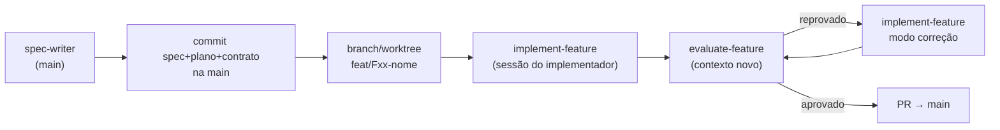
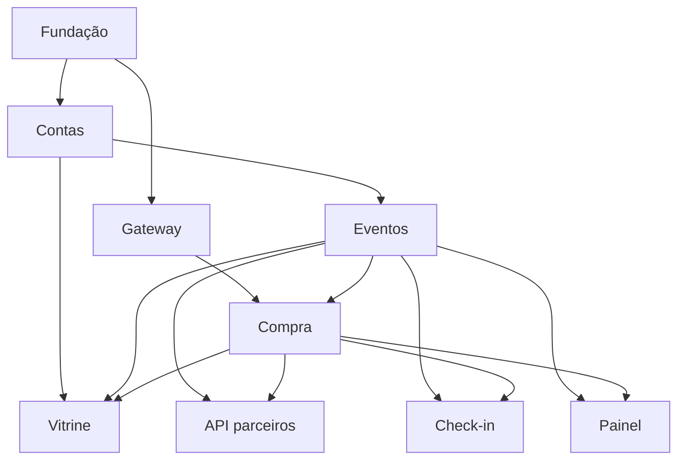

# Plano de execução — Catraca

Plano para levar o brief (`docs/brief.md`) ao produto, com agentes, em waves, cada feature aprovada por um avaliador independente. Este arquivo é o roteiro do orquestrador (você + a sessão principal); os agentes entram pelo `AGENTS.md`.

## 1. Ferramental

| Skill (em `.claude/skills/`) | Papel | Ajustes feitos para o desafio |
|---|---|---|
| `prd-writer` | Brief → `docs/PRD.md` | PRD em pt-BR; brief como fonte da verdade (R01–R13, mensagens exatas, API e gateway copiados sem reinterpretar); entrevista só sobre o que o brief deixa aberto; `Consome` = dependências (inclui auth/infra); **waves** com pelo menos uma paralela; critérios com ID (`F05-CA03`, `CF04`); um critério cross-feature **por aresta** do grafo; tabela de rastreabilidade R01–R13; checklist de validação com os requisitos do desafio. |
| `spec-writer` | Feature → `spec.md` + `plan.md` + **`contract.md`** | Terceiro arquivo (contrato, template em `references/contract-template.md`); pasta `docs/features/<ID>-<nome>/`; contrato escrito e commitado antes da implementação e congelado; invariantes compartilhadas na spec; pontos de extensão para waves paralelas; fase Documentação sem `CHECKLIST.md` e sem marcar o PRD; batch por `wave N`; atualiza `docs/state.json`. |
| `implement-feature` | Spec/plano/contrato → código, 1 commit por fase | Lê o contrato e roda **todos** os itens antes de entregar (auto-checagem ≠ aprovação); status máximo `ready for evaluation`; nunca edita contrato, relatórios ou PRD; usa os comandos do `AGENTS.md`; cuidado com worktrees paralelas; **modo correção** a partir de um relatório reprovado. |
| `evaluate-feature` (criada para o desafio) | Contrato → relatório de avaliação | Contexto vazio; sobe o ambiente do zero; roda cada item; registra data, commit, ferramenta, modelo e veredito com evidência; grava um relatório **novo** por avaliação e nunca o altera; não corrige código. |

## 2. Ciclo de cada feature



1. **Especificar (na `main`)** — `/spec-writer Fxx` (interativo) ou `/spec-writer wave N` (batch, auto-aceita as recomendações). Você revisa principalmente o **contrato**. Commit `docs(Fxx): spec, plano e contrato`; estado → `especificada`.
2. **Abrir a branch** — `git worktree add ../catraca-wt/Fxx -b feat/Fxx-<nome>`. Primeiro commit da branch: estado → `em_implementacao`. Abrir o PR como draft logo em seguida (`gh pr create --draft`).
3. **Implementar** — sessão nova do Claude Code na worktree: `/implement-feature Fxx`. Sai com `ready for evaluation` e estado `aguardando_avaliacao`.
4. **Avaliar** — **outro contexto**: subagente novo ou outra sessão, de preferência com outro modelo (ex.: implementa com Opus, avalia com Sonnet): `/evaluate-feature Fxx`. Gera `docs/features/Fxx-<nome>/reports/<AAAA-MM-DD-HHMMSS>.md` em um commit só, com o estado → `concluida` (tudo aprovado) ou `reprovada`.
5. **Corrigir, se preciso** — `/implement-feature <caminho do relatório>` (modo correção) e nova avaliação, até o relatório mais recente aprovar tudo.
6. **Integrar** — PR pronto → merge na `main` → `gates` na `main`. A wave seguinte só começa com todas as features da wave atual integradas.

Regras que valem em todo o ciclo: quem implementa não avalia; relatório nunca é editado (formatadores ignoram `reports/`); contrato só muda antes da primeira avaliação, com registro.

## 3. Proposta de features e waves

Ponto de partida para a entrevista do `prd-writer`. **A divisão final está no [PRD](PRD.md):** a mesma, com uma correção — o Painel (F09) consome o check-in da F08 e por isso foi para uma Wave 6 própria (Wave 5 = F06 ‖ F07 ‖ F08; 15 arestas, 20 critérios `CF`).

| ID | Feature | Regras | Depende de | Wave |
|---|---|---|---|---|
| F01 | Fundação e harness (Docker Compose, banco, migrations, seed idempotente, `up`/`down`/`gates`, `AGENTS.md`) | ambiente e harness | — | 1 |
| F02 | Contas e acesso (cadastro/entrada/saída do participante, login do organizador da seed, papéis) | R13 | F01 | 2 ‖ |
| F03 | Gateway de pagamento simulado (resultado e atraso pelo final do cartão, resposta assíncrona persistida) | R08 | F01 | 2 ‖ |
| F04 | Gestão de eventos (criar, editar, publicar, **cancelar**; página de gestão com URL própria e pontos de extensão) | R01–R04, R11 (evento), R13 | F02 | 3 |
| F05 | Compra e ciclo do ingresso (vagas, compra atômica, pendente → confirmado/recusado, código, efeitos do cancelamento nos ingressos, resposta tardia ignorada) | R05–R09, R11 (ingressos) | F03, F04 | 4 |
| F06 | Vitrine e Meus ingressos | R02, R06, R07, R09 | F02, F04, F05 | 5 ‖ |
| F07 | API de parceiros (3 rotas, contrato fixo, `X-Api-Key`) | R02, R05–R07 | F04, F05 | 5 ‖ |
| F08 | Check-in | R10 | F04, F05 | 5 ‖ |
| F09 | Painel do evento | R12, R03 | F04, F05, F08 | 6 |



Por que assim:
- **Duas waves paralelas.** A Wave 2 (F02 ‖ F03) é pequena e de baixo conflito: prova o paralelismo cedo. A Wave 5 (4 features) é onde as features se encontram; se a máquina não aguentar quatro ambientes, rode em duas duplas.
- **Cancelamento dividido no ponto certo.** O lado do evento (status, irreversível, não edita, sai das listagens) fica na F04; o lado dos ingressos (estornados/cancelados em até 10 s, resposta tardia ignorada) fica na F05. Assim, check-in, painel, vitrine e API (Wave 5) já encontram o cancelamento pronto e os contratos deles exercitam os encontros que quebraram a primeira tentativa.
- **Um serviço de compra para os dois canais.** F06 e F07 consomem o mesmo serviço da F05 — a regra "compra pela API vale como a da vitrine" vira critério cross-feature em vez de duas implementações.
- **Pontos de extensão.** A F04 entrega a página de gestão com seções plugáveis e o registro de rotas por arquivo, para que F08/F09 adicionem arquivos em vez de editar o mesmo template.
- 14 arestas → pelo menos 14 critérios `CF`.

## 4. Decisões técnicas recomendadas

A confirmar na entrevista do PRD e na spec da F01; todas entram na seção **Decisões** do README.

| Tema | Recomendação | Motivo |
|---|---|---|
| Stack | Node.js LTS + TypeScript, Fastify, HTML renderizado no servidor (formulários + redirect), PostgreSQL 16, Vitest | O avaliador tem Node; sem build de SPA; páginas verificáveis por `curl`/navegador; design não conta. |
| Endereços | `$WEB` e `$API` no mesmo servidor (ex.: `http://localhost:3000`) | Menos portas para subir/derrubar. |
| R07 sob concorrência | Transação por compra com `SELECT … FOR UPDATE` na linha do evento, contagem de `pending`+`confirmed` e `INSERT` do ingresso na mesma transação | Fonte única da verdade (sem contador que desincroniza); serializa só compras do mesmo evento. A mesma trava protege a redução de lotação (R03) e o cancelamento. |
| Gateway assíncrono | Tentativa de pagamento persistida com `respond_at` calculado pelo final do cartão; worker no processo aplica o resultado com `UPDATE … WHERE status = 'pending'` | Sobrevive a restart; resposta tardia não altera ingresso cancelado/estornado por construção. Escala de atraso só no ambiente de teste. |
| Cancelamento | Na mesma transação que marca o evento cancelado: confirmados → `refunded`, pendentes → `cancelled` | Fica instantâneo (bem dentro dos 10 s) e sem janela de corrida com o worker. |
| Receita (R03/R12) | Preço gravado no ingresso no momento da compra; receita = soma dos `confirmed` | Mudança de preço não reescreve o passado; estorno nunca conta. |
| Harness | `package.json` da raiz sem dependências: `npm run up` (`docker compose up -d --build --wait`, migrations + seed no entrypoint), `npm run down`, `npm run gates` (lint + typecheck + testes em container, com nome de projeto próprio e sem porta no host) | Clone limpo → um comando; gates não colidem com o ambiente rodando nem com worktrees paralelas. |
| Seed | Upsert por e-mail: organizador A, organizador B, participante; chave de parceiro fixa por variável de ambiente com valor padrão | Pode rodar de novo sem erro; credenciais no README. |

## 5. Fases

### Fase 0 — Preparação

1. **Ambiente:** o brief pede WSL no Windows (a máquina do avaliador é Linux/macOS). Recomendação: clonar e trabalhar no WSL; se ficar no Windows, `.gitattributes` com `eol=lf`, scripts só em Node (nada de bash obrigatório) e o fluxo final rodado no WSL.
2. `git init` na `main`, `.gitattributes`, `.gitignore`.
3. Criar a skill `evaluate-feature` (com template do relatório).
4. `AGENTS.md` inicial (regras do projeto, ciclo da seção 2, mapa dos artefatos, comandos "definidos na F01") e `CLAUDE.md` apontando para ele (`@AGENTS.md`).
5. `docs/state.json` inicial.
6. Repositório **público** no GitHub (`gh repo create … --public --source . --push`) — nome a confirmar.
7. Commit inicial com brief, skills e este plano.

### Fase 1 — PRD

1. `/prd-writer` → entrevista curta (divisão em features, stack, abordagem de UI, ambiguidades do brief).
2. `docs/PRD.md` validado pelo checklist da skill: ≥ 5 features, `Provê`/`Consome`, grafo, waves com uma paralela, `CF` por aresta, R01–R13 na tabela, fora de escopo.
3. Popular `docs/state.json` com todas as features em `pendente`. Commit.

### Fase 2 — Waves

| Wave | Features | Modo |
|---|---|---|
| 1 | F01 | sequencial — define comandos, seed e `AGENTS.md` definitivo |
| 2 | F02 ‖ F03 | **paralela** — duas worktrees, duas sessões, dois PRs |
| 3 | F04 | sequencial — entrega a página de gestão com pontos de extensão |
| 4 | F05 | sequencial — rajada de R07 repetida ≥ 3× no contrato |
| 5 | F06 ‖ F07 ‖ F08 ‖ F09 | **paralela** — onde as features se encontram |

Como rodar uma wave paralela:
1. Specs da wave na `main` (`/spec-writer wave N`), revisão dos contratos, commit.
2. Uma worktree e uma sessão por feature, iniciadas juntas. O primeiro commit de cada branch (estado `em_implementacao`) sai logo no início e o PR draft é aberto em seguida — é isso que prova que "o primeiro commit de cada PR é anterior ao último commit dos outros".
3. Cada worktree sobe o ambiente com nome de projeto e portas próprios (`.env` local, fora do git).
4. Avaliação de cada feature em contexto novo, na própria branch.
5. Merge um por vez; o segundo PR traz a `main`, resolve conflitos (esperados em `docs/state.json`, `package.json`, registro de rotas), roda `gates` e só então faz merge. Se a resolução mexer em comportamento, nova avaliação.

### Fase 3 — Fechamento

1. **Fluxo do avaliador na `main`, a partir de um clone limpo, no Linux/WSL:** passos 1–17 do brief, executados por um agente de contexto novo (curl + navegador), com a rajada do passo 15 repetida várias vezes em eventos novos. Falha aqui volta para correção da feature responsável, com nova avaliação.
2. `README.md` com as seções do Entregável: como rodar, endereços, credenciais, mapa dos artefatos (com links dos PRs das waves paralelas) e decisões (stack, R07, gateway assíncrono, isolamento da avaliação).
3. Conferência final: `docs/state.json` com todas as features `concluida` e caminhos existentes; cada relatório em um único commit (`git log --format="%h %ad" --date=iso -- <relatório>`); `gates` verde na `main`; `down` sem containers nem portas restantes; `up` de novo funcionando.

## 6. Artefatos

| Artefato | Caminho |
|---|---|
| Brief (sem HTML) | `docs/brief.md` |
| PRD | `docs/PRD.md` |
| Spec, plano, contrato | `docs/features/<ID>-<nome>/{spec,plan,contract}.md` |
| Relatórios de avaliação | `docs/features/<ID>-<nome>/reports/<AAAA-MM-DD-HHMMSS>.md` |
| Estado do projeto | `docs/state.json` |
| Porta de entrada dos agentes | `AGENTS.md` (+ `CLAUDE.md` → `@AGENTS.md`) |
| Skills | `.claude/skills/` |

Formato do estado (uma entrada por feature, sem campos globais que mudem a cada PR, para reduzir conflitos):

```json
{
  "features": {
    "F01": { "nome": "Fundação e harness", "wave": 1, "status": "pendente", "branch": null, "pr": null, "ultimo_relatorio": null }
  }
}
```

Status: `pendente` → `especificada` → `em_implementacao` → `aguardando_avaliacao` → `reprovada` | `concluida`.

## 7. Riscos

| Risco | Mitigação |
|---|---|
| R07 passa uma vez e falha depois | Trava por evento no banco + teste de rajada real nos gates + item de contrato com ≥ 3 rodadas + rajada repetida no fluxo final. |
| Resposta tardia do gateway "desfaz" cancelamento | `UPDATE` condicional (`WHERE status = 'pending'`) + item de contrato com cartão `…0003` e espera de 45 s. |
| Esperas de 30–45 s deixam testes lentos | Escala de atraso só no ambiente de teste; contratos verificam o modo padrão. |
| Worktrees paralelas colidindo em portas/containers | Nome de projeto do Compose por worktree, portas por `.env`, gates sem porta no host. |
| CRLF/Windows quebrando scripts no container | WSL ou `.gitattributes eol=lf` + scripts em Node; fluxo final no Linux/WSL. |
| Relatório alterado depois do commit | Um arquivo novo por avaliação, formatadores ignoram `reports/`, conferência com `git log` no fechamento. |
| Merge de uma wave quebra feature já aprovada | `gates` na `main` após cada merge e fluxo do avaliador completo no fechamento. |
